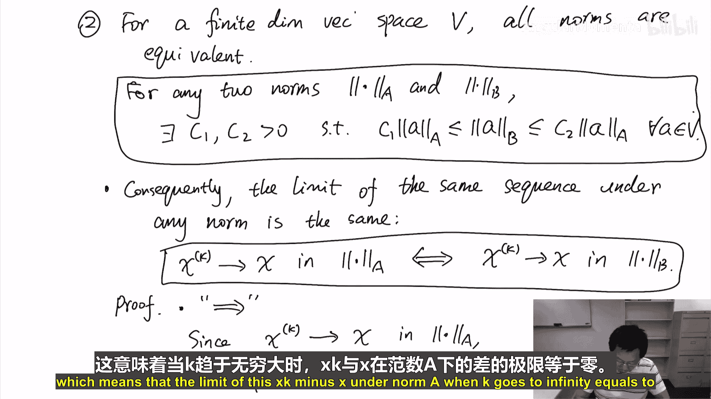
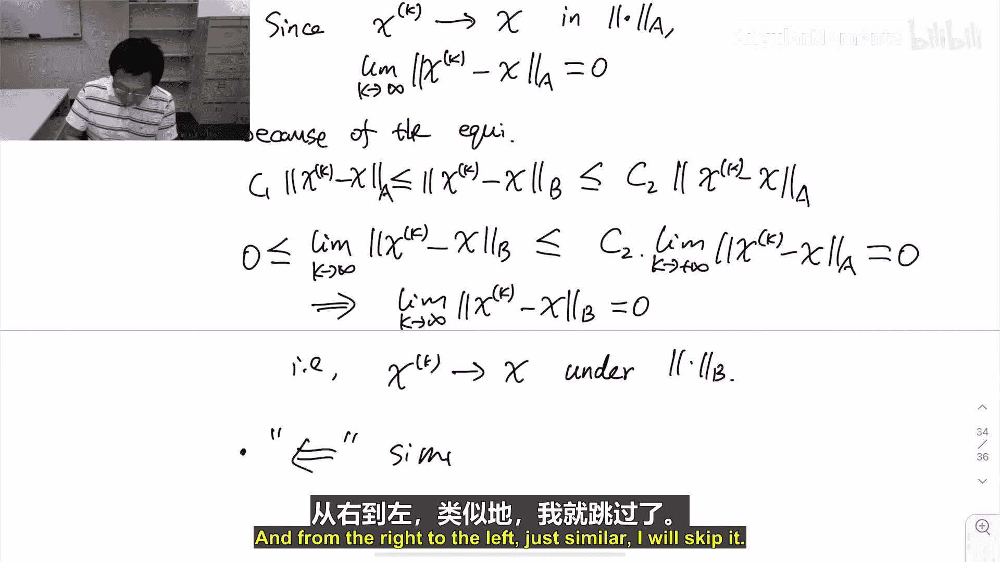
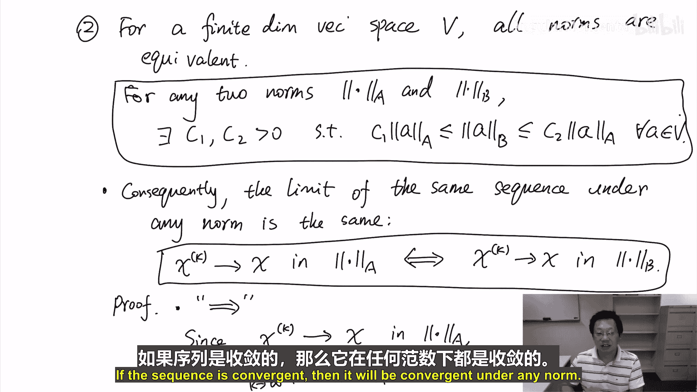
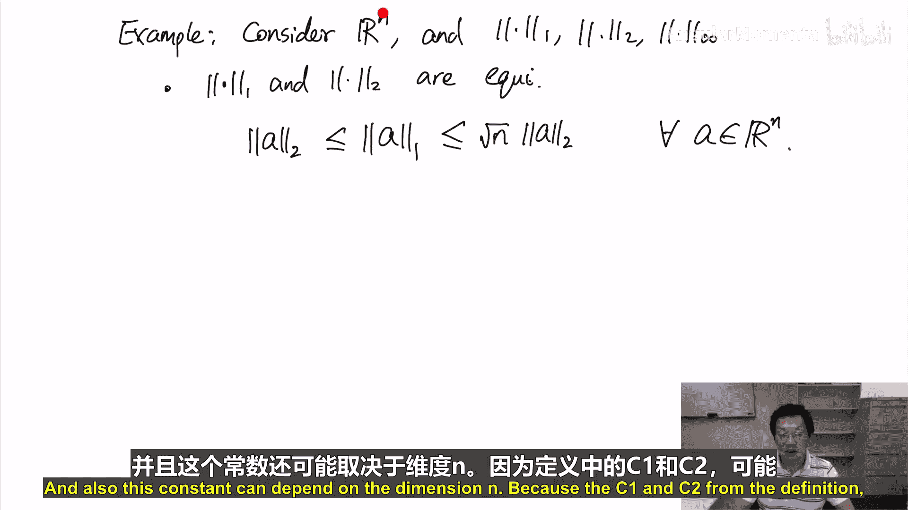
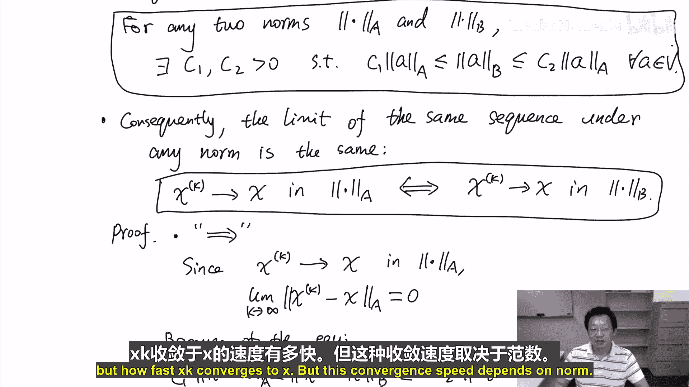
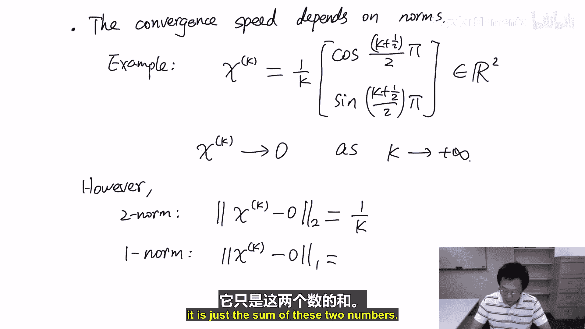
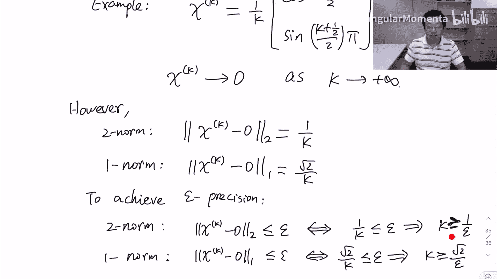
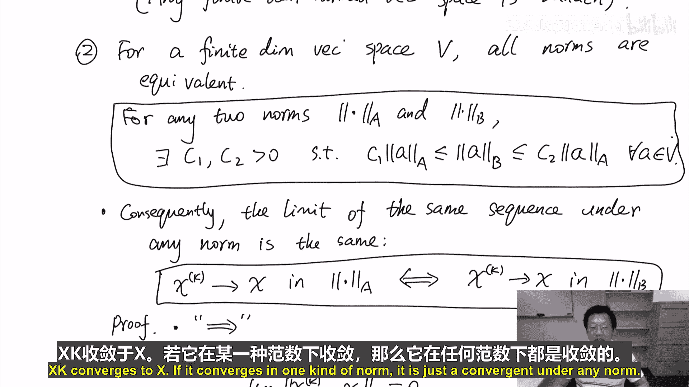
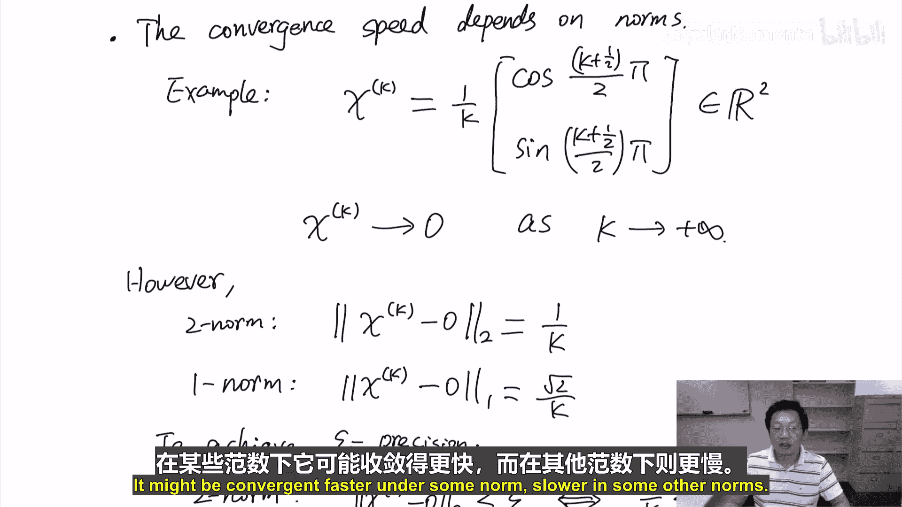

数据分析的数学方法：07-06-02：有限维向量空间的范数等价性 🔗

在本节中，我们将学习有限维向量空间的第二个重要性质：范数等价性。我们将了解这一性质的含义、证明过程、具体例子，以及它对序列收敛行为的影响。

---

### 概述



在有限维向量空间中，所有范数都是等价的。这意味着，对于任意两种不同的范数，一种范数总是可以被另一种范数所界定。这一性质带来一个直接结果：**同一个序列在任何范数下的极限都是相同的**。换句话说，收敛性与范数的选择无关。然而，收敛速度可能因范数的不同而有所差异。

---

### 范数等价性的定义与证明

上一节我们介绍了范数的基本概念，本节中我们来看看范数等价性的具体含义。

对于定义在有限维向量空间 `V` 上的任意两种范数，例如范数 `A` 和范数 `B`，如果存在正常数 `C1` 和 `C2`，使得对于空间 `V` 中的所有向量 `a`，都有：

**公式：**
```
C1 * ||a||_A ≤ ||a||_B ≤ C2 * ||a||_A
```



那么，我们就称范数 `A` 和范数 `B` 是等价的。

这个等价关系的一个重要推论是：**序列的收敛性独立于范数的选择**。具体来说，如果一个序列 `{X_k}` 在范数 `A` 下收敛于 `x`，那么它在范数 `B` 下也收敛于同一个 `x`。

以下是这个推论的简单证明：



**证明：**
假设序列 `{X_k}` 在范数 `A` 下收敛于 `x`，即：
```
lim (k→∞) ||X_k - x||_A = 0
```
根据范数等价性，我们有：
```
C1 * ||X_k - x||_A ≤ ||X_k - x||_B ≤ C2 * ||X_k - x||_A
```
对不等式两边同时取极限 `k→∞`：
- 右边：`lim (k→∞) C2 * ||X_k - x||_A = C2 * 0 = 0`
- 左边：`lim (k→∞) C1 * ||X_k - x||_A = C1 * 0 = 0`，且 `||X_k - x||_B` 作为范数始终非负。

根据夹逼定理，可得：
```
lim (k→∞) ||X_k - x||_B = 0
```
这意味着序列 `{X_k}` 在范数 `B` 下也收敛于 `x`。反之亦然，证明过程类似。

因此，在有限维空间（如 `R^n`、矩阵空间、张量空间）中，序列的收敛行为不依赖于我们选择哪种范数来判断。这非常方便，在实践中，我们只需任意选择一种范数；如果序列在该范数下收敛，那么它在任何范数下都收敛。

---

### 具体例子：`R^n` 空间中的范数等价



现在，让我们看一些有限维向量空间中范数等价的具体例子。我们考虑 `R^n` 空间中最常用的三种 `p-范数`：1-范数、2-范数和无穷范数。

以下是它们之间的等价关系及相应的常数：

1.  **1-范数与2-范数的等价关系：**
    ```
    ||a||_2 ≤ ||a||_1 ≤ √n * ||a||_2
    ```
    其中，常数 `C1 = 1`，`C2 = √n`。

2.  **2-范数与无穷范数的等价关系：**
    ```
    ||a||_∞ ≤ ||a||_2 ≤ √n * ||a||_∞
    ```
    其中，常数 `C1 = 1`，`C2 = √n`。

3.  **1-范数与无穷范数的等价关系：**
    ```
    ||a||_∞ ≤ ||a||_1 ≤ n * ||a||_∞
    ```
    其中，常数 `C1 = 1`，`C2 = n`。

在这些关系中，常数 `C1` 和 `C2` 对于所有向量 `a` 都是相同的，但它们可能依赖于空间的维度 `n` 以及所比较的两种范数的定义。

---



### 收敛速度的差异

虽然范数等价性保证了收敛性的一致，但**收敛速度却可能因范数的不同而不同**。

让我们通过一个例子来理解这一点。考虑 `R^2` 空间中的序列 `{X_k}`：
**公式：**
```
X_k = (1/k) * [cos(πk/2), sin(πk/2)]^T
```
这个序列收敛于零向量 `[0, 0]^T`。

现在，我们计算它在不同范数下与零向量的距离：



- **在2-范数下：**
  ```
  ||X_k - 0||_2 = 1/k
  ```
  要使 `||X_k - 0||_2 < ε`，需要 `k > 1/ε`。

- **在1-范数下：**
  ```
  ||X_k - 0||_1 = √2 / k
  ```
  要使 `||X_k - 0||_1 < ε`，需要 `k > √2 / ε`。

可以看到，为了达到相同的精度 `ε`，在2-范数下所需的迭代次数 `k` 与 `1/ε` 成正比，而在1-范数下则与 `√2/ε` 成正比。因此，在这个例子中，序列在2-范数意义下“收敛得更快”。这说明**收敛速度依赖于所选择的范数**。

---



### 总结

本节课中我们一起学习了有限维向量空间中范数等价性的核心内容：



1.  **定义**：在有限维空间中，任意两种范数都是等价的，即一种范数可以被另一种范数乘上常数后所界定。
2.  **核心推论**：序列的收敛性独立于范数的选择。若序列在一种范数下收敛，则在所有范数下都收敛于同一点。
3.  **重要区别**：尽管收敛性一致，但**收敛速度**可能因所选范数的不同而有显著差异。在评估算法性能或进行误差分析时，需要特别注意这一点。



理解范数等价性，有助于我们在处理有限维空间中的收敛问题时，灵活选择最方便的范数进行分析，同时也不忽视对收敛速度的细致考量。