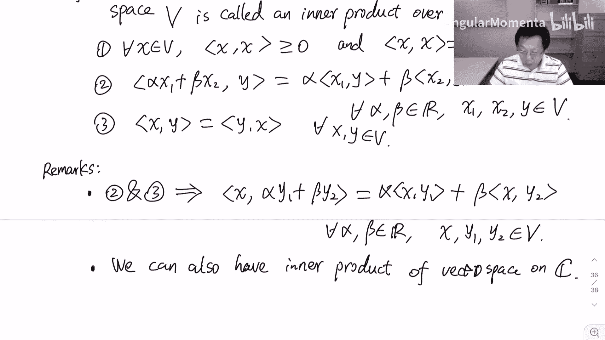

# 031：内积的定义与动机 📐

在本节中，我们将学习向量空间中的一个新概念——**内积**。我们将探讨为什么仅靠距离（范数）不足以描述向量之间的关系，并正式定义内积及其基本性质。

---

## 概述：从距离到相关性

上一节我们介绍了向量空间上的范数和距离。有了距离，我们可以定义向量序列的极限和收敛性。然而，在许多实际情况下，仅凭距离是不够的。距离无法描述两个向量是如何“对齐”或“相关”的。

在许多应用中，我们确实需要衡量两个向量的相关性或对齐程度。为了理解这一点，我们考虑一个极端情况：假设有一个向量 `x` 和它的两倍 `2x`。`2x` 与 `x` 之间的距离是 `||x||`。如果 `x` 的范数很大，这个距离就会非常大。然而，向量 `x` 和 `2x` 的方向完全相同，它们是完美对齐、完全相关的。因此，范数无法描述向量之间的相关性，而这种相关性恰恰能提供关于向量的重要信息。

## 现实场景举例

更具体地说，我们考虑这样一个场景：有两张图片 `X` 和 `Y`，它们拍摄的是同一场景，但拍摄时间不同。例如，`X` 在清晨拍摄，`Y` 在正午拍摄。由于拍摄的是同一物体，两张图片的模式非常相似，几乎相同。但因为拍摄时的光照条件不同，像素的强度值可能差异很大。光照条件更好，像素值通常就更大。因此，`Y` 的像素值可能普遍大于 `X`。

在这种情况下，`X` 和 `Y` 本质上非常相似，它们对齐得很好，相关性很高。但我们不能用 `X` 和 `Y` 之间的距离来描述它们的关系，因为这个距离可能非常大，尽管它们的方向是对齐的。

类似的情况也可能出现在股票价格分析中。假设一只股票的价格变化完全跟随另一只股票，但这两家公司规模不同。那么，尽管这两只股票的价格向量高度相关、对齐良好，它们之间的距离（价格差的幅度）却可能非常大。此时，距离同样不是描述向量间相关性的好指标。

因此，我们需要引入一个新的量来描述向量是如何对齐的，或者说，我们需要定义两个向量之间的**夹角**。为此，我们首先需要定义**内积**。

---

## 3.1 内积的定义

内积是一个作用于一对向量的函数。它将一个向量和另一个向量映射到一个实数。

这个函数需要满足以下条件：

1.  **非负性与确定性**：同一个向量的内积必须非负。
    *   **公式**：`<x, x> ≥ 0`
    *   并且 `<x, x> = 0` 当且仅当 `x = 0`。

2.  **对第一个变量的线性**：内积对于其第一个变量是线性的。
    *   **公式**：对于任意标量 `α, β` 和向量 `x1, x2, y`，有 `<αx1 + βx2, y> = α<x1, y> + β<x2, y>`。

3.  **对称性（交换性）**：内积的两个变量是可交换的。
    *   **公式**：`<x, y> = <y, x>`。

以上就是内积的定义。

---

## 定义的直接推论

从这个定义中，我们可以立即得出几个重要推论。

**第一个推论**：内积对于其第二个输入也是线性的。

这是由条件2和条件3共同保证的。从条件2可知，内积对第一个输入是线性的。从条件3可知，内积是对称的。因此，我们可以交换变量的位置，从而得出内积对第二个输入也是线性的。

**第二个备注**：在这个定义中，我们是在实数域 `R` 上定义内积的。内积是从向量对到 `R` 的映射，而 `V` 是定义在 `R` 上的向量空间。

正如之前提到的，我们也可以有定义在复数域 `C` 上的向量空间。在这种情况下，内积应该是从 `V × V` 到 `C`（一个复数）的映射，我们可以进行类似的定义。

---

## 总结

本节课中，我们一起学习了内积的概念。我们首先理解了为什么在距离（范数）之外还需要内积——为了度量向量的**相关性**和**对齐程度**。接着，我们正式定义了内积，它必须满足**非负性、确定性和对称性**，并且对第一个变量是**线性**的。最后，我们推导出内积对第二个变量也是线性的，并提及了在复数域上定义内积的可能性。内积是构建向量空间几何结构（如角度和正交性）的基础，在数据分析中至关重要。