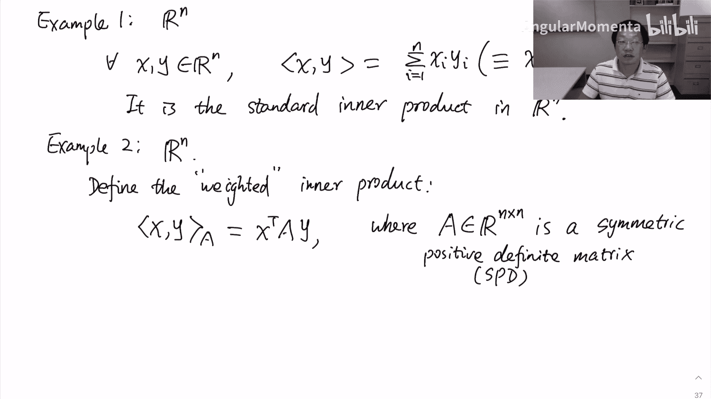
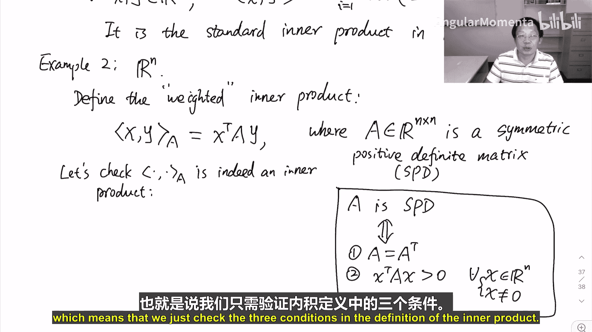
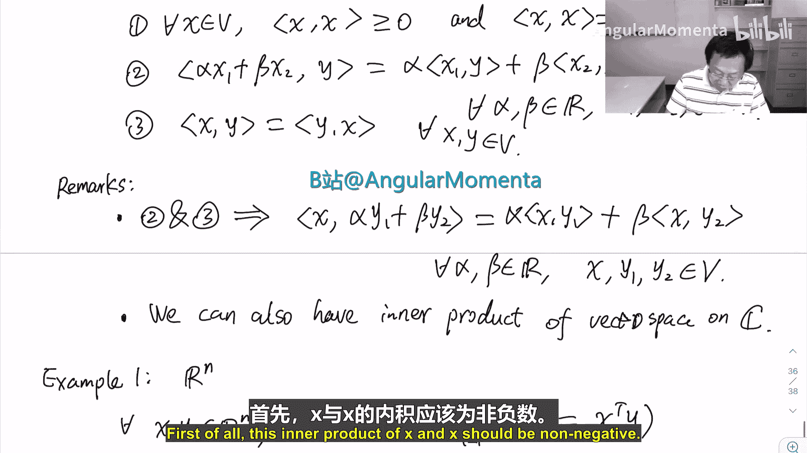
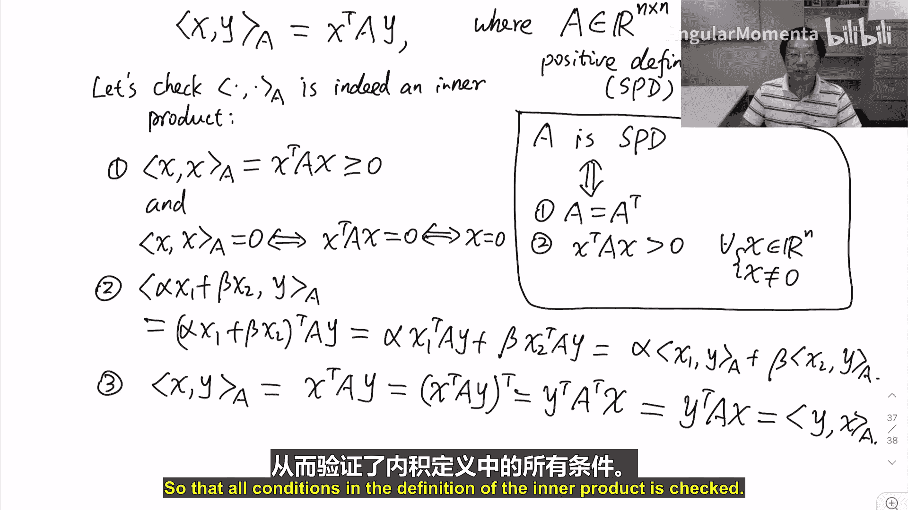
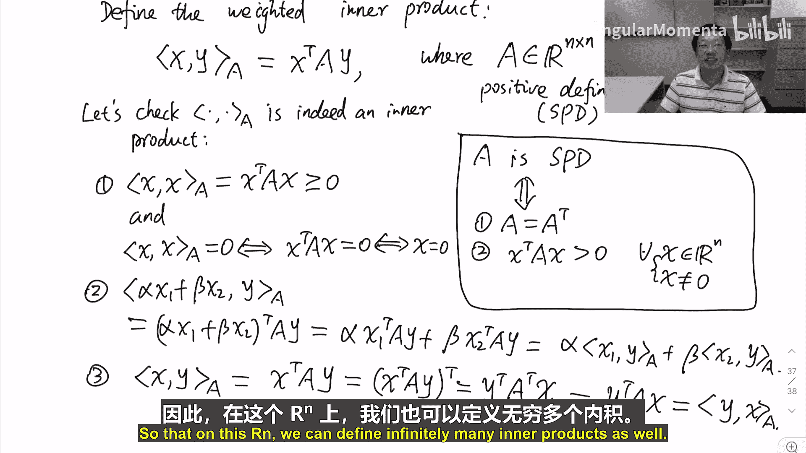
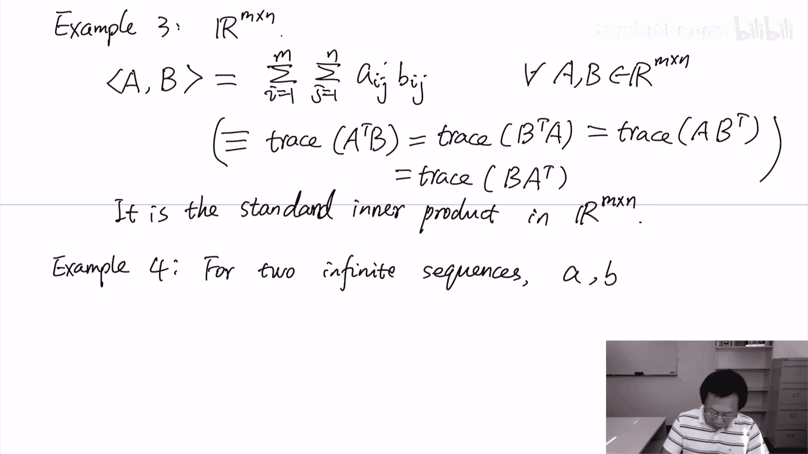
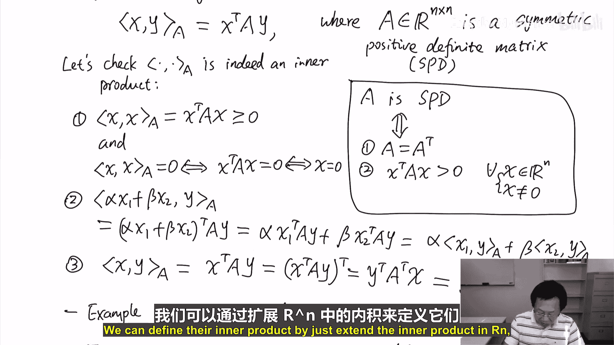
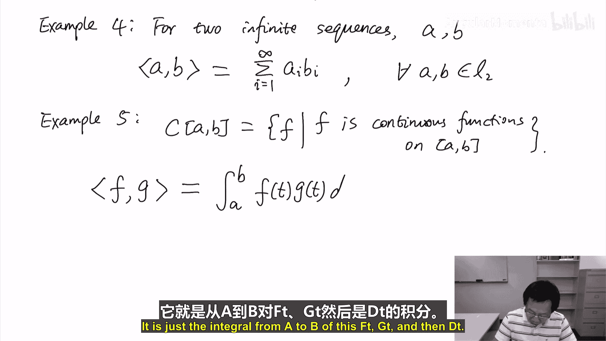

# 032：内积的示例与应用 🔍

在本节中，我们将通过一系列具体的例子来深入理解内积的概念。上一节我们介绍了内积的抽象定义，本节中我们来看看内积在不同数学空间中的具体表现形式。

## 概述
我们将探讨内积在欧几里得空间、矩阵空间以及函数空间中的不同定义方式，并验证它们是否满足内积的三个基本条件。

## 示例一：欧几里得空间 R^N
在欧几里得空间 **R^N** 中，标准内积的定义是众所周知的。对于任意向量 **x** 和 **y**，其内积定义为对应分量乘积之和。

**公式**：
`<x, y> = Σ_{i=1}^{N} x_i * y_i`

或者等价地，用矩阵转置表示为：
`<x, y> = x^T * y`

这是 **R^N** 空间中最标准的内积定义。

## 示例二：加权内积
与范数类似，同一个向量空间可以定义不同的内积。我们仍然考虑 **R^N** 空间，但定义一个所谓的**加权内积**。

**定义**：
`<x, y>_A = x^T * A * y`

其中，**A** 是一个 **N x N** 的矩阵，并且是一个**对称正定矩阵**。

**对称正定矩阵** 的定义如下：
1.  **对称性**：`A = A^T`
2.  **正定性**：对于任意非零向量 **x ∈ R^N**，有 `x^T * A * x > 0`

接下来，我们验证这个加权内积是否满足内积的定义。

以下是需要验证的三个条件：

**条件一：非负性与确定性**
`<x, x>_A = x^T * A * x`
根据SPD矩阵的定义，对于任意非零 **x**，此值大于0；对于零向量 **x=0**，此值等于0。因此条件一满足。

**条件二：对第一变量的线性**
考虑 `αx1 + βx2` 与 **y** 的内积：
`<αx1 + βx2, y>_A = (αx1 + βx2)^T * A * y = α(x1^T A y) + β(x2^T A y) = α<x1, y>_A + β<x2, y>_A`
因此条件二满足。

**条件三：对称性（交换性）**
`<x, y>_A = x^T * A * y`
由于 `x^T A y` 是一个标量，其转置等于自身。同时利用矩阵转置规则和 **A** 的对称性：
`(x^T A y)^T = y^T A^T x = y^T A x = <y, x>_A`
因此条件三满足。

验证完毕，加权内积确实是一个合法的内积。通过选择不同的SPD矩阵 **A**，我们可以在 **R^N** 上定义无穷多种内积。示例一中的标准内积是此例的一个特例，即当 **A** 为单位矩阵 **I** 时。

## 示例三：矩阵空间 R^{M x N}
现在考虑矩阵空间 **R^{M x N}**。我们也可以在此空间定义内积。

**定义**：
对于两个矩阵 **A** 和 **B**，其内积定义为所有对应位置元素乘积之和。

**公式**：
`<A, B> = Σ_{i=1}^{M} Σ_{j=1}^{N} A_{ij} * B_{ij}`

这是矩阵空间中的标准内积。它还有一些等价的流行表达式，例如：
`<A, B> = trace(A^T * B) = trace(B^T * A) = trace(A * B^T) = trace(B * A^T)`
其中，`trace()` 表示矩阵的迹，即方阵对角线元素之和。

## 示例四：序列空间与函数空间
内积的概念可以推广到更抽象的空间。

**1. 平方可和序列空间 l²**
考虑由无穷序列构成的空间 **l²**。对于两个序列 **a = (a1, a2, ...)** 和 **b = (b1, b2, ...)**，其内积定义为：
`<a, b> = Σ_{i=1}^{∞} a_i * b_i`
**注意**：此定义要求无穷级数收敛，这正是序列属于 **l²** 空间的条件。对于其他空间（如 **l¹**），此级数可能不收敛，因此内积无定义。

**2. 连续函数空间 C[a, b]**
考虑定义在区间 **[a, b]** 上的所有连续函数构成的空间。对于两个函数 **f(t)** 和 **g(t)**，其内积定义为：
`<f, g> = ∫_{a}^{b} f(t) * g(t) dt`
在连续情形下，积分取代了离散的求和。

## 总结
本节课中我们一起学习了内积在不同数学空间中的具体示例。我们从熟悉的欧几里得空间 **R^N** 的标准内积出发，探讨了通过对称正定矩阵定义的**加权内积**，并验证了其合法性。接着，我们将内积的概念扩展到了**矩阵空间**、无穷**序列空间 l²** 以及**连续函数空间 C[a, b]**。这些例子表明，内积是一个强大而通用的工具，其核心思想——衡量两个元素的“相似性”或“对齐程度”——可以应用于各种数学对象，为数据分析中的度量、投影和优化等问题奠定了基础。