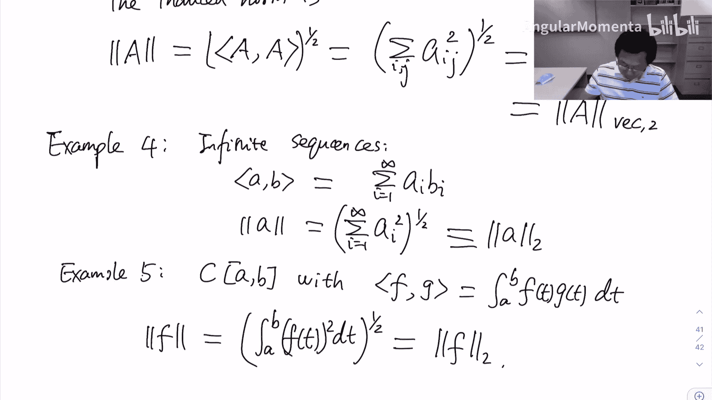

# 034：由内积诱导的范数 📐

在本节中，我们将学习柯西-施瓦茨不等式的一个重要应用：如何从一个内积出发，自然地构造出一个范数。我们将看到，内积空间天生就带有一种“标准”的范数。

## 概述


上一节我们介绍了柯西-施瓦茨不等式。基于这个不等式，我们可以推导出许多有趣的结论。本节中，我们将探讨第一个直接推论：**如何从一个内积构造出一个范数**。这意味着，只要一个向量空间定义了内积，它就自动具备了一种特定的范数结构。

## 从内积诱导范数


设 `V` 是一个定义了内积 `<·, ·>` 的向量空间。目前，这个空间只有内积，还没有范数。然而，利用柯西-施瓦茨不等式，我们可以通过内积来构造一个范数。


以下是构造方法：
对于任意向量 `x ∈ V`，我们按如下方式定义其范数：
```
||x|| = √<x, x>
```
现在，我们需要验证这个定义确实满足范数的所有条件。


### 验证范数公理

我们需要验证 `||·||` 满足范数的三个基本性质。


**1. 非负性与零向量**
首先，根据定义，`||x|| = √<x, x>`。由于内积 `<x, x>` 总是非负的，其平方根也非负，所以 `||x|| ≥ 0`。
其次，`||x|| = 0` 当且仅当 `<x, x> = 0`，而这根据内积的定义，当且仅当 `x = 0`。

**2. 齐次性**
接下来，我们检查齐次性。对于任意标量 `α` 和向量 `x`：
```
||αx|| = √<αx, αx> = √(α² <x, x>) = |α| √<x, x> = |α| ||x||
```
因此，齐次性成立。


**3. 三角不等式**
最后，也是最关键的一步，是验证三角不等式：`||x + y|| ≤ ||x|| + ||y||`。
我们不直接证明这个不等式，而是考虑它的平方：
```
||x + y||² = <x + y, x + y>
```
展开这个内积：
```
<x + y, x + y> = <x, x> + 2<x, y> + <y, y>
```
根据我们的范数定义，`<x, x> = ||x||²`，`<y, y> = ||y||²`。对于中间项，我们利用其绝对值进行放缩：
```
<x + y, x + y> = ||x||² + 2<x, y> + ||y||²
                ≤ ||x||² + 2|<x, y>| + ||y||²
```
现在，**柯西-施瓦茨不等式**登场了。它告诉我们：
```
|<x, y>| ≤ √<x, x> · √<y, y> = ||x|| ||y||
```
将这个结果代入上式：
```
||x + y||² ≤ ||x||² + 2||x|| ||y|| + ||y||² = (||x|| + ||y||)²
```
对不等式两边同时取平方根，我们就得到了三角不等式：
```
||x + y|| ≤ ||x|| + ||y||
```

至此，我们验证了所有三个条件。因此，通过 `||x|| = √<x, x>` 定义的 `||·||` 确实是向量空间 `V` 上的一个范数。


## 诱导范数与柯西-施瓦茨不等式的简化

这个由内积定义的范数，被称为**由内积诱导的范数**，或内积空间中的**标准范数**。

同时，由于我们定义了 `||x|| = √<x, x>`，柯西-施瓦茨不等式可以简化为一个更简洁的形式：
```
|<x, y>| ≤ ||x|| ||y||
```
这个形式在后续的推导和计算中非常常用。

## 示例

以下是几个由内积诱导范数的具体例子：


**示例 1：ℝⁿ 中的标准内积**
在 ℝⁿ 中，标准内积定义为 `<x, y> = xᵀy`。
其诱导的范数为：
```
||x|| = √(xᵀx) = √(∑_{i=1}^n x_i²)
```
这正是我们熟知的 **ℓ² 范数**（或欧几里得范数）。这也解释了为什么 ℓ² 范数在欧几里得空间中如此基础和自然。


**示例 2：ℝⁿ 中的加权内积**
在 ℝⁿ 中，给定一个正定矩阵 `A`，可以定义加权内积 `<x, y>_A = xᵀAy`。
其诱导的范数称为 **A-范数** 或加权范数：
```
||x||_A = √(xᵀAx)
```
展开后为 `√(∑_{i=1}^m ∑_{j=1}^n A_{ij} x_i x_j)`。这是一个不同于 ℓ^p 范数的新范数族。


**示例 3：关于 ℓ^p 范数的思考**
我们知道 ℓ² 范数可以由标准内积诱导。一个自然的问题是：对于一般的 `p`，ℓ^p 范数 `(∑ |x_i|^p)^{1/p}` 是否也能由某个内积诱导？
答案是：**仅当 `p = 2` 时**。也就是说，ℓ^p 范数是内积诱导范数，当且仅当 `p = 2`。


**示例 4：矩阵空间**
在矩阵空间 ℝ^{m×n} 中，定义内积 `<A, B> = ∑_{i,j} A_{ij} B_{ij}`。
其诱导的范数为：
```
||A||_F = √(∑_{i,j} A_{ij}²)
```
这正是矩阵的 **Frobenius 范数**（或希尔伯特-施密特范数），它相当于将矩阵视为向量后的 ℓ² 范数。

**示例 5：连续函数空间**
在连续函数空间 `C[a, b]` 中，定义内积 `<f, g> = ∫_a^b f(t)g(t) dt`。
其诱导的范数为：
```
||f||_2 = √(∫_a^b [f(t)]² dt)
```
这正是函数空间中的 **L² 范数**。


## 总结



本节课中，我们一起学习了柯西-施瓦茨不等式的一个重要应用。我们证明了，在任何定义了内积 `<·, ·>` 的向量空间中，都可以通过公式 `||x|| = √<x, x>` 自然地导出一个范数，这被称为**由内积诱导的范数**。这个过程的关键步骤——验证三角不等式——依赖于柯西-施瓦茨不等式。最后，我们通过多个例子（如欧几里得空间、矩阵空间、函数空间）看到了这一构造的具体表现形式，并了解到 ℓ² 范数、Frobenius 范数和 L² 范数都是其特例。这一理论将内积的代数结构与范数的几何（度量）结构紧密联系在了一起。