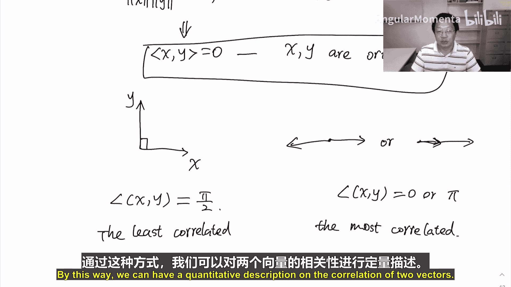

# 035：内积空间中的角度与正交性 📐

在本节中，我们将学习如何利用柯西-施瓦茨不等式，在内积空间中定义向量之间的角度，并由此引出正交性的概念。我们将看到，内积不仅能定义距离（范数），还能量化向量之间的“相关性”。

---

上一节我们介绍了柯西-施瓦茨不等式如何帮助我们定义范数。本节中，我们来看看它如何帮助我们定义向量间的角度。

柯西-施瓦茨不等式指出，对于内积空间 **V** 中的任意向量 **x** 和 **y**，有：

**|⟨x, y⟩| ≤ ||x|| · ||y||**

如果我们去掉绝对值符号，并假设 **x** 和 **y** 是非零向量，那么我们可以得到：

**-||x||·||y|| ≤ ⟨x, y⟩ ≤ ||x||·||y||**

接下来，我们考虑内积与两个范数乘积的比值。将不等式两边同时除以 **||x||·||y||**（由于向量非零，分母有意义），我们得到：

**-1 ≤ ⟨x, y⟩ / (||x||·||y||) ≤ 1**

这个比值被限制在 **-1** 和 **1** 之间。这个比值与角度有何关系？让我们分析几种极端情况。

以下是三种关键情况：

1.  **比值等于 1**：此时，柯西-施瓦茨不等式取等号，意味着存在一个正数 **α > 0**，使得 **x = αy**。这表明向量 **x** 和 **y** 方向完全相同。直观上，它们之间的夹角应为 **0**。
2.  **比值等于 -1**：同样，不等式取等号，但此时存在一个负数 **α < 0**，使得 **x = αy**。这表明向量 **x** 和 **y** 方向完全相反。直观上，它们之间的夹角应为 **π**（180度）。
3.  **比值介于 -1 和 1 之间**：此时，不等式严格成立，意味着 **x** 和 **y** 并非严格共线。它们之间的夹角应大于 **0** 且小于 **π**。

观察上述情况，我们发现比值与夹角的关系恰好符合反余弦函数 **arccos** 的性质：
*   **arccos(1) = 0**
*   **arccos(-1) = π**
*   对于 **t ∈ (-1, 1)**，**arccos(t) ∈ (0, π)**

因此，我们可以自然地定义内积空间中两个非零向量 **x** 和 **y** 之间的夹角 **θ** 为：

**θ = arccos( ⟨x, y⟩ / (||x||·||y||) )**

这个定义与我们在 **R²** 和 **R³** 中从初等几何学到的向量夹角公式完全一致，因此是合理且直观的。

---

定义了角度之后，我们可以进一步探讨向量间的“相关性”。夹角的大小直接反映了向量的相关程度。

以下是基于夹角的关联性分析：

*   **夹角为 0 或 π**：向量完全共线（同向或反向），此时它们“最相关”，相关性最强。
*   **夹角为 π/2 (90度)**：此时比值为 **0**，即 **⟨x, y⟩ = 0**。这意味着向量“最不相关”，或者说“最独立”。

当内积 **⟨x, y⟩ = 0** 时，我们称向量 **x** 和 **y** 是**正交**的。正交性是线性代数中一个极其重要的概念。

总结来说：
*   **⟨x, y⟩ = 0 (正交)** → 夹角为 **π/2** → 向量最不相关，最独立。
*   **|⟨x, y⟩| = ||x||·||y|| (共线)** → 夹角为 **0** 或 **π** → 向量最相关。

通过这种方式，我们利用内积和柯西-施瓦茨不等式，为向量间的相关性与独立性提供了一个精确的定量描述工具。

---

本节课中我们一起学习了如何在内积空间中定义向量夹角，其核心公式为 **θ = arccos( ⟨x, y⟩ / (||x||·||y||) )**。我们了解到，夹角的大小衡量了向量的相关性：夹角越小越相关，夹角为 **π/2**（即内积为零）时向量正交，代表最不相关或最独立的状态。这是理解后续正交投影、正交基等概念的重要基础。