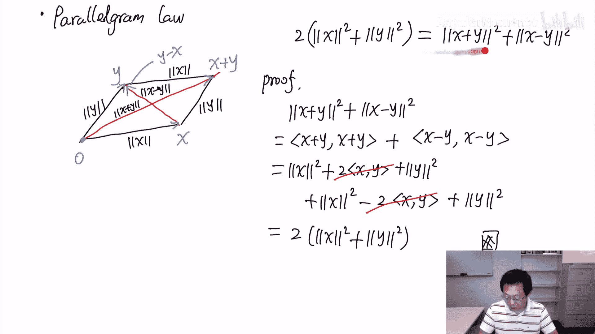

# 036：内积空间中的不等式与恒等式 🔍

在本节课中，我们将学习与内积和范数相关的几个重要定理与恒等式，包括著名的毕达哥拉斯定理和帕拉图定律。这些定理将几何直观与代数运算联系起来，是理解向量空间结构的基础。

---

## 毕达哥拉斯定理 📐

上一节我们介绍了内积和正交性的概念。本节中，我们来看看如何将这些概念推广到更一般的几何关系。

在初等几何中，毕达哥拉斯定理指出：对于一个直角三角形，斜边长度的平方等于两直角边长度的平方和。我们可以将此定理推广到一般的内积空间。

设 **x** 和 **y** 是内积空间 **V** 中的两个向量。那么，**x** 正交于 **y** 的充要条件是：

**\|x + y\|² = \|x\|² + \|y\|²**

以下是证明过程：

1.  根据范数的定义，**\|x + y\|² = <x + y, x + y>**。
2.  展开内积：**<x + y, x + y> = <x, x> + 2<x, y> + <y, y> = \|x\|² + 2<x, y> + \|y\|²**。
3.  如果 **x** 正交于 **y**，则 **<x, y> = 0**，因此 **\|x + y\|² = \|x\|² + \|y\|²**。
4.  反之，如果 **\|x + y\|² = \|x\|² + \|y\|²**，则根据展开式可得 **2<x, y> = 0**，即 **<x, y> = 0**，所以 **x** 正交于 **y**。

从几何上看，我们可以建立一个向量系统：以原点为起点，**x** 和 **y** 作为两个直角边，那么 **x + y** 就是斜边。正交性保证了这是一个直角三角形，因此斜边长度的平方等于两直角边长度的平方和。

---

## 帕拉图定律（平行四边形法则）⬥

理解了正交性下的长度关系后，我们来看一个更普遍的、不依赖于正交性的恒等式——帕拉图定律，或称平行四边形法则。

在初等几何中，平行四边形法则指出：一个平行四边形四条边的平方和，等于其两条对角线的平方和。用初等几何证明此定律较为复杂，但利用内积空间的概念，证明会变得非常简单。

我们再次建立向量系统：以原点为平行四边形的一个顶点，设相邻的两条边为向量 **x** 和 **y**。那么，平行四边形的四条边分别为 **x**, **y**, **x**, **y**，两条对角线分别为 **x + y** 和 **x - y**。

因此，平行四边形法则可以表述为以下恒等式：

**2(\|x\|² + \|y\|²) = \|x + y\|² + \|x - y\|²**

以下是证明过程：

1.  计算等式右边：**\|x + y\|² + \|x - y\|²**。
2.  展开为内积形式：**<x + y, x + y> + <x - y, x - y>**。
3.  分别展开两个内积：
    *   **<x + y, x + y> = \|x\|² + \|y\|² + 2<x, y>**
    *   **<x - y, x - y> = \|x\|² + \|y\|² - 2<x, y>**
4.  将两者相加，交叉项 **2<x, y>** 和 **-2<x, y>** 相互抵消，得到 **2(\|x\|² + \|y\|²)**。

证明完毕。可以看到，利用内积的性质，这个在初等几何中不易证明的定律变得一目了然。更重要的是，这个结论在任何内积空间中都是成立的。

---

## 总结 📝

本节课中我们一起学习了内积空间中的两个核心恒等式：
1.  **毕达哥拉斯定理**：**x ⊥ y ⇔ \|x + y\|² = \|x\|² + \|y\|²**。它将向量的正交性与长度关系完美地联系起来。
2.  **帕拉图定律（平行四边形法则）**：**2(\|x\|² + \|y\|²) = \|x + y\|² + \|x - y\|²**。这是一个普遍成立的恒等式，展示了内积工具在简化几何证明中的强大威力。

这些定理不仅是优美的数学结论，也是后续学习数据分析中许多算法（如最小二乘法、主成分分析等）的重要理论基础。