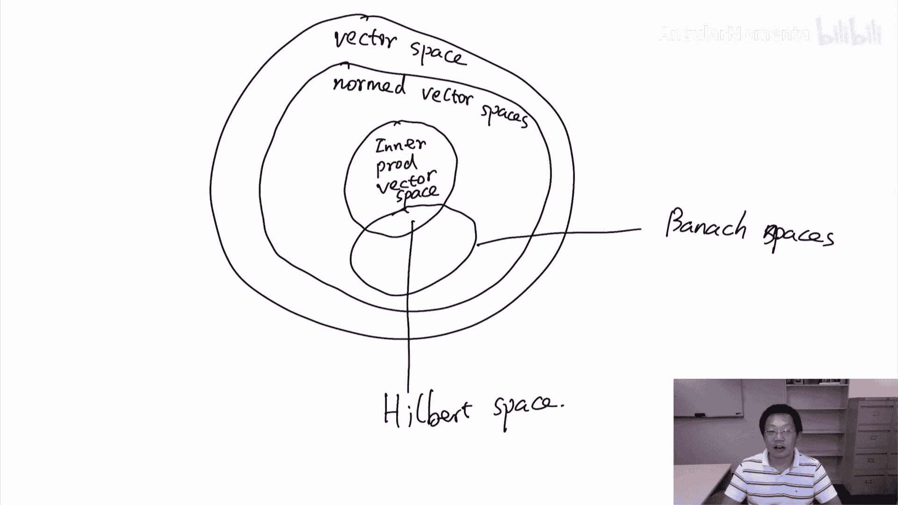

数据分析的数学方法：08-07-02：希尔伯特空间 🧮

在本节中，我们将学习希尔伯特空间的概念。希尔伯特空间是内积空间的完备化，它在数据分析中扮演着重要角色，因为它为处理无限维数据提供了坚实的数学基础。

---

上一节我们介绍了内积空间，它帮助我们定义了度量、范数和角度。我们知道，范数引出了极限和收敛的概念。我们希望空间在范数意义下是完备的。那么，内积空间的完备性如何呢？这就是希尔伯特空间。

**希尔伯特空间**的定义是：一个完备的内积空间被称为希尔伯特空间。此处的完备性，是指由内积诱导出的范数所定义的完备性。

---

以下是希尔伯特空间的一些例子：

**例1：ℝⁿ**
考虑ℝⁿ及其标准内积：**⟨x, y⟩ = xᵀy**。这是一个有限维空间，我们知道任何有限维赋范向量空间都是完备的。因此，配备此内积的ℝⁿ是一个希尔伯特空间。

**例2：带加权内积的ℝⁿ**
考虑ℝⁿ及其加权内积：**⟨x, y⟩_A = xᵀAy**，其中A是一个对称正定矩阵。在此内积诱导的范数下，ℝⁿ仍然是有限维且完备的，因此也是一个希尔伯特空间。

**例3：矩阵空间ℝ^{m×n}**
考虑所有m×n实矩阵的空间，配备弗罗贝尼乌斯内积：**⟨A, B⟩ = tr(AᵀB)**。这同样是一个有限维空间，因此在此内积下是完备的，构成希尔伯特空间。

**例4：ℓ² 空间**
考虑所有平方可和无限序列的集合ℓ²，即满足 **∑_{i=1}^∞ |a_i|² < ∞** 的序列。其内积定义为：**⟨a, b⟩ = ∑_{i=1}^∞ a_i b_i**。我们知道ℓ²空间在由其诱导的2-范数下是完备的，因此它是一个希尔伯特空间。

**例5：连续函数空间C[a, b]**
考虑区间[a, b]上所有连续函数的空间C[a, b]，其内积定义为：**⟨f, g⟩ = ∫_a^b f(t)g(t) dt**。然而，由此内积诱导的范数正是2-范数，而我们知道C[a, b]在2-范数下**不是**完备的。因此，这个内积空间不是希尔伯特空间。它的完备化就是著名的**L²[a, b]**空间。

---

最后，我们用一张图来总结我们目前讨论过的各类空间之间的关系：

我们所有的讨论都基于**向量空间**，这是最大的集合。
*   在向量空间上定义**范数**，就得到**赋范向量空间**。
*   在向量空间上定义**内积**，可以诱导出一个范数，因此**内积空间**是**赋范向量空间**的一个子集。反之，一个赋范向量空间不一定能定义内积。
*   在赋范向量空间中，**完备**的那些被称为**巴拿赫空间**。
*   同时是**内积空间**且**完备**的空间，就是**希尔伯特空间**。因此，希尔伯特空间是巴拿赫空间与内积空间的交集。

---

本节课中，我们一起学习了希尔伯特空间的定义，它本质上是完备的内积空间。我们通过多个例子，从有限维的ℝⁿ、矩阵空间，到无限维的ℓ²空间，理解了这一概念。同时，我们也看到了一个不完备内积空间的例子（连续函数空间C[a, b]），并了解了其完备化方向。最后，通过空间关系图，我们清晰地梳理了向量空间、赋范空间、内积空间、巴拿赫空间和希尔伯特空间之间的层次与包含关系。