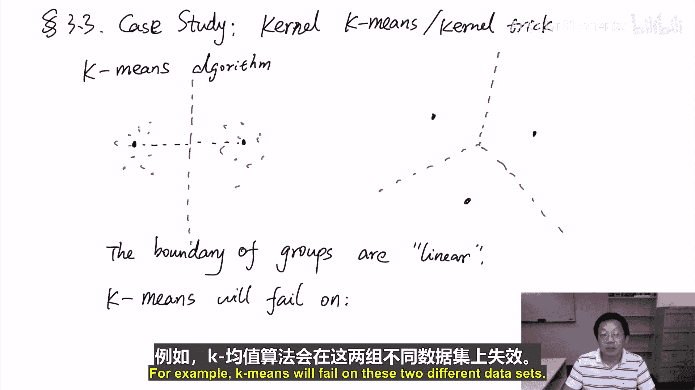
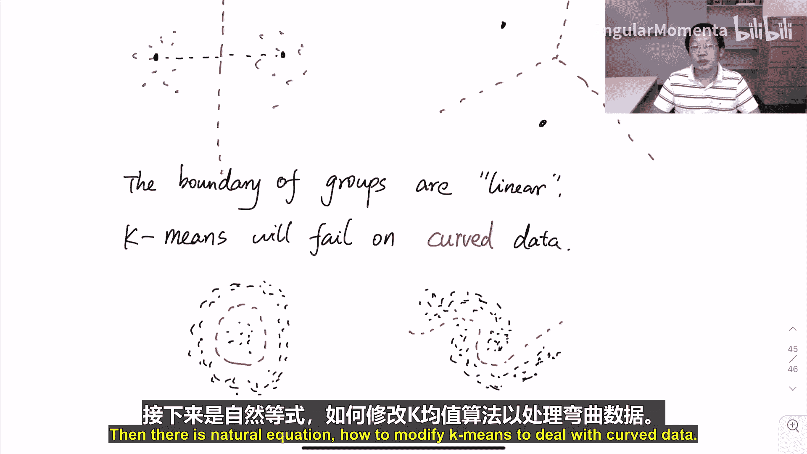
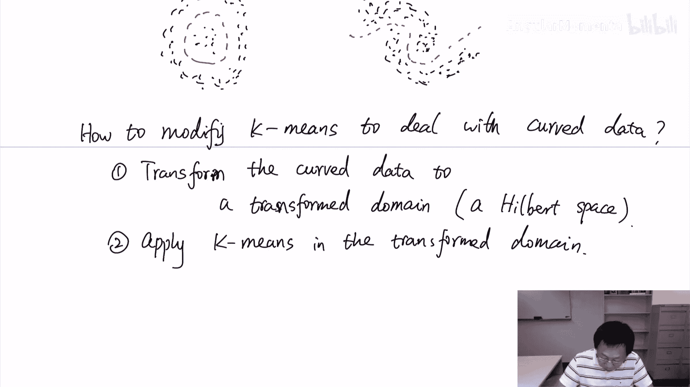
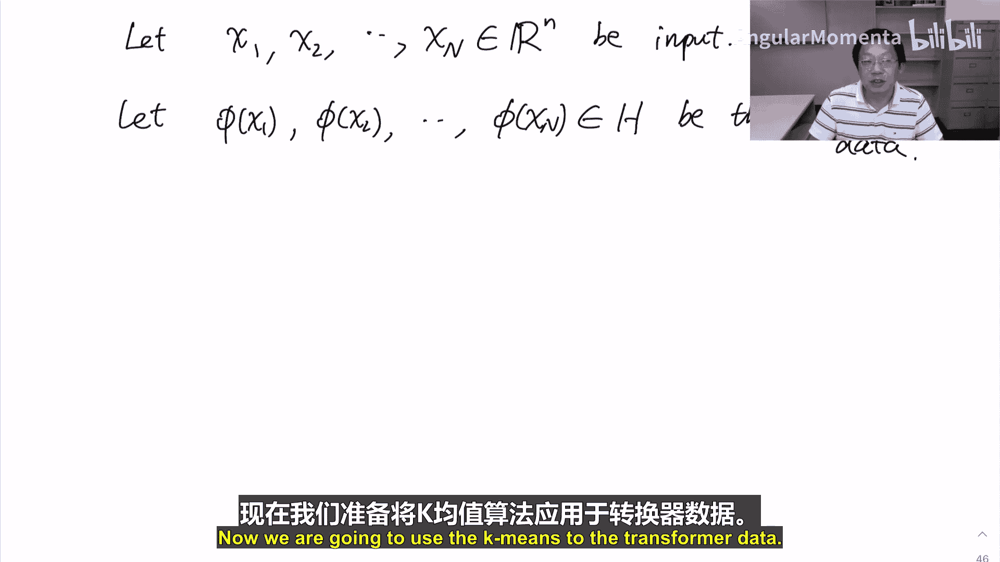
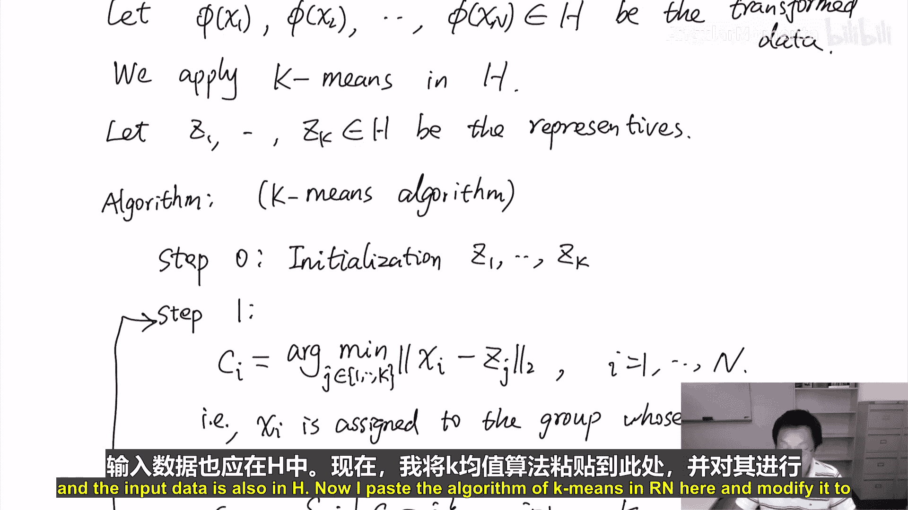
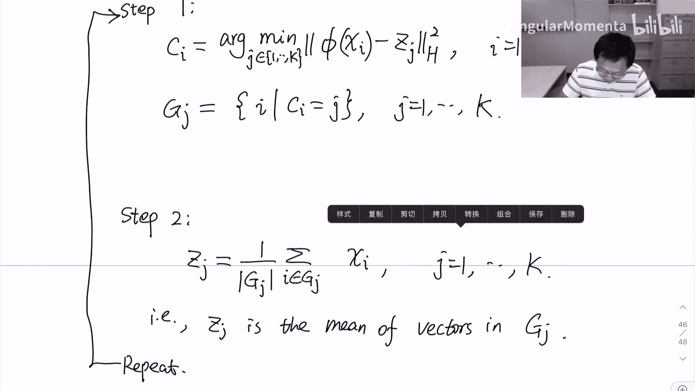
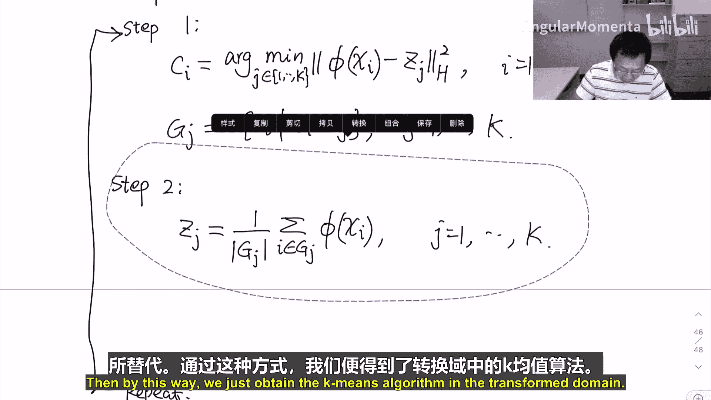
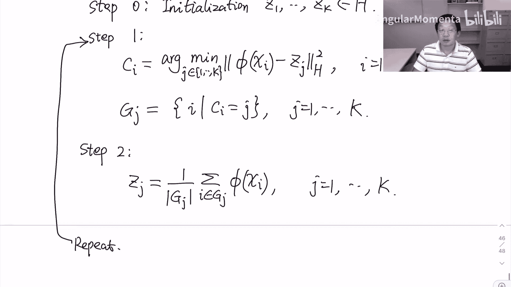

**数据分析的数学方法：09-01-02：核技巧与核K均值算法**

在本节中，我们将学习内积和希尔伯特空间的一个具体应用：改进用于聚类的K均值算法。我们将得到一个所谓的**核K均值**算法，并更一般地介绍**核技巧**。

---

### **概述：从线性到非线性**

上一节我们介绍了内积空间的基本概念。本节中，我们来看看如何利用这些概念，将原本只能处理线性可分数据的K均值算法，扩展到能处理非线性边界的数据。

我们首先回顾标准的K均值算法。假设我们只有两个组，用两个黑点作为代表点。那么这两个组之间的边界，实际上是连接这两个代表点的线段的**垂直平分线**。位于这条平分线左侧的点离左侧代表点更近，属于左侧的组；右侧的点则属于右侧的组。因此，两个不同组之间的边界是**线性的**（在二维是直线，在高维是超平面）。

如果有三个代表点（三个组），边界就是这些垂直平分线的交点。最终，整个区域被划分为三个部分，每个部分内的点都离其所属组的代表点最近。所有这些边界都是线性的。

正因如此，K均值算法本质上是一个**线性算法**。对于边界是非线性的数据集，例如下面展示的两种数据，K均值算法会失效。

*   左图数据集有两组：内圈一组，外圈一组。它们的边界是一个圆环曲线。
*   右图数据集也有两组：一组在红色曲线上方，一组在下方。它们的边界也是一条曲线。

这两个数据集的边界都是**非线性**的。因此，K均值算法无法正确处理这类“弯曲”的数据。这就引出了一个自然的问题：如何修改K均值算法以处理非线性数据？

---

### **核心思想：映射到高维空间**

一个非常自然的想法是：我们不在原始数据域（如 R^2）直接工作，而是先将数据通过一个变换 **Φ**，映射到一个**更高维的希尔伯特空间 H** 中。然后，在这个变换后的空间 H 里应用标准的K均值算法。

这个过程分为两步：
1.  将数据从原始空间 **R^N** 变换到希尔伯特空间 **H**。
2.  在空间 **H** 中应用标准K均值算法。

如上图所示，原始数据经过变换 **Φ** 后，在空间 H 中可能变得**线性可分**（即可以用一个超平面分开）。这样，原本在低维空间中复杂的非线性边界，在高维空间中就变成了简单的线性边界，从而使得K均值算法能够生效。

这里，原始数据点 **x_i** 和 **x_j** 被映射为 **Φ(x_i)** 和 **Φ(x_j)**。这个想法成功的关键在于，我们能否找到一个合适的映射 **Φ** 和空间 **H**，使得变换后的数据是线性可分的。

---

### **在希尔伯特空间中的K均值算法**

接下来，我们具体看看如何在变换后的空间 H 中执行K均值算法。

设原始输入数据为 **x_1, x_2, ..., x_N ∈ R^N**。
经过变换后，数据变为 **Φ(x_1), Φ(x_2), ..., Φ(x_N) ∈ H**。

我们将在空间 H 中寻找 K 个代表点 **z_1, z_2, ..., z_K ∈ H**。

以下是标准K均值算法在空间 H 中的修改版本：

**初始化**：随机初始化 K 个代表点 **z_1, ..., z_K ∈ H**。

然后迭代以下两个步骤：

**步骤1：分配数据点到最近的代表点**
对于每一个变换后的数据点 **Φ(x_i)**，计算它到所有代表点 **z_k** 的距离，并将其分配到距离最近的那个代表点所在的组。在希尔伯特空间 H 中，距离由该空间的内积诱导的范数定义。我们通常使用距离的平方，因为平方函数是单调递增的，不影响最小化的结果。

分配规则可以用以下公式表示：
将 **Φ(x_i)** 分配到组 **G_j**，如果满足：
**j = argmin_{k} ||Φ(x_i) - z_k||_H^2**

**步骤2：更新代表点为组内均值**
对于每一个组 **G_j**，计算该组内所有数据点（在空间 H 中）的平均值，并将此平均值设为新的代表点 **z_j**。

更新公式为：
**z_j = (1 / |G_j|) * Σ_{i∈G_j} Φ(x_i)**

其中，**|G_j|** 表示第 j 组中数据点的个数。

通过不断迭代步骤1和步骤2，我们就得到了在变换域 H 中的K均值算法。

---

### **总结**

本节课中，我们一起学习了如何利用希尔伯特空间的概念来扩展K均值算法。核心思路是**核技巧**：通过一个映射 **Φ** 将原始非线性可分数据映射到高维特征空间 H，使得数据在该空间中变得线性可分，然后在高维空间中执行标准的线性K均值算法。由此得到的算法称为**核K均值算法**。这为解决复杂的非线性聚类问题提供了一个强大的工具框架。下一节，我们将探讨如何实际计算这个映射，并引入“核函数”这一关键概念。