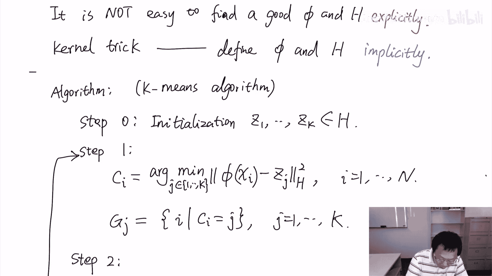
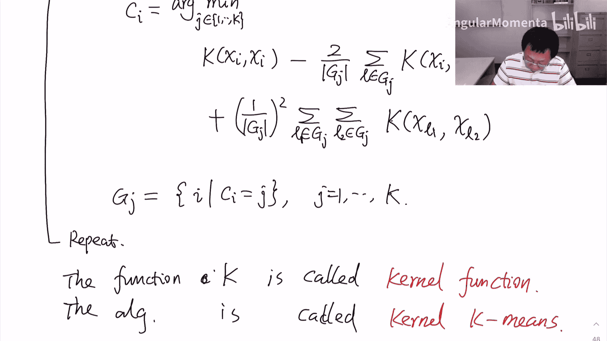

# 039：核技巧与核K均值算法 🧠

在本节课中，我们将学习如何通过“核技巧”来改进K均值算法，使其能够处理线性不可分的数据。我们将看到，通过隐式地定义特征映射和希尔伯特空间，我们可以设计出更强大的聚类算法。

---

上一节我们讨论了在高维空间中使用K均值算法进行线性分离的挑战。本节中，我们来看看如何通过“核技巧”来克服这些挑战。

## 核技巧的引入

直接寻找一个合适的显式特征映射函数 **Φ** 和希尔伯特空间 **H** 来线性分离数据并非易事。

因此，人们引入了所谓的“核技巧”。

核技巧的关键在于，我们**不显式地定义 Φ 和 H**，而是**隐式地**定义它们。为了实现这个目标，让我们首先在高维空间 **H** 中重新表述K均值算法。

## 算法的重新表述

让我们检查这个算法。在算法中，我们显式地有向量 **Z₁, Z₂, ..., Zₖ**，它们是 **H** 空间中的向量。由于我们不希望 **H** 有显式形式，自然也不希望 **Z₁** 到 **Zₖ** 有显式形式。因此，我们尝试消除 **Z₁** 到 **Zₖ**。

让我们仔细看看这个算法。实际上，**Z₁** 到 **Zₖ** 是中间向量，因为K均值算法的最终输出仅仅是**分组**。代表向量本身并不重要，也不是必需的。

通过分别检查步骤一和步骤二中的两个公式，我们可以看到 **Zⱼ** 实际上是第 **j** 组中向量的均值。将这个 **Zⱼ** 的表达式代入到这里的表达式中，我们就不再需要步骤二了，因为它已与步骤一合并。

此外，在这个公式中，**i** 是固定的，但求和中的 **i** 是一个变量。因此，我将此处的 **i** 改为另一个符号 **l**。

现在，你可以看到这个新版本只包含一个步骤。我们只需重复此步骤多次。

这里有一个小问题：由于我们不再需要 **Z₁** 到 **Zₖ**，因此我们也不再需要初始化它们。相反，我们初始化分组 **G**。这样，我们得到了K均值算法在 **H** 空间中的一个新表述。

在这个重新表述中，我们不再有代表向量，只有分组作为变量。但是，在这个公式中，你仍然可以看到涉及到了 **Φ** 和 **H** 空间中的范数。我们仍然不喜欢它，因为我们不希望 **H** 和 **Φ** 是显式的。

好消息是，所有这些 **Φ** 和 **H** 仅出现在这个范数平方项中。

## 消除显式映射

下一步，让我们重新整理这个范数平方项，看看是否能消除 **Φ** 和 **H**。

对于这个项，它是希尔伯特空间中的一个范数平方，因此可以写成一个内积。然后，利用内积的线性性质，我们可以展开这个项。

展开后如下：

这个范数平方是该向量与自身的内积。现在，我进行展开：
*   第一项是第一个向量与自身的内积。
*   我们有交叉项，即两倍的内积。
*   我们还有最后一项。

然后，我们可以利用内积函数的线性性质进一步展开这个求和。现在，这个范数平方函数被展开为许多内积的线性组合。

观察这个表达式，你会发现只有这三项涉及 **Φ**。当然，**H** 空间中的内积也涉及其中。但所有这些项都具有特殊的形式：它们是 **Φ(x)** 和 **Φ(y)** 的内积形式。

这种形式实际上很容易处理。因为如果我们把 **x** 和 **y** 视为变量（它们都在 **ℝⁿ** 中），那么这个内积的值是一个实数。因此，这个函数可以看作是一个从 **ℝⁿ × ℝⁿ** 到 **ℝ** 的映射。它有两个输入 **x** 和 **y**，输出是一个实数。

## 定义核函数

现在，我们不再显式地定义 **Φ** 和 **H**，而是只需要定义这个函数。一旦我们有了这个函数，那么这些项就可以用这个函数的值来重写，从而我们可以计算它们并进行最小化。

我们称这个函数为**核函数**，记作 **K**。我们定义一个函数 **K**，它从 **ℝⁿ × ℝⁿ** 映射到 **ℝ**，使得：
**K(x, y) = <Φ(x), Φ(y)>_H**

这样，就不再需要 **Φ**、**H** 和内积的显式形式了。

## 核K均值算法

现在我们得到了一个像这样的算法：

我们仍然初始化分组 **G₁, G₂, ..., Gₖ**。然后在每一步，我们通过以下最小化来获得 **cᵢ**（即数据点 **xᵢ** 应属于的组）：

具体来说，最小化的表达式被替换为：

*   原表达式中的 **‖Φ(xᵢ)‖²** 被替换为 **K(xᵢ, xᵢ)**。
*   原表达式中的 **<Φ(xᵢ), Φ(xₗ)>** 被替换为 **K(xᵢ, xₗ)**。
*   原表达式中的 **<Φ(xₗ₁), Φ(xₗ₂)>** 被替换为 **K(xₗ₁, xₗ₂)**。

现在，你可以看到这是可计算的，因为我们已经定义了这个核函数 **K**。核函数很容易定义，它只是一个将两个 **ℝⁿ** 向量映射到一个实数的函数（后续课程会给出例子）。对于任何 **j**，这只是一个数值。因此，我们可以比较从 **1** 到 **k** 的值，取最小值，就得到了 **cᵢ**。

这个算法被称为**核K均值算法**。这个函数 **K** 被称为**核函数**。

---

本节课中，我们一起学习了核技巧的核心思想以及如何将其应用于K均值算法。我们了解到，通过隐式地定义一个核函数 **K(x, y)** 来代替显式的特征映射 **Φ** 和希尔伯特空间 **H** 的内积，我们可以设计出强大的核K均值算法。这种方法使我们能够处理原始空间中线性不可分的数据，而无需直接计算复杂的高维映射。