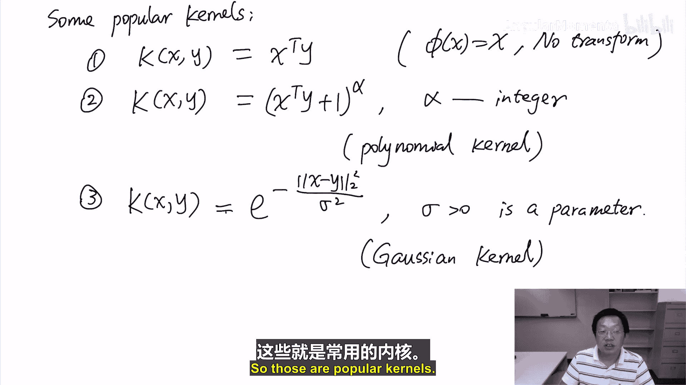

# 040：核函数的选择与性质 🔍

在本节课中，我们将要学习核K均值算法中一个尚未解决的问题：如何选择合适的核函数K。我们将探讨核函数必须满足的数学条件，并介绍几种在实践中常用的核函数。

---

上一节我们介绍了核K均值算法，本节中我们来看看如何为算法选择一个合适的核函数。核函数并非可以任意选择，因为根据其构造定义，它必须能表示为某个映射函数φ(x)和φ(y)在某个内积空间中的内积形式。

因此，我们首先需要找出核函数必须满足的必要条件。

### 核函数的必要条件

以下是核函数需要满足的两个核心必要条件：

1.  **对称性**
    由于内积具有对称性，即 `<φ(x), φ(y)> = <φ(y), φ(x)>`，因此核函数也必须满足对称性：
    **K(x, y) = K(y, x)**
    对于任意x和y都成立。满足此条件的核被称为**对称核**。

2.  **半正定性**
    内积的另一个性质是，一个向量与自身的内积必须非负，即 `<v, v> ≥ 0`。这个性质对核函数提出了更严格的要求。
    考虑任意m个向量 y₁, y₂, ..., yₘ 和任意m个系数 c₁, c₂, ..., cₘ。根据内积的线性和非负性，我们可以推导出：
    **∑ᵢ ∑ⱼ cᵢ cⱼ K(yᵢ, yⱼ) ≥ 0**
    如果我们将这些点对的核函数值排列成一个矩阵 **K**，其中 **Kᵢⱼ = K(yᵢ, yⱼ)**，那么上述不等式等价于要求对于任意向量 **c**，其二次型非负：
    **cᵀ K c ≥ 0**
    同时，结合对称性条件，矩阵 **K** 也是一个对称矩阵。因此，核函数必须使得由任意点集构成的**格拉姆矩阵（Gram Matrix）** 是**对称半正定（Symmetric Positive Semi-Definite, SPSD）** 的。满足此条件的核被称为**SPSD核**。

### 充分条件：Mercer定理

令人欣慰的是，SPSD条件不仅是必要的，也是充分的。这由著名的**Mercer定理**所保证。

该定理指出：如果一个核函数 **K** 是SPSD的，那么必然存在一个希尔伯特空间 **H** 和一个映射函数 **φ**，使得对于所有的 **x** 和 **y**，都有：
**K(x, y) = <φ(x), φ(y)>**
其中 `<·, ·>` 是空间 **H** 中的内积。

这意味着，只要我们选择的核函数满足SPSD条件，它就对应着某个特征空间中的内积，从而可以安全地用于核方法。

### 常用的核函数

了解了核函数的选择标准后，我们来看看在实践中几种流行且满足SPSD条件的核函数：

1.  **线性核**
    **K(x, y) = xᵀy**
    这是最简单的核函数，对应的映射函数 **φ(x) = x**，即不做任何变换，直接在原始数据空间中进行内积运算。

2.  **多项式核**
    **K(x, y) = (xᵀy + 1)^d**
    其中 **d** 是一个正整数参数。这个核函数对应的特征空间是所有阶数不超过 **d** 的多项式组合的空间。它能捕捉特征间的高阶交互关系。

3.  **高斯核（径向基函数核）**
    **K(x, y) = exp(-||x - y||² / (2σ²))**
    这是最常用、最强大的核函数之一。其中 **σ** 是一个控制函数平滑度的参数。高斯核对应的特征空间是无限维的，它能将数据映射到一个非常复杂的空间中，从而处理高度非线性的问题。

---

本节课中我们一起学习了为核方法选择核函数的关键。我们首先推导出核函数必须满足**对称性**和**半正定性（SPSD）** 这两个必要条件。接着，我们了解到**Mercer定理**保证了SPSD条件同时也是充分的，即任何SPSD核都隐式地定义了一个高维特征空间的内积。最后，我们介绍了三种在实践中广泛使用的核函数：**线性核**、**多项式核**和**高斯核**，为实际应用提供了明确的选择。