# 041：核方法工作原理示例 🧠

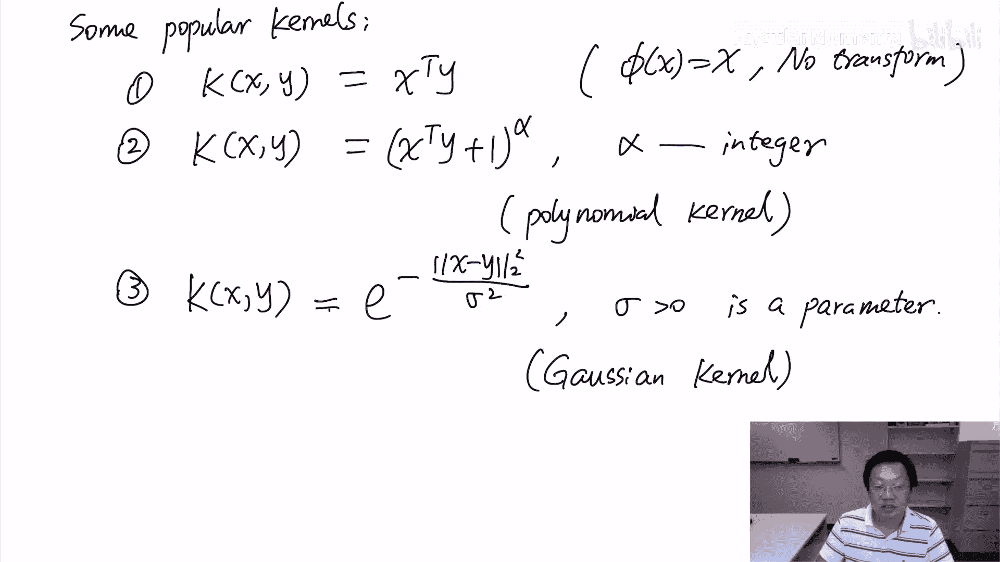

在本节中，我们将通过一个简单的例子来演示核方法为何有效。我们将使用本节开头提到的例子，并选择高斯核函数。

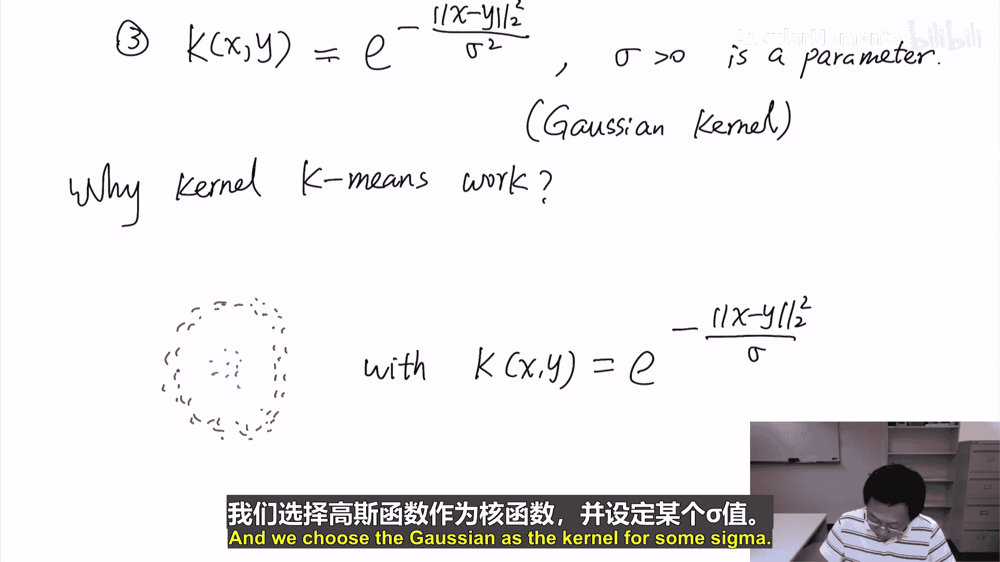

## 高斯核函数与单位球映射

我们选择的高斯核函数公式为：
```
K(x_i, x_j) = exp(-||x_i - x_j||^2 / σ^2)
```
其中，σ 是核函数的带宽参数。

使用这个核函数，我们可以观察到 `K(x_i, x_i)` 的值：
```
K(x_i, x_i) = exp(-||x_i - x_i||^2 / σ^2) = exp(0) = 1
```
对于任何数据点 `x_i` 都成立。

我们知道，核函数 `K(x_i, x_i)` 等于特征映射后向量 `φ(x_i)` 与其自身的内积，即 `φ(x_i)` 的范数平方：
```
K(x_i, x_i) = <φ(x_i), φ(x_i)> = ||φ(x_i)||^2 = 1
```
由此我们可以得出结论：经过特征映射 `φ` 后，所有的数据点 `φ(x_1), ..., φ(x_N)` 都被映射到了再生核希尔伯特空间 `H` 中的**单位球面**上。也就是说，它们都是 `H` 空间中的单位向量。

## 内积与向量关系分析

接下来，我们分析 `K(x_i, x_j)`，即两个不同数据点映射后的内积。

根据高斯核公式：
*   如果 `x_i` 和 `x_j` 在原始欧几里得空间中**非常接近**，那么 `||x_i - x_j||^2` 会很小，导致 `K(x_i, x_j) ≈ 1`。
*   如果 `x_i` 和 `x_j` 在原始空间中**差异很大**（相距很远），那么 `||x_i - x_j||^2` 会很大，指数函数会迅速衰减，导致 `K(x_i, x_j) ≈ 0`。

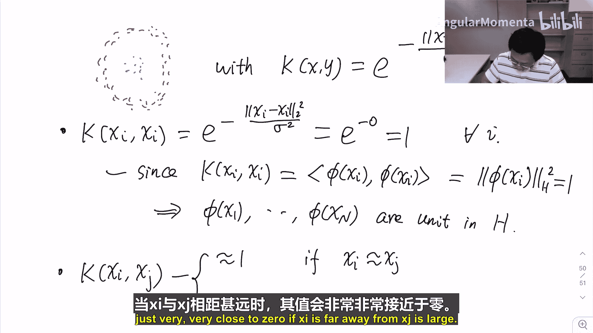

从这个内积关系，我们可以进一步推导出 `φ(x_i)` 和 `φ(x_j)` 之间的几何关系。

**情况一：当 `x_i` 接近 `x_j` 时**

由于 `K(x_i, x_j) ≈ 1`，我们计算 `φ(x_i)` 与 `φ(x_j)` 之间距离的平方：
```
||φ(x_i) - φ(x_j)||^2 = <φ(x_i)-φ(x_j), φ(x_i)-φ(x_j)>
                      = ||φ(x_i)||^2 - 2<φ(x_i), φ(x_j)> + ||φ(x_j)||^2
                      = 1 - 2*1 + 1
                      = 0
```
计算结果表明，`||φ(x_i) - φ(x_j)||^2 ≈ 0`。这意味着在特征空间 `H` 中，`φ(x_i)` 与 `φ(x_j)` **非常接近**。

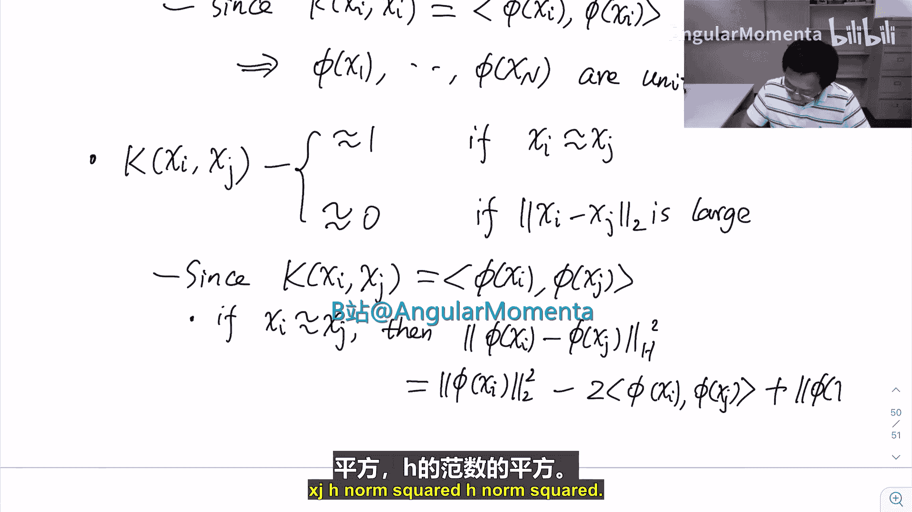

**情况二：当 `x_i` 远离 `x_j` 时**

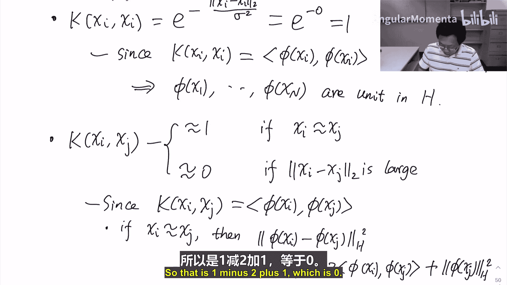

此时 `K(x_i, x_j) = <φ(x_i), φ(x_j)> ≈ 0`。这意味着在特征空间 `H` 中，向量 `φ(x_i)` 与 `φ(x_j)` 大致是**正交**的。

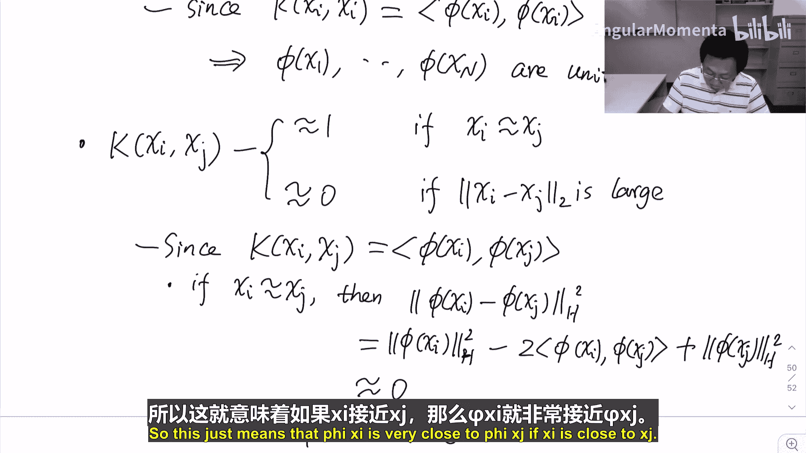

## 空间变换的可视化解释

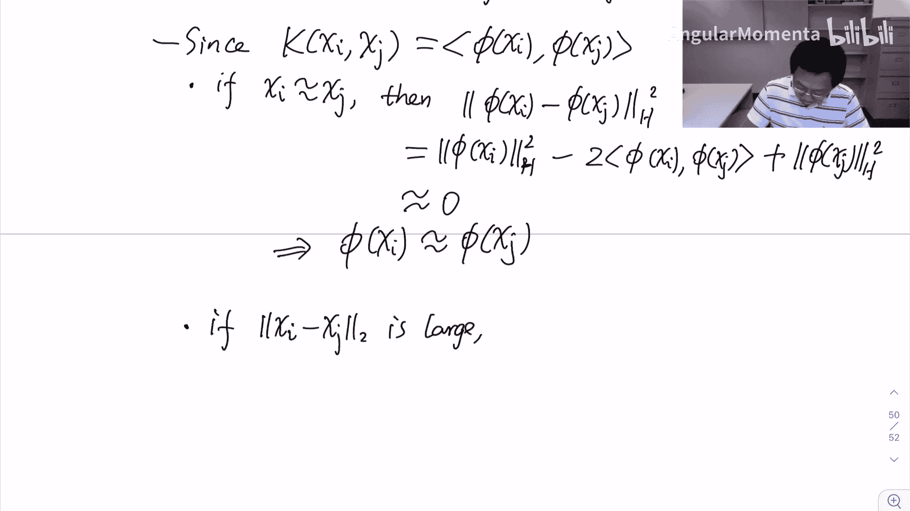

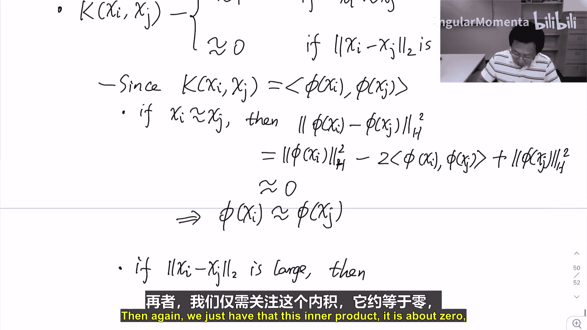

现在，我们可以描绘出经过 `φ` 变换后的图像。

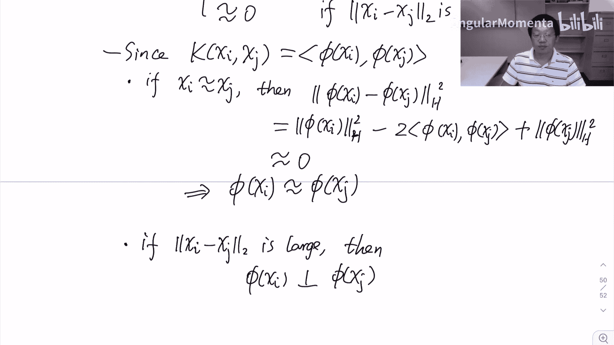

在原始空间 `R` 中，数据点可能复杂地交织在一起。但在特征空间 `H` 中，每个向量都被映射到了单位球面上。

假设我们有两类数据点（例如用蓝色和红色表示）：
*   在原始空间中，**不同类**的蓝点和红点彼此相距很远。
*   根据我们的分析，在特征空间 `H` 中，这些蓝点映射后的向量 `φ(蓝点)` 将与红点映射后的向量 `φ(红点)` 近似正交。

为了简化理解，我们用三维空间来可视化这个 `H` 空间。我们可以想象：
*   蓝点被映射到空间中的某个位置（例如 Z 轴正方向）。
*   由于红点与蓝点正交，它们将被映射到与蓝点方向垂直的平面（例如 XY 平面）上。

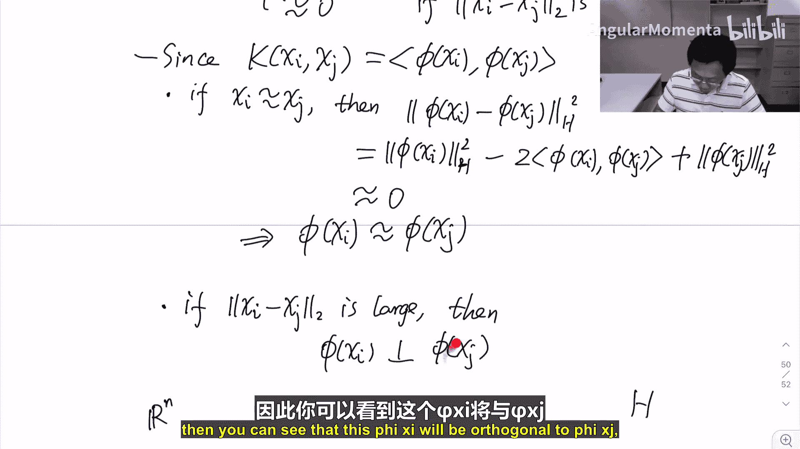

在代表红点的 XY 平面内：
*   那些在原始空间中**彼此接近**的红点，在特征空间中也彼此接近（聚集在平面某个区域）。
*   那些在原始空间中**彼此远离**的红点，在特征空间中也几乎正交（分散在平面不同方向）。

## 核方法如何助力聚类

经过这样的变换后，原本在低维原始空间中线性不可分的数据，在**高维特征空间 `H` 中变得更容易分离**。

以上面的蓝点和红点为例：
*   在特征空间中，所有蓝点聚集在单位球面的一个区域（如北极），而所有红点分布在与之垂直的赤道平面（XY平面）上。
*   此时，我们可以很容易地用一个**平面**（例如一个平行于XY平面、略低于北极点的平面）将蓝点和红点完美地分开。

这正是核方法的核心优势：**通过核函数隐式地将数据映射到高维空间，使得原本复杂的非线性模式（如聚类边界）在高维空间中表现为线性模式**。因此，我们可以在高维空间中使用像 K-means 这样的线性算法来成功地对数据进行分区和聚类。

## 本节总结

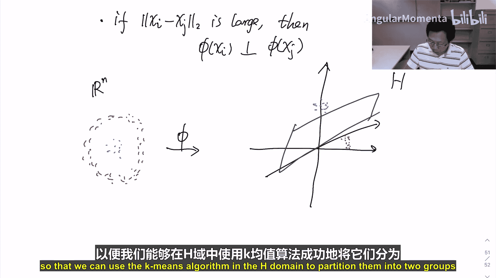

本节课我们一起学习了核方法工作原理的一个具体示例。通过分析高斯核函数，我们了解到：
1.  核函数能将所有数据点映射到高维特征空间的单位球面上。
2.  原始空间中接近的点，在特征空间中也接近；原始空间中远离的点，在特征空间中趋向于正交。
3.  这种变换使得数据在特征空间中更容易被线性模型（如一个平面）分离，从而解释了核方法如何解决原始空间中的非线性问题。