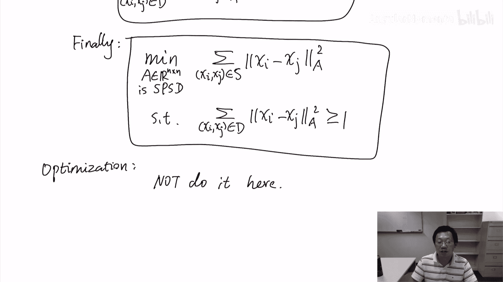

# 042：内积与度量学习的应用 🧠

在本节课中，我们将要学习内积及其诱导度量的另一个重要应用：**度量学习**。我们将了解如何利用数学工具，根据数据的相似性信息，学习一个能够更好反映数据内在关系的距离度量。

---

## 问题定义

上一节我们介绍了内积和度量的基本概念，本节中我们来看看如何将它们应用于机器学习中的一个具体任务。

我们面临的任务如下：给定一组数据点，例如 **x₁, x₂, ...**，这些点都位于 **ℝⁿ** 空间中。同时，我们拥有这些数据点的标签信息。这些标签以两种集合的形式给出：
*   **相似集 S**：包含所有被认为是“相似”的数据点对 **(xᵢ, xⱼ)**。
*   **不相似集 D**：包含所有被认为是“不相似”的数据点对 **(xᵢ, xⱼ)**。

我们的目标是：基于这些相似与不相似的信息，学习一个**距离度量**（或**度量**），使得在这个新度量下，相似的点对距离很近，而不相似的点对距离很远。

例如，假设我们有六个数据点，其原始分布和相似关系如下图所示。在原始空间中，一些不相似的点（如点5和点6）在几何上可能非常接近，这并不符合我们的语义认知。

我们期望通过度量学习，得到一个如下图所示的新空间。在这个新度量下，不相似的点6与其他点距离很远，而相似的点（红色连接）则彼此靠近。

---

## 解决方案框架

为了解决这个问题，我们依然遵循**表示 + 评估 + 优化**的框架。

### 表示：如何表达一个度量？

首先，我们需要决定如何表示我们要学习的度量。目前我们学过的度量有两种：
1.  **p-范数**：`||x||_p = (∑ᵢ |xᵢ|^p)^(1/p)`，其中 `p ≥ 1`。
2.  **加权范数**：由加权内积诱导的范数。

让我们先尝试 **p-范数**。这个范数族只有一个参数 `p`，这意味着优化过程只涉及一个变量。然而，这个范数族**太小了**，仅凭一个参数 `p` 很难灵活地拟合复杂的度量学习任务。

因此，我们考虑一个更大的范数族：**由加权内积诱导的范数**。具体来说，我们引入一个**对称正定矩阵 A**，定义内积为：
`<x, y>_A = xᵀ A y`
由此诱导出的范数为：
`||x||_A = √(xᵀ A x)`

这个范数族足够大，因为每个 SPD 矩阵都定义了一个加权范数。所有 `n×n` 矩阵的空间维度是 `n²`，所以这个范数族的表达能力很强。

于是，寻找一个度量就等价于寻找一个矩阵 **A**。有了矩阵 A，点 `x` 和 `y` 之间的距离定义为：
`dist_A(x, y) = ||x - y||_A = √((x - y)ᵀ A (x - y))`

**重要说明**：我们的假设空间是所有 SPD 矩阵的集合。然而，这个集合**不是闭集**（一个 SPD 矩阵序列的极限可能是一个半正定矩阵，而非正定矩阵）。为了使优化问题良定义，我们需要将其完备化。完备化后的集合是**对称半正定矩阵**的集合。

如果 A 是**对称半正定**矩阵，那么 `||x||_A` 不再是一个严格的**范数**，而是一个**半范数**。因为它可能不满足“`||x||_A = 0` 当且仅当 `x = 0`”这一条件（当 A 奇异时，存在非零向量 x 使得 `xᵀ A x = 0`）。不过，这并不影响我们的度量学习任务，因为我们只关心距离的相对大小，并且允许非常相似的点对距离为零。

### 评估：如何定义“好”的度量？

现在，我们需要定义一个标准，来判断哪个矩阵 A 是“好”的。我们的目标是：
*   **对于相似对 (xᵢ, xⱼ) ∈ S**：希望它们的距离 `dist_A(xᵢ, xⱼ)²` **小**。
*   **对于不相似对 (xᵢ, xⱼ) ∈ D**：希望它们的距离 `dist_A(xᵢ, xⱼ)²` **大**。

一个自然的想法是构造一个优化目标：最小化相似对的距离之和，同时最大化不相似对的距离之和。这可以表述为：
`min_A ∑_S dist_A(xᵢ, xⱼ)² - ∑_D dist_A(xᵢ, xⱼ)²`

为了避免平凡解（例如 A=0 矩阵），并控制度量的尺度，通常会对不相似对的距离之和施加一个约束，例如要求它大于某个常数（如1）。于是，优化问题变为：
`min_A ∑_( (xᵢ, xⱼ) ∈ S ) (xᵢ - xⱼ)ᵀ A (xᵢ - xⱼ)`
约束条件为：
1.  `A` 是半正定矩阵。
2.  `∑_( (xᵢ, xⱼ) ∈ D ) (xᵢ - xⱼ)ᵀ A (xᵢ - xⱼ) ≥ 1`

### 优化

最终的优化问题是一个在**半正定矩阵锥**上的**二次约束二次规划**问题。这类问题通常比较复杂，需要使用专门的凸优化算法（如梯度下降、投影方法或使用现成的优化求解器）来求解。本节课我们专注于问题的建模，具体的优化算法实现将不在此详细展开。

---

## 总结

本节课中我们一起学习了**度量学习**的基本数学框架。
1.  **问题**：根据数据的成对相似/不相似信息，学习一个更能反映数据语义关系的距离度量。
2.  **表示**：我们选择使用由**对称半正定矩阵 A** 诱导的半范数 `||·||_A` 来表示度量。距离公式为 `dist_A(x, y) = √((x-y)ᵀ A (x-y))`。
3.  **评估**：我们构建了一个优化问题，目标是**最小化相似对之间的总距离**，同时**约束不相似对之间的总距离大于一个阈值**。
4.  **优化**：该问题最终归结为一个**半正定规划**问题，可通过凸优化技术求解。

通过这个流程，我们可以将原始数据投影到一个新的度量空间中，使得数据点之间的几何距离更好地匹配其语义相似性。