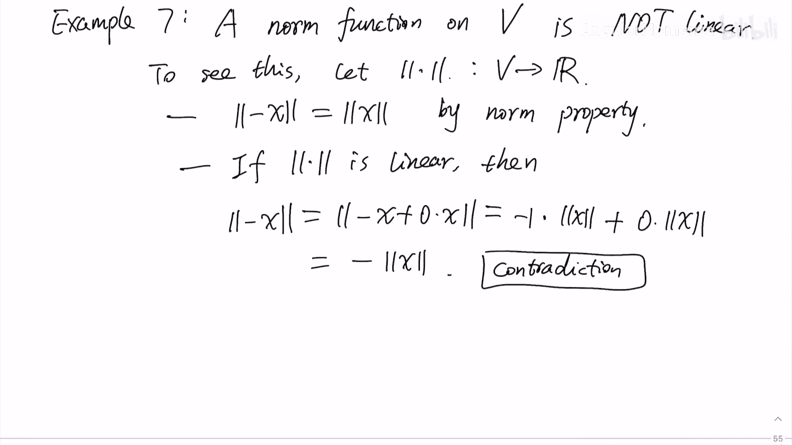

# 043：线性函数 📐

在本节课中，我们将学习向量空间上的一类基础且重要的函数：**线性函数**。我们将了解其定义，并通过多个具体例子来理解哪些函数是线性的，哪些不是。

---

## 概述

上一节我们介绍了向量空间及其结构（如范数和内积）。本节中，我们将目光转向定义在这些向量空间上的函数，特别是**线性函数**。线性函数是函数中最简单、最基础的类型，它满足一个核心性质：**函数运算与向量的线性组合运算可以交换顺序**。理解线性函数是后续学习更复杂函数（如非线性函数的微分近似）的基石。

---

## 线性函数的定义

设 **V** 是一个向量空间。一个函数 **F: V → R** 被称为**线性函数**，如果对于 **V** 中的任意两个向量 **x** 和 **y**，以及任意两个实数 **α** 和 **β**，都满足以下条件：

**F(αx + βy) = αF(x) + βF(y)**

这个公式的含义是：**先对向量做线性组合再应用函数**，得到的结果与**先对每个向量应用函数再做结果的线性组合**完全相同。也就是说，线性组合运算与函数映射 **F** 是**可交换**的。

---

## 线性函数示例

以下是几个具体的例子，帮助我们理解线性函数的定义。

**示例 1：向量的均值**
考虑定义在 **Rⁿ** 上的函数。对于任意向量 **x = (x₁, x₂, ..., xₙ)**，定义其均值为：
**F(x) = (x₁ + x₂ + ... + xₙ) / n**
这个函数是线性的。因为对于 **αx + βy**，其均值计算满足线性组合的分配律。

**示例 2：向量的最大分量**
考虑定义在 **Rⁿ** 上的函数：**F(x) = max{x₁, x₂, ..., xₙ}**
这个函数**不是**线性的。我们可以构造一个反例：
*   令 **x = (1, 0, 0, ...)**， **y = (0, 1, 0, ...)**， **α = β = 1**。
*   则 **F(x + y) = F(1, 1, 0, ...) = 1**。
*   但 **αF(x) + βF(y) = 1*1 + 1*1 = 2**。
两者不相等，违反了线性定义。

**示例 3：与固定向量的内积**
设 **a** 是 **Rⁿ** 中的一个固定向量。定义函数 **F(x) = 〈a, x〉**（即 **a** 与 **x** 的内积）。
根据内积的定义（对第二个变量是线性的），这个函数是线性的。

**示例 4：函数在固定点的取值**
考虑函数空间 **C[-1, 1]**（定义在区间[-1,1]上的所有连续函数）。定义泛函 **F: C[-1,1] → R** 为：
**F(f) = f(0)**
这个“函数的函数”是线性的。因为 **F(αf + βg) = (αf + βg)(0) = αf(0) + βg(0) = αF(f) + βF(g)**。

**示例 5：函数的定积分**
考虑函数空间 **C[a, b]**。定义泛函 **F(f) = ∫ₐᵇ f(t) dt**。
根据积分的线性性质，这个泛函是线性的。

**示例 6：一般内积空间上的内积**
设 **V** 是任意一个内积空间，其内积记为 **〈·, ·〉**。固定一个向量 **a ∈ V**，定义函数 **F(x) = 〈a, x〉**。
与示例3同理，由内积的线性性质可知，**F** 是线性函数。

---

## 非线性函数示例

并非所有具有“良好结构”的函数都是线性的。以下是一个关键的反例。

**示例 7：范数函数**
设 **V** 是一个赋范向量空间。考虑其范数函数 **‖·‖: V → R**。
范数函数**不是**线性的。我们可以用反证法证明：
1.  假设范数 **‖·‖** 是线性函数。
2.  根据线性定义，对于任意向量 **x**，应有 **‖-x‖ = -‖x‖**。
3.  但根据范数的定义性质，我们知道 **‖-x‖ = ‖x‖**。
4.  对于非零向量 **x**，**‖x‖ > 0**，因此 **‖x‖** 不可能等于 **-‖x‖**。
5.  这就产生了矛盾，所以假设不成立，范数不是线性函数。

---

## 总结

本节课中，我们一起学习了**线性函数**的核心概念。我们明确了其数学定义：**F(αx + βy) = αF(x) + βF(y)**。通过多个正例（如均值、内积、积分）和反例（如最大值、范数），我们加深了对线性性质的理解。线性函数是分析更复杂函数的基础工具，在下一节中，我们将探讨如何用线性函数来近似非线性函数，即**微分**的概念。