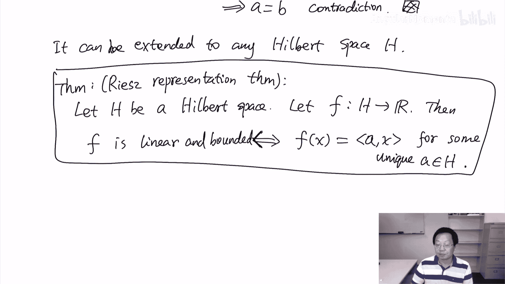

# 045：线性函数与希尔伯特空间

在本节课中，我们将要学习希尔伯特空间中的线性函数，并探讨一个核心定理：里斯表示定理。该定理揭示了希尔伯特空间上的线性有界函数与空间中的向量之间存在一一对应的关系，这种关系通过内积来建立。

上一节我们介绍了内积空间和线性函数的基本概念。本节中我们来看看，对于一个给定的线性函数，我们是否总能找到一个向量，使得该函数可以表示为与该向量的内积形式。

## 希尔伯特空间中的线性函数

我们首先将讨论限制在希尔伯特空间。希尔伯特空间是一个完备的内积空间。

对于内积空间，我们可以通过固定内积的第一个输入来定义一个线性函数。例如，对于任意向量 **a**，函数 **f(x) = <a, x>** 是一个线性函数。这意味着，从一个向量出发，我们可以构造出无穷多个线性函数。

现在，我们考虑其逆问题：给定一个线性函数 **f**，我们能否找到一个向量 **a**，使得对于所有 **x**，都有 **f(x) = <a, x>** 成立？如果答案是肯定的，那么在希尔伯特空间的向量和该空间上的线性函数之间，就存在一一对应的关系。

## 有限维情况：R^N 空间中的证明

为了便于理解，我们先在有限维空间 **R^N** 中探讨这个问题。我们将其总结为一个定理。

**定理**：对于任意线性函数 **f: R^N → R**，总存在唯一的向量 **a ∈ R^N**，使得对于所有 **x ∈ R^N**，有：
**f(x) = <a, x>**

以下是证明过程。

**证明**：
在 **R^N** 中，存在一组自然基 **{e₁, e₂, ..., e_N}**，其中 **e_i** 是第 **i** 个分量为1、其余分量为0的向量。

对于任意向量 **x = (x₁, x₂, ..., x_N)**，它可以表示为基向量的线性组合：
**x = x₁e₁ + x₂e₂ + ... + x_Ne_N**

由于函数 **f** 是线性的，我们可以计算 **f(x)**：
**f(x) = f(x₁e₁ + x₂e₂ + ... + x_Ne_N)**
**= x₁f(e₁) + x₂f(e₂) + ... + x_Nf(e_N)**

观察上述结果，它恰好是向量 **x** 与另一个向量 **a = (f(e₁), f(e₂), ..., f(e_N))** 的内积：
**f(x) = <a, x>**

因此，我们找到了这样的向量 **a**。

接下来证明 **a** 的唯一性。

**唯一性证明（反证法）**：
假设存在两个不同的向量 **a** 和 **b**，都满足 **f(x) = <a, x> = <b, x>** 对所有 **x** 成立。
取 **x = e_i**，则有：
**f(e_i) = <a, e_i> = a_i**
**f(e_i) = <b, e_i> = b_i**
因此，**a_i = b_i** 对所有 **i** 成立。这意味着 **a** 和 **b** 的所有分量都相同，即 **a = b**，与假设矛盾。故向量 **a** 是唯一的。

至此，我们证明了在 **R^N** 中，每个线性函数都唯一对应一个向量，且函数值等于该向量与输入向量的内积。

## 推广：里斯表示定理

上述结论可以推广到一般的希尔伯特空间，这就是著名的**里斯表示定理**。

**里斯表示定理**：
设 **H** 是一个希尔伯特空间，函数 **f: H → R** 是线性且有界的。那么，存在唯一的向量 **a ∈ H**，使得对于所有 **x ∈ H**，有：
**f(x) = <a, x>**

反之，如果一个函数能写成这种内积形式，那么它必然是线性且有界的。

需要注意的是，在推广到一般希尔伯特空间时，对函数的要求不仅是“线性”，还需要是“有界”的。对于无界线性函数，此表示形式可能不成立。反之，由柯西-施瓦茨不等式可知，内积形式 **<a, x>** 自动定义了线性且有界的函数。

本节课中我们一起学习了希尔伯特空间上线性函数的核心表示定理。我们首先在熟悉的 **R^N** 空间中证明了一个线性函数可以唯一地表示为与某个固定向量的内积。随后，我们了解到这一结论可以推广为更一般的里斯表示定理，它建立了希尔伯特空间上有界线性泛函与空间自身向量之间的一一对应关系，这是泛函分析中的一个基本且重要的结果。