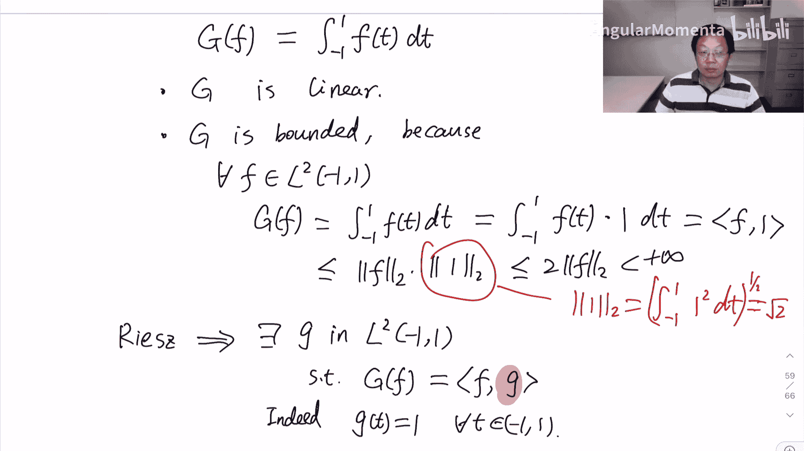

# 046：Riesz表示定理及其应用 🧮

在本节课中，我们将要学习泛函分析中的一个基本定理——Riesz表示定理。该定理建立了希尔伯特空间中的线性有界泛函与空间中的向量之间的一一对应关系。我们将通过几个具体的例子来深入理解这一定理的含义和应用场景。


## Riesz表示定理概述


Riesz表示定理是泛函分析中的一个基本定理。它建立了希尔伯特空间 `H` 上的所有线性有界泛函与 `H` 中所有向量之间的一一对应关系。

对于 `H` 中的一个向量 `a`，我们可以找到一个线性有界泛函 `F`，使得 `F(x) = ⟨a, x⟩`。反之，对于任意一个线性有界泛函 `F`，我们也能在 `H` 中找到一个唯一的向量 `a` 来表示它。因此，这两者之间存在一一对应的关系。

## 定理应用示例

上一节我们介绍了Riesz表示定理的核心思想，本节中我们来看看几个具体的例子，以加深理解。


以下是几个应用Riesz表示定理的例子：


1.  **均值函数**
    考虑向量 `x ∈ ℝⁿ` 的均值函数。我们知道，均值函数 `F(x) = (x₁ + x₂ + … + xₙ) / n` 是线性的。根据Riesz表示定理，我们可以将其写成内积形式：
    ```
    F(x) = ⟨a, x⟩
    ```
    其中向量 `a = (1/n, 1/n, …, 1/n)ᵀ`。

2.  **范数函数**
    考虑由内积诱导的范数函数 `‖x‖ = √⟨x, x⟩`。任何范数都是非线性的。因此，我们无法在希尔伯特空间 `H` 中找到一个向量 `a`，使得对于所有 `x ∈ H`，都有 `‖x‖ = ⟨a, x⟩`。范数无法写成这种内积形式。

3.  **矩阵的迹函数**
    考虑由 `n×n` 方阵构成的空间 `ℝⁿˣⁿ`，其标准内积定义为 `⟨A, B⟩ = Σᵢ Σⱼ Aᵢⱼ Bᵢⱼ`。在这个内积空间上定义迹函数 `tr(A) = Σᵢ Aᵢᵢ`。迹函数在机器学习和矩阵相关问题中经常出现。
    由于 `ℝⁿˣⁿ` 是有限维的，配备此内积后构成一个希尔伯特空间。根据Riesz表示定理，迹函数可以写成内积形式：
    ```
    tr(A) = ⟨A, I⟩
    ```
    其中 `I` 是单位矩阵。我们找到了空间中的一个元素（单位矩阵），使得迹等于该元素与 `A` 的内积。

## 有限维与无限维空间的差异


在例1和例3中，我们无需担心泛函的有界性，因为 `ℝⁿ` 和 `ℝⁿˣⁿ` 都是有限维空间。在有限维希尔伯特空间中，**线性性等价于有界性**。

然而，这一性质在无限维空间中并不成立。即使在有限维希尔伯特空间中，也可能存在**线性但无界**的泛函。让我们看一个无限维空间的例子。


以下是两个在无限维空间 `L²[-1, 1]` 中的泛函例子：


*   **例4：无界线性泛函**
    考虑空间 `L²[-1, 1]`，它是由连续函数空间 `C[-1, 1]` 完备化得到的。定义泛函 `F(f) = f(0)`。这个泛函是线性的，但在 `L²` 空间中是**无界**的。我们可以构造一个函数，其 `L²` 范数有限，但在 `0` 点的值为无穷大（例如，在 `0` 点有一个狄拉克δ函数特性的函数）。对于这样的函数，`F(f)` 无意义，因此该泛函没有内积表示。

*   **例5：有界线性泛函**
    同样在 `L²[-1, 1]` 中，考虑泛函 `G(f) = ∫₋₁¹ f(t) dt`。首先，`G` 是线性的，因为积分运算是线性的。其次，`G` 是**有界**的。我们可以将其重写为：
    ```
    G(f) = ∫₋₁¹ f(t) * 1 dt = ⟨f, 1⟩
    ```
    根据柯西-施瓦茨不等式，有 `|G(f)| ≤ ‖f‖₂ * ‖1‖₂ = √2 * ‖f‖₂ < ∞`。因此 `G` 有界。根据Riesz表示定理，存在一个函数 `g ∈ L²[-1, 1]`，使得 `G(f) = ⟨f, g⟩`。事实上，我们已经找到了这个 `g`，它就是常值函数 `g(t) = 1`。

## 总结




本节课中我们一起学习了Riesz表示定理及其应用。我们了解到，该定理为希尔伯特空间中的每个线性有界泛函都找到了一个唯一的向量表示。通过均值函数和迹函数的例子，我们看到了定理在有限维空间中的直接应用。同时，通过对比 `L²` 空间中有界和无界线性泛函的例子，我们认识到定理中“有界性”条件在无限维空间中的关键作用，以及有限维与无限维希尔伯特空间在线性泛函性质上的重要差异。