# 048：超平面上的投影 🎯

在本节课中，我们将要学习如何计算一个点到超平面的投影。超平面在机器学习中应用非常广泛，理解其投影的计算方法至关重要。

## 概述

超平面由单个线性方程定义，结构简单。在许多机器学习任务中，我们需要找到给定点到超平面的最近点，即该点在超平面上的投影。本节我们将推导投影的闭式解。

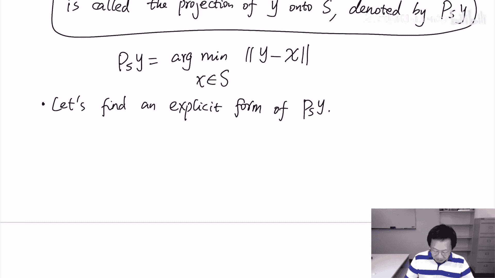

## 超平面与投影定义

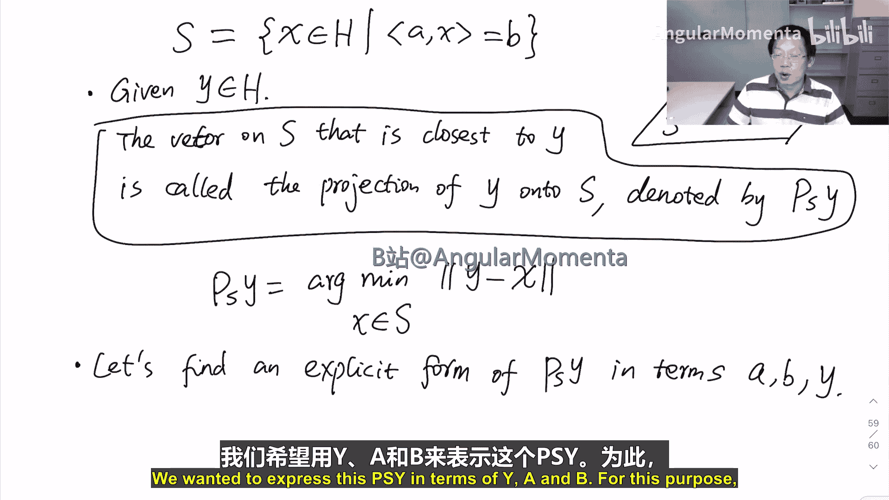

首先，我们考虑一个超平面。在希尔伯特空间 **H** 中，超平面 **S** 定义如下：
**S = { x ∈ H | A x = B }**
为简化，此处省略了下标。

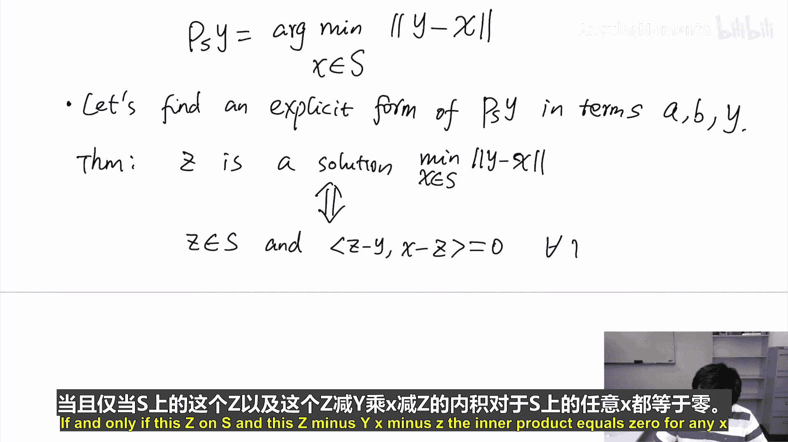

假设空间中存在一点 **y**。我们希望找到超平面 **S** 上距离 **y** 最近的点。**S** 上距离 **y** 最近的点被称为 **y** 在 **S** 上的投影。

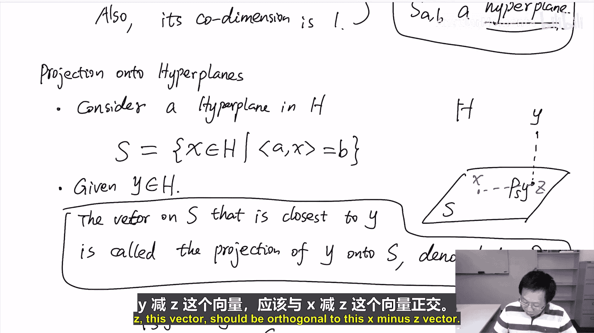

**S** 上最接近 **y** 的向量被称为 **y** 在 **S** 上的投影，记作 **P_S(y)**。其中 **P** 代表投影，**S** 代表目标集，**y** 是被投影的点。

用优化术语描述，**P_S(y)** 是以下问题的最小化解：
**min_{x ∈ S} ||y - x||**
此处使用的范数是希尔伯特空间 **H** 上的诱导范数。

现在，让我们寻找 **P_S(y)** 的闭式解。在许多应用中，我们需要 **P_S(y)** 的公式。该公式应仅使用定义 **S** 的 **A**、**B** 以及点 **y** 来表达。我们希望用 **y**、**A** 和 **B** 来表示 **P_S(y)**。

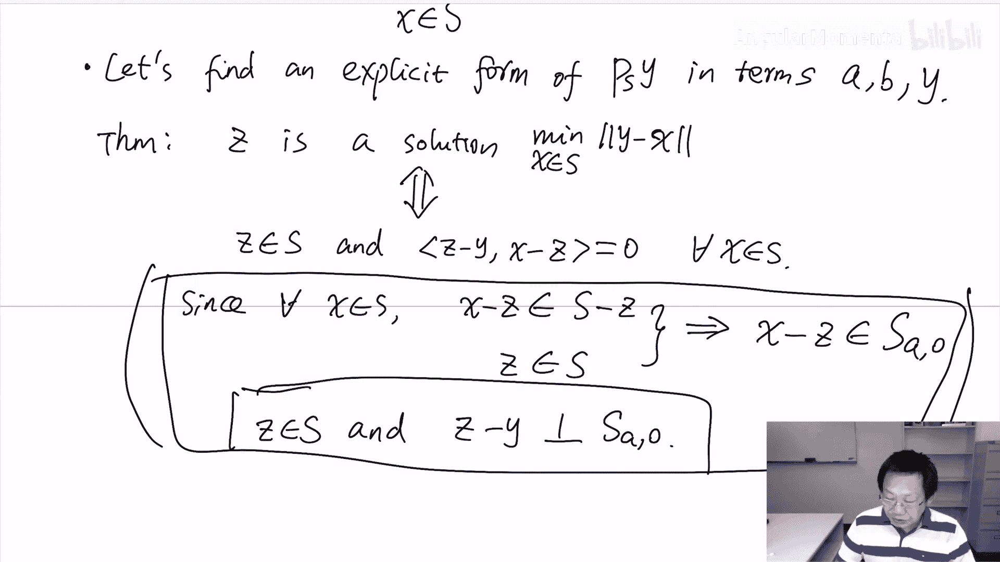

## 投影解的特征定理

为此，首先介绍一个定理。该定理指出，向量 **z** 是上述最小化问题的解，当且仅当满足以下两个条件：
1.  **z ∈ S**
2.  **< z - y, x - z > = 0**，对于所有 **x ∈ S**

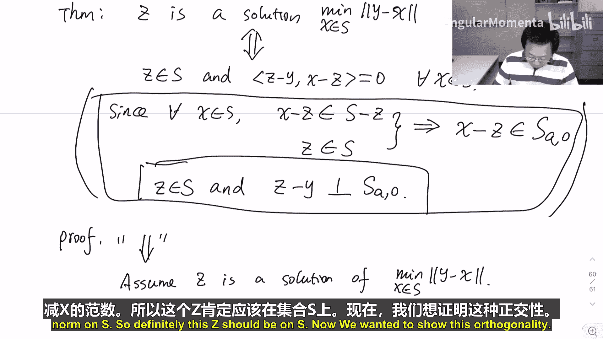

从几何上看，如果 **z** 是投影点 **P_S(y)**，那么向量 **y - z** 与 **x - z** 对于 **S** 上的任何 **x** 都正交。这意味着向量 **y - z** 应该与向量 **x - z** 正交。

同时，由于对于任何 **x ∈ S**，向量 **x - z** 属于集合 **S - z**。而 **z ∈ S**，这意味着 **x - z ∈ S_A0**（即与 **A** 正交的子空间）。因此，上述条件等价于：**z ∈ S** 且 **z - y** 与子空间 **S_A0** 正交。

关于这个定理的备注是，从几何角度，如果 **z** 是最小化解，我们必须有 **z - y** 正交于 **S_A0**，而 **S_A0** 是一个子空间。

## 定理证明（充分性）

现在我们来证明这个定理。我们从“顶部到底部”开始，即假设 **z** 是一个解，我们要证明上述条件成立。

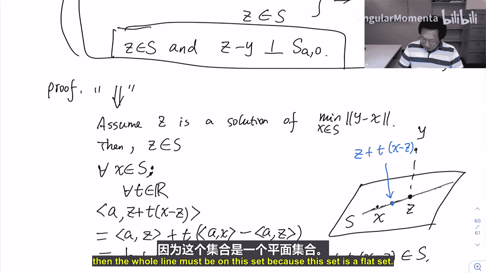

假设 **z** 是一个解。显然，**z** 必须在 **S** 上，因为约束条件是 **x ∈ S**，我们在 **S** 上最小化 **||y - x||**。

接下来，为了证明正交性，我们考虑对于任何 **x ∈ S**，连接 **z** 和 **x** 的直线。这条直线上的任何点都可以表示为 **z + t(x - z)**，其中 **t** 是一个实数。

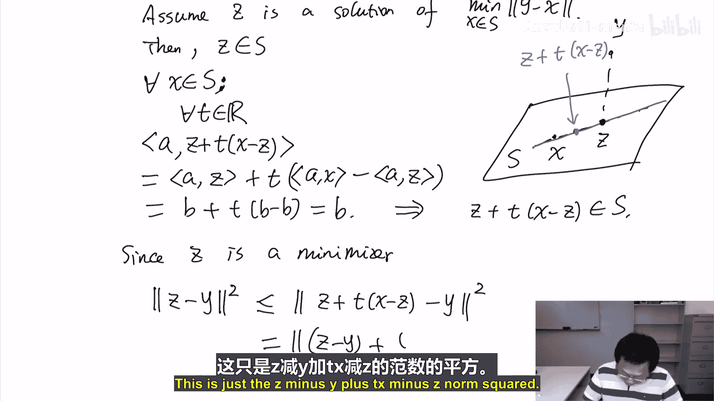

对于任何 **t ∈ R**，我们考虑这条红线上的一点。首先，我们证明整条红线都在 **S** 上。为此，计算 **A** 与该点的内积：
**A (z + t(x - z)) = A z + t (A x - A z) = B + t(B - B) = B**
因此，**z + t(x - z) ∈ S**。这很直观，因为 **S** 是一个平面（平坦集），如果一条直线上的两点在集合内，那么整条直线都在集合内。

接着，我们利用 **z** 是最小化解这一事实。**z** 到 **y** 的距离是 **S** 上最小的。因此，对于任何 **t**，有：
**||y - z||² ≤ ||y - (z + t(x - z))||²**
因为 **z** 和 **z + t(x - z)** 都在 **S** 上，而 **z** 是 **S** 上离 **y** 最近的点。

对不等式右边进行展开和整理：
**||y - z||² ≤ || (y - z) - t(x - z) ||² = ||y - z||² - 2t < y - z, x - z > + t² ||x - z||²**
两边消去 **||y - z||²**，得到：
**0 ≤ -2t < y - z, x - z > + t² ||x - z||²**
即：
**2t < y - z, x - z > ≤ t² ||x - z||²**

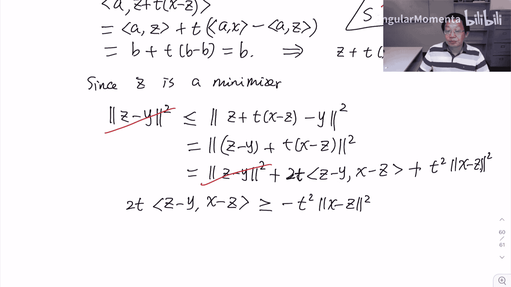

现在，我们利用 **t** 的符号进行分析。

如果 **t > 0**，将不等式两边同时除以 **2t**（正数，不等号方向不变）：
**< y - z, x - z > ≤ (t/2) ||x - z||²**
令 **t → 0⁺**，取极限，右边趋于 0，得到：
**< y - z, x - z > ≤ 0**

如果 **t < 0**，将不等式两边同时除以 **2t**（负数，不等号方向反转）：
**< y - z, x - z > ≥ (t/2) ||x - z||²**
令 **t → 0⁻**，取极限，右边趋于 0，得到：
**< y - z, x - z > ≥ 0**

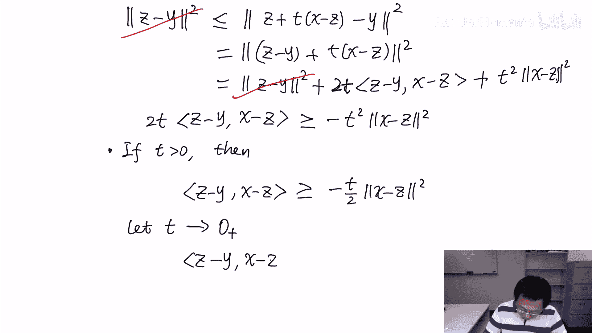

结合以上两种情况，内积 **< y - z, x - z >** 必须同时满足小于等于0和大于等于0，因此：
**< y - z, x - z > = 0**
至此，我们证明了如果 **z** 是最小化解，则 **z ∈ S** 且对于任何 **x ∈ S**，有 **< y - z, x - z > = 0**。

## 定理证明（必要性）

现在证明反向，即从“底部到顶部”：如果 **z ∈ S** 且对于任何 **x ∈ S**，有 **< y - z, x - z > = 0**，我们要证明 **z** 是最小化解。

对于任何 **x ∈ S**，考虑 **y - x** 的范数平方：
**||y - x||² = || (y - z) + (z - x) ||²**
由于 **z - x = -(x - z)**，且根据条件 **< y - z, x - z > = 0**，可知 **y - z** 与 **z - x** 也正交（内积为0）。

根据勾股定理（在希尔伯特空间中，正交向量的范数平方和等于和的范数平方），有：
**||y - x||² = ||y - z||² + ||z - x||²**
因为 **||z - x||² ≥ 0**，所以对于所有 **x ∈ S**：
**||y - x||² ≥ ||y - z||²**
并且当 **x = z** 时取等号。因此，**z** 确实是 **S** 上距离 **y** 最近的点，即 **z** 是投影 **P_S(y)**。证明完成。

## 总结

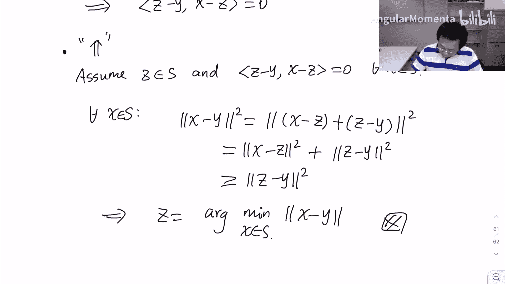

本节课中，我们一起学习了点到超平面投影的核心概念。我们首先定义了超平面及其投影，然后介绍并证明了一个关键定理：一个点是投影解当且仅当它在超平面上且与超平面上任意其他点的连线均与被投影点与该点的连线正交。这个定理为我们后续推导投影的具体计算公式奠定了理论基础。在下一节中，我们将利用本节的结论，最终导出投影 **P_S(y)** 的闭式表达式。