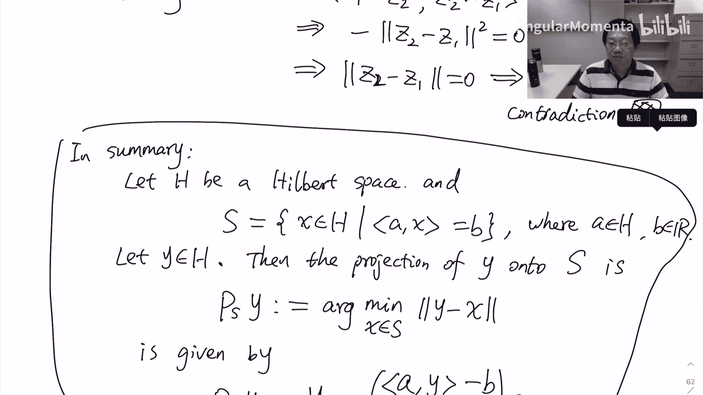

# 049：超平面上的投影公式推导 🧮

在本节课中，我们将学习如何推导向量在超平面上的投影公式。我们将从投影的必要充分条件出发，证明解的存在性与唯一性，并最终得到一个简洁的闭式解。

上一节我们介绍了投影到子空间上的必要充分条件。本节中，我们将把这个条件应用到由线性方程定义的超平面上，并推导出具体的投影公式。

## 问题定义与必要充分条件

设 `H` 是一个希尔伯特空间。`S` 是一个由方程 `A·X = B` 定义的超平面，其中 `A` 是 `H` 中的一个非零向量，`B` 是一个实数。给定一个向量 `Y`（不一定在 `S` 上），我们希望找到 `Y` 在 `S` 上的投影 `Z`，即 `S` 中距离 `Y` 最近的点。

投影 `Z` 的必要充分条件是：对于 `S` 中所有的 `X`，向量 `(Y - Z)` 与 `(X - Z)` 正交。用公式表示为：
`<Y - Z, X - Z> = 0`， 对所有 `X ∈ S` 成立。

然而，仅凭这个条件，我们尚不知道解是否存在或是否唯一。

## 主要定理与证明

现在，我们提出并证明一个定理：上述最小化问题的解存在且唯一，并由以下显式公式给出：

**定理公式：**
`Z = Y - ( (A·Y - B) / ||A||² ) * A`

以下是证明过程，分为存在性和唯一性两部分。

### 第一部分：存在性证明

我们首先验证按上述公式构造的 `Z` 满足投影的两个条件。

1.  **验证 Z 在超平面 S 上：**
    计算 `A` 与 `Z` 的内积：
    `A·Z = A·Y - ( (A·Y - B) / ||A||² ) * (A·A)`
    由于 `A·A = ||A||²`，上式简化为：
    `A·Z = A·Y - (A·Y - B) = B`
    因此，`Z` 满足方程 `A·X = B`，确在超平面 `S` 上。

2.  **验证正交条件：**
    对于任意 `X ∈ S`，我们需要验证 `<Y - Z, X - Z> = 0`。
    根据公式，`Y - Z = ( (A·Y - B) / ||A||² ) * A`。
    计算内积：
    `<Y - Z, X - Z> = ( (A·Y - B) / ||A||² ) * <A, X - Z>`
    由于 `X` 和 `Z` 都在 `S` 上，有 `A·X = B` 且 `A·Z = B`。因此 `A·(X - Z) = 0`。
    所以，`<Y - Z, X - Z> = 0`，正交条件满足。

由于构造的 `Z` 同时满足“在 `S` 上”和“正交条件”，根据投影的充要条件，`Z` 确实是 `Y` 在 `S` 上的投影。这证明了**解的存在性**。

### 第二部分：唯一性证明

我们使用反证法来证明投影是唯一的。

1.  假设存在两个不同的解 `Z1` 和 `Z2`，它们都是 `Y` 在 `S` 上的投影。
2.  因为 `Z1` 是解，根据充要条件，对于所有 `X ∈ S`，有 `<Y - Z1, X - Z1> = 0`。特别地，取 `X = Z2`（因为 `Z2 ∈ S`），得到：
    `<Y - Z1, Z2 - Z1> = 0`。 **(1)**
3.  同理，因为 `Z2` 是解，取 `X = Z1`，得到：
    `<Y - Z2, Z1 - Z2> = 0`。 **(2)**
4.  将等式 **(2)** 两边同时乘以 `-1`，可得：
    `<Z2 - Y, Z2 - Z1> = 0`。 **(2‘)**
5.  将等式 **(1)** 和 **(2‘)** 相加：
    `<Y - Z1, Z2 - Z1> + <Z2 - Y, Z2 - Z1> = 0`
    根据内积的线性性质，合并同类项：
    `< (Y - Z1) + (Z2 - Y), Z2 - Z1> = <Z2 - Z1, Z2 - Z1> = 0`
    即 `||Z2 - Z1||² = 0`。
6.  这意味着 `Z2 - Z1` 的范数为零，所以 `Z2 = Z1`，与最初的假设“两个不同的解”矛盾。

因此，假设不成立，投影解是**唯一的**。

## 总结与应用

综合以上证明，我们得到关于超平面投影的完整结论：

**投影公式总结：**
设 `H` 为希尔伯特空间，`S = {X ∈ H | A·X = B}` 为一个超平面，`Y ∈ H`。则 `Y` 在 `S` 上的投影 `P_S(Y)` 存在且唯一，并由以下闭式给出：
`P_S(Y) = Y - [ (A·Y - B) / ||A||² ] * A`

以下是该公式的核心要点：
*   **输入**：定义超平面的向量 `A` 和标量 `B`，以及待投影的向量 `Y`。
*   **输出**：`S` 上距离 `Y` 最近的那个**唯一**的点。
*   **几何解释**：投影操作相当于从 `Y` 中减去其在 `A` 方向上的一个分量，该分量的大小恰好使得结果落在超平面 `S` 上。

本节课中我们一起学习了线性函数的一个重要应用：推导超平面上的投影公式。我们首先回顾了投影的充要条件，然后通过构造和反证法，严格证明了公式解的存在性与唯一性。这个简洁的公式是许多优化算法（如支持向量机、最小二乘法）的基石。线性函数因其连续性、齐次性和可加性，在希尔伯特空间中表现出优美的性质，如里斯表示定理和这里推导出的投影公式。