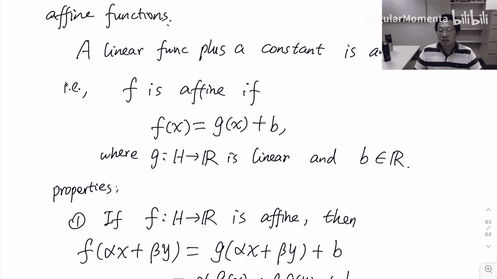

**数据分析的数学方法：10-08-02：仿射函数** 🧮

在本节中，我们将学习线性函数的一个自然扩展——仿射函数。我们将了解其定义、核心性质，并探讨它与线性函数的区别与联系。

---

上一节我们介绍了线性函数，本节中我们来看看仿射函数。仿射函数由一个线性函数加上一个常数项构成。具体来说，如果函数 **F** 满足以下形式，则称其为仿射函数：

**F(x) = G(x) + b**

其中，**G** 是一个线性函数，而 **b** 是一个实数（常数项）。仿射函数的行为与线性函数非常相似。

---

### 仿射函数的性质

以下是仿射函数的两个关键性质。

**性质一：仿射函数与线性组合的可交换性**

考虑函数 **F** 作用于一个线性组合 **αx + βy**。由于 **F** 是仿射的，它可以表示为线性部分加常数：

**F(αx + βy) = G(αx + βy) + b**

因为 **G** 是线性的，所以有：

**G(αx + βy) = αG(x) + βG(y)**

因此：

**F(αx + βy) = αG(x) + βG(y) + b**

为了使这个线性组合与函数 **F** 的运算“可交换”，即希望结果能表示为 **αF(x) + βF(y)**，我们需要对常数项 **b** 进行拆分。仅当系数满足 **α + β = 1** 时，我们可以将 **b** 拆分为 **αb + βb**，从而得到：

**F(αx + βy) = α(G(x) + b) + β(G(y) + b) = αF(x) + βF(y)**

这与线性函数不同。对于线性函数，任何系数 **α** 和 **β** 下，函数与线性组合都是可交换的。而对于仿射函数，只有当系数之和为 **1** 时，这种可交换性才成立。

**性质二：希尔伯特空间中有界仿射函数的表示**

如果 **H** 是一个希尔伯特空间，并且 **F** 是一个有界的仿射函数，那么根据里斯表示定理，其线性部分可以表示为内积形式。因此，整个仿射函数可以写作：

**F(x) = ⟨a, x⟩ + b**

其中，**a ∈ H**，**b ∈ R**。这里，线性部分由内积 **⟨a, x⟩** 表示，常数部分是 **b**。

由此可见，仿射函数与线性函数的唯一区别就在于这个常数项 **b**。在线性函数中，**b = 0**；而在仿射函数中，**b** 可以是任意实数。

---

### 仿射函数的意义与应用

这个常数项 **b** 在机器学习模型中非常重要，通常被称为**偏置项**。由于仿射函数与线性函数的区别非常细微，在实践中，我们常常不严格区分两者，并习惯性地将仿射函数也统称为线性函数。

---

本节课中，我们一起学习了仿射函数。我们明确了它的定义 **F(x) = G(x) + b**，探讨了它与线性组合交换时需要满足 **α + β = 1** 的条件，并了解了在希尔伯特空间中有界仿射函数的内积表示形式 **F(x) = ⟨a, x⟩ + b**。最后，我们认识到常数偏置项 **b** 的实际重要性，以及在许多语境下仿射函数被简称为线性函数的惯例。