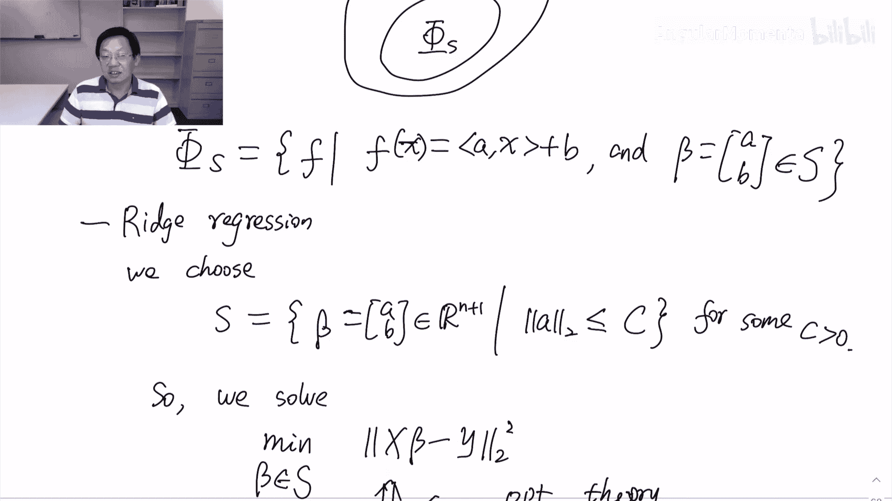

# 052：线性回归与岭回归 🧮

在本节课中，我们将要学习线性回归中的最小二乘问题，并探讨当训练数据量小于数据维度时，如何通过引入**正则化**来获得唯一解。我们将重点介绍**岭回归**，并解释其核心组成部分：数据拟合项和正则化项。

---

上一节我们介绍了标准线性回归的最小二乘问题。本节中我们来看看该问题在什么条件下有唯一解。

为了最小二乘问题有唯一解，必须确保方程的数量大于或等于未知数的数量。具体来说，对于线性回归，我们需要满足：

**N ≥ n + 1**

其中，**N** 是数据点的数量，**n** 是输入数据 **X** 的维度（特征数量），加1是因为包含了偏置项 **b**。这是一个必要条件。

然而，这个条件在实践中并不总是成立。

---

在实践中，训练数据的数量可能远小于数据的维度。让我们看一个图像识别的简单例子。

在图像识别任务中，输入 **X_i** 是图像，输出 **Y_i** 是图像的标签。对于高分辨率图像，像素数量可以达到数百万（例如1000万像素）。这意味着输入 **X** 的维度 **n** 在千万量级。

但是，数据集中图像的数量 **N**，即使是像ImageNet这样的大型数据集，最多也只有约100万张。因此，在这种情况下，**N** 远小于 **n**。

这意味着可用的训练数据集数量远小于输入的维度，因此上述唯一解的必要条件无法满足，线性回归中的最小二乘问题将没有唯一解。

---

这说明了线性回归中所有仿射函数的集合仍然太大。我们需要**缩小这个函数集的大小**。

为此，我们采用相同的**正则化**思想。这意味着我们使用仿射函数的一个子集来进行回归任务。我们称这个子集为 **F_S**。

具体来说，我们定义 **F_S** 为：

**F_S = { f | f(x) = a·x + b, 且 [a, b] ∈ S }**

其中，**S** 是 **R^(n+1)** 空间（即所有系数 **a** 和偏置 **b** 组成的空间）的一个子集。下标 **S** 表示 **a** 和 **b** 来自 **R^(n+1)** 的子集 **S**。

---

那么，如果我们从这个子集中选择函数，会得到什么结果呢？在正则化中，我们选择 **S** 为：

**S = { β = [a; b] ∈ R^(n+1) | ||a||₂ ≤ C }**

对于某个常数 **C > 0**。

因此，我们需要解决以下约束最小化问题：
**minimize (Xβ - y)ᵀ(Xβ - y)**
**subject to ||a||₂ ≤ C**

如果没有约束，**β** 可以在整个 **R^(n+1)** 空间中选择，这就是标准的最小二乘（线性回归）。现在，由于我们对 **β** 有约束，即系数向量 **a** 的L2范数必须小于等于 **C**，我们就不能在整个空间中选择 **β**，而只能从集合 **S** 中选择。这样，我们的函数 **f(x) = a·x + b** 中的 **a** 和 **b** 就来自这个受约束的集合。

---

根据优化理论，这个约束优化问题等价于以下无约束优化问题：

**minimize (Xβ - y)ᵀ(Xβ - y) + λ ||a||₂²**

其中 **β = [a; b] ∈ R^(n+1)**，**λ** 是一个常数。

这个常数 **λ** 依赖于之前定义的约束常数 **C**，也依赖于问题本身的其他因素。这个无约束优化问题的解被称为**岭回归**的解。

所以，在岭回归中，我们不是从所有仿射函数中寻找函数，而是从一个子集中寻找，即要求向量 **a** 的L2范数小于等于 **C**。这就得到了一个约束最小二乘问题，而根据优化理论，它等价于上面那个带有额外项的无约束问题。

---

让我们聚焦于岭回归中的优化问题。可以看到，公式中有两部分：

1.  **(Xβ - y)ᵀ(Xβ - y)**：我们称之为**数据拟合项**。因为它与标准线性回归中的项相同，目的是使预测值 **f(X_i)** 接近真实值 **Y_i**，用于拟合给定的数据 **(X, Y)**。
2.  **λ ||a||₂²**：我们称之为**正则化项**。这个项只作用于系数 **β**（即 **a** 和 **b**），或者说只作用于函数 **f** 本身，不涉及训练数据。这个项的目的是使我们的 **a** 和 **b** 变得“规则”。

更准确地说，它的作用是迫使系数 **β** 属于我们想要的子集 **S**，或者等价地，迫使函数 **f(x) = a·x + b** 属于函数类 **F_S**，而不是整个仿射函数空间。因此，这个项的作用是使回归中的函数变得“规则”。在这个语境下，我们说一个函数是“规则”的，仅仅意味着它在我们期望的、对回归任务有益的特定子集 **F_S** 中。

---

参数 **λ** 在这里是一个常数，其作用类似于之前定义集合 **S** 时用的常数 **C**。它被称为**正则化参数**，用于定义函数 **f** 的“规则”程度。

以下是 **λ** 大小的影响：

*   **如果 λ 较大**：那么正则化项 **λ ||a||₂²** 在目标函数中占主导地位。在最小化解处，**||a||₂²** 会相对较小，这意味着对应的 **C** 值较小，因此函数子集 **F_S** 较小。同时，数据拟合项的影响相对较弱，所以对数据的拟合会比较“宽松”。
*   **如果 λ 较小**：那么数据拟合项占主导。我们可能会得到一个较大的 **||a||₂²**，这意味着对应的 **C** 值较大，因此函数子集 **F_S** 较大。同时，模型会更好地拟合数据。

在岭回归中，我们通过选择 **S** 为那些具有较小L2范数的向量 **a** 所对应的函数集合，来引入正则化。

---

本节课中我们一起学习了线性回归最小二乘解的唯一性条件，以及当数据量不足时面临的挑战。我们引入了**正则化**的概念，通过限制模型参数的大小（具体是系数向量 **a** 的L2范数）来缩小假设空间，从而得到唯一且更稳定的解。这种具体使用L2范数平方作为惩罚项的方法就是**岭回归**。我们分析了其目标函数中的**数据拟合项**和**正则化项**，并解释了正则化参数 **λ** 如何控制模型的复杂度和拟合程度。