# 053：从岭回归到Lasso回归 📈

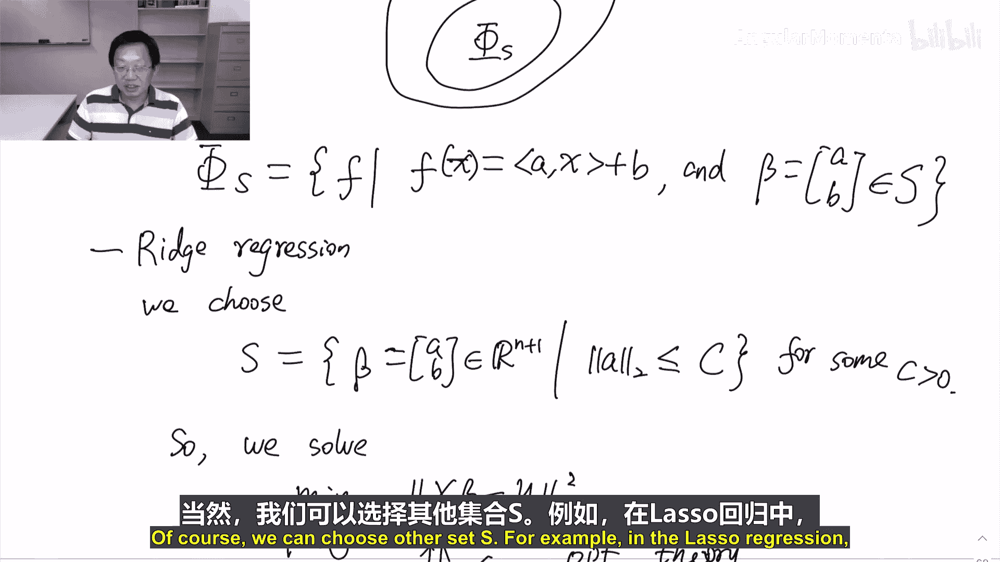

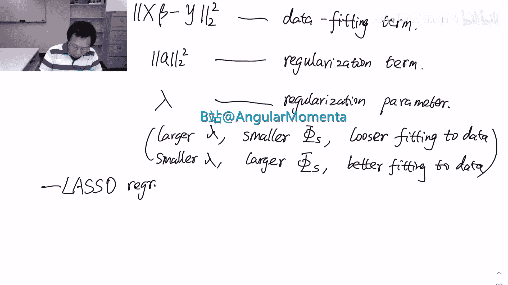

在本节课中，我们将要学习两种重要的线性回归正则化方法：岭回归和Lasso回归。我们将探讨它们如何通过约束模型参数来防止过拟合，并重点理解Lasso回归如何产生稀疏解，从而提升模型的可解释性。

上一节我们介绍了通过约束参数集合 `S` 来寻找函数 `f` 的基本思想。本节中我们来看看如何选择不同的集合 `S` 来得到不同的回归模型。

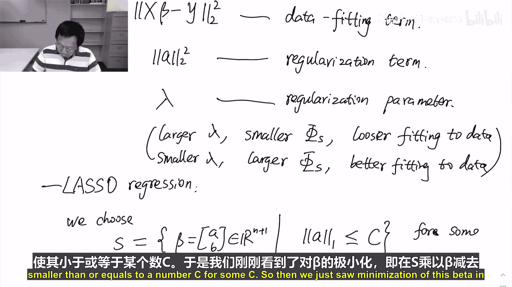

当然，我们可以选择其他集合作为 `S`。

例如，在Lasso回归中，我们选择集合 `S` 为所有 `β` 在 `R^(N+1)` 中，但其 `L1` 范数小于或等于某个常数 `C` 的向量集合。

具体来说，我们限制向量 `β` 的 `L1` 范数小于等于一个数 `C`。

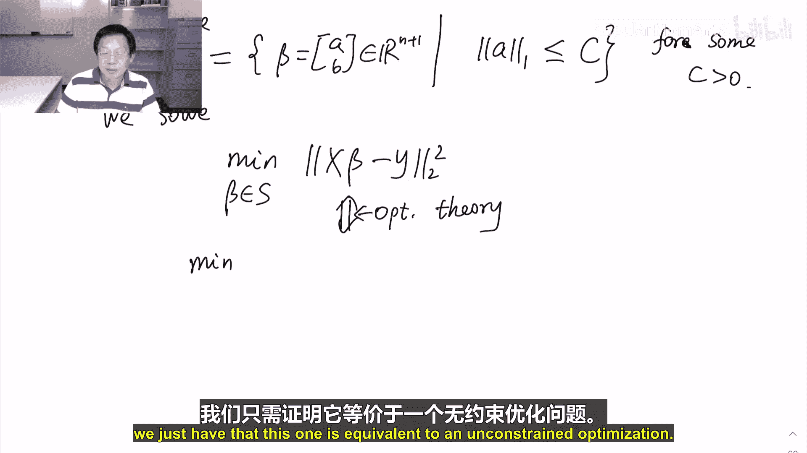

这样，我们就在集合 `S` 上最小化 `||Xβ - y||_2^2`。这同样是一个带约束的优化问题，约束条件是 `β ∈ S`，即 `β` 的 `L1` 范数小于 `C`。通过这种方式，我们在函数的一个子集上寻找最优函数。

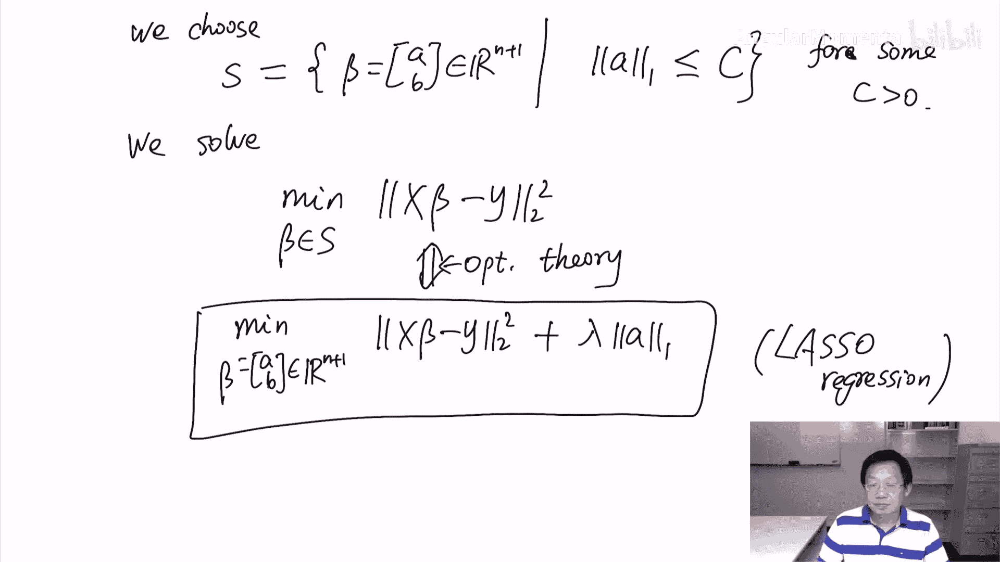

根据优化理论，这个带约束的优化问题等价于一个无约束的优化问题。

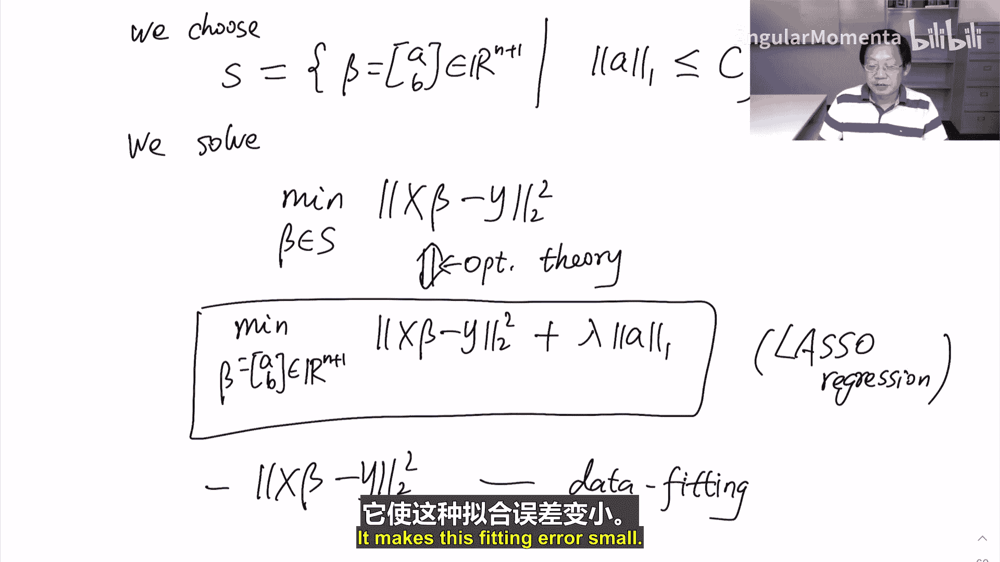

该无约束优化问题为：最小化 `||Xβ - y||_2^2 + λ||β||_1`。这正是Lasso回归模型。

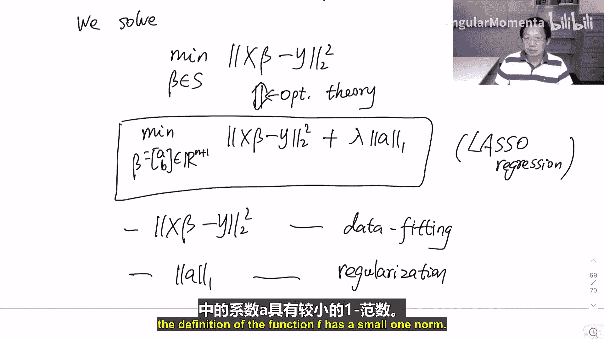

这里的 `λ` 是一个常数，其值依赖于原问题中的 `C` 以及优化问题的最优值。

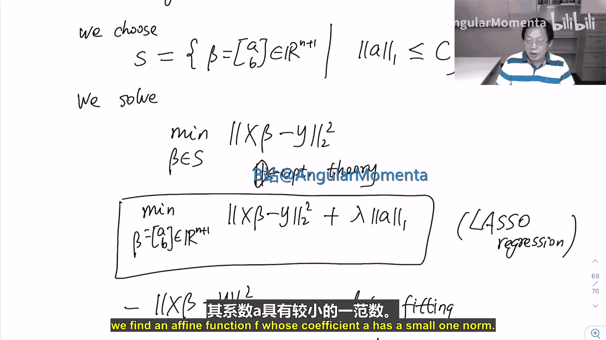

在这个无约束优化问题中，我们有两项。

*   第一项 `||Xβ - y||_2^2` 是**数据拟合项**。它用于使 `f(x_i)` 接近 `y_i`，确保拟合误差小。
*   第二项 `||β||_1` 是**正则化项**。它用于使函数 `f` 更“规则”，等价于使系数 `β` 具有较小的 `L1` 范数。

因为在这个模型中，我们希望找到的函数 `f` 其系数 `β` 具有较小的 `L1` 范数。正则化项正是为了确保 `β` 具有较小的 `L1` 范数，因此它被称为正则化。这项只作用于函数本身，与训练数据 `X` 和 `y` 无关。

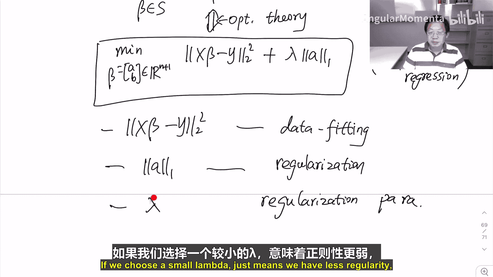

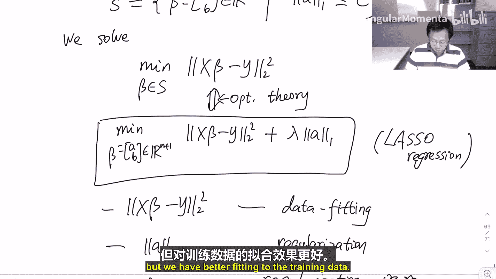

参数 `λ` 是**正则化参数**。较大的 `λ` 意味着对 `β` 的 `L1` 范数约束更强，模型更规则，但可能对数据的拟合程度变差。如果选择较小的 `λ`，则意味着正则化较弱，但对训练数据的拟合会更好。

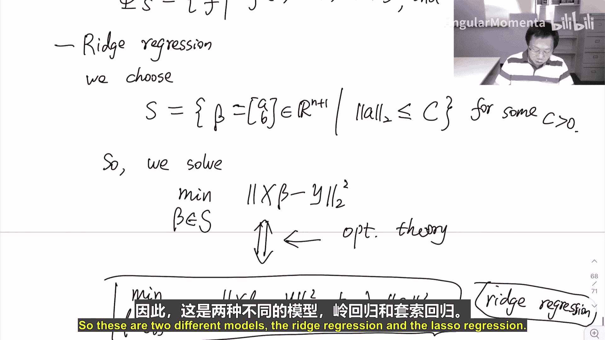

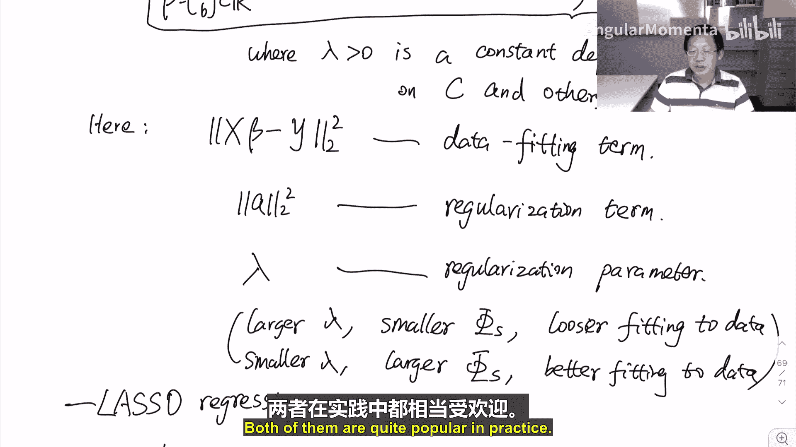

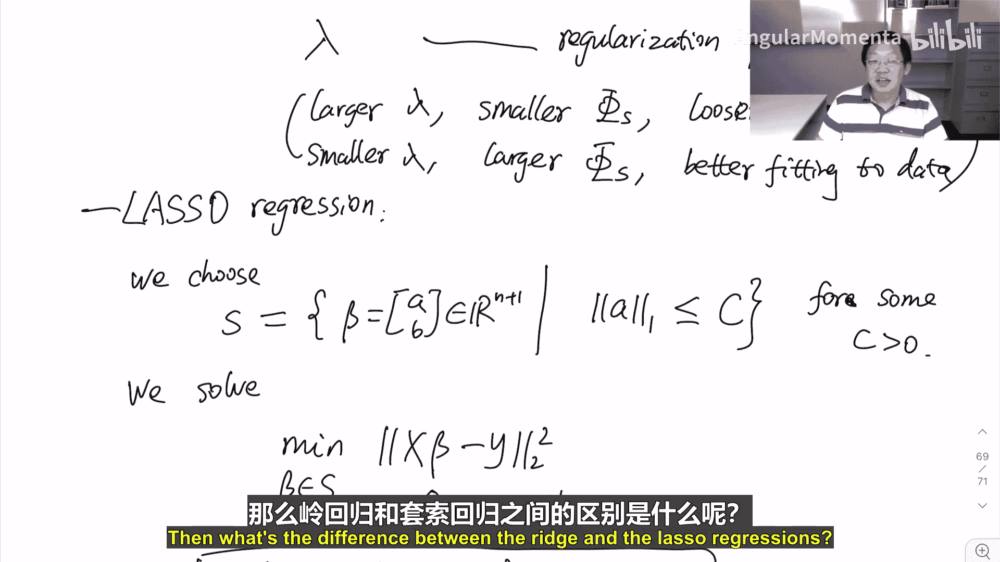

岭回归和Lasso回归是两种不同的模型，在实践中都非常流行。

那么岭回归和Lasso回归之间有什么区别呢？

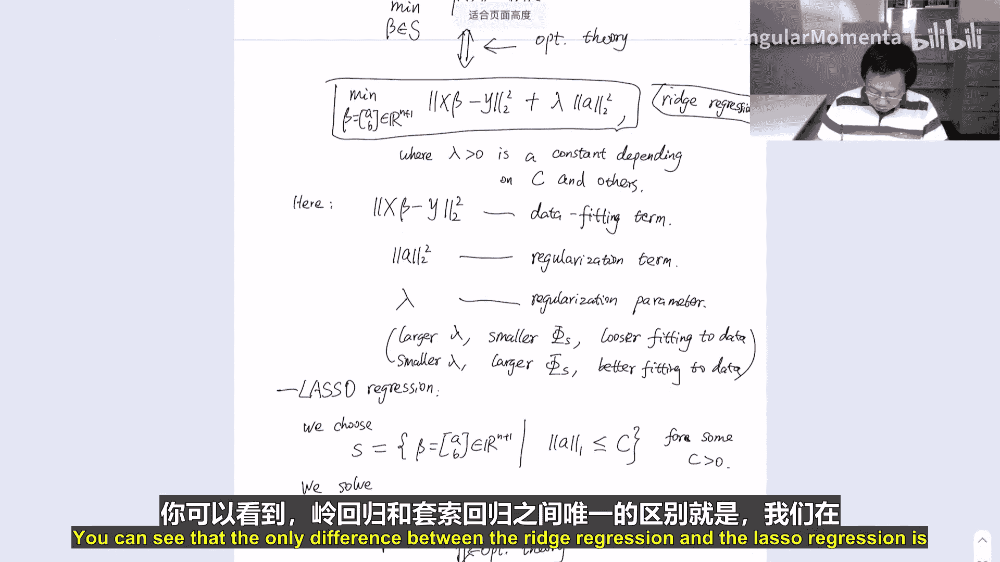

你可以看到，岭回归和Lasso回归之间唯一的区别在于我们使用了不同的范数。

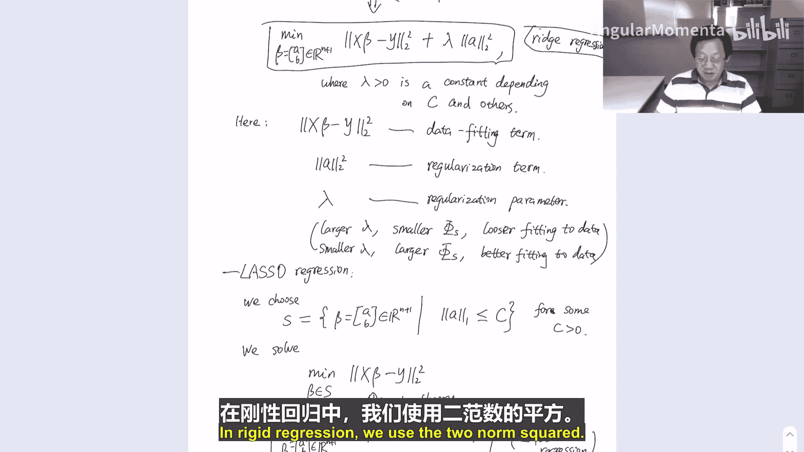

在岭回归中，我们使用 `L2` 范数的平方作为正则化项。在Lasso回归中，我们使用 `L1` 范数。这类似于K均值聚类中使用 `L2` 范数距离，而K中心点聚类中使用 `L1` 范数距离。

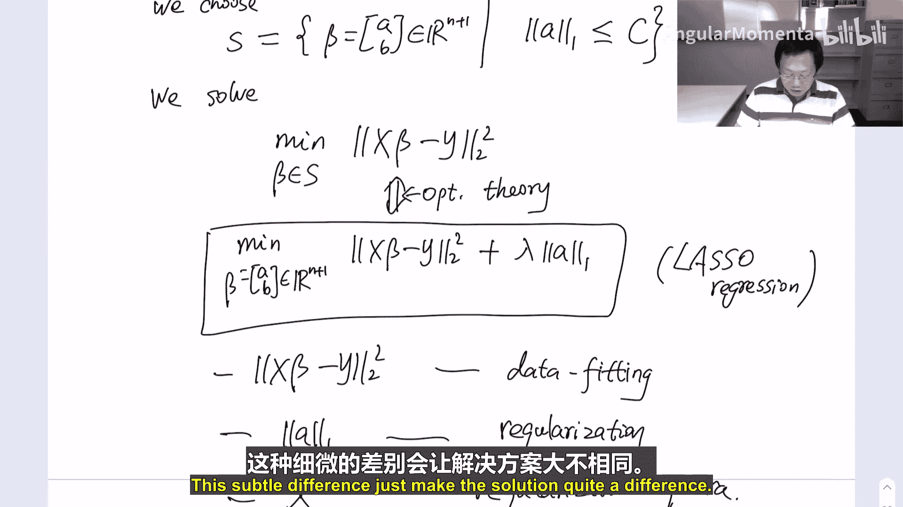

这个细微的差异通常会使解的性质产生很大不同。

Lasso回归会给出一个**稀疏解**。这意味着解向量 `β` 是稀疏的，这是由 `L1` 范数正则化导致的。而岭回归给出的解 `β` 通常不是稀疏的。

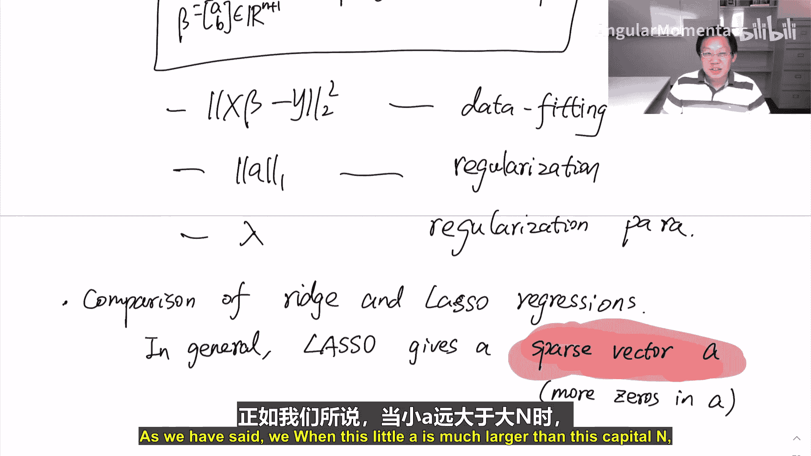

稀疏的 `β` 意味着其中有很多零元素。`β` 包含 `n` 个分量。如前所述，当 `n` 远大于样本数 `N` 时，我们需要使用正则化。因此这里的 `n` 可能非常大。

在这个非常大的向量中，由Lasso回归产生的结果里，许多分量都是0。

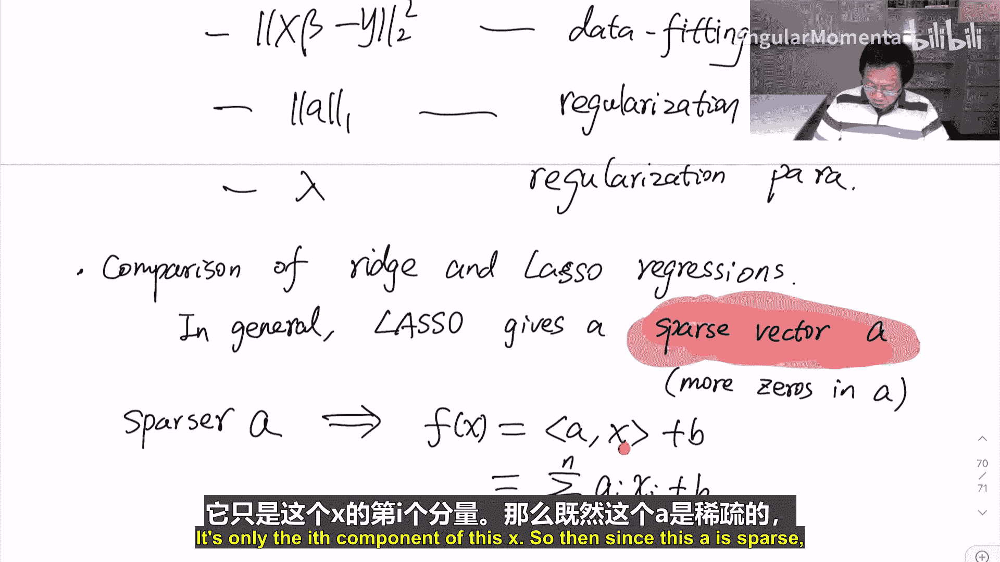

稀疏的 `β` 有什么优势呢？实际上，稀疏的 `β` 意味着线性函数 `f(x) = β^T x + b = Σ_{i=1}^n β_i x_i + b`。

由于 `β` 是稀疏的，这意味着在这个求和中，许多 `β_i` 是0。因此，求和实际上只对 `β` 的支撑集（即非零分量的下标集合）中的 `i` 进行：`Σ_{i ∈ supp(β)} β_i x_i + b`。只有那些非零的 `β_i` 才会对这个求和有贡献。

从这里可以看出，只有那些下标 `i` 在 `β` 的支撑集中的特征 `x_i` 会参与到 `f(x)` 的计算中。因此，只有这些特征对预测有贡献。

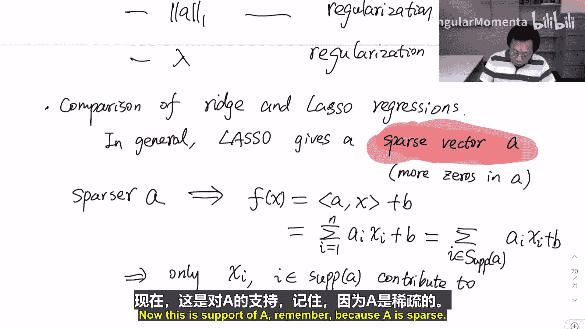

由于 `β` 是稀疏的，其支撑集 `supp(β)` 的大小（即非零元素的数量）通常远小于特征总数 `n`。

这意味着只有 `x` 的很少几个分量对预测做出贡献。

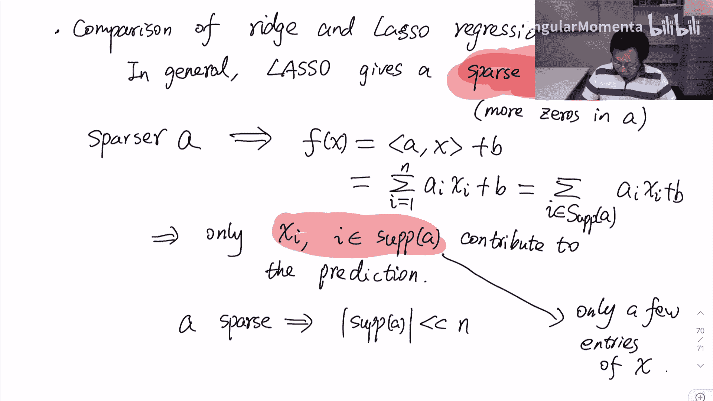

人们喜欢这个特性，因为参与预测的变量更少，会使预测结果更具**可解释性**。由于只有很少的特征参与预测，这个线性模型更容易解释。我们只需要关注那些在预测中起作用的特征，这有可能帮助我们理解线性预测背后的机制。

---

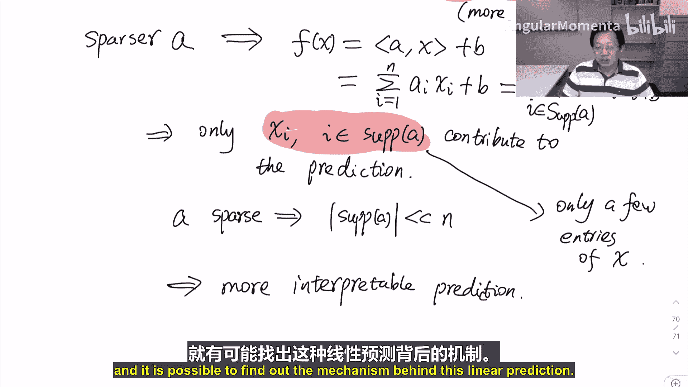

本节课中我们一起学习了岭回归与Lasso回归的核心思想。我们了解到，两者都是通过添加正则化项来约束模型参数，从而控制模型复杂度并防止过拟合。关键区别在于，岭回归使用 `L2` 范数平方作为正则项，而Lasso回归使用 `L1` 范数。正是 `L1` 正则化的性质使得Lasso回归能够产生稀疏的参数解，即许多系数为零。这种稀疏性带来了显著优势：它实现了特征选择，只有少数关键特征参与最终预测，从而大大增强了模型的可解释性，有助于我们理解数据中变量之间的本质关系。