# 054：核岭回归 🧮

在本节课中，我们将学习如何利用核方法来改进线性回归模型，从而处理非线性关系。我们将看到，通过将数据映射到一个高维特征空间，并在该空间中进行线性回归，我们可以构建出更强大、更灵活的预测模型。

上一节我们介绍了线性回归模型及其局限性。本节中我们来看看如何利用核方法对其进行扩展。

## 线性模型的局限性

我们已学习过线性回归模型，但线性回归存在一些局限。

人们有时仅使用线性模型进行预测。例如，如果某只股票价格在过去几天上涨，我们可能认为股价趋势向上。因此，我们会预测未来几天股价将继续上涨。这里，我们仅使用了一个线性模型进行预测。

然而，我们绝不会认为股价会永远上涨。因为我们知道那是不可能的。

这只是线性模型的一个局限性。为了改进线性模型，我们使用核方法来获得一些非线性模型。

## 核岭回归的核心思想

我们将使用核方法来改进岭回归，以改进线性模型。

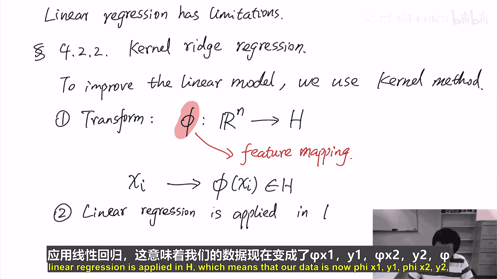

其思想与从Cams到核Kmeans的方法相同。我们只是将数据转换到一个希尔伯特空间，然后在转换后的域中应用线性方法。

以下是实现步骤：

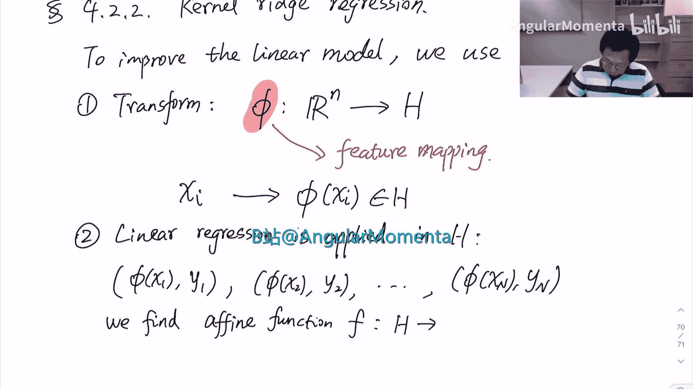

第一步是进行转换。我们应用一个变换函数 φ，将输入数据从 R^N 映射到一个希尔伯特空间 H。

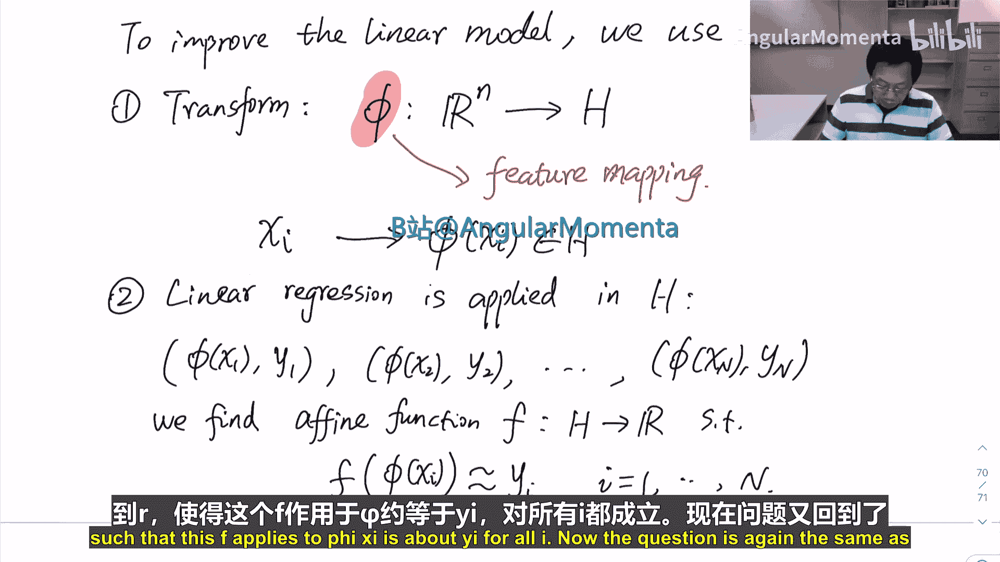

这里，这个 φ 有时被称为**特征映射**。因为我们认为 H 空间中的向量是 R 空间中向量的特征。

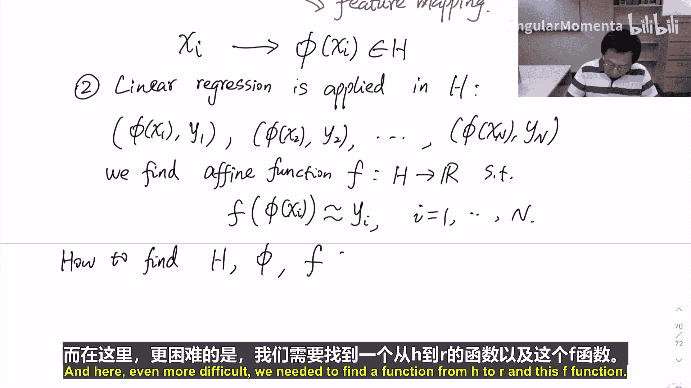

具体来说，给定数据点 x_i，它将被映射为 H 空间中的 φ(x_i)。

第二步是应用线性回归。我们在 H 空间中应用线性回归。

这意味着我们的数据现在变成了 (φ(x_1), y_1), (φ(x_2), y_2), ..., (φ(x_N), y_N)。

然后我们寻找一个函数 F，该函数从 H 映射到 R。

使得 F 作用于 φ(x_i) 的结果近似等于 y_i，对于所有 i 都成立。

现在，问题与开发核Kmeans算法时相同：如何找到这个 H 和 φ？这里甚至更困难，因为我们需要找到一个从 H 到 R 的函数 F。

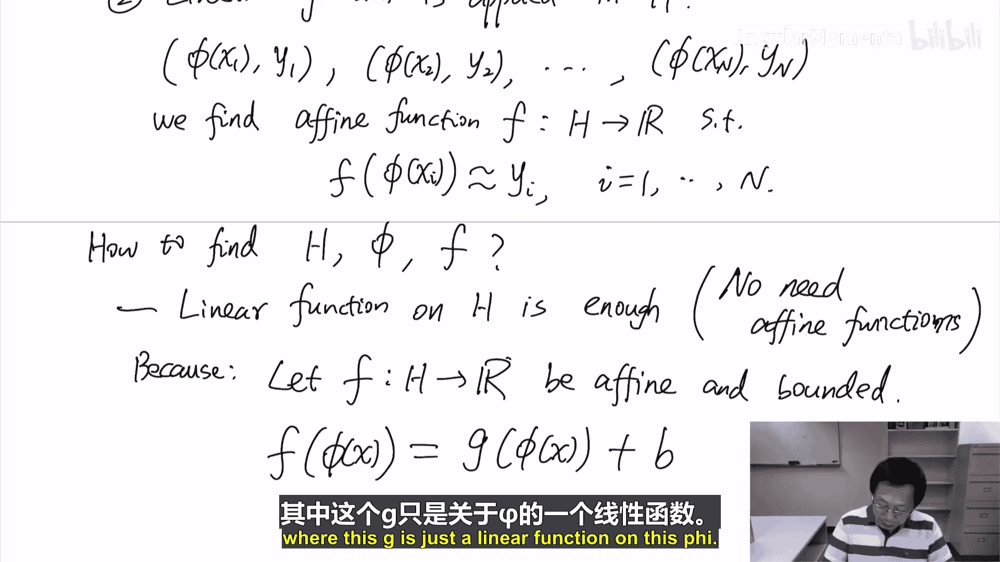

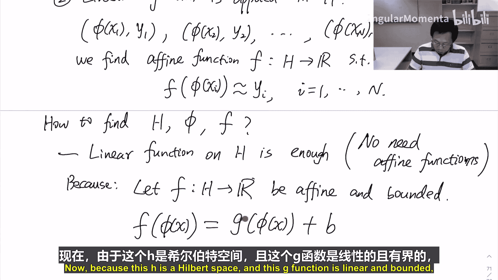

## 简化问题：为何线性函数足够

首先，我们知道我们是在希尔伯特空间 H 上寻找一个仿射函数。

第一个要点是，我们可以将这个仿射函数类简化为线性函数类，以使问题稍微容易一些。这就是为什么线性函数是足够的。

这意味着我们不需要为寻找仿射函数而烦恼。推理如下：

如果我们确实需要一个仿射函数，假设这个函数是 F。令 F 从 H 映射到 R，是仿射且有界的。我们当然希望函数有界，因为我们不想将向量映射到无穷大。

那么，这个函数在变换后的域中是仿射的。所以 F(φ(x)) 必须是 G(φ(x)) + b，其中 G 是 φ 上的一个线性函数。

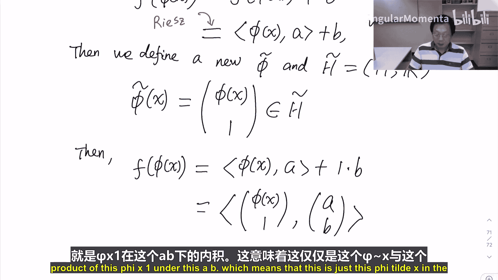

现在，因为 H 是一个希尔伯特空间，且函数 G 是线性且有界的，那么根据**里斯表示定理**，我们知道这个函数必须是 φ(x) 与某个向量 a 的内积，再加上 b，其中 a 属于 H，b 属于 R。

现在，我定义一个新的特征映射 φ̃ 和一个新的希尔伯特空间 H̃。H̃ 就是旧的 H 加上一个实数维度。所以 H̃ 的维度比 H 多一维，我们只是添加了一个额外的坐标——一个实数。

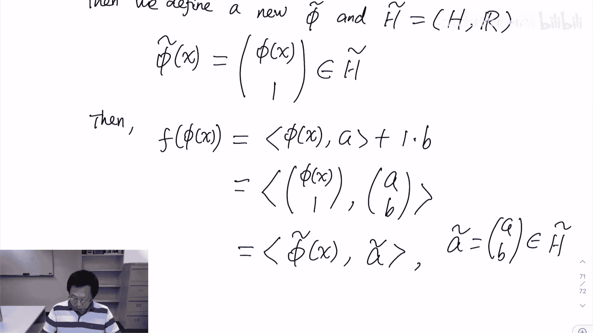

然后，我也定义这个 φ̃(x)。对于输入 x，φ̃(x) 就是原始的 φ(x) 加上一个数字 1。我只是在 φ(x) 向量上添加了一个数字。所以这肯定属于 H̃。

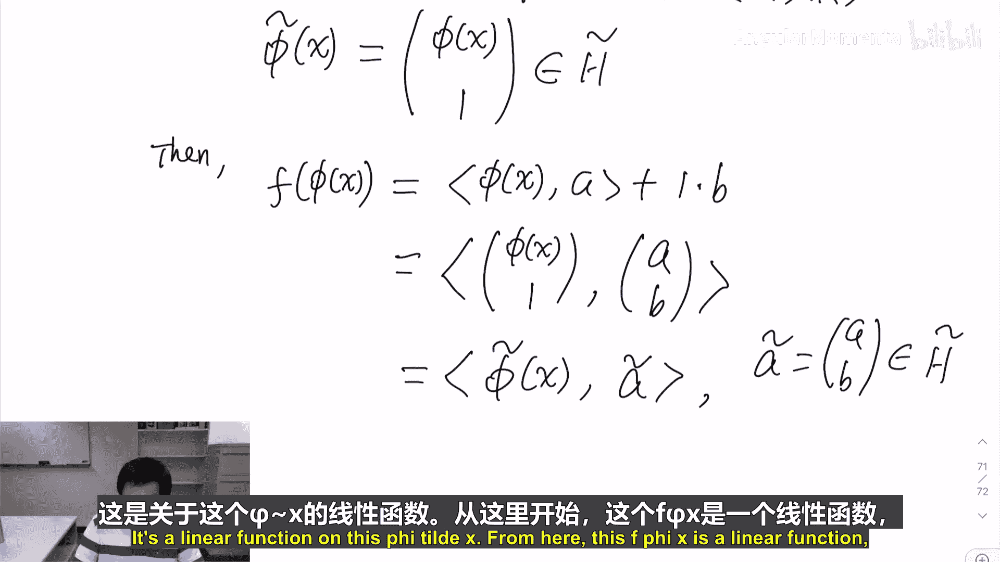

那么，你可以看到 F(φ(x)) 等于 φ(x) 与 a 的内积，再加上 1 乘以 b。这正好是 (φ(x), 1) 这个向量与 (a, b) 这个向量的内积。

这意味着 F(φ(x)) 就是 φ̃(x) 与向量 ã 的内积，其中 ã 就是 (a, b)，它属于 H̃，因为它是一个 H 中的向量和一个数字。

从这里可以看出，现在的 F(φ(x)) 是 H̃ 空间上的一个线性函数。它是 φ̃(x) 上的一个线性函数。

因此，如果确实需要仿射函数 F，我们只需重新定义一个特征映射和对应的希尔伯特空间 H̃，那么 H 上的这个仿射函数，就变成了 H̃ 上的一个线性函数。所以我们只需在 H̃ 上处理线性函数即可。

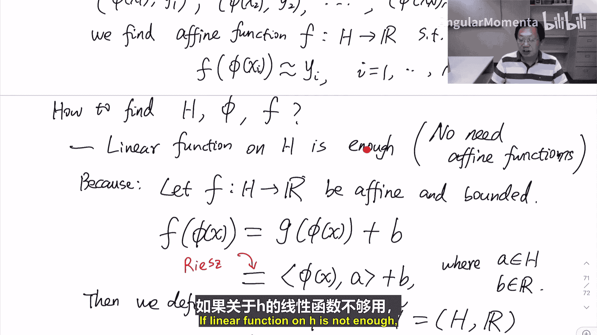

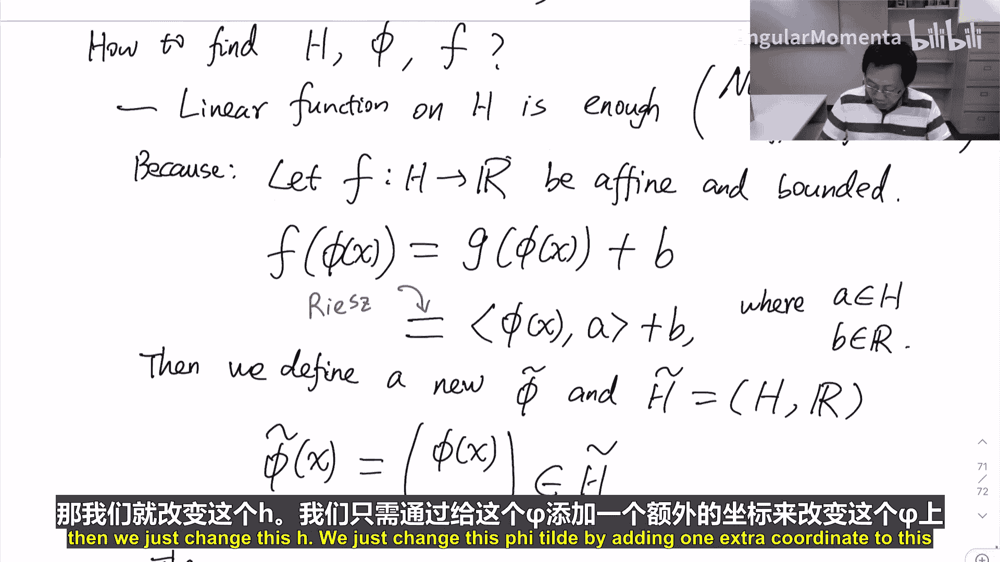

这就是为什么 H 上的线性函数就足够了。如果 H 上的线性函数不够，那么我们只需改变 H，通过给 φ 添加一个额外的坐标来得到 φ̃ 和 H̃。那么，在这个新空间上的函数 F，确实就是一个线性函数。

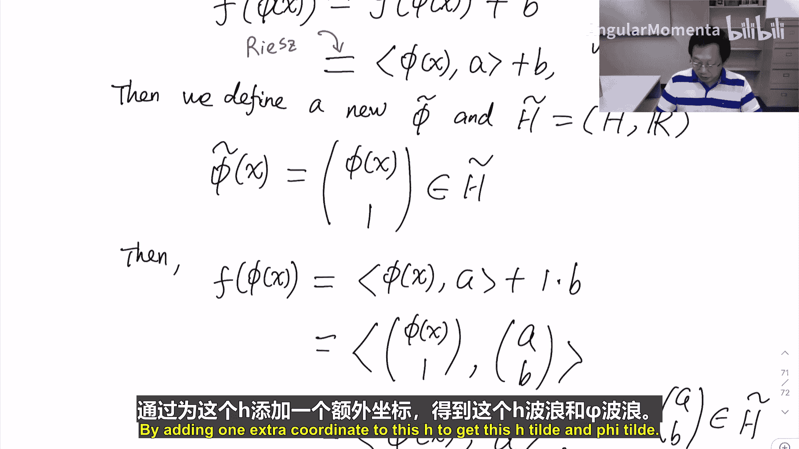

## 总结

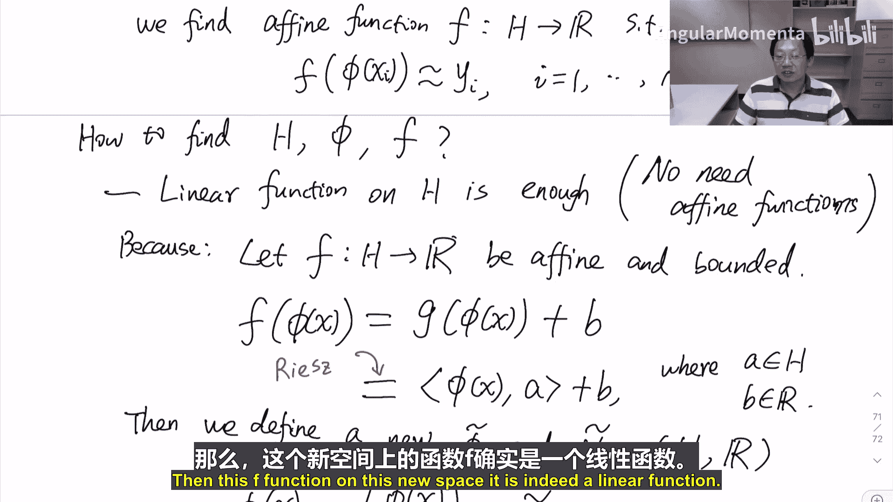

本节课中我们一起学习了核岭回归的基本原理。我们了解到，通过引入特征映射 φ 将数据从原始空间转换到高维希尔伯特空间 H，并在该空间中应用线性回归，可以克服单纯线性模型的局限性。关键在于，即使我们最终需要的是一个仿射函数，也可以通过扩展特征空间（添加常数维度）将其转化为新空间中的线性函数问题，从而利用核技巧高效求解，无需显式计算高维映射。这为处理复杂的非线性数据关系提供了强大的工具。