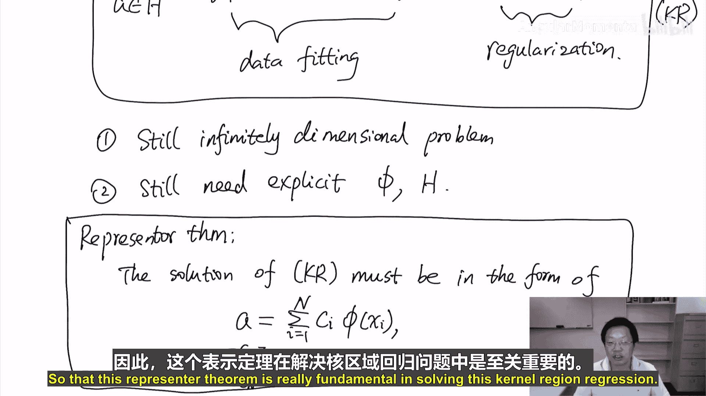

# 055：核岭回归与表示定理 🧠

在本节课中，我们将学习如何将线性回归问题推广到高维甚至无限维的特征空间，并解决由此带来的计算难题。我们将重点介绍核岭回归的优化问题，以及一个关键的数学工具——表示定理。这个定理能将无限维的优化问题转化为有限维的、可计算的形式。

上一节我们介绍了在特征空间 `H` 中寻找线性函数 `F` 来拟合数据。本节中我们来看看如何将这个想法具体化为一个可求解的优化问题。

## 从线性函数到向量表示

根据里斯表示定理，希尔伯特空间 `H` 上的任意线性有界泛函 `F` 都可以表示为与某个向量 `A` 的内积形式，即 `F(z) = <A, z>`。因此，寻找线性函数 `F` 等价于寻找向量 `A`。

于是，我们的回归问题在变换后的特征空间 `H` 中，就转化为寻找一个向量 `A`，使得对于所有数据点 `i`，满足：
`<A, φ(x_i)> ≈ y_i`

其中 `φ` 是将原始数据映射到 `H` 的特征映射。

## 最小二乘与维度灾难

与普通最小二乘法的思想类似，我们希望最小化所有数据点上的预测误差平方和。因此，我们定义目标函数为：
`min_{A ∈ H} Σ_{i=1}^{n} (<A, φ(x_i)> - y_i)^2`

然而，直接求解这个最小化问题通常是不可行的。因为特征空间 `H` 在大多数情况下（例如使用高斯核时）是无限维的。我们试图用有限的 `n` 个方程去求解一个无限维空间中的向量 `A`，这相当于用有限的信息去确定无限个未知数，问题是不适定的，没有唯一解。

## 引入正则化：核岭回归

为了解决这个维度灾难问题，我们需要对解空间进行约束，即引入正则化。类似于线性模型中的岭回归，我们在目标函数中加入对向量 `A` 本身大小的惩罚项。在 `H` 空间中，我们使用由该空间内积诱导的范数 `||·||_H`。

由此，我们得到**核岭回归**的优化问题：
`min_{A ∈ H} Σ_{i=1}^{n} (<A, φ(x_i)> - y_i)^2 + λ ||A||_H^2`

其中，第一项是数据拟合项，第二项是正则化项，`λ` 是控制正则化强度的超参数。

## 表示定理：化无限为有限

尽管定义了核岭回归，但上述优化问题仍面临两大实践挑战：
1.  **无限维问题**：`A` 位于无限维空间 `H`，无法用有限参数直接表示和计算。
2.  **显式映射依赖**：优化过程需要显式知道特征映射 `φ` 和空间 `H` 的内积定义。

此时，**表示定理**带来了关键突破。该定理指出，上述核岭回归优化问题的解 `A*` 必然具有以下形式：
`A* = Σ_{i=1}^{n} c_i · φ(x_i)`

其中，`c_i` 是一些标量系数。

以下是表示定理带来的两个核心好处：
*   **维度降低**：解被表示为已知数据点映射 `φ(x_i)` 的线性组合。因此，我们不再需要寻找无限维的 `A`，而只需寻找 `n` 个有限维的系数 `c = (c_1, ..., c_n)^T`。优化问题从无限维降到了有限维。
*   **核技巧应用**：由于解是 `φ(x_i)` 的线性组合，在计算目标函数中的内积时，例如 `<A, φ(x_j)>`，最终都会转化为形如 `<φ(x_i), φ(x_j)>` 的计算。这正是核函数 `K(x_i, x_j)` 的定义。因此，我们无需知道 `φ` 和 `H` 的具体形式，只需定义一个核函数 `K` 即可完成所有计算。

## 转化为可计算问题

借助表示定理，我们可以将原始的核岭回归优化问题，重写为仅关于系数向量 `c` 的优化问题。

首先，将解的形式 `A = Σ_{i=1}^{n} c_i φ(x_i)` 代入：
*   预测值：`<A, φ(x_j)> = Σ_{i=1}^{n} c_i <φ(x_i), φ(x_j)> = Σ_{i=1}^{n} c_i K(x_i, x_j)`
*   正则化项：`||A||_H^2 = <A, A> = Σ_{i=1}^{n} Σ_{j=1}^{n} c_i c_j <φ(x_i), φ(x_j)> = Σ_{i=1}^{n} Σ_{j=1}^{n} c_i c_j K(x_i, x_j)`

令 `K` 为 `n×n` 的核矩阵，其元素 `K_{ij} = K(x_i, x_j)`，`y` 为 `n×1` 的标签向量。则优化问题可简洁地写为：
`min_{c ∈ R^n} ||Kc - y||_2^2 + λ c^T K c`

这是一个关于有限维向量 `c` 的凸二次优化问题，其解析解可以通过求导得到：
`c* = (K + λ I)^{-1} y`

其中 `I` 是 `n×n` 的单位矩阵。

## 总结

本节课中我们一起学习了核岭回归的核心思想与求解路径。我们从无限维特征空间中的线性回归问题出发，通过引入 `L2` 正则化定义了核岭回归。面对无限维优化和显式映射依赖的挑战，**表示定理**起到了桥梁作用，它证明了最优解必定位于训练数据映射的张成空间中。这使我们能够将问题转化为一个仅关于有限个系数 `c` 的优化问题，并最终通过核矩阵 `K` 得到闭式解 `c* = (K + λ I)^{-1} y`。表示定理是核方法得以高效实现的数学基石。