# 056：表示定理的证明 🧮

在本节课中，我们将学习表示定理的一个关键证明步骤。我们将看到，希尔伯特空间中的任意向量都可以被分解为两个部分：一个与特定向量集正交的部分，以及一个由这些特定向量的线性组合构成的部分。

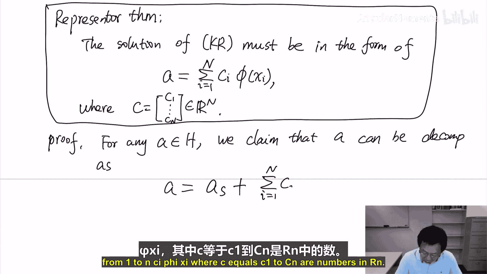

上一节我们介绍了希尔伯特空间和投影的概念，本节中我们来看看如何利用这些概念来证明一个重要的分解定理。

## 定理陈述与分解

我们首先陈述要证明的定理。对于希尔伯特空间 **H** 中的任意向量 **A**，以及一组固定的向量 **φ(x₁), φ(x₂), ..., φ(xₙ)**，我们可以将 **A** 分解为以下形式：

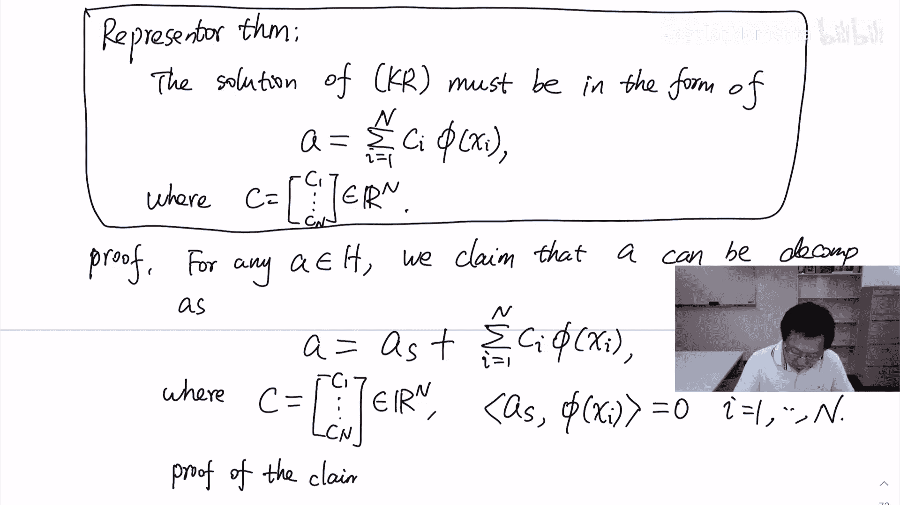

**A = Aₛ + Σᵢ₌₁ⁿ cᵢ φ(xᵢ)**

其中：
*   **c₁, c₂, ..., cₙ** 是实数，属于 **ℝⁿ**。
*   **Aₛ** 与所有 **φ(xᵢ)** 正交，即对于任意 **i**，都有 **<Aₛ, φ(xᵢ)> = 0**。

这里的 **φ(xᵢ)** 是固定向量，因为输入 **xᵢ** 是固定的。对于任意向量 **A**，我们使用同一组 **φ(xᵢ)** 来进行分解。因此，这个表达式是 **H** 空间中任意向量 **A** 的一种表示。

## 证明思路：从简单情况开始

我们首先证明这个论断为何成立。为了简化，我们先证明 **n = 1** 的情况。对于 **n = 2** 或更大的情况，证明思路是类似的。

当 **n = 1** 时，我们只有一个输入向量 **x₁**，对应一个固定向量 **φ(x₁)**。我们的目标是将 **A** 分解为 **Aₛ + c₁ φ(x₁)**，其中 **Aₛ** 与 **φ(x₁)** 正交。

我们定义集合 **S** 为所有与 **φ(x₁)** 正交的向量构成的子空间：
**S = { V ∈ H | <V, φ(x₁)> = 0 }**

根据上一节的讨论，这是一个超平面，也是一个子空间。

## 利用投影进行分解

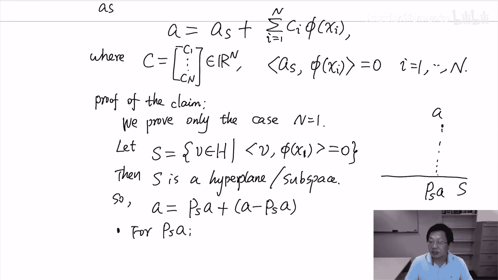

我们可以通过几何投影来理解这个分解。将 **S** 想象为二维空间中的一条直线（代表一个一维子空间），向量 **A** 位于空间中某处。

以下是分解的关键步骤：
1.  我们将向量 **A** 投影到子空间 **S** 上，得到投影向量 **PₛA**。
2.  根据投影的定义，原向量 **A** 等于其投影 **PₛA** 加上残差向量 **A - PₛA**，即 **A = PₛA + (A - PₛA)**。

现在，我们来看这两个部分：
*   由于 **PₛA** 在子空间 **S** 中，根据 **S** 的定义，它必然与 **φ(x₁)** 正交。因此，我们令 **Aₛ = PₛA**。
*   接下来，我们证明残差部分 **A - PₛA** 是 **φ(x₁)** 的倍数。

## 证明残差是基向量的倍数

根据上一节学习的投影定理，对于投影 **PₛA**，残差 **A - PₛA** 与子空间 **S** 中的任意向量正交。

我们选择 **S** 中的一个特殊向量：**0** 向量。因为 **<0, φ(x₁)> = 0**，所以 **0 ∈ S**。将 **V = 0** 代入正交条件，我们得到：
**<A - PₛA, PₛA - 0> = <A - PₛA, PₛA> = 0**
这意味着 **A - PₛA** 与 **PₛA**（即 **Aₛ**）正交。这与我们的分解图景一致。

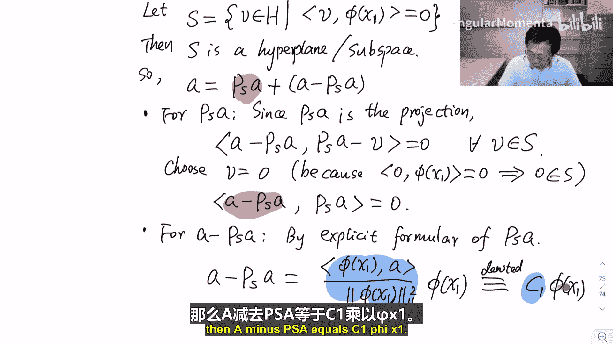

为了证明 **A - PₛA** 是 **φ(x₁)** 的倍数，我们使用上一节推导出的投影显式公式。当子空间 **S** 由与 **φ(x₁)** 正交的向量构成时，向 **S** 的投影公式较为复杂，但我们可以考虑向由 **φ(x₁)** 张成的一维子空间的投影，其补空间与我们的 **S** 有关。更直接的方法是，注意到 **A - PₛA** 与 **S** 正交，而 **S** 的正交补空间恰好是由 **φ(x₁)** 张成的（在一维情况下）。因此，**A - PₛA** 必然落在 **φ(x₁)** 的方向上。

我们可以通过计算验证这一点。实际上，**A - PₛA** 可以表示为：
**A - PₛA = [ <A, φ(x₁)> / ||φ(x₁)||² ] * φ(x₁)**

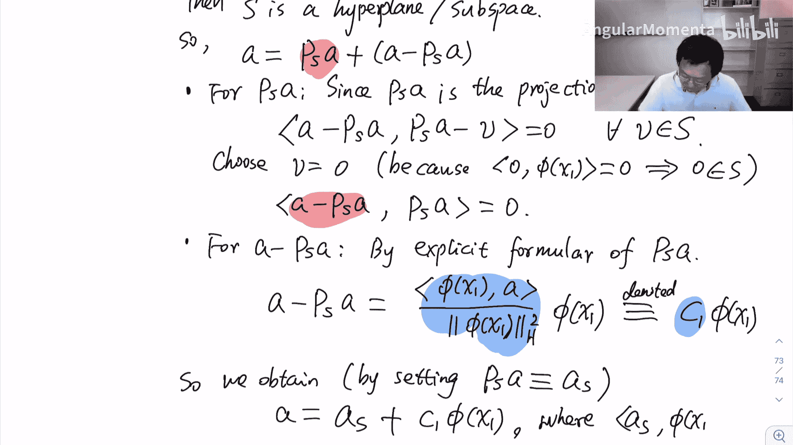

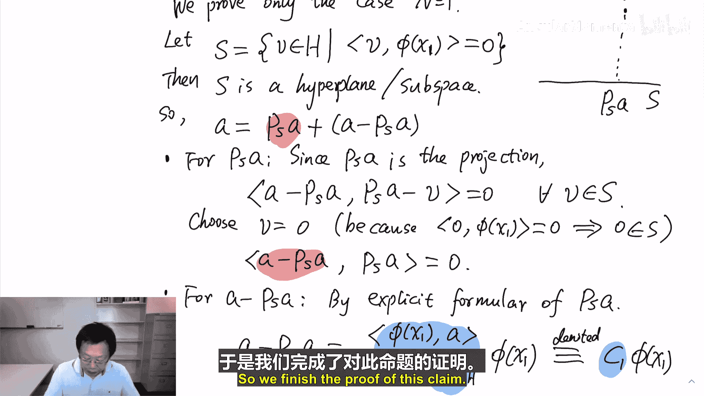

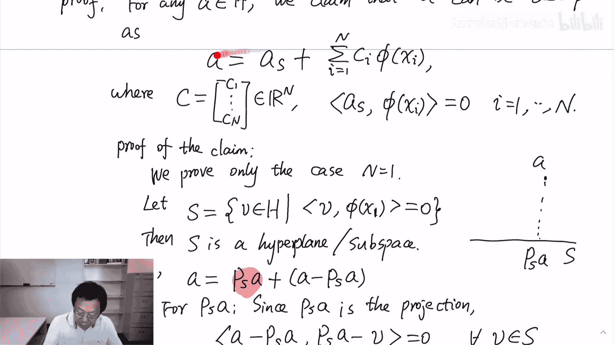

我们令这个标量系数为 **c₁**：
**c₁ = <A, φ(x₁)> / ||φ(x₁)||²**

于是，我们得到：
**A - PₛA = c₁ φ(x₁)**

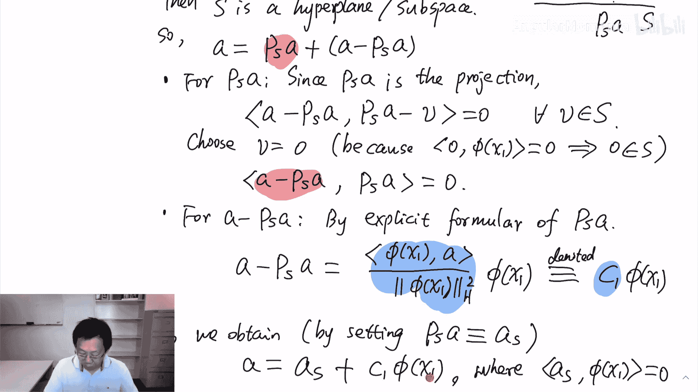

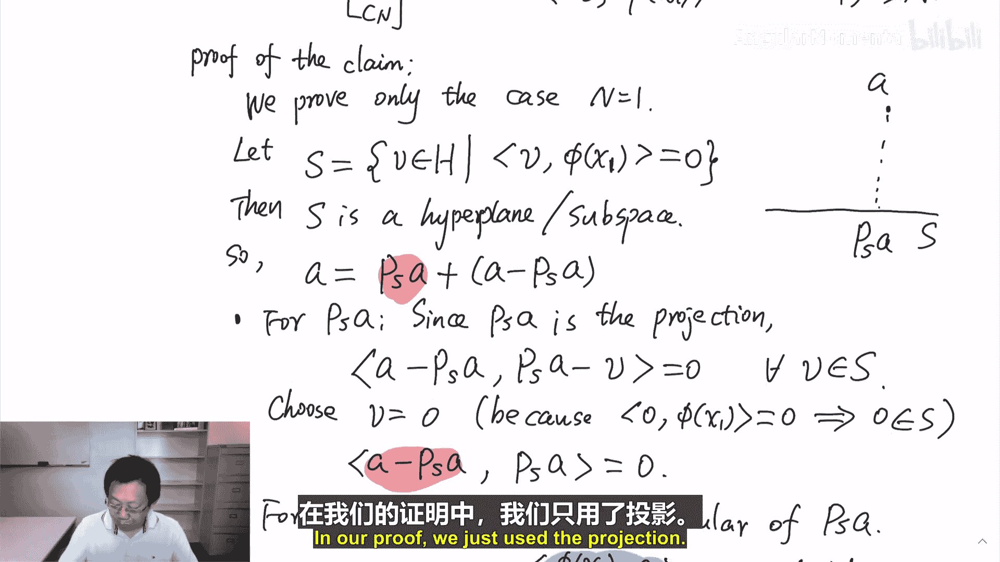

## 完成 n=1 情况的证明

综合以上步骤，我们完成了当 **n = 1** 时的分解证明：
**A = PₛA + (A - PₛA) = Aₛ + c₁ φ(x₁)**
其中 **Aₛ** 与 **φ(x₁)** 正交。

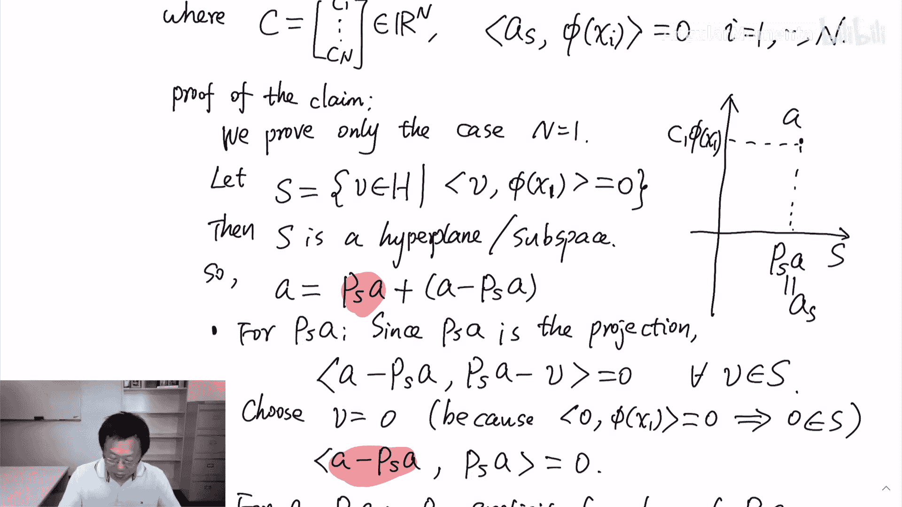

在证明中，我们核心用到了投影操作：将 **A** 投影到与 **φ(x₁)** 正交的子空间 **S** 上，得到 **Aₛ**；而剩余部分自然就是 **φ(x₁)** 方向的成分，即 **c₁ φ(x₁)**。

## 推广到一般 n 的情况

对于 **n = 2** 或任意 **n** 的情况，我们可以进行类似的推广。

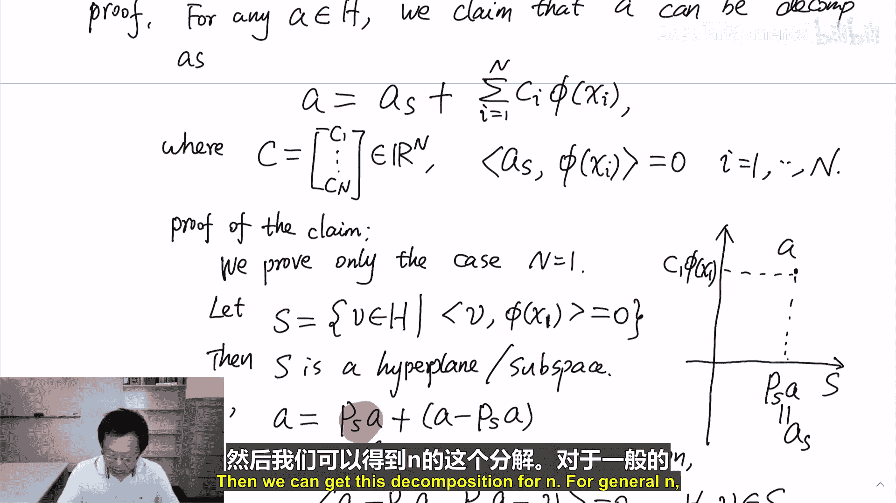

我们定义子空间 **S** 为与所有 **φ(xᵢ)** 都正交的向量集合的交集：
**S = { V ∈ H | <V, φ(xᵢ)> = 0, for i = 1, 2, ..., n }**
这是 **n** 个超平面的交集，本身也是一个子空间。

然后，我们同样将向量 **A** 投影到这个交集子空间 **S** 上，得到 **Aₛ = PₛA**。根据投影定理，残差 **A - Aₛ** 将与子空间 **S** 正交。由于 **S** 是所有这些正交条件的交集，其正交补空间就是由 **{φ(x₁), φ(x₂), ..., φ(xₙ)}** 张成的子空间。因此，残差 **A - Aₛ** 必然可以表示为这些向量的线性组合，即 **Σᵢ₌₁ⁿ cᵢ φ(xᵢ)**。

这样就证明了对于一般的 **n**，分解 **A = Aₛ + Σᵢ₌₁ⁿ cᵢ φ(xᵢ)** 成立，其中 **Aₛ** 与所有 **φ(xᵢ)** 正交。通过这种分解，我们用 **Aₛ** 和 **n** 个系数 **cᵢ** 参数化了向量 **A**。

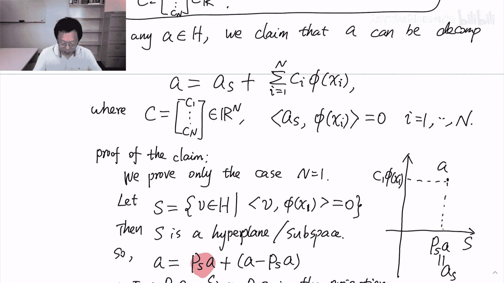

## 分解的几何图示

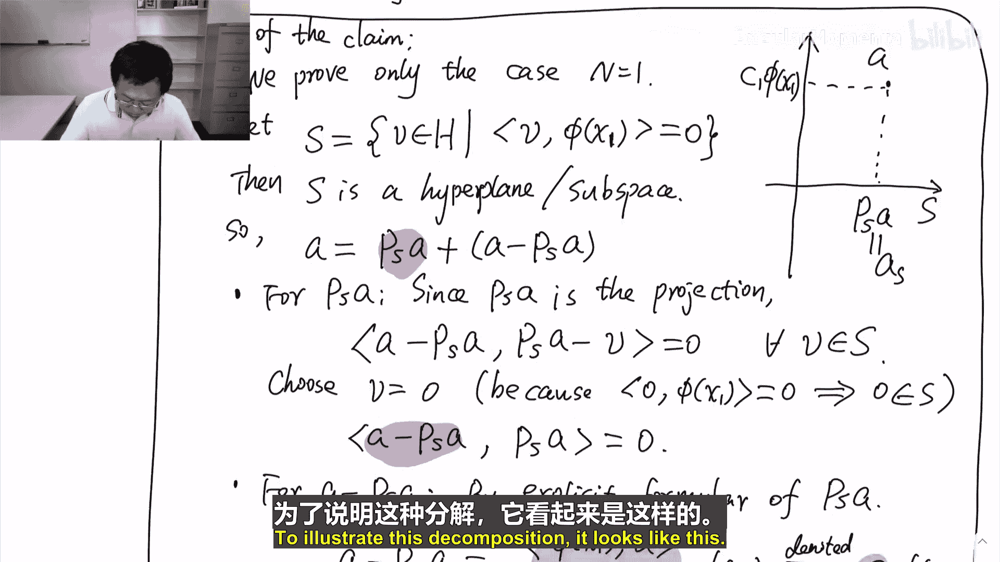

为了更直观地理解这个分解，可以想象如下几何图景：
我们有一个向量 **A**。我们有一个由 **n** 个条件 **<V, φ(xᵢ)> = 0** 定义的子空间交集 **S**。将 **A** 投影到 **S** 上，得到 **Aₛ**。剩余的部分 **A - Aₛ**，根据定理，必定位于由 **{φ(xᵢ)}** 张成的子空间中，因此可以写成它们的线性组合 **Σ cᵢ φ(xᵢ)**。**Aₛ** 则位于那些正交子空间的交集上。

---

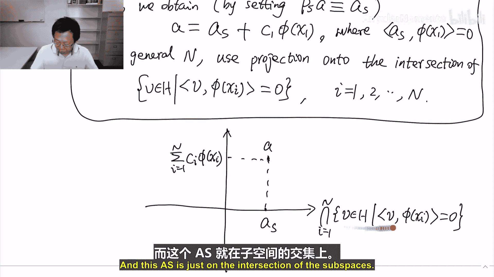

本节课中我们一起学习了表示定理核心引理的证明。我们证明了希尔伯特空间中的任意向量都可以分解为一个与给定向量集正交的分量，加上一个由该向量集线性组合而成的分量。这个分解是后续理解表示定理及其在机器学习（如支持向量机）中应用的基础。证明的关键在于巧妙地运用了希尔伯特空间的投影定理。