# 057：核回归的表示定理证明 🧮

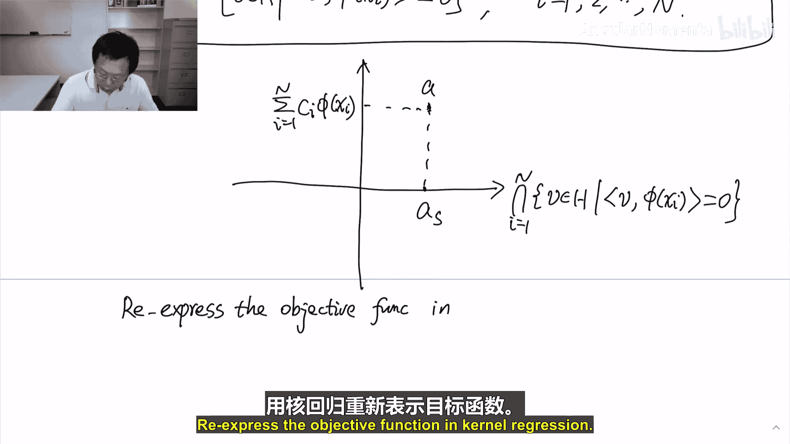

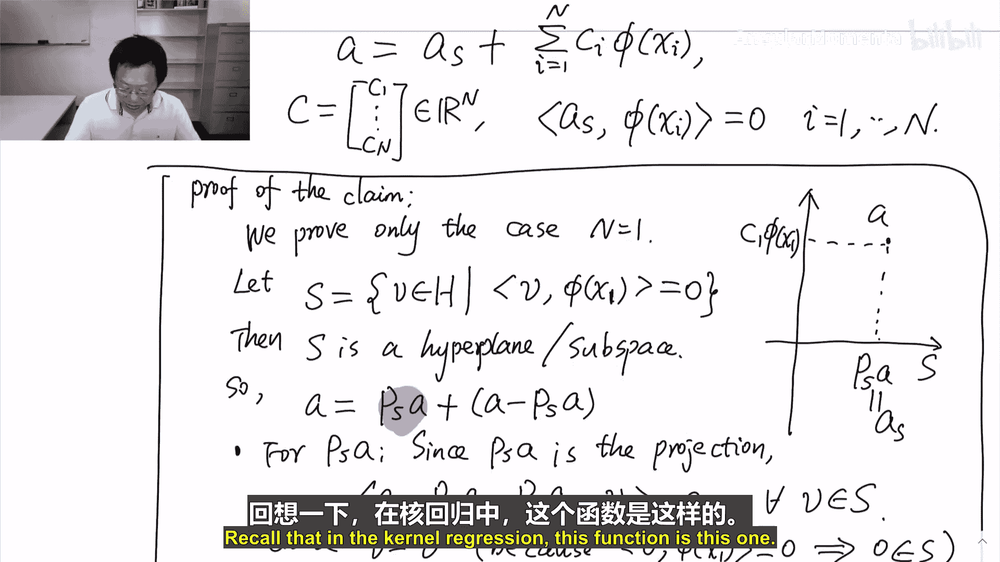

在本节课中，我们将学习核回归中一个关键定理的证明过程，即“表示定理”。该定理表明，核回归的最优解可以表示为训练数据特征向量的线性组合。我们将通过重新表述目标函数、引入分解和简化优化问题来一步步推导这个结论。

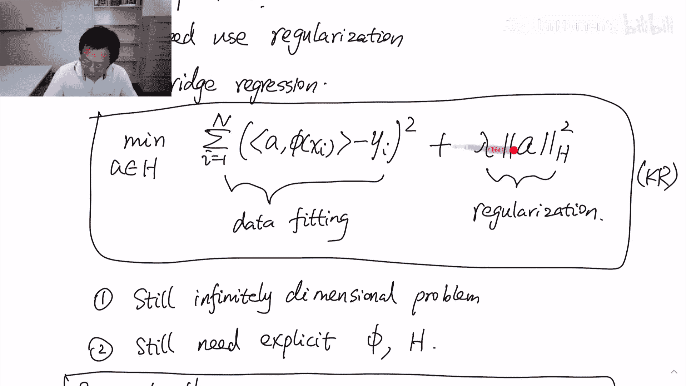

---

上一节我们讨论了特征空间中的线性表示，本节中我们来看看如何将核回归的目标函数进行重新表述。

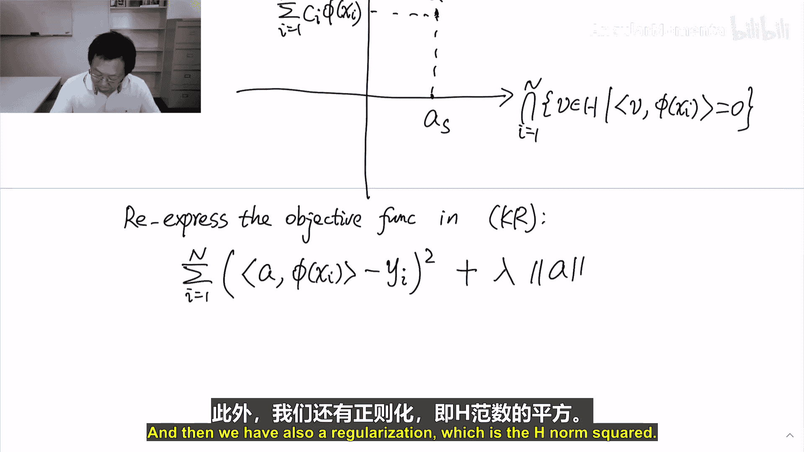

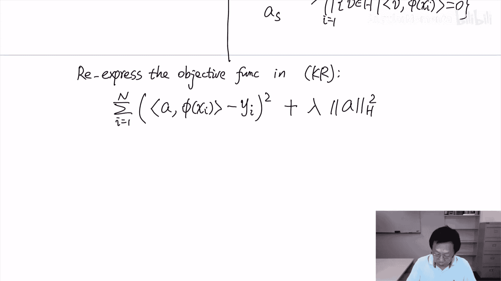

首先，我们回顾核回归的目标函数。它由数据拟合项和正则化项组成：

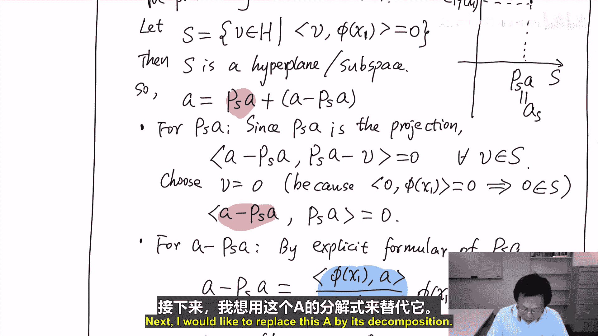

$$
\min_{a \in H} \sum_{i=1}^{n} (a^T \phi(x_i) - y_i)^2 + \lambda \|a\|_H^2
$$

其中，$a$ 是特征空间 $H$ 中的参数向量，$\phi(x_i)$ 是样本 $x_i$ 映射到特征空间后的向量，$y_i$ 是对应的输出值，$\lambda$ 是正则化系数。

---

接下来，我们将参数向量 $a$ 分解为两个部分：一个位于由所有训练数据特征向量 $\phi(x_i)$ 张成的子空间中，另一个与该子空间正交。

具体分解形式如下：

$$
a = a_S + \sum_{j=1}^{n} c_j \phi(x_j)
$$

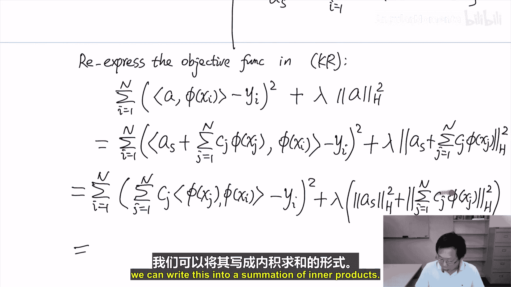

其中，$a_S$ 与所有 $\phi(x_i)$ 正交，即 $\langle a_S, \phi(x_i) \rangle_H = 0$ 对于所有 $i$ 成立。$c_j$ 是标量系数。

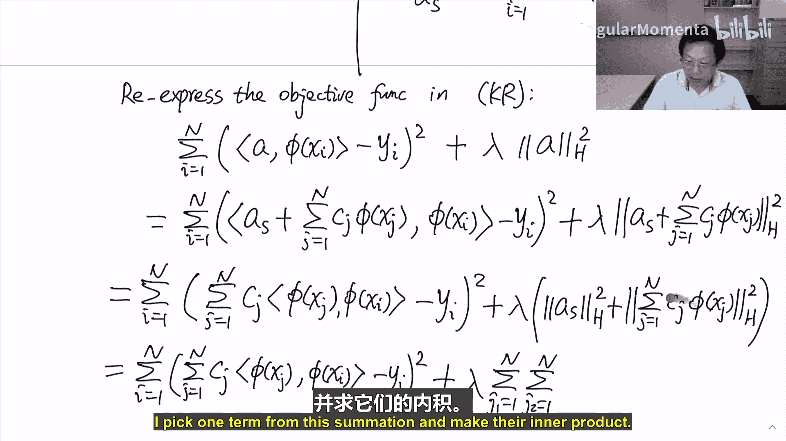

---

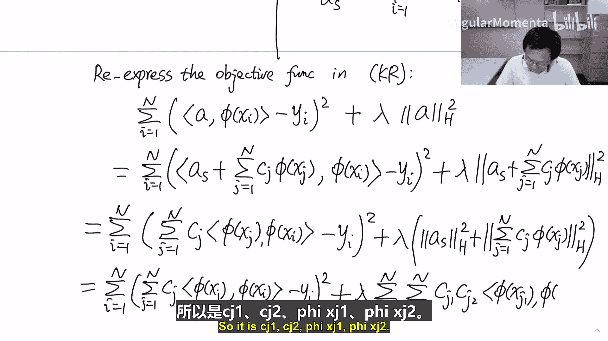

将上述分解代入原目标函数，我们可以对其进行重新表达。

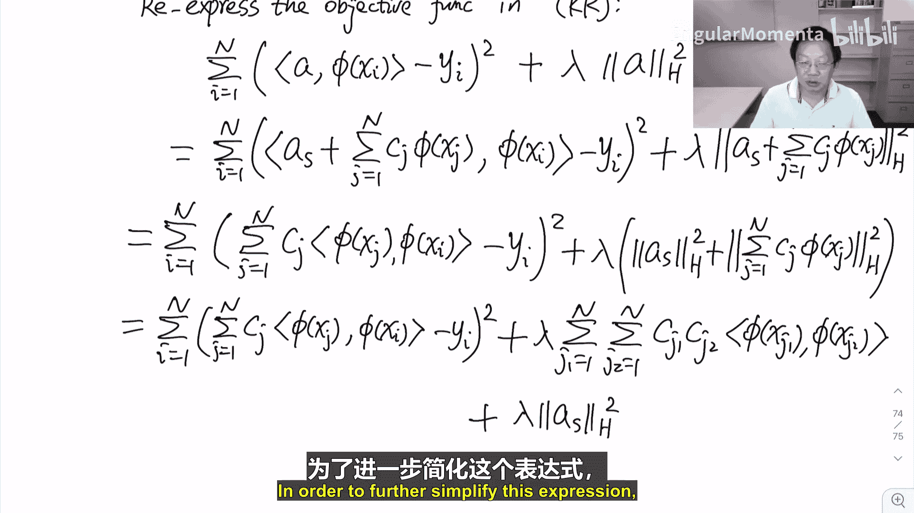

对于数据拟合项 $\sum_{i=1}^{n} (a^T \phi(x_i) - y_i)^2$，代入 $a$ 的分解：

$$
\sum_{i=1}^{n} \left( \left( a_S + \sum_{j=1}^{n} c_j \phi(x_j) \right)^T \phi(x_i) - y_i \right)^2
$$

由于 $a_S$ 与所有 $\phi(x_i)$ 正交，内积为零，因此上式简化为：

$$
\sum_{i=1}^{n} \left( \sum_{j=1}^{n} c_j \phi(x_j)^T \phi(x_i) - y_i \right)^2
$$

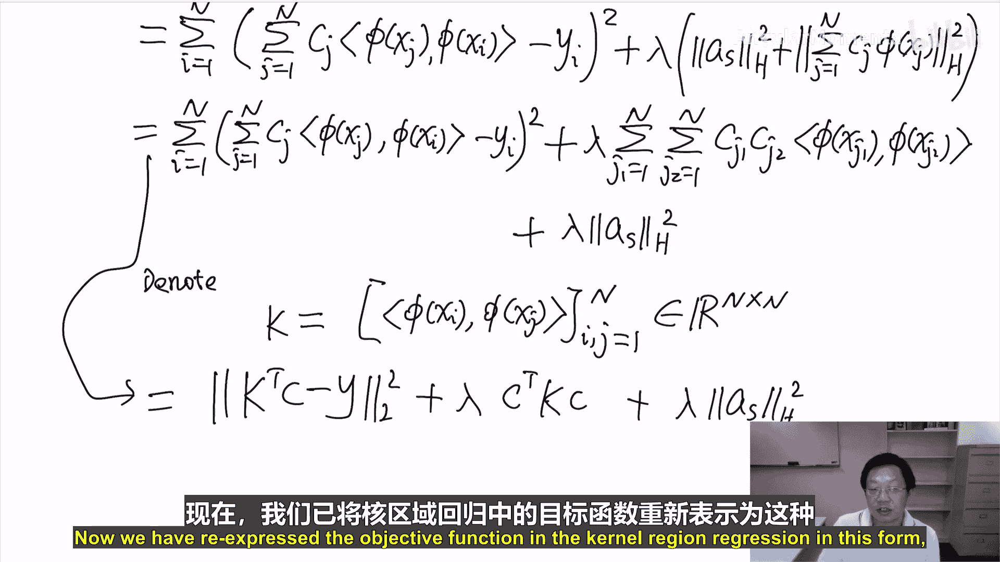

对于正则化项 $\lambda \|a\|_H^2$，同样代入分解，并利用 $a_S$ 与 $\phi(x_j)$ 的正交性，根据勾股定理可得：

$$
\lambda \|a\|_H^2 = \lambda \|a_S\|_H^2 + \lambda \sum_{j=1}^{n} \sum_{k=1}^{n} c_j c_k \phi(x_j)^T \phi(x_k)
$$

---

为了进一步简化表达式，我们引入核矩阵 $K$。

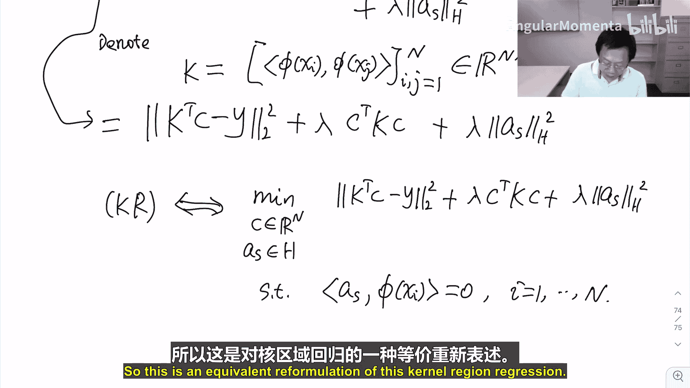

核矩阵 $K$ 是一个 $n \times n$ 的矩阵，其第 $(i, j)$ 个元素定义为 $K_{ij} = \phi(x_i)^T \phi(x_j)$。利用核矩阵，上述目标函数可以重写为更紧凑的形式。

数据拟合项可以写为向量形式：

$$
\|Kc - y\|_2^2
$$

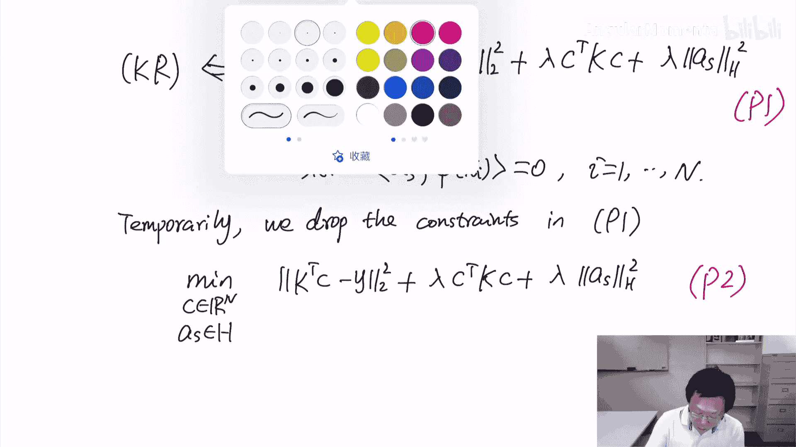

其中 $c = [c_1, c_2, ..., c_n]^T$，$y = [y_1, y_2, ..., y_n]^T$。

正则化项中关于 $c$ 的部分可以写为：

$$
\lambda c^T K c
$$

因此，完整的目标函数变为：

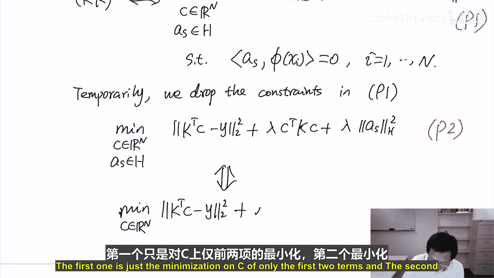

$$
\min_{c \in \mathbb{R}^n, a_S \in H} \|Kc - y\|_2^2 + \lambda c^T K c + \lambda \|a_S\|_H^2
$$

同时，我们有一个约束条件：$a_S$ 必须与所有 $\phi(x_i)$ 正交。我们称这个带约束的优化问题为 **P1**。

---

直接求解问题 **P1** 是困难的，因为它涉及两个变量且有约束。为了找到解决方案，我们暂时忽略约束，考虑一个简化的问题 **P2**。

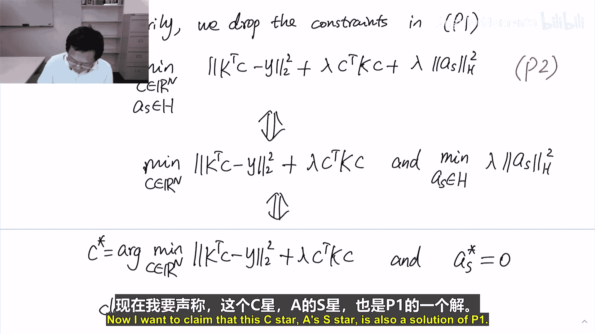

问题 **P2** 的定义如下，它移除了 **P1** 中的正交约束：

$$
\min_{c \in \mathbb{R}^n, a_S \in H} \|Kc - y\|_2^2 + \lambda c^T K c + \lambda \|a_S\|_H^2
$$

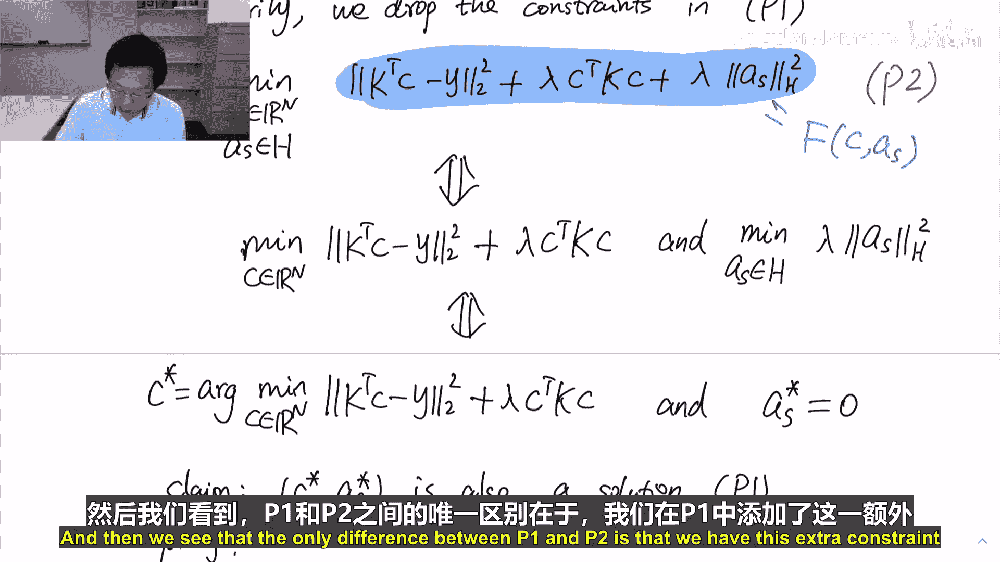

观察 **P2**，我们发现目标函数是可分离的：第一、二项只与 $c$ 有关，第三项只与 $a_S$ 有关。因此，**P2** 可以分解为两个独立的子问题：

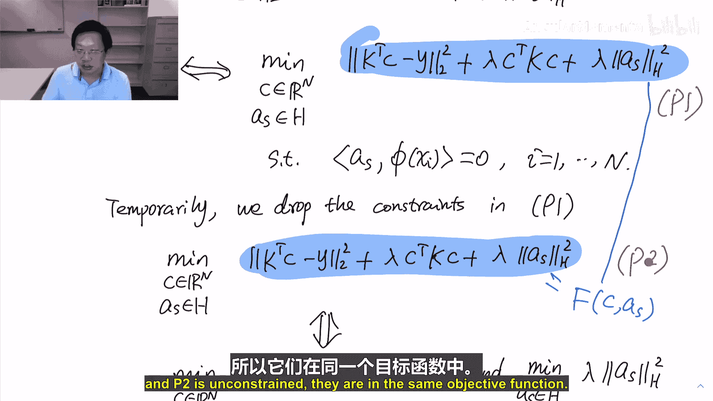

1.  关于 $c$ 的优化：$\min_{c \in \mathbb{R}^n} \|Kc - y\|_2^2 + \lambda c^T K c$
2.  关于 $a_S$ 的优化：$\min_{a_S \in H} \lambda \|a_S\|_H^2$

第二个子问题非常容易求解，其最小值在 $a_S^* = 0$ 时取得，最小值为0。第一个子问题是一个关于 $c$ 的岭回归问题，我们可以求解得到最优的 $c^*$。

因此，问题 **P2** 的最优解是 $(c^*, a_S^* = 0)$。

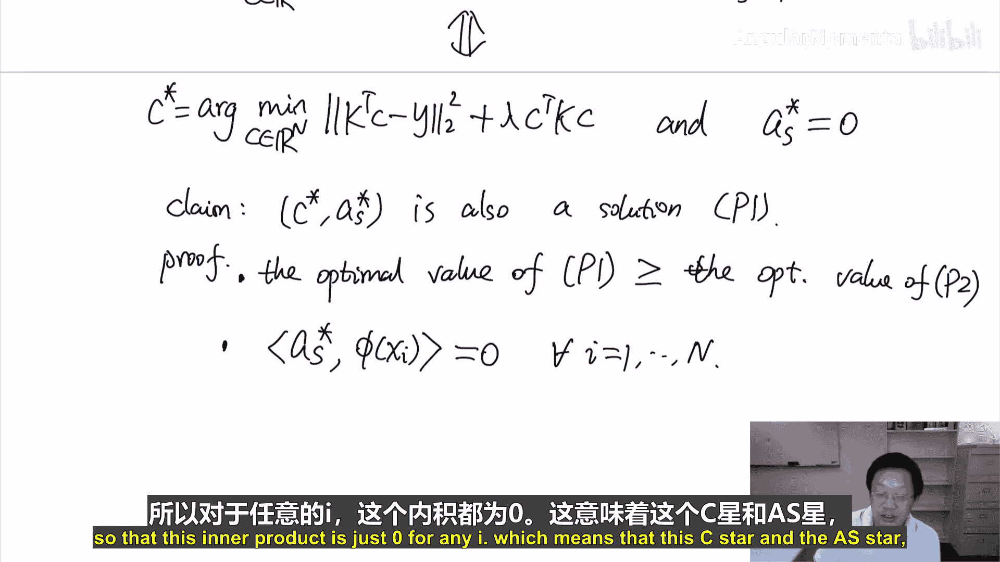

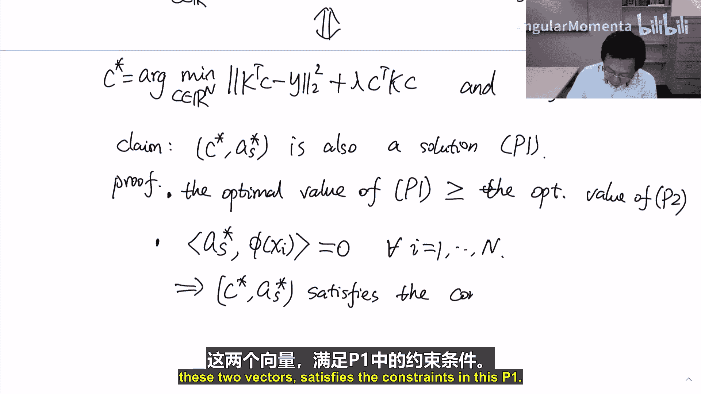

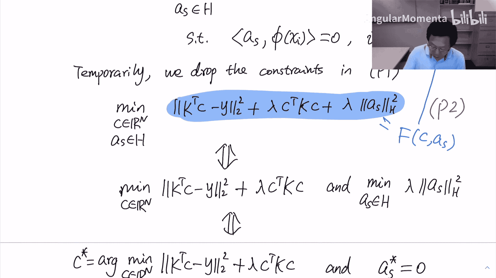

---

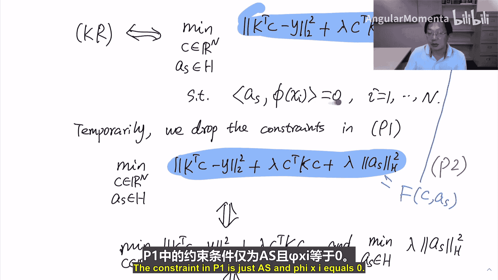

现在，关键的一步是证明 **P2** 的这个最优解 $(c^*, 0)$ 实际上也是原始约束问题 **P1** 的解。

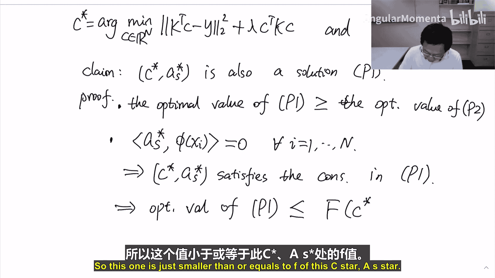

证明思路如下：
1.  由于 **P1** 比 **P2** 多一个约束，所以 **P1** 的最优目标值不可能小于 **P2** 的最优目标值。
2.  我们找到的 **P2** 的解 $(c^*, 0)$ 恰好满足 **P1** 的约束（因为 $a_S^*=0$ 自然与所有 $\phi(x_i)$ 正交）。
3.  因此，$(c^*, 0)$ 也是 **P1** 的一个可行解，其目标函数值等于 **P2** 的最优值。
4.  结合1和3，可以得出 $(c^*, 0)$ 就是 **P1** 的最优解。

由此我们证明，核回归的最优参数 $a^*$ 具有以下形式：

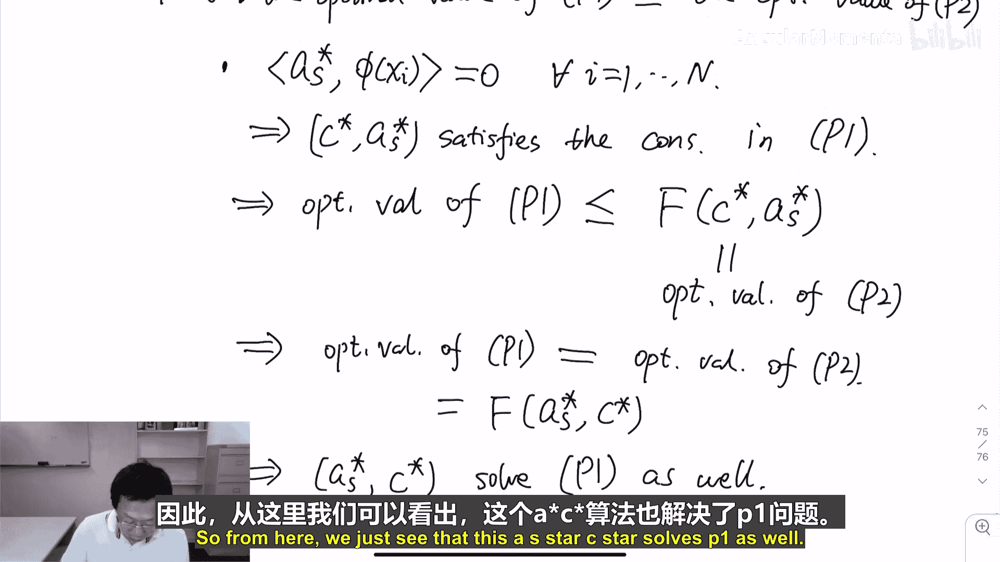

$$
a^* = 0 + \sum_{i=1}^{n} c_i^* \phi(x_i) = \sum_{i=1}^{n} c_i^* \phi(x_i)
$$

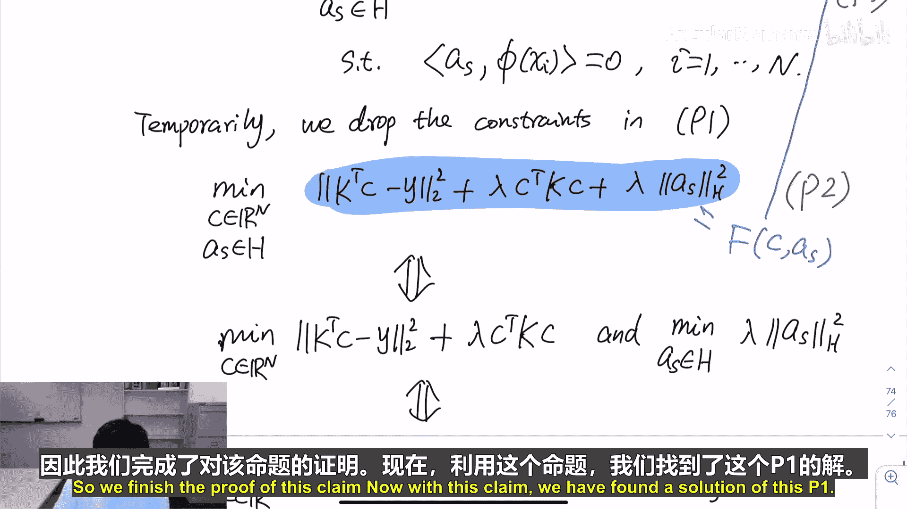

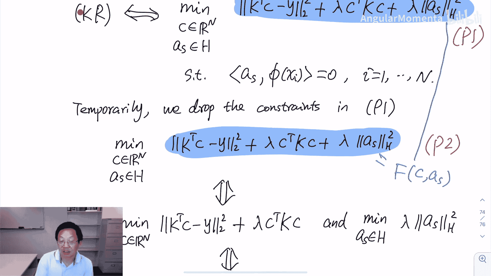

其中系数向量 $c^*$ 通过求解以下优化问题得到：

$$
c^* = \arg\min_{c \in \mathbb{R}^n} \|Kc - y\|_2^2 + \lambda c^T K c
$$

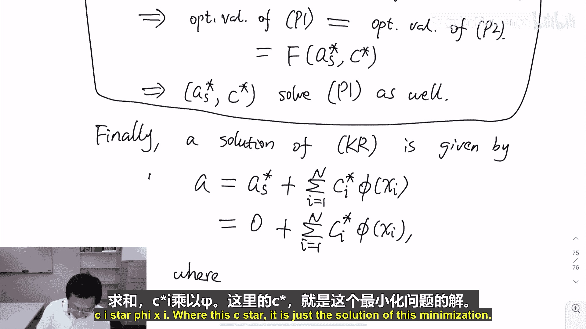

---

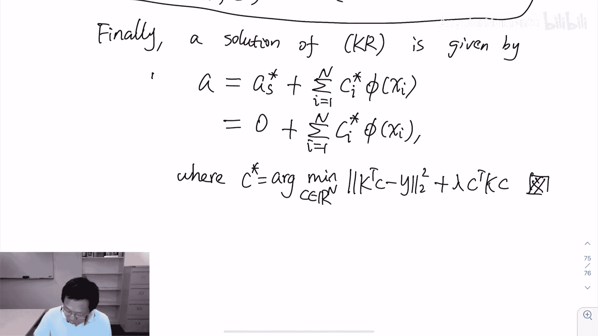

本节课中我们一起学习了核回归表示定理的完整证明过程。我们首先将参数向量分解，重新表述了目标函数并引入了核矩阵。然后，通过构造并求解一个无约束的简化问题，我们证明了核回归的最优解必然可以表示为训练样本特征向量的线性组合，其系数由一个新的、只涉及核矩阵 $K$ 的优化问题决定。这个定理是理解核方法，特别是支持向量机（SVM）中“核技巧”的重要理论基础。