# 058：核岭回归的完整流程 🧮

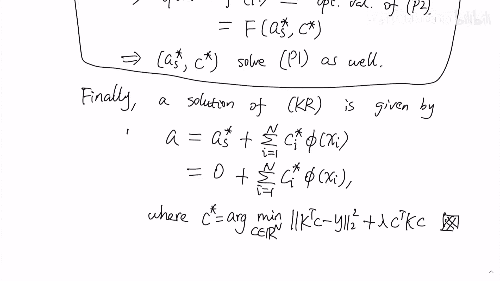

在本节课中，我们将学习核岭回归的完整计算流程。我们将看到，通过利用核技巧，我们无需显式地知道高维特征空间的具体形式，就能有效地求解回归问题。

## 概述

从代表性定理的证明中我们看到，为了得到核岭回归的解，我们首先需要在 **R^N** 空间中解决一个优化问题，得到最优系数 **c***。利用这个 **c***，我们就能构造出核岭回归的解。

因此，这个流程中的关键步骤是获得 **c***，即解决在 **R^N** 中的最小化问题。在这个优化问题的定义中，我们只使用了核矩阵 **K**。这意味着，这里涉及的特征映射和希尔伯特空间，仅通过构造这个核矩阵 **K** 来体现。

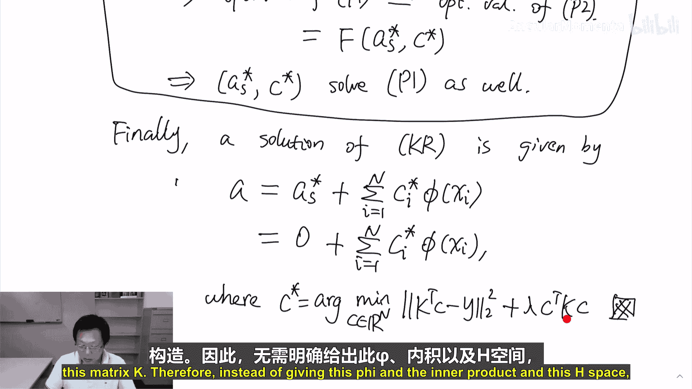

## 核技巧的应用

因此，我们不需要显式地给出特征映射 **Φ** 和希尔伯特空间 **H** 的内积。我们只需要定义任意 **x_i** 和 **x_j** 对应的 **Φ(x_i)** 和 **Φ(x_j)** 的内积。这正是核函数。

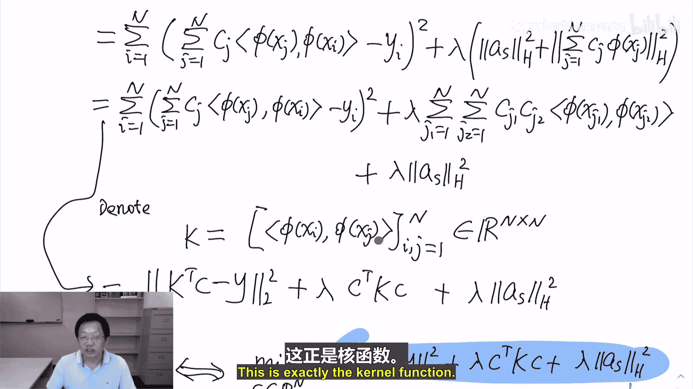

因此，我们可以应用核技巧。作为代表性定理证明的一个副产品，我们得以应用核技巧。

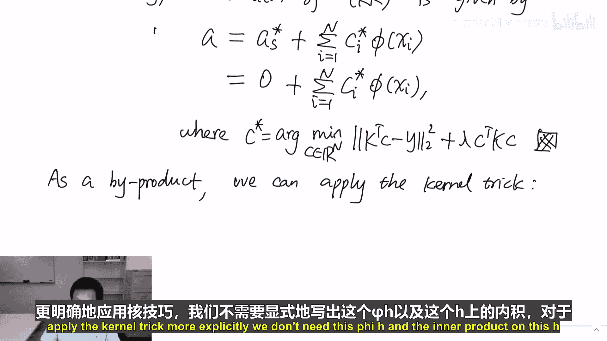

更明确地说，我们不需要显式地知道 **H** 空间及其内积。我们只需要知道 **Φ(x_i)** 和 **Φ(x_j)** 的内积，对于 **R** 中的任意 **x_i** 和 **x_j**。因此，我们将其定义为核函数 **K(x_i, x_j)**。

## 核岭回归的步骤

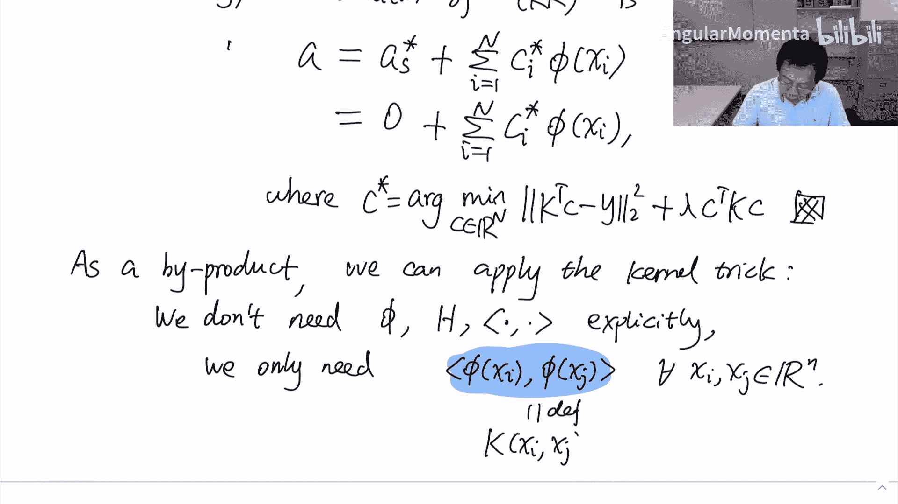

现在，核岭回归的步骤变得清晰：

**第一步：选择核函数**

我们首先选择一个核函数 **K(x, y)**。当然，这个核函数的选择要满足 **K(x, y)** 恰好是 **Φ(x)** 和 **Φ(y)** 的内积。根据 Mercer 定理，我们只需选择一个对称的半正定核函数，它就是一个有效的核。

以下是几种流行的核函数选择：

*   **高斯核**：`K(x, y) = exp(-||x - y||^2 / σ^2)`
*   **多项式核**：`K(x, y) = (x^T y + 1)^α`，其中 **α** 是某个整数。

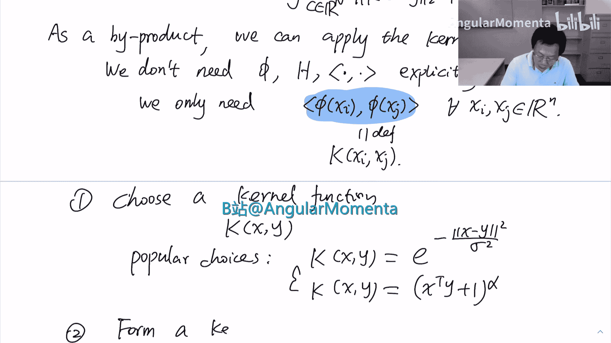

**第二步：构造核矩阵**

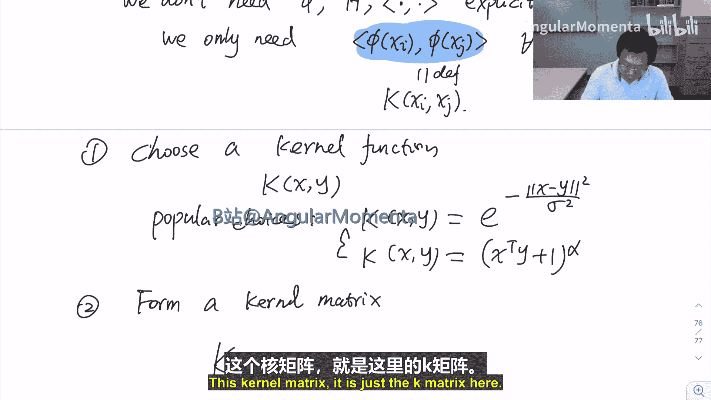

一旦我们选择了核函数，我们就为给定的数据点构造核矩阵 **K**。

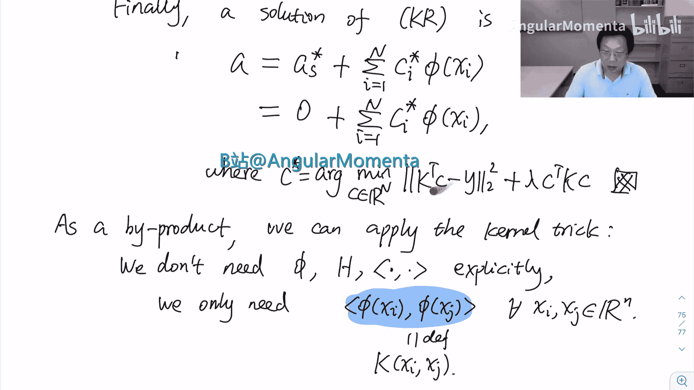

核矩阵 **K** 的定义如下：

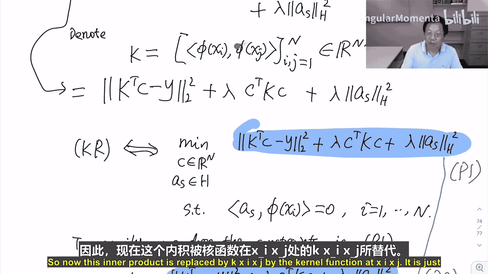

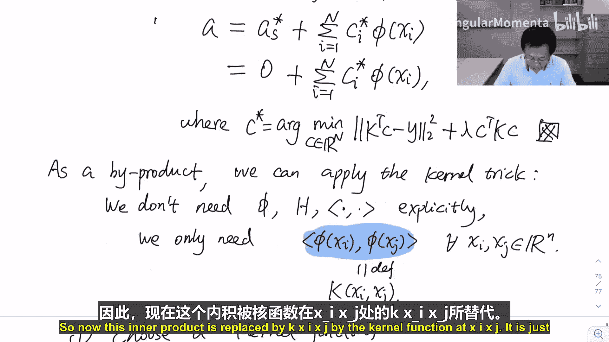

`K_ij = K(x_i, x_j)`

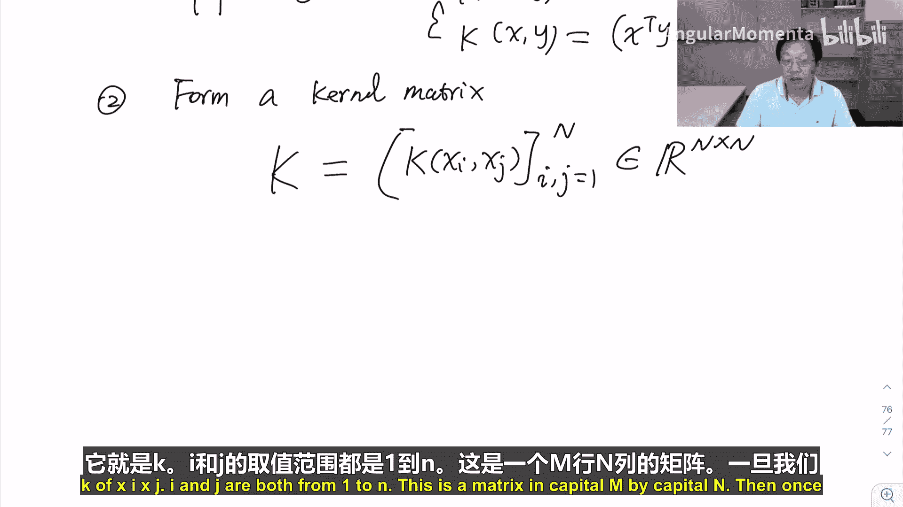

其中 **i** 和 **j** 都从 1 到 **N**。这是一个 **N × N** 的矩阵。现在，内积 **<Φ(x_i), Φ(x_j)>** 被核函数 **K(x_i, x_j)** 所取代。

**第三步：求解优化问题**

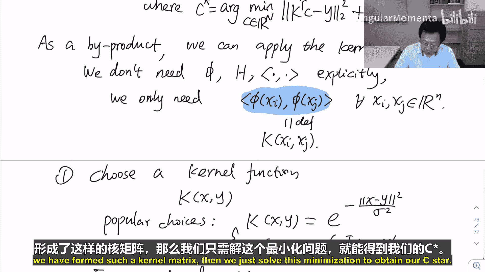

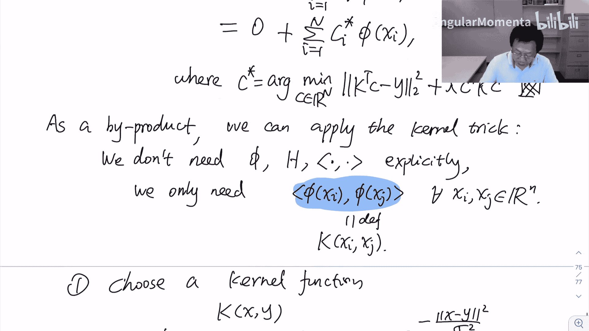

一旦我们形成了这样的核矩阵，我们就通过求解以下最小化问题来获得最优系数 **c***：

`c* = argmin_c ||K^T c - y||^2 + λ c^T K c`

这个 **c*** 向量将用于定义核岭回归问题的解。

## 回归函数与预测

有了核岭回归的解，我们就得到了回归函数。回归函数是对于任意给定的新输入 **x**，其预测输出为 **<a, Φ(x)>**，其中 **a** 是核岭回归的解向量。

具体来说，给定一个新的输入向量 **x**，我们想要预测其对应的输出。我们首先将 **x** 转换到特征域，然后与解向量 **a** 做内积。解向量 **a** 由 **c*** 和训练数据点给出：`a = Σ_{i=1}^{N} c_i* Φ(x_i)`。

因此，预测输出为：

`f(x) = <a, Φ(x)> = Σ_{i=1}^{N} c_i* <Φ(x_i), Φ(x)>`

同样，你可以看到它涉及特征变换 **Φ** 和希尔伯特空间的内积。但根据核函数的定义，`<Φ(x_i), Φ(x)>` 就是我们的核函数 **K(x_i, x)**。

因此，预测函数最终形式为：

`f(x) = Σ_{i=1}^{N} c_i* K(x_i, x)`

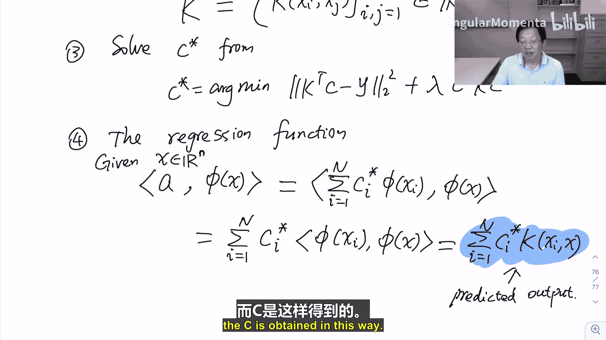

对于 **R^N** 中的任意 **x**，我们都可以使用这个公式计算预测输出。这就是回归函数。再次注意，在这个函数中，并不涉及显式的 **Φ**、**H** 或 **H** 上的内积。它只涉及核函数和通过优化得到的系数 **c***。

## 流程总结与示例

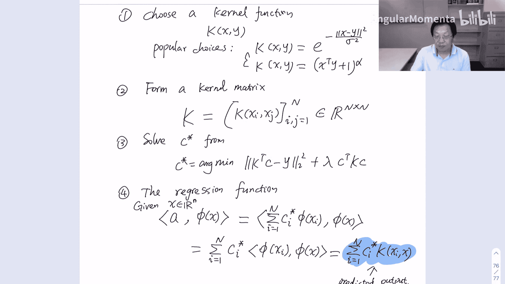

这就是核岭回归的完整流程。它在计算机上是完全可计算的，因为唯一的计算就是上述的优化问题。

最后，我想用一个简单的例子来说明核岭回归。考虑在 **R^2** 空间中给定一组数据点 **(x, y)**。假设这组数据看起来像一条曲线。如果我们使用线性回归，效果肯定不好，因为数据是弯曲的。然而，如果我们应用核岭回归，我们会得到一个函数，这个函数会拟合出一条曲线来匹配给定的数据点。

## 总结

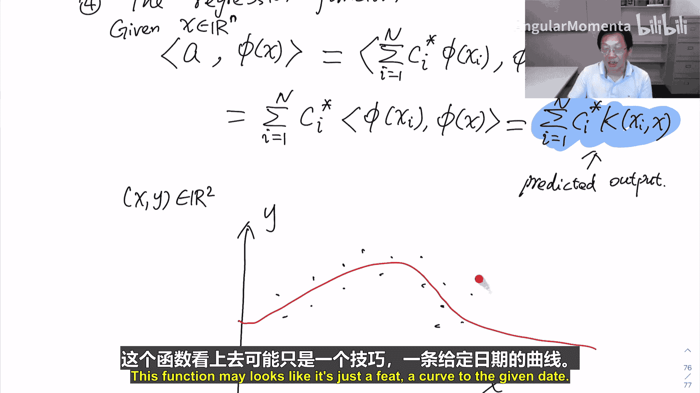

本节课中，我们一起学习了核岭回归的完整实施流程。我们了解到，通过核技巧，我们可以绕过对高维特征空间的显式计算，直接利用核函数在原始数据空间进行操作。核心步骤包括：1）选择合适的核函数；2）构造核矩阵；3）求解一个在 **R^N** 空间中的正则化最小二乘问题以获得系数 **c***；4）利用 **c*** 和核函数构造出最终的回归预测函数 `f(x) = Σ c_i* K(x_i, x)`。这个过程使得我们能够处理线性模型无法解决的复杂非线性关系。