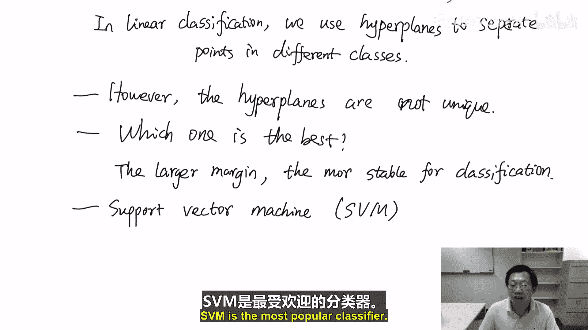

# 059：线性分类与支持向量机

在本节课中，我们将要学习线性分类的基本概念，并了解如何利用超平面来划分不同类别的数据点。我们还将探讨为何需要寻找具有最大间隔的分类器，并引出支持向量机（SVM）的核心思想。

## 线性分类问题

上一节我们介绍了回归问题，本节中我们来看看分类问题。分类与回归非常相似，它同样是一个监督学习任务，给定一组训练数据。这些数据同样是输入-输出对 `(X_i, Y_i)`。其中，`X_1` 到 `X_N` 是输入向量，与回归问题相同。但这里的输出 `Y_1` 到 `Y_N` 是二元的，取值只能是 `-1` 或 `+1`，代表两个不同的类别。

我们的任务是：给定一个新的输入，预测它属于哪个类别。分类问题同样是寻找一个能反映输入 `X_i` 与其对应标签 `Y_i` 之间关系的函数 `F`。

我们寻找一个函数 `F`，它从 `R^N` 映射到 `R`（实数集），而不是直接映射到二元值。这个函数需要满足以下条件：
*   当 `Y_i = +1` 时，`F(X_i) >= +1`。
*   当 `Y_i = -1` 时，`F(X_i) <= -1`。

**公式表示：**
`F: R^N -> R`，且满足：
*   若 `Y_i = +1`，则 `F(X_i) >= +1`
*   若 `Y_i = -1`，则 `F(X_i) <= -1`

## 几何解释与预测

从几何上看，我们有两类数据点，例如红色点代表类别 `+1`，蓝色点代表类别 `-1`。我们寻找的函数 `F` 会定义两条曲线（或超曲面）：
*   所有满足 `F(X) = +1` 的点构成一条曲线。
*   所有满足 `F(X) = -1` 的点构成另一条曲线。

因此，属于类别 `-1` 的蓝色点满足 `F(X) <= -1`，而属于类别 `+1` 的红色点满足 `F(X) >= +1`。

对于预测，由于我们的函数 `F` 输出实数值，而标签是二元的，我们需要一个转换。给定一个新的输入 `X`，我们不直接使用 `F(X)`，而是使用它的符号作为预测标签：
*   如果 `F(X) > 0`，则预测为类别 `+1`。
*   如果 `F(X) < 0`，则预测为类别 `-1`。

等价地，决策边界由 `F(X) = 0` 定义。新点落在边界哪一侧，就属于哪个类别。

## 线性分类器

与回归问题类似，我们需要确定函数 `F` 所属的类别。在线性分类中，我们选择仿射函数。

任何从 `R^N` 到 `R` 的仿射函数都具有以下形式：
`F(X) = A^T X + b`
其中，`A` 是 `R^N` 中的向量，`b` 是 `R` 中的标量。

**公式表示：**
`F(X) = A · X + b`，其中 `A ∈ R^N`, `b ∈ R`

因此，我们的任务转化为寻找参数 `A` 和 `b`，使得对于所有训练数据 `(X_i, Y_i)` 满足：
*   若 `Y_i = +1`，则 `A · X_i + b >= +1`
*   若 `Y_i = -1`，则 `A · X_i + b <= -1`

**公式表示：**
寻找 `A ∈ R^N` 和 `b ∈ R`，使得：
*   当 `Y_i = +1` 时，`A · X_i + b >= +1`
*   当 `Y_i = -1` 时，`A · X_i + b <= -1`

## 超平面与分类

由于 `F(X)` 是仿射函数，方程 `F(X) = +1`、`F(X) = -1` 和 `F(X) = 0` 在几何上都表示超平面。
*   `F(X) = +1` 定义一个超平面。
*   `F(X) = -1` 定义另一个超平面。
*   `F(X) = 0` 定义的超平面是决策边界。

新数据点根据其位于决策边界的哪一侧来进行分类。因此，**在线性分类中，我们使用超平面来分隔不同类别的点**。

然而，从图中可以轻易看出，这样的分隔超平面不是唯一的。存在无数个超平面都能完美分开红色和蓝色的点。这就引出了一个关键问题：既然有这么多选择，我们如何挑选“最好”的一个？

## 间隔与最优分类器

超平面不唯一，因此我们需要一个标准来选择最优的那一个。考虑一个新数据点（例如一个大红点）和两个不同的分类器（紫色和绿色超平面）。在数据没有噪声的情况下，两个分类器都能正确分类该点。

但现实数据总包含噪声。假设这个红点受到噪声干扰，位置发生了偏移。对于紫色分类器，需要较大的噪声才能将它推到错误的一侧（即越过决策边界）。而对于绿色分类器，只需要较小的噪声就能导致误分类。

两个分类器对应的“容错空间”大小不同。这个空间，即分隔超平面 `F(X)=+1` 和 `F(X)=-1` 之间的距离，被称为**间隔**。紫色分类器的间隔较大，绿色分类器的间隔较小。

**我们偏好具有更大间隔的分类器**，因为：
1.  更大的间隔意味着需要更大的噪声才会导致误分类。
2.  因此，具有更大间隔的分类器对噪声更稳定，分类更鲁棒。

这种追求**最大间隔**的策略，正是**支持向量机**（Support Vector Machine， SVM）的核心思想。SVM 旨在寻找那个能将两类数据正确分开，并且具有最大可能间隔的超平面。

本节课中我们一起学习了线性分类的基本框架，理解了如何使用超平面作为决策边界，并认识到最大化间隔对于构建稳定、鲁棒分类器的重要性，从而引出了支持向量机这一强大工具。