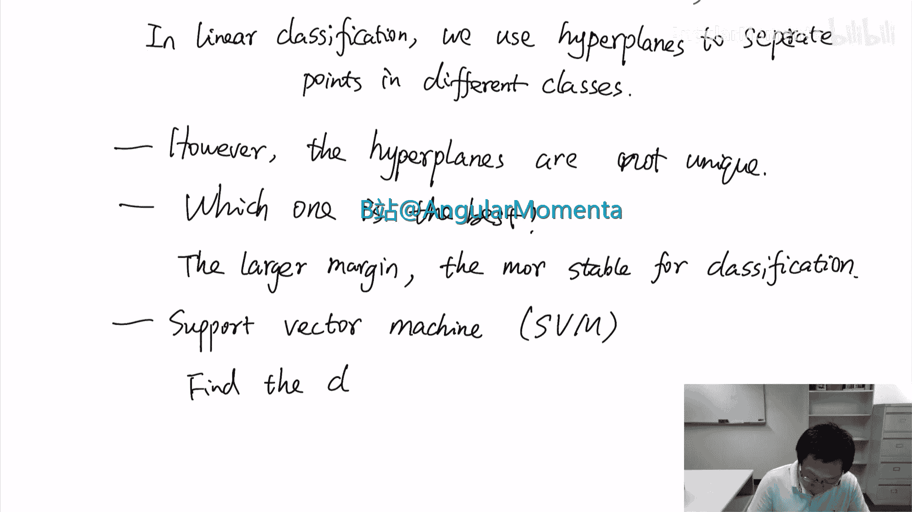
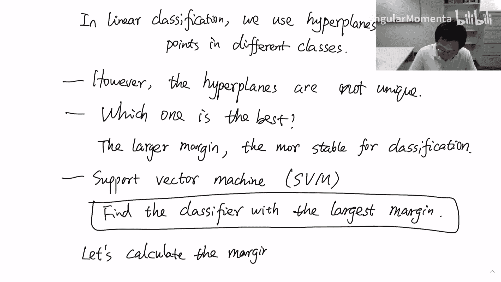
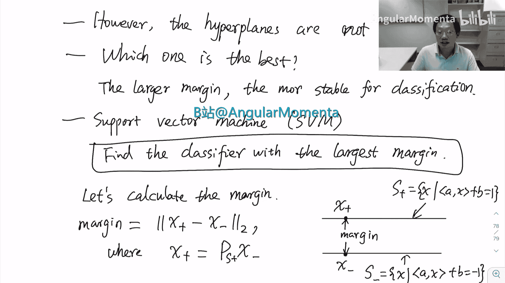
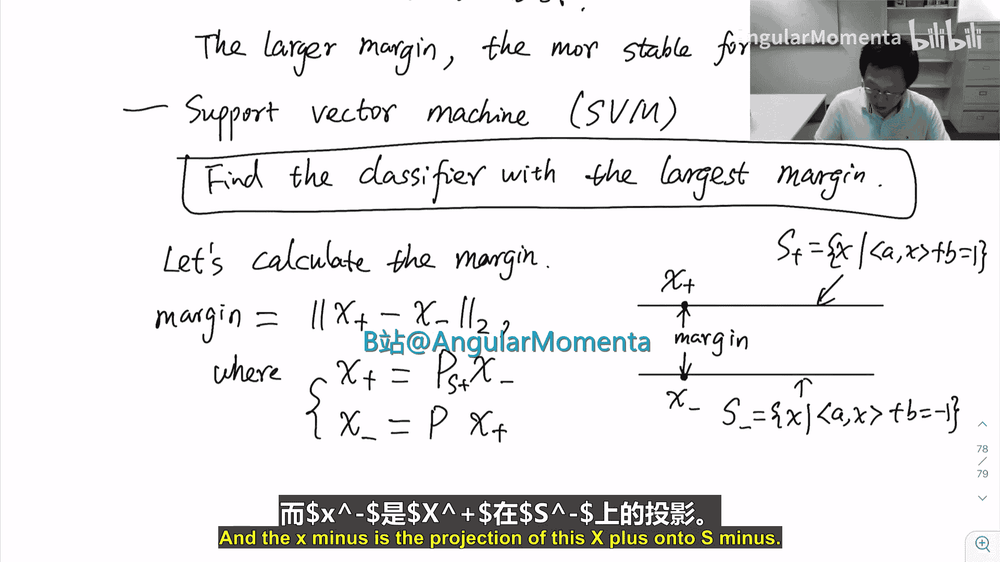
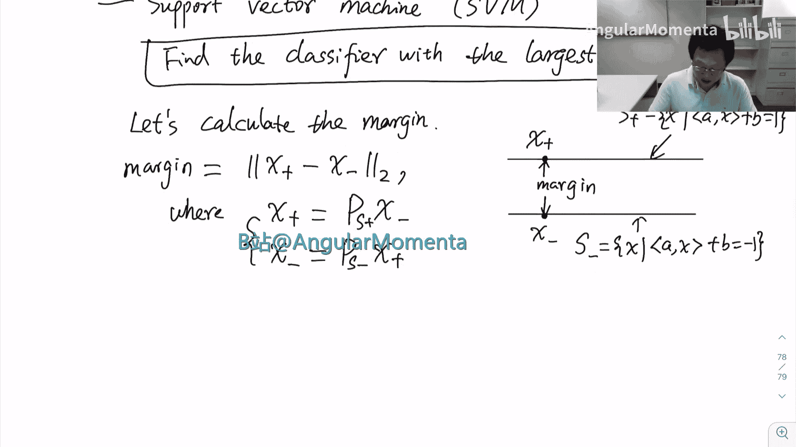
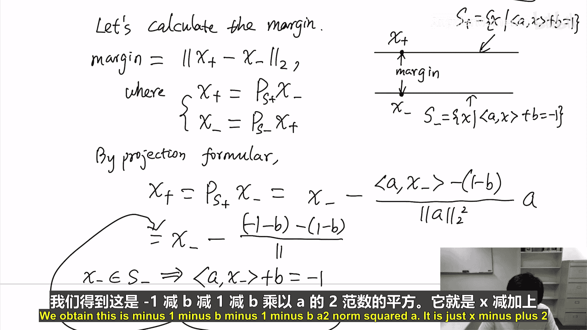
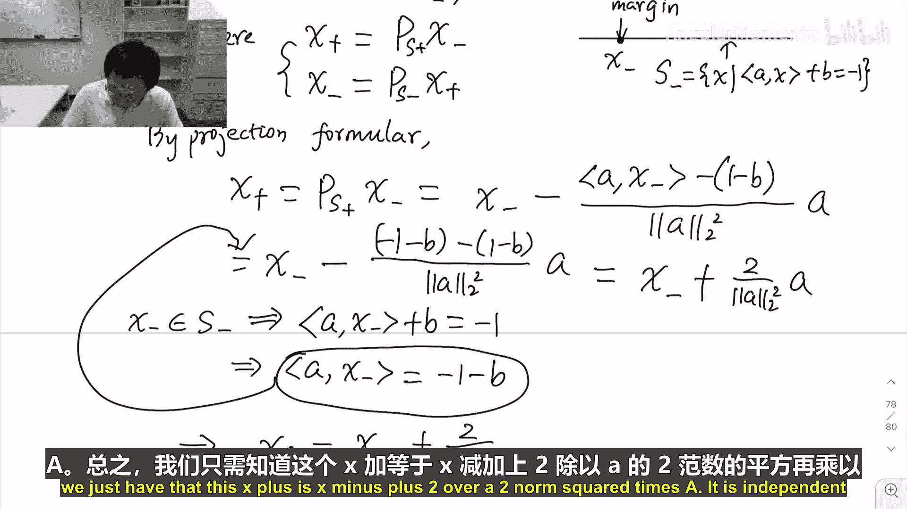
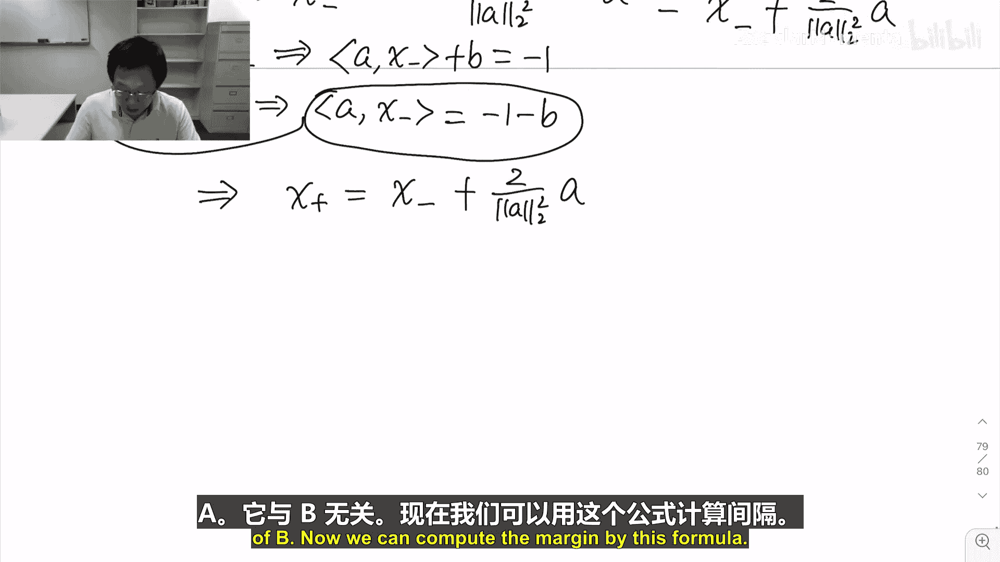
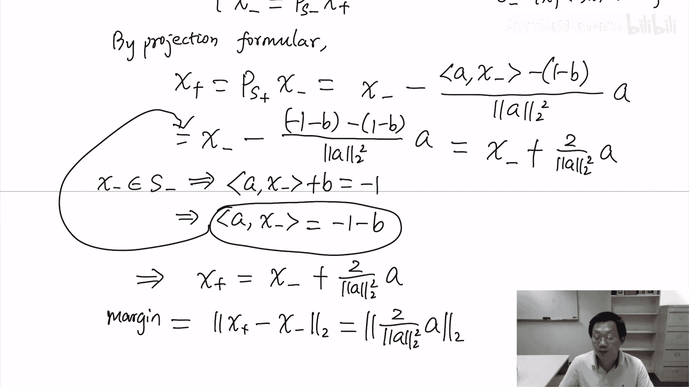
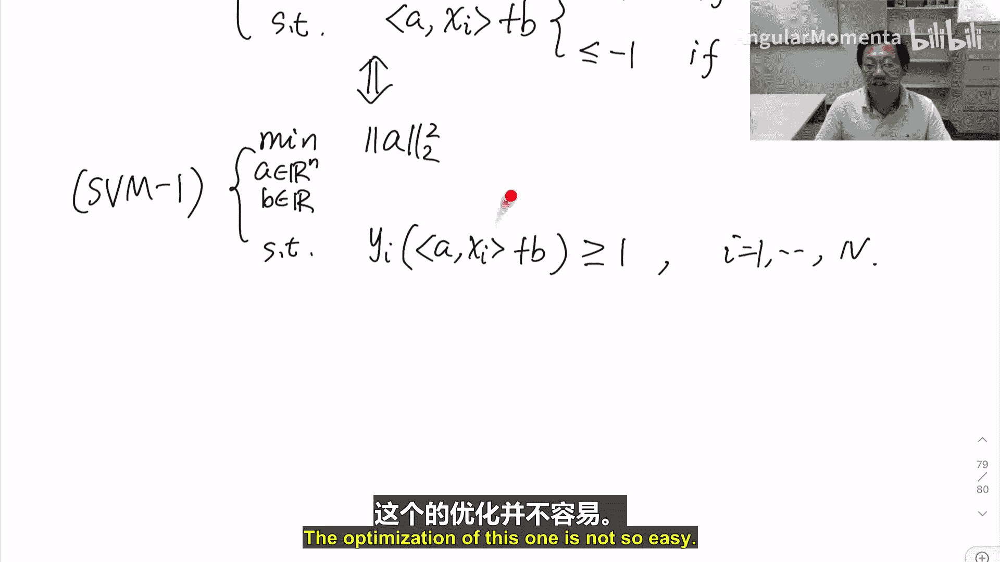

# 060：支持向量机（SVM）基础与间隔计算 🧠

在本节课中，我们将要学习支持向量机（SVM）的基本概念。SVM是一种非常流行的分类器，其核心思想是寻找一个具有最大“间隔”的线性分类器。我们将从定义间隔开始，并推导出如何将其转化为一个具体的优化问题。

## 什么是SVM与最大间隔？

支持向量机是最流行的分类器。它被定义为具有最大间隔的线性分类器。

这意味着我们选择最稳定的分类器。为了将其转化为一个优化问题，我们首先需要对“间隔”进行定量描述。我们需要计算对于一个形如 **f(x) = A·x + B** 的分类器，其间隔有多大。

## 间隔的几何定义与计算

上一节我们介绍了SVM的目标是最大化间隔，本节中我们来看看如何具体计算这个间隔。

图中绘制了两个分离超平面。顶部的超平面是 **A·x + B = 1**，底部的超平面是 **A·x + B = -1**。对于训练数据，类别为+1的点位于上方，类别为-1的点位于下方。我们称上方的平面为 **S+**，下方的平面为 **S-**。

间隔就是这两个平行超平面之间的距离。为了计算这个距离，我们考虑两个点：**x+** 在 **S+** 上，**x-** 在 **S-** 上。**x-** 是 **x+** 在 **S-** 上的投影，反之亦然。这意味着向量 **x+ - x-** 与超平面正交。

基于这个观察，我们可以计算间隔。间隔就是 **x+** 和 **x-** 之间的欧几里得距离（2-范数）。

## 利用投影公式推导间隔

以下是利用投影公式计算 **x+** 和 **x-** 关系的步骤。

我们之前已经讨论过投影公式。根据该公式，**x+**（即 **x-** 在 **S+** 上的投影）可以表示为：

**x+ = x- - [ (A·x- + B - 1) / ||A||² ] * A**

由于 **x-** 在 **S-** 上，满足 **A·x- + B = -1**。因此，内积 **A·x- = -1 - B**。将其代入上式：

**x+ = x- - [ (-1 - B - 1) / ||A||² ] * A = x- - [ (-2) / ||A||² ] * A = x- + (2 / ||A||²) * A**

这个结果与 **B** 无关。

现在我们可以计算间隔了。

## 得出间隔公式

根据公式，间隔 **margin = ||x+ - x-||₂**。将 **x+** 的表达式代入：

**margin = || [x- + (2 / ||A||²) * A] - x- ||₂ = || (2 / ||A||²) * A ||₂**

由范数的齐次性质，可得：

**margin = (2 / ||A||²) * ||A||₂ = 2 / ||A||₂**

因此，间隔的公式为 **2 / ||A||₂**。可以看到，间隔大小仅由向量 **A** 的范数决定。对于不同的分类器（对应不同的 **A**），会得到不同的间隔值 **2 / ||A||₂**。

## 构建SVM优化问题

我们的目标是最大化间隔，即最大化 **2 / ||A||₂**。这等价于最小化分母 **||A||₂**。通常我们使用平方形式 **||A||₂²**，因为对于正数输入，平方函数是单调递增的，最小化两者是等价的。

同时，分类器 **f(x) = A·x + B** 必须正确分类所有训练数据。这个约束条件可以统一写为：

**y_i * (A·x_i + B) ≥ 1， 对于所有 i = 1, 2, ..., m**

这里 **y_i** 是样本的真实标签（+1或-1）。这个不等式确保了预测值与真实标签同号，并且函数值距离分离超平面至少为1。

综合以上，我们得到SVM的标准优化问题形式：

**最小化： (1/2) * ||A||²**
**约束条件： y_i * (A·x_i + B) ≥ 1， 对所有 i**

这个公式被称为SVM的原始形式或硬间隔SVM。求解这个优化问题本身并不简单，涉及拉格朗日乘子法等技术，我们在此不深入展开。

## 总结

本节课中我们一起学习了支持向量机的基础。我们从定义最大间隔分类器开始，逐步推导了间隔的几何含义和计算公式 **margin = 2 / ||A||₂**。最后，我们将寻找最优分类器的问题，形式化为了一个在线性约束下最小化权重向量范数平方 **||A||²** 的凸优化问题。这是理解更复杂SVM模型（如软间隔、核方法）的重要基石。