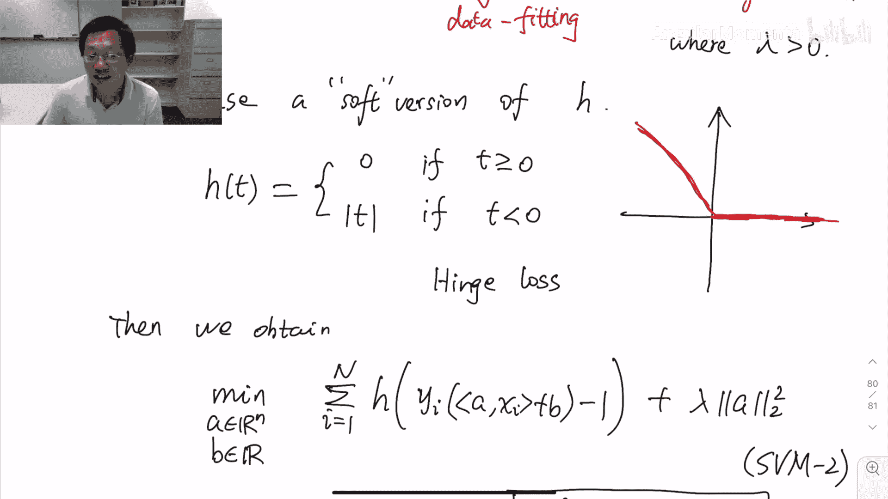

# 061：从硬间隔到软间隔支持向量机

在本节课中，我们将学习支持向量机（SVM）的核心思想及其演变。我们将从最初的“硬间隔”SVM开始，探讨其在面对噪声数据时的局限性，并最终推导出更鲁棒的“软间隔”SVM。

## 硬间隔支持向量机（SVM1）及其局限性

上一节我们介绍了支持向量机的基本概念，即寻找一个能最大化分类间隔的超平面。其优化问题如下：

**目标**：最大化分类间隔。
**约束**：所有样本点都被正确分类。

用数学公式表示，对于数据集 `{(x_i, y_i)}`，其中 `y_i ∈ {+1, -1}`，我们希望找到超平面参数 `a` 和 `b`，使得对于所有 `i`，满足：
`y_i * (a^T x_i + b) >= 1`

这个优化问题本身并不简单，我们在此不展开求解过程。我们最大化间隔的目的是为了使分类器对噪声具有鲁棒性，即在预测阶段保持稳定。这里的“间隔”衡量了需要多大的噪声才会导致分类错误。

然而，这种对噪声的鲁棒性仅限于**预测阶段**。那么，在**训练阶段**呢？

如果训练数据本身含有噪声，情况就不同了。噪声可能导致正类（+1）和负类（-1）的样本点相互交错。在这种情况下，我们可能无法找到一个线性超平面来完美地将两类分开。

以下是一个简单的例子：
*   假设我们有干净的训练数据，红色点代表正类（+1），蓝色点代表负类（-1），我们可以找到一个超平面将其分开。
*   但在实践中，数据可能含有噪声。一些蓝色点可能因为噪声被扰动到红色区域，反之亦然。
*   此时，正类和负类的样本会相互交织。无论选择哪个超平面，其两侧都会同时存在红色和蓝色的点。

在这种情况下，任何超平面都无法**完全分离**这两个类别。从优化问题的角度看，这意味着约束条件无法被满足，该约束优化问题的可行解集是空的。也就是说，对于SVM1这个最小化问题，**不存在解**。

## 从约束优化到无约束优化

为了解决上述问题，我们需要重新表述SVM1。思路是首先将其转化为一个无约束优化问题。

在优化理论中，一种常见做法是定义一个约束条件的**指示函数**。我们定义一个函数 `H`，它将实数 `R` 映射到扩展的实数集 `R ∪ {+∞}`。

`H(t)` 的定义如下：
*   如果 `t >= 0`，则 `H(t) = 0`。
*   如果 `t < 0`，则 `H(t) = +∞`。

这个 `H` 函数就是非负实数集的指示函数：对于非负数，其值为0；对于负数，其值为无穷大。

利用这个记号，SVM1可以等价地改写为以下形式：

`min_{a, b} [ λ * ||a||^2 + Σ_{i=1}^{n} H( y_i * (a^T x_i + b) - 1 ) ]`

为什么这个形式与SVM1等价呢？
*   如果某个 `y_i * (a^T x_i + b) - 1 < 0`，那么 `H(...)` 的结果就是 `+∞`。由于求和项和正则项都是非负的，整个目标函数值就会变成 `+∞`，这绝不可能是最小值。
*   因此，目标函数值为有限值的**充要条件**是所有 `y_i * (a^T x_i + b) - 1 >= 0` 都成立，即所有原始约束都被满足。
*   当所有约束都被满足时，所有的 `H(...)` 项都等于0，此时最小化目标函数就等价于最小化 `λ * ||a||^2`。

这个新的表述非常有趣。实际上，它可以被看作是一个“损失函数+正则化项”的标准形式：
*   `Σ H(...)` 是**数据拟合项**，它衡量模型对训练数据的分类损失。
*   `λ * ||a||^2` 是**正则化项**，用于控制模型复杂度，防止过拟合。这与岭回归中使用的L2正则化相同。

然而，这里的**数据拟合项**与线性回归不同。在线性回归中，我们使用预测值与观测值之差的平方和。而在分类问题中，我们使用了基于分类正确性的不同损失函数。

## 引入软间隔：Hinge损失函数

基于上述重新表述，我们可以得到一个对训练数据噪声更鲁棒的SVM新形式。核心思想是替换掉那个过于严格的数据拟合项。

原来的 `H` 函数要求必须完美分类所有样本，否则就施加无穷大的惩罚。这在训练数据有噪声时限制过强、过于“硬性”。

因此，我们需要**软化**这个无穷大的惩罚。我们用一个更温和的版本来替代 `H` 函数：
*   当约束被满足时（即 `t >= 0`），损失仍然为0，因为我们不希望惩罚正确分类的样本。
*   当约束未被满足时（即 `t < 0`），我们不直接设为无穷大，而是根据其违反约束的程度施加一个**线性惩罚**。

具体来说，我们使用以下函数，称为**Hinge损失函数**（因其图像形如合页）：

`H_hinge(t) = max(0, 1 - t)`
或者等价地：
*   如果 `t >= 1`，则 `H_hinge(t) = 0`。
*   如果 `t < 1`，则 `H_hinge(t) = 1 - t`。

注意，在SVM的上下文中，我们通常将参数代入 `t = y_i * (a^T x_i + b)`，因此损失函数变为 `max(0, 1 - y_i * (a^T x_i + b))`。这与我们之前形式 `H( y_i * (a^T x_i + b) - 1 )` 的软版本 `max(0, - (y_i * (a^T x_i + b) - 1))` 是等价的。

于是，我们得到了新的优化问题，称为**软间隔支持向量机（SVM2）**：

`min_{a, b} [ λ * ||a||^2 + (1/n) * Σ_{i=1}^{n} max(0, 1 - y_i * (a^T x_i + b) ) ]`

有时也直接称为**软间隔SVM**。

## 硬间隔与软间隔SVM的区别

软间隔SVM与原始硬间隔SVM（SVM1）的关键区别，仅在于我们改变了损失函数 `H`：
*   在原始SVM中，我们使用**硬性指示函数**。如果约束不满足（分类错误），损失直接设为 `+∞`，这严格不允许任何错误。
*   在软间隔SVM中，我们使用**Hinge损失函数**。如果约束只是轻微不满足（轻微分类错误），它是可以接受的，尽管我们并不希望如此；如果错误非常严重，损失会线性增长。

通过最小化这个新的目标函数，算法会尝试找到一个超平面参数 `a` 和 `b`，使得：
*   对于大多数样本 `i`，`y_i * (a^T x_i + b)` 大于等于1（即分类正确且有足够间隔）。
*   对于少数可能因噪声而误分类的样本，`y_i * (a^T x_i + b)` 可能小于1，但算法会通过最小化损失，迫使这个值不要太小（即不要错得太离谱）。

这样，模型就在**最大化间隔**（通过正则项 `||a||^2`）和**容忍少量分类错误**（通过Hinge损失项）之间取得了平衡，从而对训练数据中的噪声具有了鲁棒性。

---

本节课中我们一起学习了支持向量机从硬间隔到软间隔的发展。我们首先看到了硬间隔SVM在训练数据含噪声时可能无解的局限性。接着，通过将约束优化问题转化为带有指示函数的无约束形式，我们引出了“损失函数+正则化”的框架。最后，通过将硬性的指示函数替换为柔性的Hinge损失函数，我们得到了经典的软间隔支持向量机，它能够容忍一定的分类错误，从而增强了模型在现实嘈杂数据中的实用性。