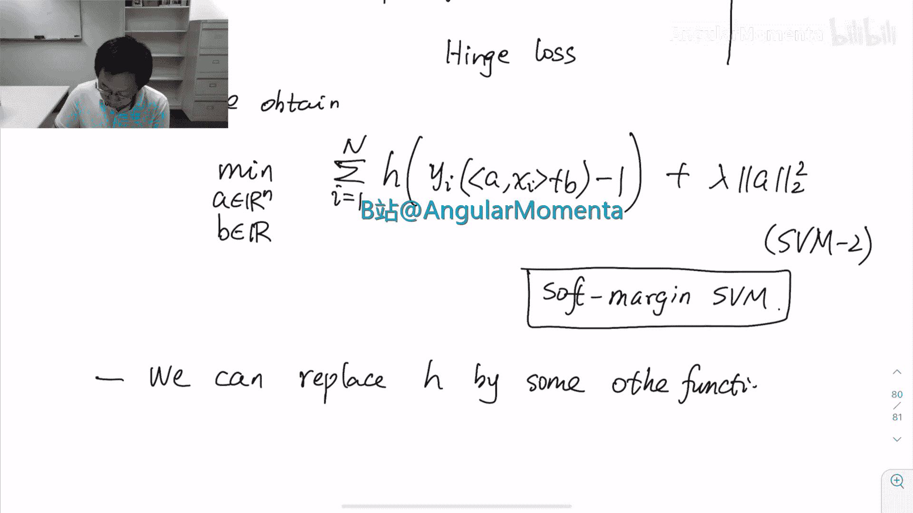
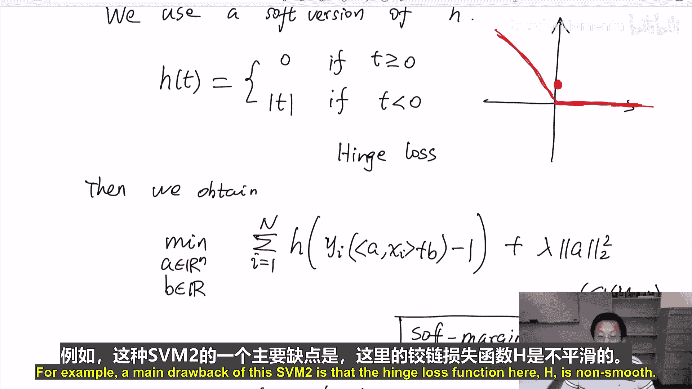
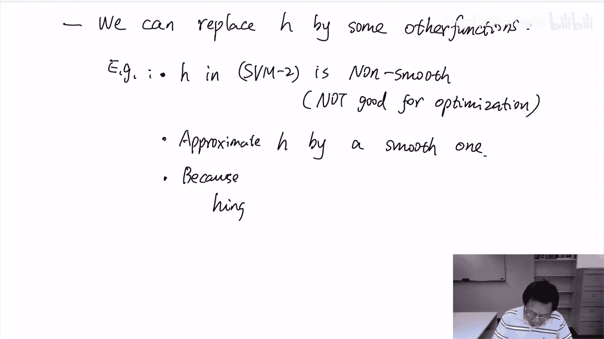
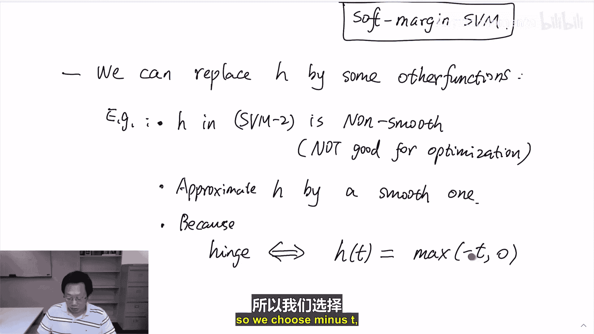
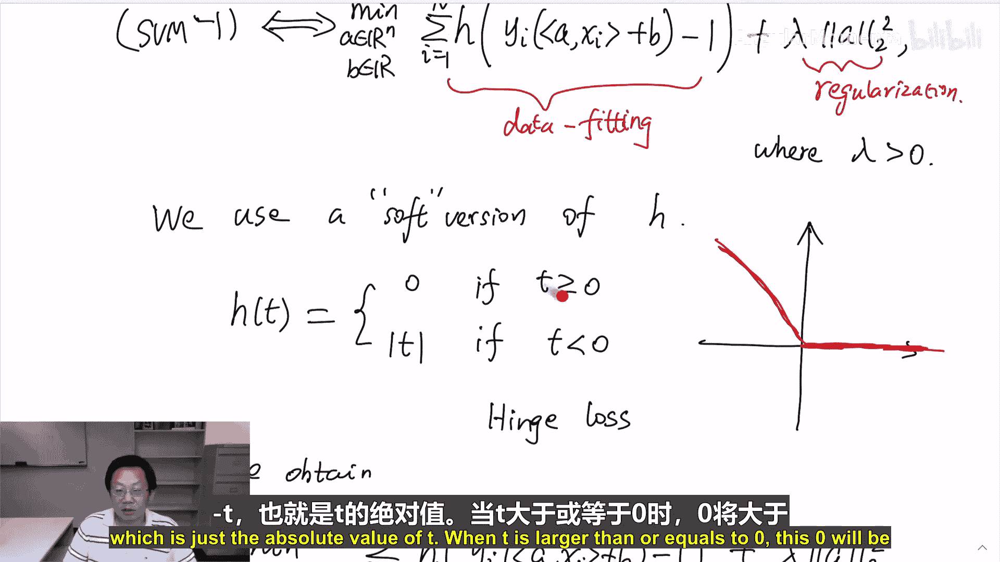
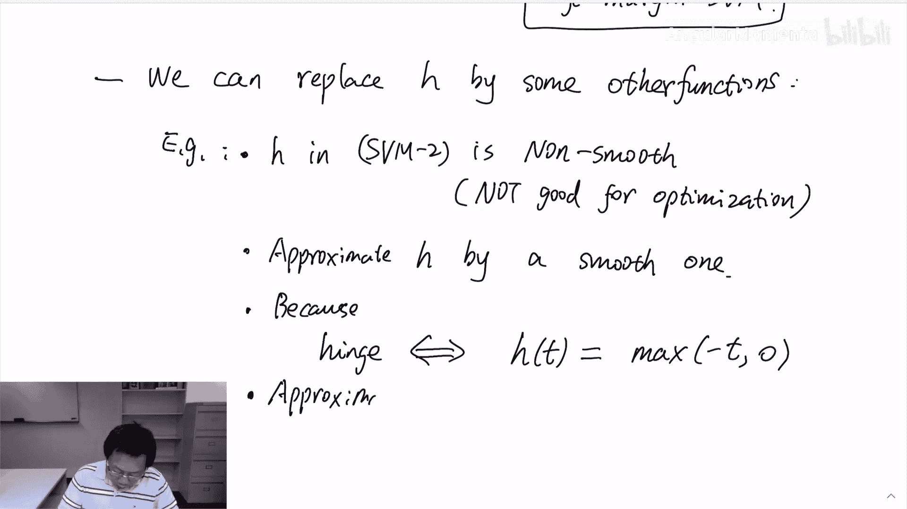
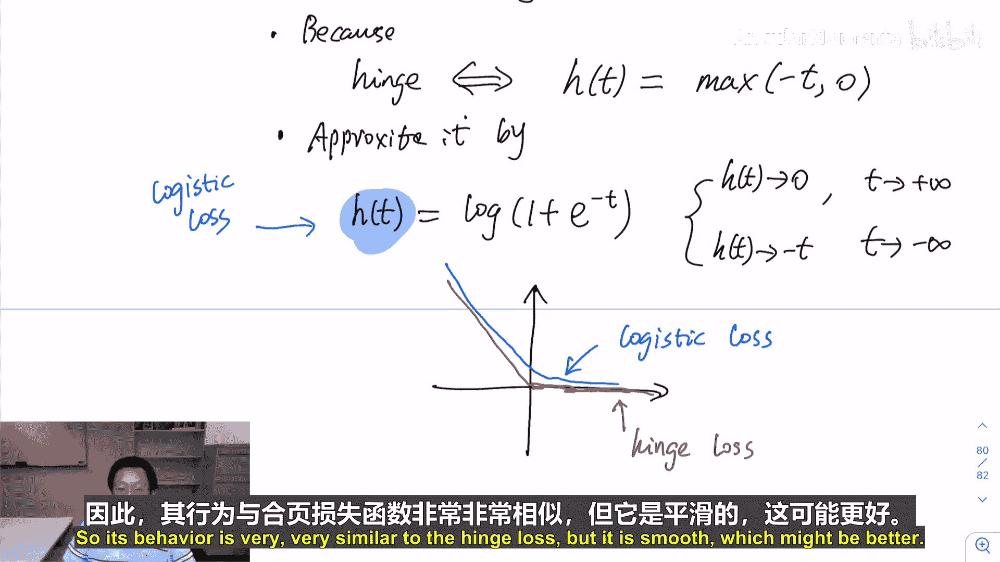
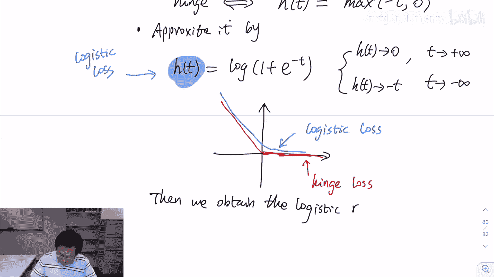
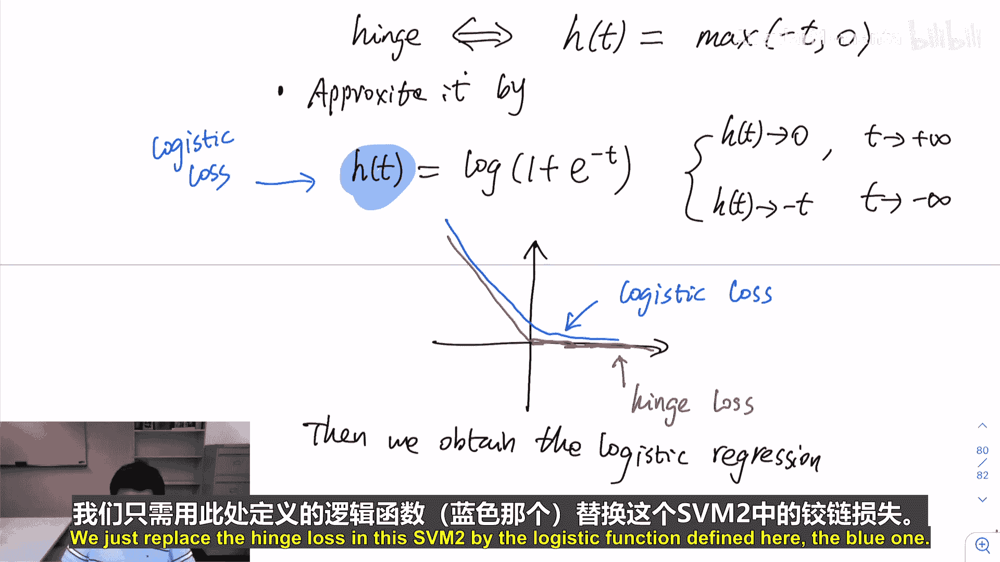
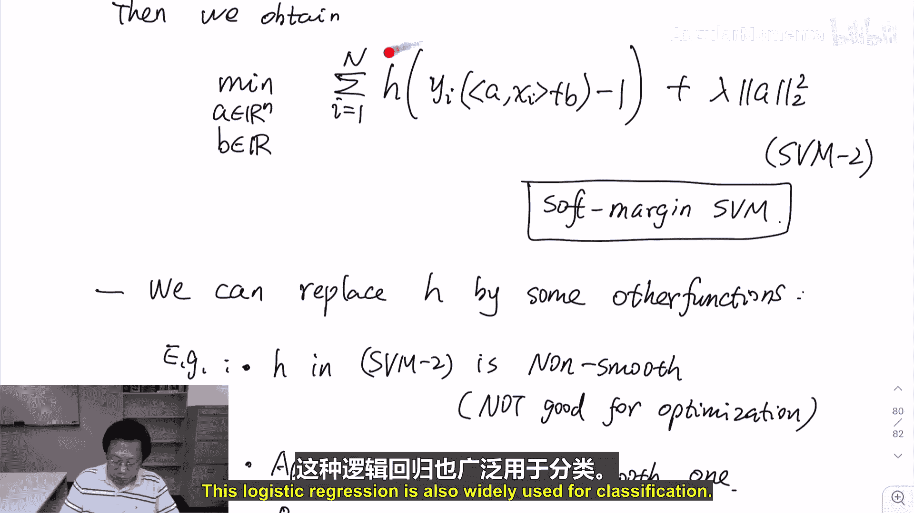

# 062：从SVM到逻辑回归的平滑过渡 🧮

在本节课中，我们将学习如何通过平滑近似的方法，将支持向量机（SVM）中的铰链损失函数替换为逻辑损失函数，从而推导出逻辑回归模型。我们将重点关注损失函数的平滑化过程及其带来的计算优势。

上一节我们介绍了支持向量机（SVM2）及其使用的铰链损失函数。本节中我们来看看该损失函数的一个主要缺点，以及如何通过平滑近似来改进它。

## 铰链损失函数的局限性

支持向量机（SVM2）的一个主要缺点是，其使用的铰链损失函数 **H** 是非平滑的。

该函数在 **t = 0** 处存在一个尖锐的拐角。如果发生这种情况，那么针对此SVM2的优化算法将变得非常困难。许多算法（例如梯度下降法）会因为这个尖锐的拐角而变得非常缓慢。

为了提升计算效率，或出于其他原因，我们需要一个平滑的损失函数。我们需要设计一个平滑的边缘。SVM2中的铰链损失函数是非平滑的，不利于优化。

## 平滑近似方法

因此，我们通过一个平滑函数来近似这个损失函数。我们只需用一个平滑函数来近似这个铰链损失函数，使得该函数图像的曲线上没有拐角。

让我们看看如何实现。以下是平滑近似的原理。

因为铰链损失函数 **H(t)** 可以重写为 **max(-t, 0)**。

你可以看到，当 **t ≤ 0** 时，**-t ≥ 0**，我们选择 **-t**，这正好是 **t** 的绝对值。当 **t ≥ 0** 时，**0 ≥ -t**，我们选择 **0**。因此，铰链损失中的 **H(t)** 正好可以写成这种形式。

对于这个 **max** 函数，我们可以使用 **softmax** 近似。

我们定义一个新函数 **H(t) = log(1 + exp(-t))**。

可以看到，对于这个函数：
*   当 **t → +∞** 时，**exp(-t) → 0**，所以 **log(1) = 0**。因此 **H(t) → 0**。
*   当 **t → -∞** 时，**exp(-t)** 变得非常大，主导了整个表达式，使得 **1 + exp(-t) ≈ exp(-t)**。取对数后得到 **-t**。因此 **H(t) → -t**。

这个新函数 **H(t)** 的图像是一条非常平滑的曲线。它是我们铰链损失函数的一个平滑近似。对于这个平滑函数，当 **t** 趋于正无穷时，它趋于 **0**；当 **t** 趋于负无穷时，它趋于 **-t**。因此，其渐近行为与铰链损失函数相同。总体而言，它只是铰链损失函数的一个平滑近似。

下图蓝色曲线就是这个新的 **H** 函数。

这个函数我们称之为**逻辑损失函数**。因此，这就是逻辑损失函数。该函数的优点是平滑且凸。虽然渐近行为与铰链损失相同，但其行为与铰链损失非常相似，并且是平滑的，这可能更好。

## 逻辑回归模型

接下来，我们只需将SVM2中的铰链损失替换为此处定义的逻辑损失函数（蓝色曲线），就可以得到所谓的逻辑回归。

我们得到以下优化问题：

这个逻辑回归模型也广泛用于分类任务。

---

本节课中我们一起学习了如何通过平滑近似，将支持向量机中的非平滑铰链损失函数替换为平滑的逻辑损失函数，从而推导出逻辑回归模型。我们了解了平滑化对优化算法效率的提升，并看到了两种损失函数在形式与渐近行为上的联系。逻辑回归因其平滑的特性，在实际计算中往往更具优势。