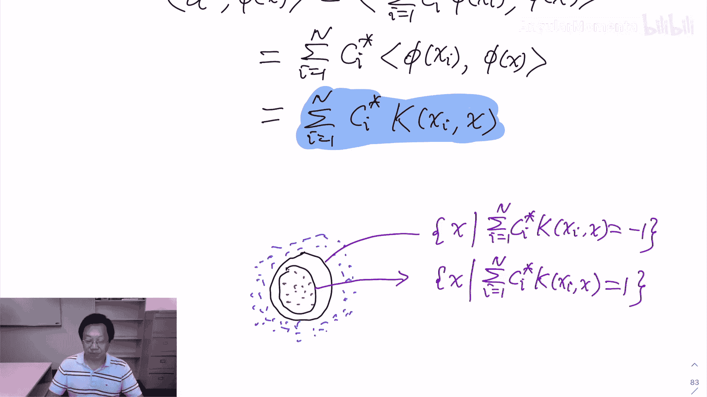

# 063：核支持向量机（Kernel SVM）🚀

在本节课中，我们将要学习如何将线性支持向量机（SVM）扩展为能够处理非线性数据的核支持向量机。我们将看到，通过使用“核技巧”，我们可以在一个高维特征空间中应用线性SVM，从而在原始输入空间中实现非线性的分类边界。

## 线性模型的局限性

上一节我们介绍了多种线性SVM模型。它们都是线性分类器，使用超平面来分隔不同类别的数据点。

然而，这些模型无法处理非线性数据。例如，我们有一个“+1”类数据点被“-1”类数据点包围。对于这种数据，无论标准SVM、软间隔SVM还是逻辑回归，都无法有效工作，因为它们都只使用线性函数（超平面）来分隔数据。而在这个例子中，“+1”类和“-1”类之间的边界显然是一个圆形。

在这种情况下，这些线性SVM模型无法工作。因此，我们需要转向非线性方法。

## 引入核技巧

与从K均值到核K均值、从线性回归到核岭回归的转变类似，我们也可以将“核技巧”应用于SVM，从而得到核支持向量机。这意味着我们将在变换后的特征域中应用线性分类器。

具体来说，我们首先通过一个特征变换函数 **Φ** 将输入数据映射到特征空间 **H**。

**公式：** `x ∈ ℝᴺ → Φ(x) ∈ H`

这里，**Φ** 是将输入数据从 **ℝᴺ** 映射到希尔伯特空间 **H** 的特征变换。这个希尔伯特空间通常是无限维的。

然后，我们在 **H** 空间中应用SVM。现在，数据点变为 **(Φ(x₁), y₁), ..., (Φ(x_N), y_N)**。

与回归情况类似，在 **ℝᴺ** 中的线性回归模型我们实际上使用了仿射函数。但在非线性核岭回归中，我们只使用了线性函数，因为仿射函数在特征域中并非必需。我们可以通过添加一个额外的坐标来创建一个新的特征变换，然后在这个新变换下，我们只需要使用线性函数。

这里的情况相同。我们只需要在 **H** 中找到一个用于分类的线性函数。根据表示定理，**H** 中的任何线性函数都可以表示为内积形式。

因此，我们最小化以下目标函数，这与线性SVM的情况类似：

**公式：** `min_{a ∈ H} Σ_{i=1}^{N} H(y_i * <a, Φ(x_i)>) + λ ||a||_H²`

这里，我们只使用参数 **a**，而没有偏置项 **b**，因为我们在 **H** 中使用的是线性函数。正则化项是 **H** 空间中的范数平方。

## 表示定理与问题简化

由于 **a** 位于 **H** 中，而 **H** 通常是无限维的，直接参数化 **a** 需要无限多个参数，因此这个最小化问题是不切实际的。此外，这个公式需要显式地知道 **H** 空间的内积、**Φ** 变换和 **H** 范数，这些我们都不希望直接处理。

再次，我们使用表示定理。首先，将 **a** 正交分解：

**公式：** `a = a_s + Σ_{j=1}^{N} c_j Φ(x_j)`

其中，**a_s** 与所有 **Φ(x_i)** 正交。将分解式代入目标函数，并利用正交性进行化简。

为了简化表示，我们引入核矩阵 **K**：

**公式：** `K_{ij} = <Φ(x_i), Φ(x_j)>`

**K** 是一个 **N × N** 的矩阵。利用核矩阵，目标函数可以简化为关于向量 **c** 和 **a_s** 的函数。

**公式：** `Σ_{i=1}^{N} H( y_i * (K^T c)_i ) + λ c^T K c + λ ||a_s||_H²`

现在，我们需要在向量 **c ∈ ℝᴺ** 和与所有 **Φ(x_i)** 正交的 **a_s ∈ H** 上最小化这个目标函数。

## 推导核SVM的解

与核岭回归的技巧类似，我们可以暂时忽略 **a_s** 的正交约束。此时，最小化问题等价于分别对 **c** 和 **a_s** 进行最小化。

对于 **a_s** 项，显然其最小化结果为 **0**。

**结论：** `a_s* = 0`

因此，最优解 **a*** 必须具有以下形式：

**公式：** `a* = Σ_{i=1}^{N} c_i* Φ(x_i)`

而最优系数向量 **c*** 通过求解以下优化问题得到：

**公式：** `c* = argmin_{c ∈ ℝᴺ} Σ_{i=1}^{N} H( y_i * (K^T c)_i ) + λ c^T K c`

这就是核SVM的表示定理。它证明了最优解 **a*** 一定是训练数据特征映射的线性组合。

## 核SVM完整算法

从上述推导中，我们可以看到可以应用核技巧。我们不需要显式定义 **Φ** 和内积，只需要定义一个核函数。

以下是核SVM的完整算法步骤：

**第一步：定义核函数**
选择一个核函数 **K(x, y)**，它满足 **K(x, y) = <Φ(x), Φ(y)>** 对于某个映射 **Φ** 成立。根据Mercer定理，只要 **K** 是对称半正定的，这样的 **Φ** 就存在。常见的选择包括：
*   高斯核（RBF核）
*   多项式核

**第二步：构建核矩阵**
利用训练数据 **{x₁, ..., x_N}** 计算核矩阵 **K**：

**代码/公式：** `K[i][j] = K(x_i, x_j)`

**第三步：求解系数**
通过求解以下优化问题得到系数向量 **c***：

**公式：** `c* = argmin_{c} Σ_{i=1}^{N} H( y_i * (K^T c)_i ) + λ c^T K c`

其中，函数 **H** 取决于所使用的SVM变体：
*   **标准（硬间隔）SVM**：**H(z)** 是指示函数（0/∞）。
*   **软间隔SVM**：**H(z)** 是合页损失函数。
*   **核逻辑回归**：**H(z)** 是对数损失函数。

**第四步：构建分类器函数**
对于新的输入数据点 **x**，其分类决策函数为：

**公式：** `f(x) = sign( Σ_{i=1}^{N} c_i* K(x_i, x) )`

这个函数在原始输入空间 **ℝᴺ** 中是非线性的，但在特征空间 **H** 中是线性的。它只依赖于核函数 **K** 的计算，而无需显式计算 **Φ(x)**。

## 处理非线性数据

应用核SVM到之前提到的圆形数据上，我们将得到一个函数，其决策边界是曲线（例如，圆形或更复杂的形状）。这个分类函数 **f(x)** 的零水平集（或±1水平集）就是分隔两个类别的曲线。

**核心思想：** 我们通过在高维特征空间中构造线性边界，从而在原始空间中实现了非线性的分类边界。

---

**本节课总结**

在本节课中，我们一起学习了核支持向量机（Kernel SVM）。我们从线性SVM处理非线性数据的局限性出发，引入了特征映射和核技巧。通过表示定理，我们将无限维特征空间中的优化问题，转化为一个只需在有限维核矩阵上求解的优化问题。核SVM的完整算法包括：定义核函数、构建核矩阵、求解系数、以及使用核函数计算新样本的类别。最终，我们获得了一个强大的非线性分类器，能够处理复杂的、线性不可分的数据集。