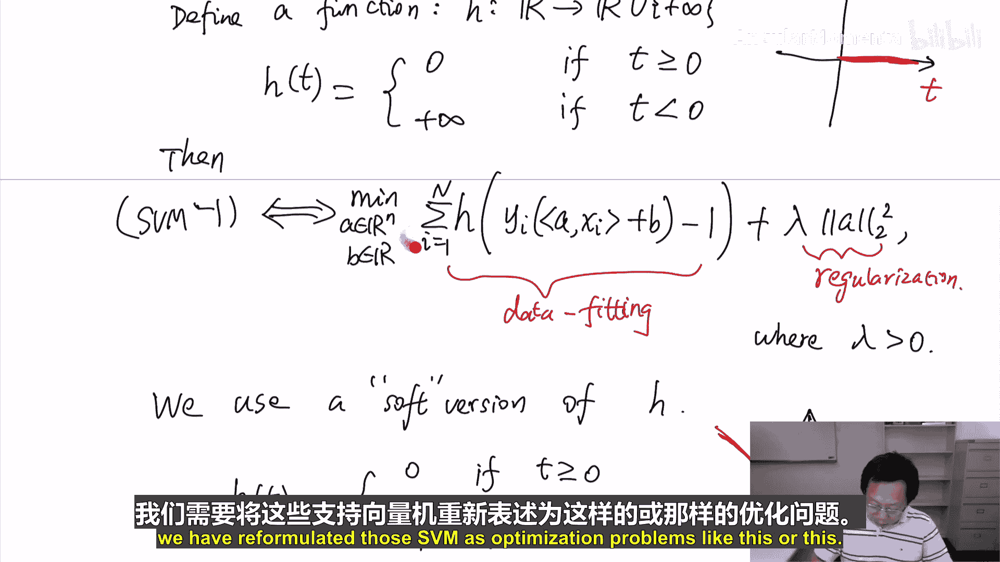
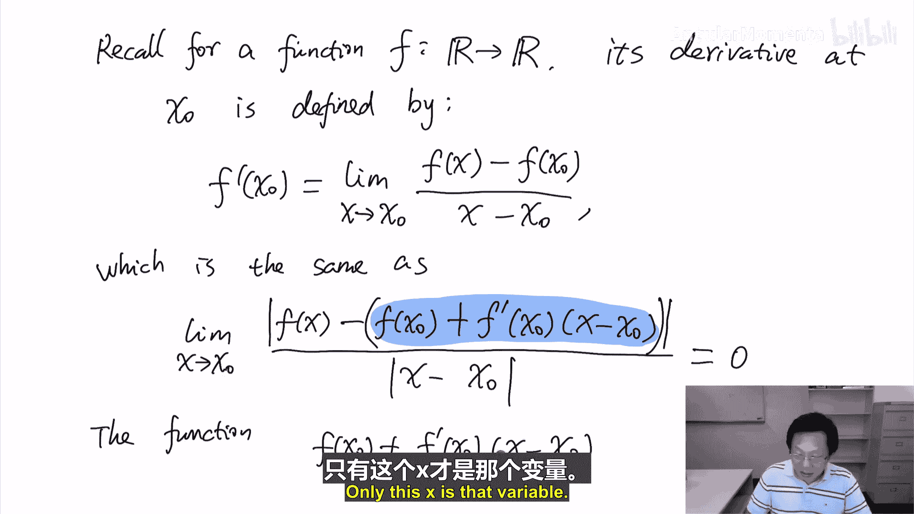
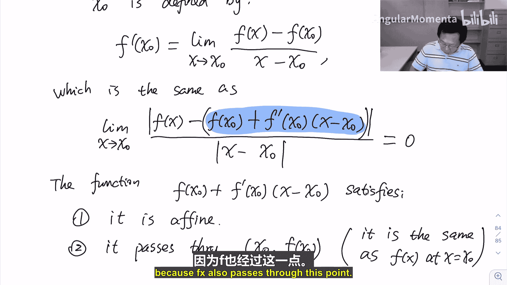
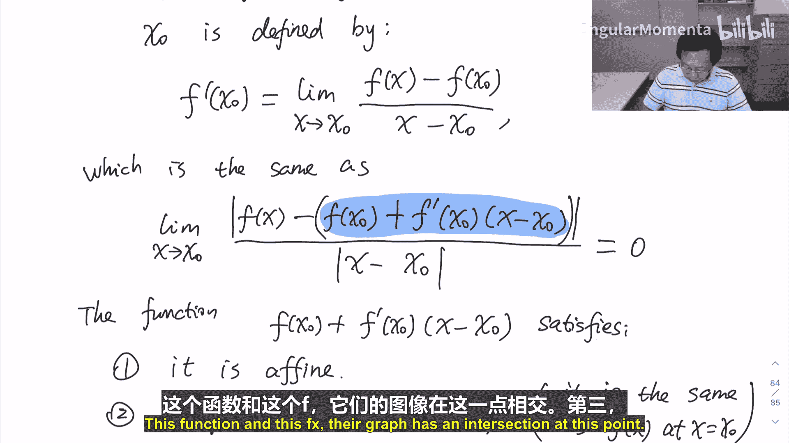
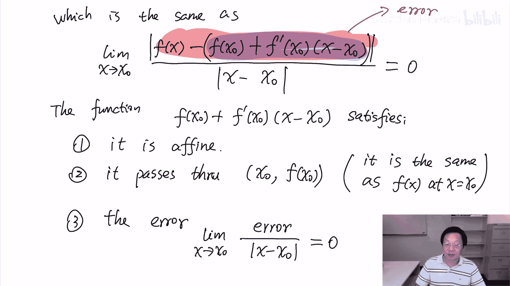
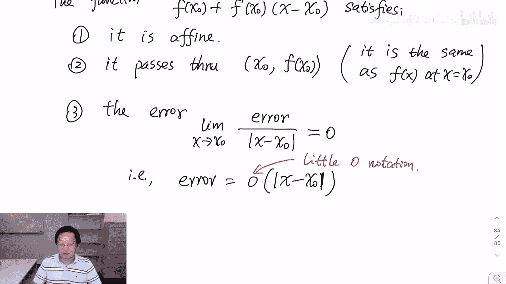

# 064：非线性函数与微分

在本节课中，我们将要学习非线性函数，并探讨如何通过线性函数来局部近似它们，这一过程被称为微分。

## 概述

我们已经在向量空间上研究了线性和有限函数。特别是对于希尔伯特空间上的线性函数，根据里斯表示定理，我们知道希尔伯特空间上的任何线性有界函数都可以用内积来表示。我们也成功地将线性函数应用于回归和分类任务。

然而，在许多其他情况下，我们仍然需要使用非线性函数。例如，在线性回归中，我们应用线性函数进行回归任务；在分类中，我们使用线性函数来获得支持向量机方法。尽管这两种方法在许多应用中都能取得良好效果，我们仍希望提升其性能。

近年来，人们开始考虑由神经网络产生的非线性函数。这些函数是高度非线性的，它们是一类特殊设计的非线性函数，这就是所谓的深度学习。如今，深度学习是推动人工智能技术近期迅猛发展的主要驱动力。

此外，即使是像支持向量机这样的线性模型，如果我们想求解SVM模型，也需要将其重新表述为如下优化问题：




这里，优化问题中的目标函数对于参数 **A** 和 **B** 是非线性的。虽然我们在此使用了线性模型，但由于损失函数 **h** 是非线性的（它不是平方和），这仍然是一个非线性优化问题。

因此，非线性函数也出现在线性模型的优化问题中。基于以上两个目的以及更多原因，我们需要学习非线性函数。接下来，我们将研究向量空间上的非线性函数，并进入线性近似，即微分。

## 微分的核心思想

简单的想法是，我们用线性函数来近似非线性函数。但如果你考虑一个二次函数，想要用一个线性函数全局地近似它似乎是不可能的。因为无论使用哪个线性函数，你都会看到该线性函数与这个二次函数之间存在巨大差异。

所以，这种线性近似只能局部进行。这意味着我们只考虑某个点（如下图所示）的一个小邻域。现在你可以看到，用一个线性函数来很好地近似它是可能的。这就是微分。



## 从单变量函数开始

让我们从 **R** 到 **R** 的函数的微分开始。回顾一下，对于一个函数 **f: R → R**，它在某点 **x₀** 的导数定义如下。

通常在微积分中，我们通过一个极限来定义 **f‘** 在 **x₀** 的值：考虑函数值之差与 **x** 之差的比值。函数值之差 **f(x) - f(x₀)** 除以 **x - x₀**，然后令 **x** 趋近于 **x₀**。这是单变量函数在 **x₀** 处导数的通常定义。

现在，我想从线性近似的角度重新表述这个定义。为此，我们首先需要重新表述这个定义。这个定义等价于：

我将 **f’(x₀)** 从等式左边移到右边，然后得到一个极限等于零的表达式：
```
lim (x→x₀) [ f(x) - f(x₀) - f‘(x₀) * (x - x₀) ] / (x - x₀) = 0
```
如果我在分子和分母上都加上绝对值函数，这仍然成立。特别地，我也将这两个减法重写为求和后的减法。

那么，让我们关注这个项。这个求和可以被视为对函数 **f** 的线性近似。让我们看看这个函数的性质。

函数 **f(x₀) + f’(x₀) * (x - x₀)** 是 **x** 的函数（**x₀** 是给定的常数）。这个函数满足以下性质：

首先，这个函数是一个线性函数。这很明显，它是 **f‘(x₀)** 乘以 **x** 再加上一个常数。

其次，如果我们设 **x = x₀**，那么这个函数值就是 **f(x₀)**。这意味着该函数的图像经过点 **(x₀, f(x₀))**。所以，这意味着在 **x = x₀** 处，它与 **f(x)** 的值相同，因为 **f(x)** 的图像也经过这个点。




这个函数和 **f(x)** 的图像在这一点相交。





第三，误差。我们用这个线性函数来近似 **f(x)**，它们的差值就是误差。上面的等式给出了这个误差大小的定量描述。该等式告诉我们，当 **x** 趋近于 **x₀** 时，误差除以 **(x - x₀)** 的极限为 0。




这恰恰意味着，误差是 **(x - x₀)** 的**小o**。这里我使用了小o记号。当我写“误差是 |x - x₀| 的小o”时，意思就是上面这个极限定义。不要将这个小o记号与大O记号混淆。大O只意味着该极限被一个常数有界，而小o意味着当 **x** 趋近于 **x₀** 时，这个误差与 **(x - x₀)** 相比是可忽略的，它甚至比 **(x - x₀)** 还要小，它的阶数低于 **(x - x₀)**。



## 总结


本节课中，我们一起学习了非线性函数的重要性及其在机器学习和优化中的出现。我们探讨了用线性函数局部近似非线性函数的核心理念，即微分。我们从单变量函数的导数定义出发，并从线性近似的角度重新阐释了它，引入了误差的小o记号来描述近似的精度。这为后续学习多变量函数的微分奠定了重要基础。