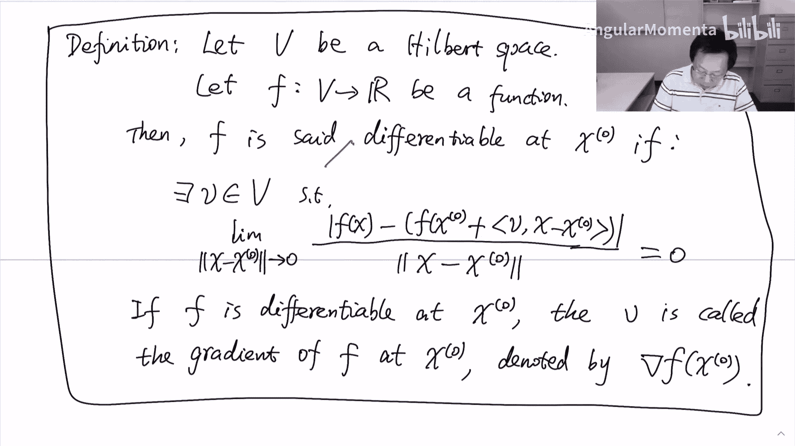

# 065：希尔伯特空间上函数的导数与梯度定义 🧮


在本节课中，我们将学习如何将单变量函数的导数概念，推广到更一般的希尔伯特空间上的函数。我们将通过寻找一个仿射函数来近似非线性函数，并以此为基础，严格定义函数的可微性和梯度。


---


上一节我们回顾了单变量函数的导数定义。本节中，我们来看看如何将这个定义推广到希尔伯特空间上的函数。


对于一个从希尔伯特空间 **V** 映射到实数 **R** 的函数 **F**，我们考虑其在某一点 **x₀** 的导数。其核心思想是，在 **x₀** 附近，用一个仿射函数 **G** 来近似原函数 **F**。

这个仿射函数 **G** 需要满足以下三个条件：
1.  **G** 是一个仿射且有界的函数。
2.  **G** 在点 **x₀** 处的函数值与原函数 **F** 相同，即 **G(x₀) = F(x₀)**。
3.  当 **x** 趋近于 **x₀** 时，用 **G** 近似 **F** 所产生的误差，相对于 **x** 与 **x₀** 之间的距离（范数）而言，是一个高阶无穷小。

更精确地说，我们希望误差满足以下极限条件：
```
lim_{x → x₀} ( |F(x) - G(x)| / ||x - x₀|| ) = 0
```
或者等价地，误差是 **||x - x₀||** 的“小o”量级：
```
F(x) - G(x) = o(||x - x₀||)  当 x → x₀
```


---


接下来，我们根据上述条件来推导仿射函数 **G** 的具体形式。


由于 **G** 是仿射且有界的，根据表示定理，它可以写成一个线性函数加上一个常数的形式：
```
G(x) = <v, x> + a
```
其中 **v** 是空间 **V** 中的一个向量，**a** 是一个实数，**<·, ·>** 表示内积。


我们可以将上述形式改写为：
```
G(x) = <v, x - x₀> + (<v, x₀> + a)
```


根据条件2，函数 **G** 必须经过点 **(x₀, F(x₀))**。将 **x = x₀** 代入上式，我们得到：
```
G(x₀) = <v, x₀> + a = F(x₀)
```
由此，我们可以解出常数项 **a = F(x₀) - <v, x₀>**。


将 **a** 代回 **G(x)** 的表达式，我们得到 **G** 的最终形式：
```
G(x) = <v, x - x₀> + F(x₀)
```

现在，我们来看条件3。将 **G(x)** 的表达式代入误差极限条件中：
```
lim_{x → x₀} ( |F(x) - [F(x₀) + <v, x - x₀>]| / ||x - x₀|| ) = 0
```
寻找满足条件的仿射函数 **G**，等价于寻找一个特定的向量 **v**，使得上述极限成立。这个向量 **v** 至关重要。


---

基于以上的推导，我们现在可以给出希尔伯特空间上函数可微性与梯度的正式定义。


**定义**：
设 **V** 是一个希尔伯特空间，**F: V → R** 是一个函数。称 **F** 在点 **x₀** 处**可微**，如果存在一个向量 **v ∈ V**，使得下式成立：
```
lim_{x → x₀} ( |F(x) - F(x₀) - <v, x - x₀>| / ||x - x₀|| ) = 0
```
或者等价地：
```
F(x) = F(x₀) + <v, x - x₀> + o(||x - x₀||)  当 x → x₀
```
如果 **F** 在 **x₀** 处可微，那么满足上述条件的唯一向量 **v** 称为 **F** 在 **x₀** 处的**梯度**，记作：
```
v = ∇F(x₀)
```

---



本节课中我们一起学习了如何将导数的概念从单变量函数推广到希尔伯特空间上的函数。核心在于利用仿射函数进行局部线性近似，并通过极限来严格定义可微性。满足近似条件的那个关键线性项所对应的向量，就被定义为该函数在该点的**梯度**。这是理解多元函数微分和优化算法的基础。