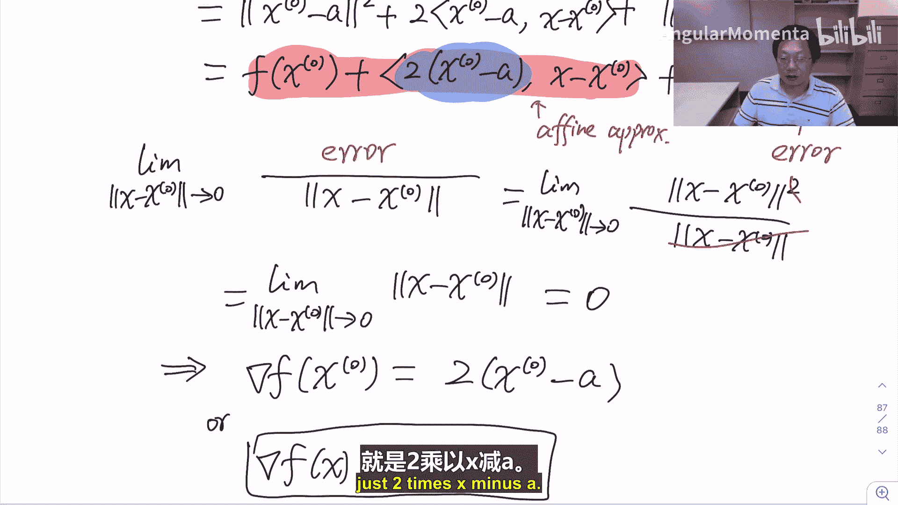

# 066：希尔伯特空间中的函数微分示例 🧮

在本节课中，我们将学习如何在希尔伯特空间中对函数进行微分。我们将通过三个具体的例子，展示如何找到函数的梯度。这些例子将帮助我们理解在更一般的向量空间中，微分的概念是如何运作的。

上一节我们介绍了希尔伯特空间中函数微分的定义，本节中我们来看看几个具体的计算实例。

## 示例一：函数 F(x) = ||x||²

我们考虑函数 **F(x) = ||x||²**，其中范数是由内积导出的。我们在任意点 **x₀ ∈ V** 处考虑它。

我们希望用一个仿射函数来近似 **F(x)**。这个仿射函数的形式是：
**F(x₀) + ⟨b, x - x₀⟩**

我们计算 **F(x)** 在 **x₀** 附近的展开式：
**F(x) = ||x||² = ||x₀ + (x - x₀)||²**

展开这个范数的平方：
**= ||x₀||² + ||x - x₀||² + 2⟨x₀, x - x₀⟩**

其中，**||x₀||²** 就是 **F(x₀)**。于是我们得到：
**F(x) = F(x₀) + 2⟨x₀, x - x₀⟩ + ||x - x₀||²**

这里，**F(x₀)** 是常数项，**2⟨x₀, x - x₀⟩** 是线性项，而 **||x - x₀||²** 是误差项。

为了验证可微性，我们考察误差项相对于 **x - x₀** 的大小：
**lim_{x→x₀} [F(x) - F(x₀) - 2⟨x₀, x - x₀⟩] / ||x - x₀|| = lim_{x→x₀} ||x - x₀|| = 0**

由于该极限为0，误差项是 **o(||x - x₀||)**。因此，该仿射近似是有效的。

于是，函数 **F(x) = ||x||²** 在点 **x₀** 处的梯度就是线性项中的向量 **b**：
**∇F(x₀) = 2x₀**

通常我们用变量 **x** 表示，所以梯度为：
**∇F(x) = 2x**

## 示例二：线性函数 F(x) = ⟨a, x⟩

我们考虑一个线性函数 **F(x) = ⟨a, x⟩**，其中 **a** 是空间 **V** 中的一个固定向量。在点 **x₀** 处，我们进行近似。

计算 **F(x)** 与 **F(x₀)** 的差：
**F(x) - F(x₀) = ⟨a, x⟩ - ⟨a, x₀⟩ = ⟨a, x - x₀⟩**

这恰好就是一个仿射函数的形式：
**F(x) = F(x₀) + ⟨a, x - x₀⟩**

在这个表达式中，误差项为0。

因此，极限条件自动满足：
**lim_{x→x₀} [F(x) - F(x₀) - ⟨a, x - x₀⟩] / ||x - x₀|| = 0**

所以，线性函数 **F(x) = ⟨a, x⟩** 的梯度就是向量 **a** 本身：
**∇F(x) = a**

## 示例三：函数 F(x) = ||x - a||²

我们考虑函数 **F(x) = ||x - a||²**，其中 **a** 是一个固定向量。在点 **x₀** 处进行分析。

根据定义：
**F(x) = ||x - a||² = ||(x₀ - a) + (x - x₀)||²**

展开范数的平方：
**= ||x₀ - a||² + ||x - x₀||² + 2⟨x₀ - a, x - x₀⟩**

其中，**||x₀ - a||²** 就是 **F(x₀)**。于是我们得到：
**F(x) = F(x₀) + 2⟨x₀ - a, x - x₀⟩ + ||x - x₀||²**

这里，**F(x₀)** 是常数项，**2⟨x₀ - a, x - x₀⟩** 是线性项，**||x - x₀||²** 是误差项。

我们检查误差项的性质：
**lim_{x→x₀} [F(x) - F(x₀) - 2⟨x₀ - a, x - x₀⟩] / ||x - x₀|| = lim_{x→x₀} ||x - x₀|| = 0**

极限为0，因此该仿射近似是有效的。

所以，函数 **F(x) = ||x - a||²** 在点 **x₀** 处的梯度为：
**∇F(x₀) = 2(x₀ - a)**

用变量 **x** 表示，梯度为：
**∇F(x) = 2(x - a)**

---

本节课中我们一起学习了在希尔伯特空间中计算函数梯度的三个基本例子。我们看到了如何将函数展开为常数项、线性项和误差项之和，并通过考察误差项的极限来验证可微性，从而找出梯度。这些方法是将有限维微积分推广到无限维空间的基础。