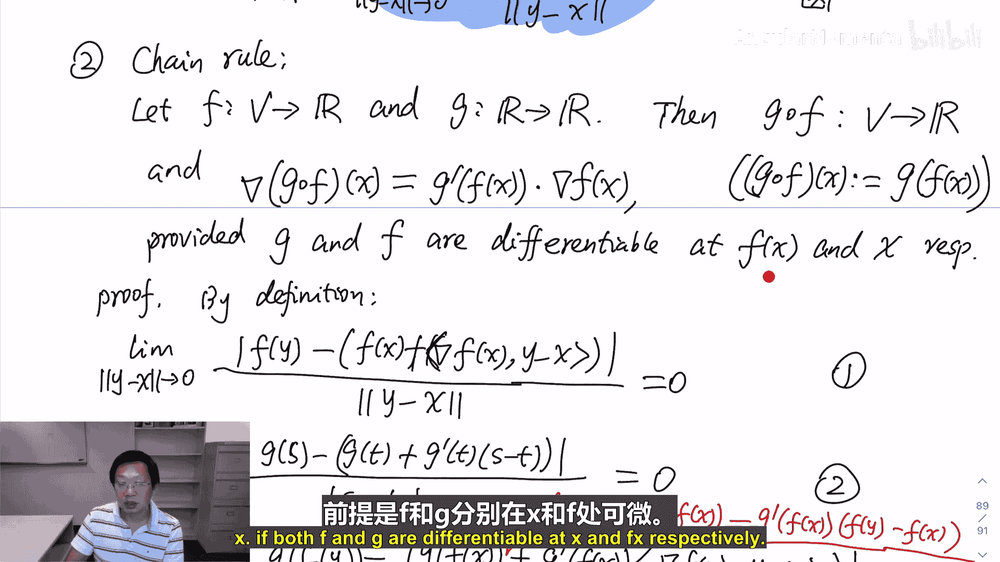

# 068：链式法则的证明 🔗

在本节课中，我们将要学习多元函数微积分中的一个核心性质——链式法则。我们将从单变量函数的链式法则出发，将其推广到向量空间上的函数，并详细证明其成立的条件和形式。

上一节我们介绍了梯度的定义和基本性质，本节中我们来看看如何计算复合函数的梯度，即链式法则。

## 概述

链式法则描述了复合函数导数的计算方法。对于单变量函数，我们有熟悉的公式。对于定义在向量空间 `V` 上的函数，链式法则具有类似的形式，但梯度变成了向量。具体来说，如果 `F: V → R` 和 `G: R → R` 都是可微函数，那么复合函数 `G ∘ F: V → R` 在点 `x` 处的梯度为：

**公式：**
`∇(G ∘ F)(x) = G'(F(x)) · ∇F(x)`

其中 `G'` 是 `G` 的导数（一个标量），`∇F(x)` 是 `F` 在 `x` 处的梯度（一个向量）。这个结果确保了 `∇(G ∘ F)(x)` 仍然是一个属于 `V` 的向量。

## 证明过程

为了证明上述公式，我们需要验证由该公式给出的向量确实满足梯度的定义。根据定义，向量 `v` 是函数 `H` 在 `x` 点的梯度，当且仅当下式成立：

**公式：**
`lim_(‖y-x‖ → 0) [ H(y) - H(x) - <v, y-x> ] / ‖y-x‖ = 0`

对于我们的情况，`H = G ∘ F`，而 `v` 是候选的梯度 `G'(F(x)) · ∇F(x)`。因此，我们需要证明以下极限为零：

**公式：**
`lim_(‖y-x‖ → 0) [ G(F(y)) - G(F(x)) - G'(F(x)) · <∇F(x), y-x> ] / ‖y-x‖ = 0`

### 准备工作

证明需要用到 `F` 和 `G` 的可微性定义。

1.  由于 `F` 在 `x` 点可微，根据梯度定义，存在向量 `∇F(x)` 使得：
    **公式：**
    `lim_(‖y-x‖ → 0) [ F(y) - F(x) - <∇F(x), y-x> ] / ‖y-x‖ = 0`
    我们称此为 **方程(1)**。

2.  由于 `G` 在 `t = F(x)` 点可微，根据导数定义，存在数 `G'(F(x))` 使得：
    **公式：**
    `lim_(s → t) [ G(s) - G(t) - G'(t) · (s - t) ] / |s - t| = 0`
    令 `t = F(x)`，我们得到：
    **公式：**
    `lim_(s → F(x)) [ G(s) - G(F(x)) - G'(F(x)) · (s - F(x)) ] / |s - F(x)| = 0`
    我们称此为 **方程(2)**。

### 极限的分解与估计

我们的目标是证明极限 `L` 为零：
**公式：**
`L = lim_(‖y-x‖ → 0) { G(F(y)) - G(F(x)) - G'(F(x)) · <∇F(x), y-x> } / ‖y-x‖`

为了估计这个极限，我们在表达式中插入并减去同一项 `G'(F(x)) · (F(y) - F(x))`：

**公式：**
`L = lim { [G(F(y)) - G(F(x)) - G'(F(x))·(F(y)-F(x))] + [G'(F(x))·(F(y)-F(x) - <∇F(x), y-x>)] } / ‖y-x‖`

根据极限的线性性质，`L` 可以分解为两项极限之和：
`L = lim I1 + lim I2`
其中：
**公式：**
`I1 = [G(F(y)) - G(F(x)) - G'(F(x))·(F(y)-F(x))] / ‖y-x‖`
**公式：**
`I2 = G'(F(x)) · [F(y) - F(x) - <∇F(x), y-x>] / ‖y-x‖`

#### 处理 `I2`

`I2` 项相对简单。注意到中括号内的部分正是 **方程(1)** 的分子。因此，根据 **方程(1)**，当 `‖y-x‖ → 0` 时，`[F(y) - F(x) - <∇F(x), y-x>] / ‖y-x‖` 的极限为 0。而 `G'(F(x))` 是一个固定的有限数。所以：
**结论：**
`lim I2 = G'(F(x)) · 0 = 0`

#### 处理 `I1`

`I1` 项的处理需要一些技巧。我们将其分子和分母同时乘以 `|F(y) - F(x)|`（假设 `F(y) ≠ F(x)`，若相等则 `I1` 分子为零，极限显然为零）：

**公式：**
`I1 = { [G(F(y)) - G(F(x)) - G'(F(x))·(F(y)-F(x))] / |F(y)-F(x)| } · { |F(y)-F(x)| / ‖y-x‖ }`

我们定义：
**公式：**
`I3 = [G(F(y)) - G(F(x)) - G'(F(x))·(F(y)-F(x))] / |F(y)-F(x)|`
**公式：**
`I4 = |F(y)-F(x)| / ‖y-x‖`

于是 `I1 = I3 · I4`。接下来我们分别分析 `I3` 和 `I4` 在 `y → x` 时的行为。

**分析 `I4`：**
我们需要 `I4` 在 `y` 接近 `x` 时是有界的。从 **方程(1)** 我们可以得到 `F(y)` 的近似表达式：
**公式：**
`F(y) = F(x) + <∇F(x), y-x> + o(‖y-x‖)`
其中 `o(‖y-x‖)` 表示比 `‖y-x‖` 更高阶的无穷小。两边取绝对值并应用三角不等式和柯西-施瓦茨不等式：
**公式：**
`|F(y)-F(x)| ≤ |<∇F(x), y-x>| + |o(‖y-x‖)| ≤ ‖∇F(x)‖ · ‖y-x‖ + o(‖y-x‖)`
因此，当 `‖y-x‖` 足够小时，存在常数 `C`（例如 `C = ‖∇F(x)‖ + 1`）使得：
**公式：**
`|F(y)-F(x)| ≤ C · ‖y-x‖`
这直接意味着 `I4 = |F(y)-F(x)| / ‖y-x‖ ≤ C`，即 `I4` 有界。同时，此不等式也表明当 `y → x` 时，`F(y) → F(x)`。

**分析 `I3`：**
现在观察 `I3` 的形式。如果我们令 `s = F(y)`，`t = F(x)`，那么 `I3` 恰好就是 **方程(2)** 中的那个比值：
**公式：**
`I3 = [G(s) - G(t) - G'(t)·(s-t)] / |s-t|`
我们已经知道当 `y → x` 时，有 `s = F(y) → F(x) = t`。根据 **方程(2)**，当 `s → t` 时，这个比值的极限为 0。因此：
**结论：**
`lim_(y→x) I3 = 0`

**综合 `I1`：**
由于 `I1 = I3 · I4`，且 `I3 → 0`，`I4` 有界，根据极限的乘积法则，可得：
**结论：**
`lim I1 = 0`

### 完成证明

现在，我们已经证明了：
`lim I1 = 0` 且 `lim I2 = 0`
因此，它们的和 `L = lim (I1 + I2) = 0 + 0 = 0`。

极限 `L` 为零，这正是梯度定义所要求的条件。因此，我们成功地证明了：
**公式：**
`∇(G ∘ F)(x) = G'(F(x)) · ∇F(x)`
前提是 `F` 在 `x` 点可微，且 `G` 在 `F(x)` 点可微。

## 总结

本节课中我们一起学习了向量空间上函数的链式法则及其证明。
*   **核心结论**：对于复合函数 `G(F(x))`，其梯度等于外函数 `G` 在 `F(x)` 处的导数值乘以内函数 `F` 在 `x` 处的梯度向量，即 `∇(G ∘ F)(x) = G'(F(x)) · ∇F(x)`。
*   **证明思路**：通过将目标极限巧妙地分解为两部分（`I1` 和 `I2`），并分别利用 `F` 和 `G` 的可微性定义进行估计，最终证明两部分极限均为零，从而验证了候选梯度公式的正确性。
*   **意义**：链式法则是进行复杂函数微分运算的基石，在机器学习和优化算法的推导中至关重要。