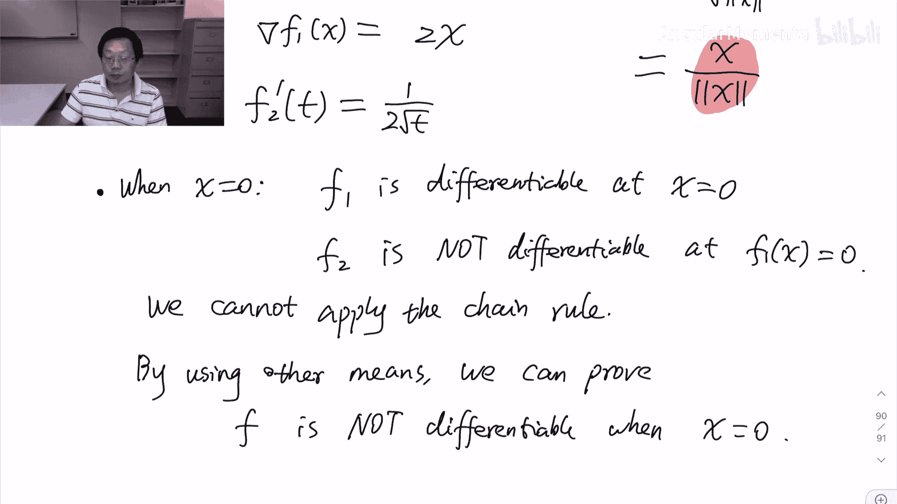

**数据分析的数学方法：13-06-02：链式法则应用实例 - 范数函数的梯度计算** 🧮

在本节中，我们将学习如何应用链式法则来计算一个具体函数的梯度。我们将以向量范数函数为例，详细演示其梯度的求解过程，并讨论函数在不同点上的可微性。

---

### **概述**

本节课我们将重点分析函数 **f(x) = ||x||** 的梯度，其中 **||x||** 是由内积诱导的范数。我们将通过将其分解为两个函数的复合形式，并应用链式法则来求解其梯度。同时，我们也会探讨该函数在零点处的可微性。

---

### **函数分解与链式法则应用**

首先，我们将目标函数 **f(x) = ||x||** 表示为两个函数的复合形式，以便应用链式法则。

以下是分解步骤：
*   **f₁(x) = ||x||²**：这是一个从向量空间 **V** 到实数 **R** 的函数。
*   **f₂(t) = √t**：这是一个从实数 **R** 到实数 **R** 的函数。
*   原函数可以写为：**f(x) = f₂( f₁(x) ) = √(||x||²)**。

上一节我们介绍了链式法则，本节中我们来看看如何将其应用于这个具体的复合函数。

---

### **当 x ≠ 0 时的梯度计算**

当 **x** 不为零向量时，两个组成函数 **f₁** 和 **f₂** 都是可微的。
*   **f₁(x)** 对于任何 **x** 都可微。
*   **f₂(t)** 在 **t > 0** 时可微。由于 **x ≠ 0**，因此 **t = f₁(x) = ||x||² > 0**，条件满足。

因此，我们可以应用链式法则。函数 **f** 在点 **x** 处的梯度公式为：

**∇f(x) = f₂‘( f₁(x) ) · ∇f₁(x)**

现在，我们分别计算等式右边的两部分。

1.  **计算 ∇f₁(x)**：
    我们知道，函数 **||x||²** 的梯度是 **2x**。因此：
    **∇f₁(x) = 2x**

2.  **计算 f₂‘(t)**：
    根据基础微积分，函数 **√t** 的导数为 **1/(2√t)**。因此：
    **f₂‘(t) = 1/(2√t)**
    将 **t = f₁(x) = ||x||²** 代入，得到：
    **f₂‘( f₁(x) ) = 1/(2√(||x||²)) = 1/(2||x||)**

3.  **合成梯度**：
    将以上结果代入链式法则公式：
    **∇f(x) = [1/(2||x||)] · (2x) = x / ||x||**

**结论**：当 **x ≠ 0** 时，函数 **f(x) = ||x||** 的梯度为 **x / ||x||**，即向量 **x** 方向上的单位向量。

---

### **当 x = 0 时的可微性分析**

现在，我们来分析函数在零点 **x = 0** 处的情况。

此时，虽然内层函数 **f₁(x) = ||x||²** 在 **x=0** 处仍然是可微的，但外层函数 **f₂(t) = √t** 在 **t = f₁(0) = 0** 处不可微，因为其在 **t=0** 处的导数不存在（导数公式 **1/(2√t)** 在 **t=0** 时无定义）。

由于链式法则要求内外层函数在对应点都可微，因此**链式法则在此情况下不适用**。

通过其他分析方法可以证明，原函数 **f(x) = ||x||** 在 **x = 0** 处本身也是不可微的。

---

### **总结**

本节课中我们一起学习了如何利用链式法则计算复合函数的梯度。
*   我们首先将范数函数 **f(x) = ||x||** 分解为平方函数与平方根函数的复合。
*   当 **x ≠ 0** 时，我们成功应用链式法则，得出其梯度为 **∇f(x) = x / ||x||**。
*   当 **x = 0** 时，由于外层函数在对应点不可微，链式法则失效，且原函数在该点不可微。

这个例子清晰地展示了链式法则的应用条件与计算过程，也提醒我们注意函数在定义域内不同点的可微性差异。