# 070：Fréchet导数的第三个性质与标准微积分的联系 🔗

在本节课中，我们将要学习Fréchet导数的第三个重要性质，即对于定义在具有标准内积的欧几里得空间上的函数，Fréchet导数与我们在多元微积分中学到的标准梯度定义是一致的。我们将通过严谨的证明来理解这一性质，并探讨内积选择对导数定义的影响。

上一节我们介绍了Fréchet导数的基本定义，本节中我们来看看它在具体空间中的表现形式。

## 性质陈述与直观理解

考虑函数 **F: R^N → R**，其中空间 **R^N** 装备了标准内积。对于这类函数，如果 **F** 在点 **x** 处是Fréchet可微的，那么其梯度 **∇F(x)** 有一个明确的表达式。

以下是该性质的数学描述：

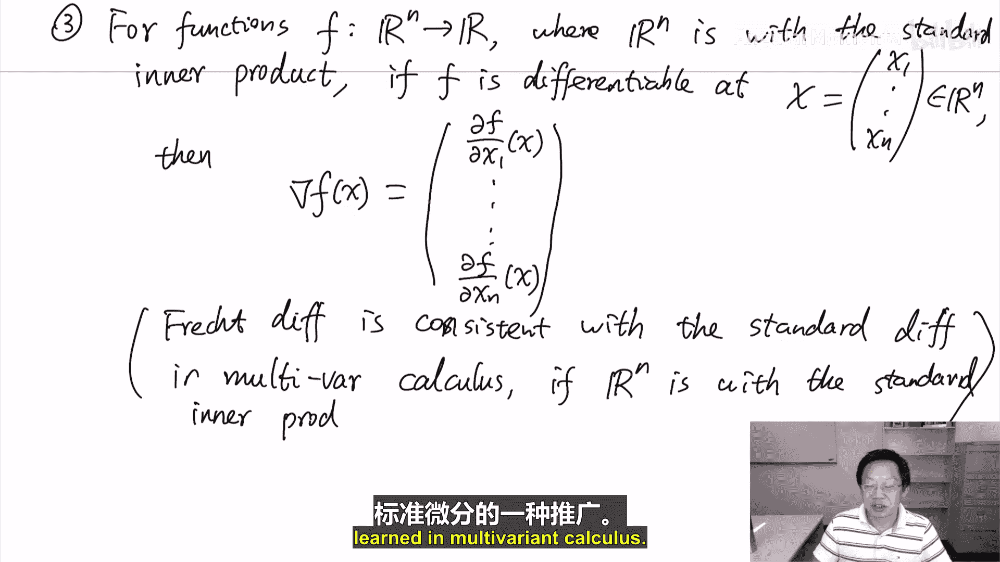

*   梯度的第一个分量是 **F** 对第一个变量的偏导数。
*   梯度的第二个分量是 **F** 对第二个变量的偏导数。
*   ……
*   梯度的第 **N** 个分量是 **F** 对第 **N** 个变量的偏导数。

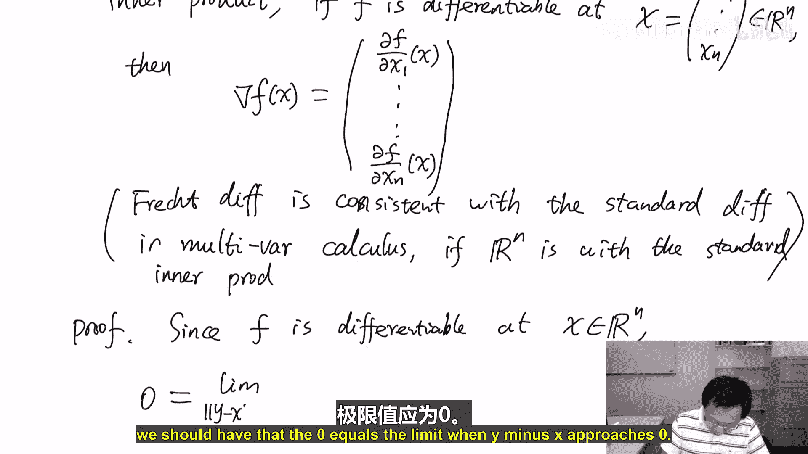

用公式表示即为：
**∇F(x) = (∂F/∂x₁, ∂F/∂x₂, …, ∂F/∂x_N)ᵀ**

这个性质告诉我们，Fréchet导数与我们多元微积分中通过偏导数定义的梯度是相同的。这表明Fréchet导数是标准多元微积分中微分概念的推广，并且在装备标准内积的 **R^N** 空间中，两者是相容的。

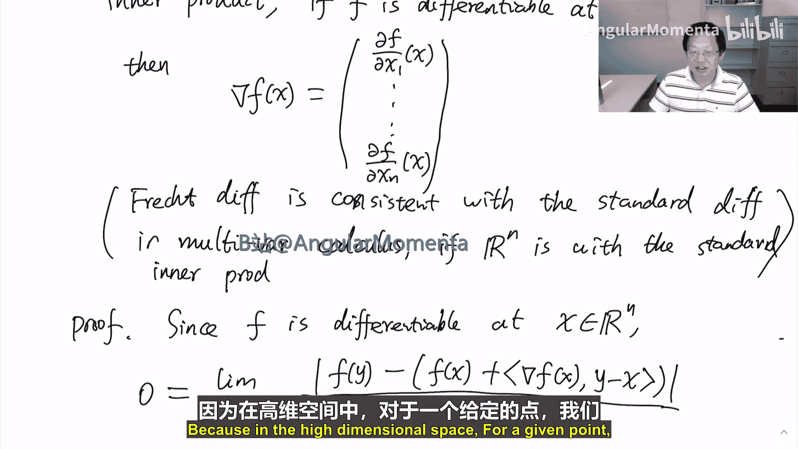

## 性质证明

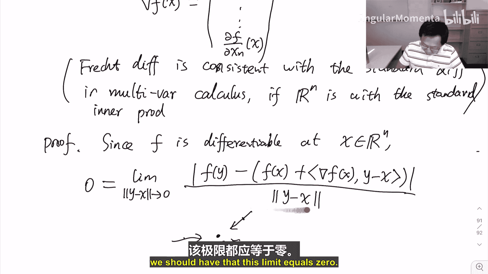

为了证明这个性质，我们依然从Fréchet导数的定义出发。

由于 **F** 在 **x** 处可微，根据定义，以下极限应为零：

**lim_{y→x} [ F(y) - F(x) - <∇F(x), y-x> ] / ||y - x|| = 0**

这里，**y** 以任意方向趋近于 **x**。为了证明梯度的第 **i** 个分量就是偏导数 **∂F/∂x_i**，我们构造一个沿特定方向趋近 **x** 的点列。

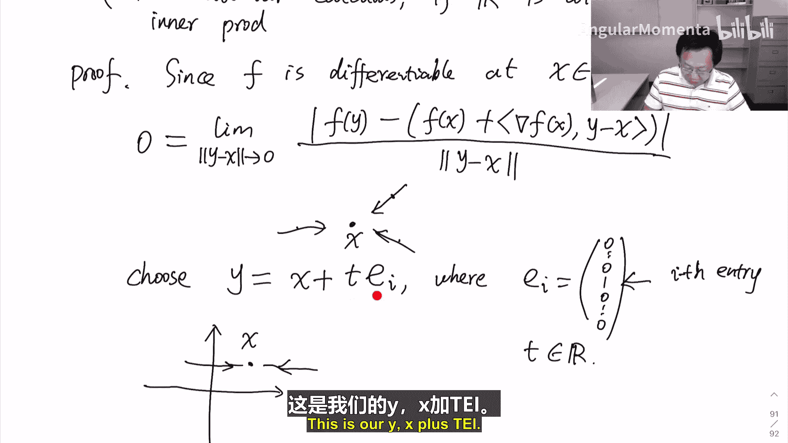

我们选择 **y = x + t * e_i**，其中 **e_i** 是第 **i** 个标准基向量（其第 **i** 个分量为1，其余为0），**t** 是一个实数。这意味着 **y** 沿着 **e_i** 方向趋近于 **x**。

将 **y = x + t e_i** 代入极限表达式：

1.  **F(y) = F(x + t e_i)**
2.  **y - x = t e_i**
3.  **||y - x|| = |t| * ||e_i|| = |t|**

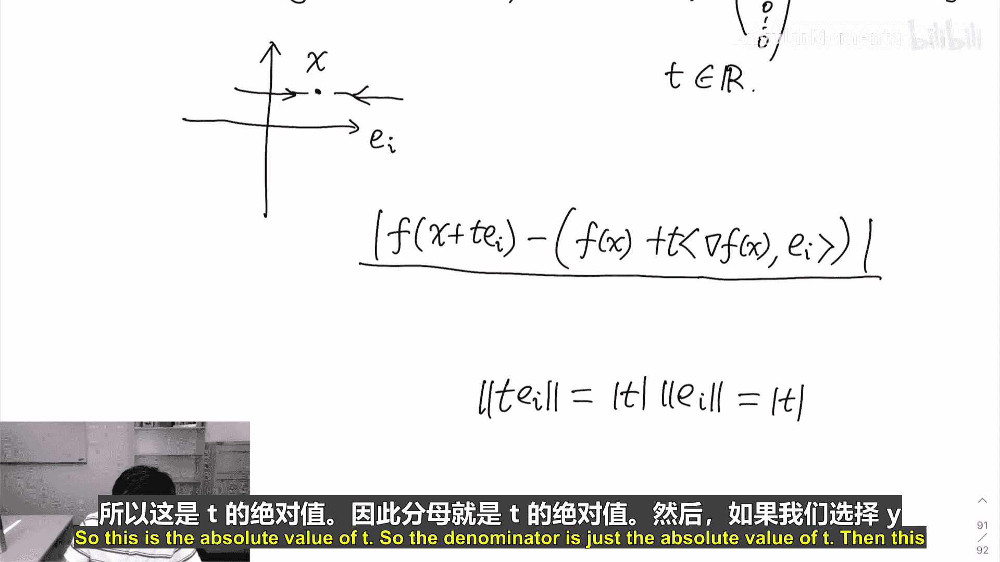

此时，极限变为：
**lim_{t→0} [ F(x + t e_i) - F(x) - <∇F(x), t e_i> ] / |t| = 0**

定义单变量函数 **g(t) = F(x + t e_i)**，则 **g(0) = F(x)**。同时，内积 **<∇F(x), t e_i> = t * <∇F(x), e_i>**。

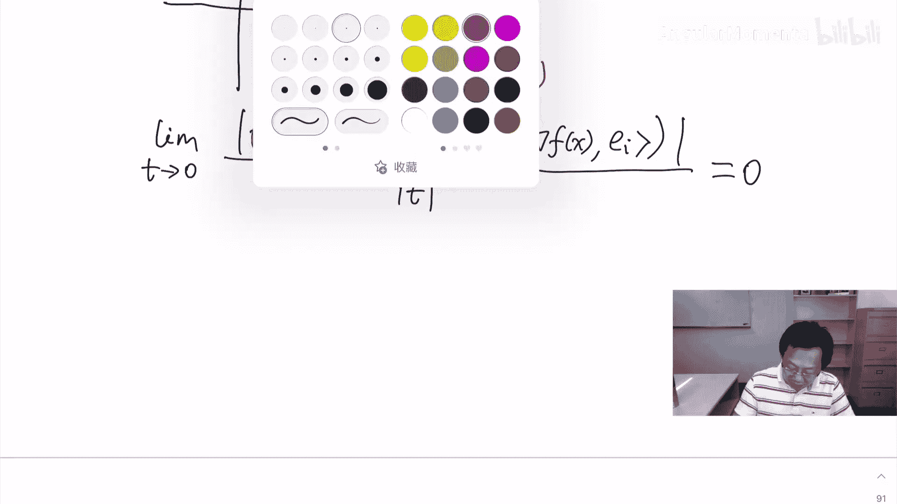

于是极限式可重写为：
**lim_{t→0} [ g(t) - g(0) - t * <∇F(x), e_i> ] / |t| = 0**

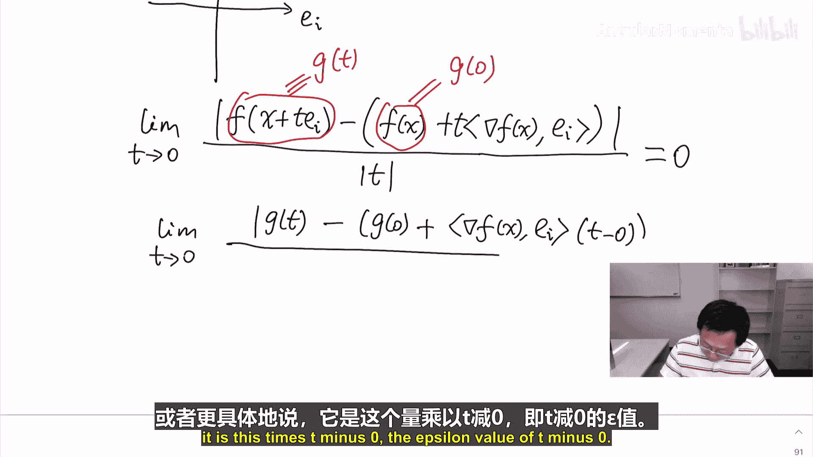

这正是单变量函数 **g(t)** 在 **t=0** 处导数的定义形式。它表明 **g(t)** 在 **0** 处的导数存在，且等于 **<∇F(x), e_i>**。

因此，我们得到：
**g'(0) = <∇F(x), e_i>**

而根据 **g(t)** 的定义，**g'(0)** 正是函数 **F** 在点 **x** 处沿 **e_i** 方向的方向导数，也就是对第 **i** 个变量的偏导数：
**g'(0) = d/dt [ F(x + t e_i) ]|_{t=0} = ∂F/∂x_i (x)**

所以，我们证明了：
**<∇F(x), e_i> = ∂F/∂x_i (x)**

由于在标准内积下，**<∇F(x), e_i>** 就是梯度向量 **∇F(x)** 的第 **i** 个分量，因此：
**∇F(x) 的第 i 个分量 = ∂F/∂x_i (x)**

证明完成。

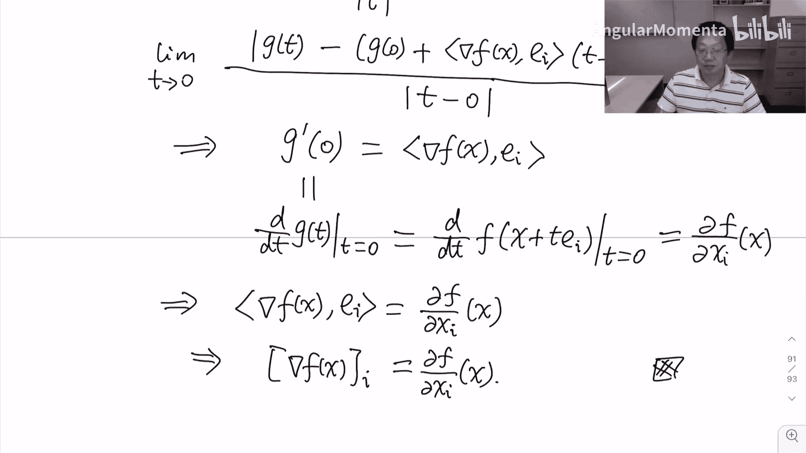

## 重要说明与总结

本节课中我们一起学习了Fréchet导数与标准梯度的等价性，但有一个至关重要的前提。

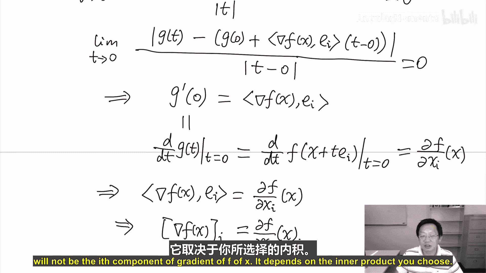

该性质成立，**当且仅当**我们在 **R^N** 中使用了**标准内积**。如果我们改变内积的定义，那么由Fréchet导数定义的梯度 **∇F(x)** 也会随之改变。此时，**<∇F(x), e_i>** 将不再等于偏导数 **∂F/∂x_i**。

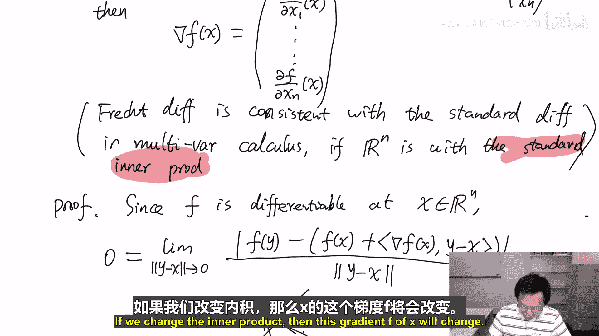

这一点引出了一个核心结论：

**Fréchet 导数的具体形式依赖于所选择的内积。**

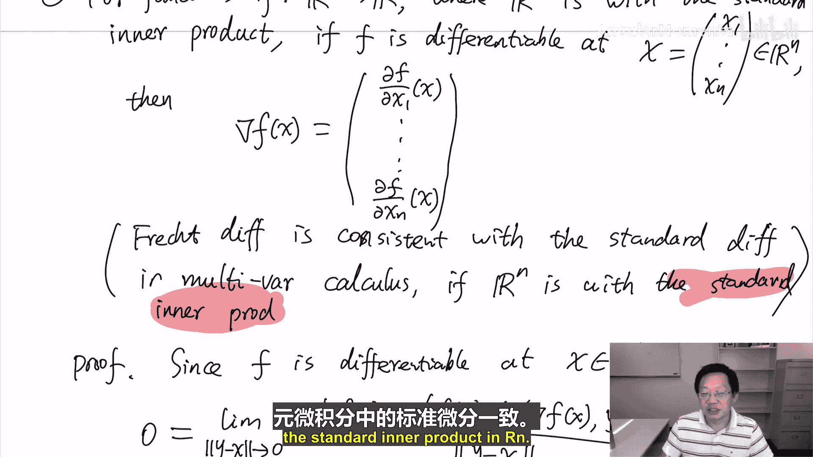

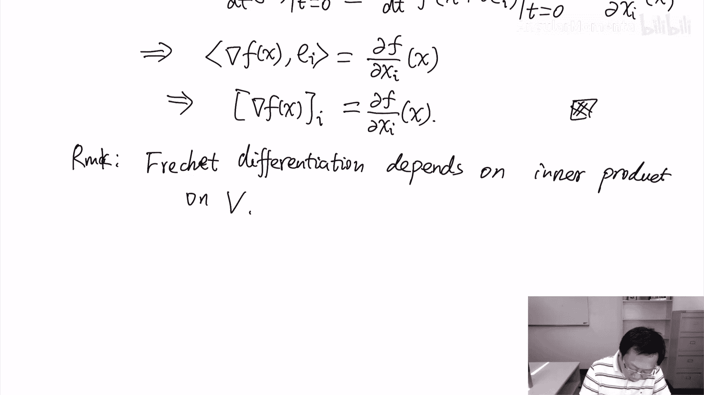

它仅在采用标准内积时，才与多元微积分中的标准梯度定义相一致。这凸显了Fréchet导数作为一种更一般、更抽象的微分概念的强大与灵活性，它能够统一处理不同几何结构（由不同内积定义）空间上的微分问题。