数据分析的数学方法：4.4：方向导数与梯度的关系 🔄

在本节中，我们将学习可微函数方向导数的定义，并证明一个关键性质：函数在某点的梯度与任意单位方向向量的内积，等于函数沿该方向的方向导数。

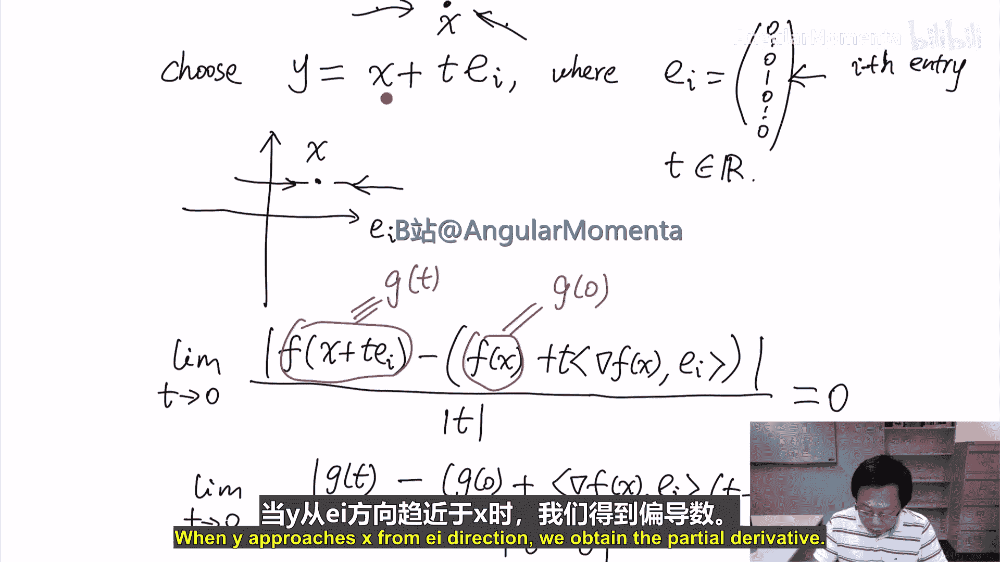

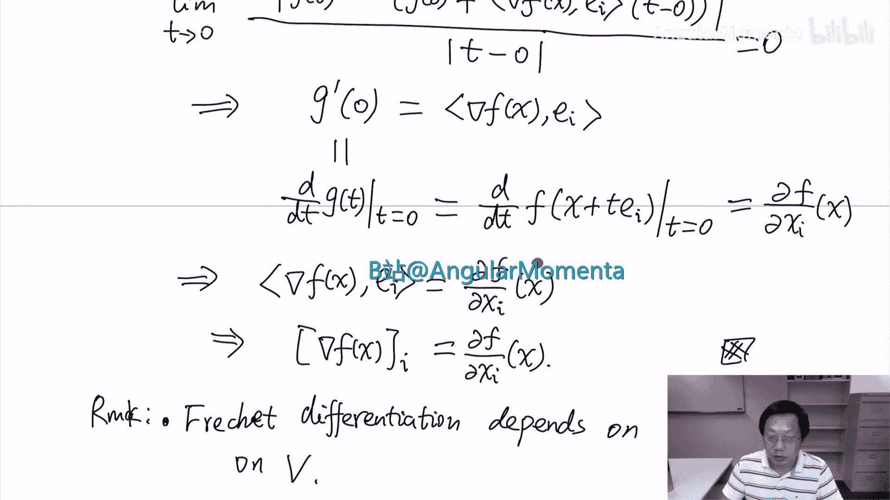

上一节我们介绍了偏导数是沿坐标轴方向的方向导数。本节中我们来看看，对于任意方向，方向导数与梯度有何关系。

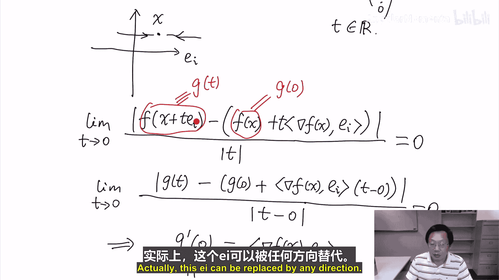

### 核心概念：方向导数

设函数 **f** 定义在希尔伯特空间 **V** 上，即 **f: V → ℝ**。假设 **f** 在点 **x** 处可微。我们选择一个方向 **u**，并令 **u** 为单位向量，即 **||u|| = 1**。

那么，函数 **f** 在点 **x** 处沿方向 **u** 的方向导数定义为：
\[
\frac{d}{dt} f(x + t u) \bigg|_{t=0}
\]
这个值衡量了当点 **x** 仅沿 **u** 方向发生微小变化时，函数值 **f** 的变化速率。

### 核心性质：梯度与方向导数的关系

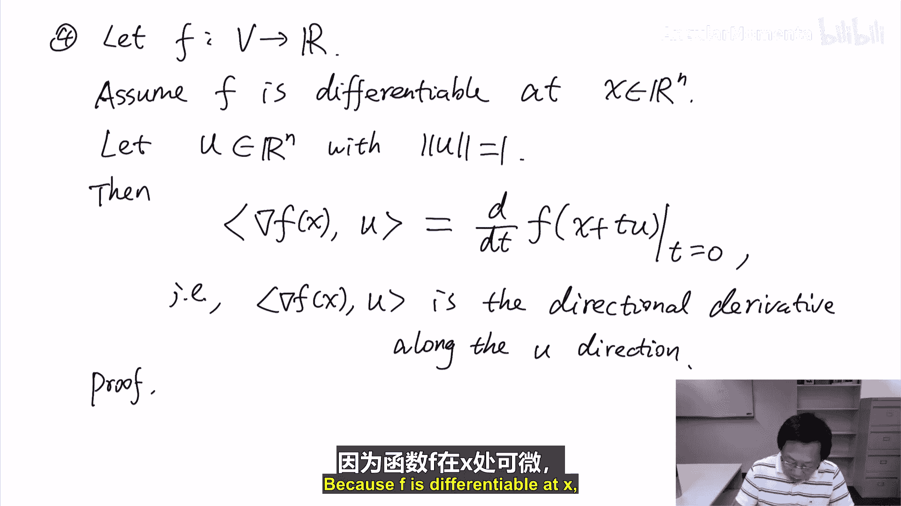

函数 **f** 在点 **x** 处的梯度 **∇f(x)** 与单位方向向量 **u** 的内积，恰好等于沿 **u** 方向的方向导数。用公式表示如下：
\[
\nabla f(x) \cdot u = \frac{d}{dt} f(x + t u) \bigg|_{t=0}
\]

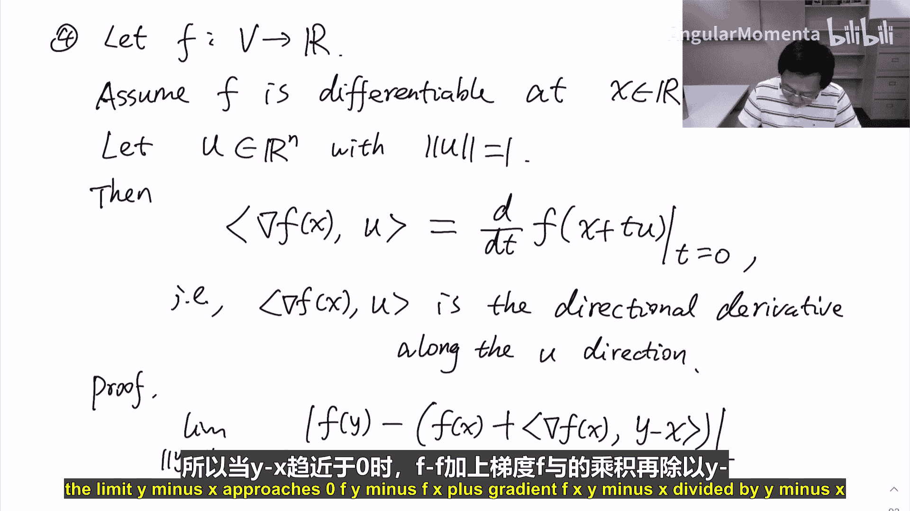

### 性质证明

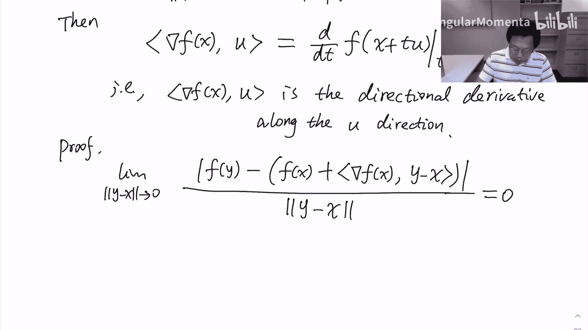

为了证明这个等式，我们从可微性的定义出发。

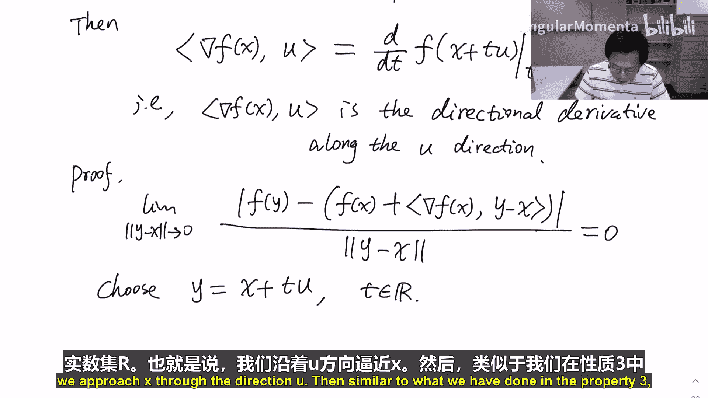

因为 **f** 在 **x** 处可微，根据定义，以下极限成立：
\[
\lim_{y \to x} \frac{f(y) - f(x) - \nabla f(x) \cdot (y - x)}{||y - x||} = 0
\]

为了证明我们的目标等式，我们选择一个特定的逼近路径。

我们令 **y** 沿着方向 **u** 趋近于 **x**，即设 **y = x + t u**，其中 **t → 0**。将这个表达式代入上面的极限定义中。

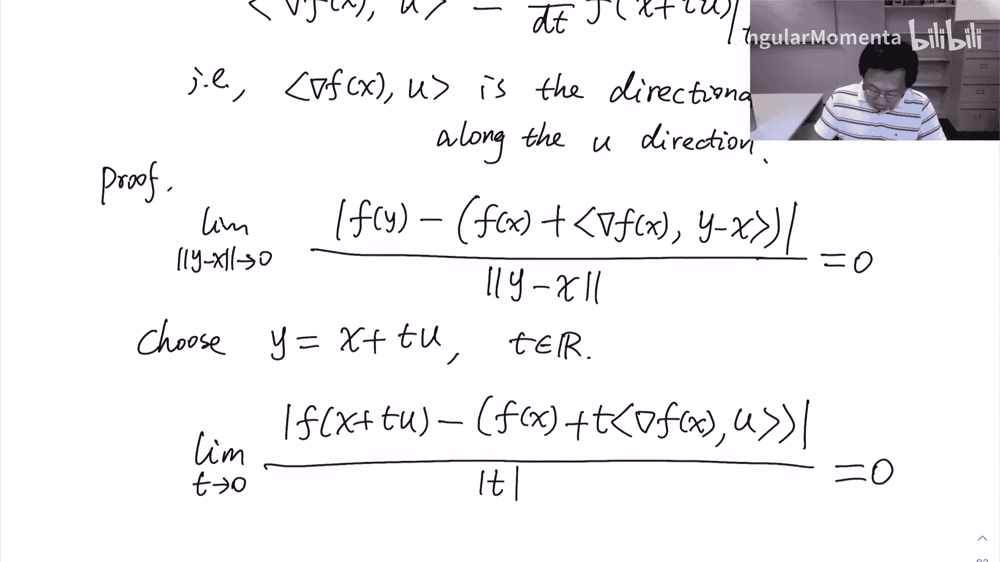

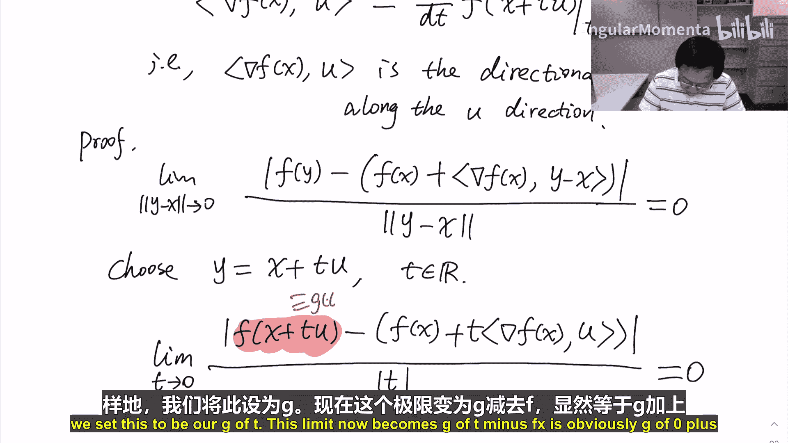

代入后，分子变为：
\[
f(x + t u) - f(x) - \nabla f(x) \cdot (t u)
\]
分母 **||y - x||** 变为 **||t u||**。由于 **u** 是单位向量，**||u|| = 1**，所以分母等于 **|t|**。

因此，极限变为：
\[
\lim_{t \to 0} \frac{f(x + t u) - f(x) - t [\nabla f(x) \cdot u]}{|t|} = 0
\]

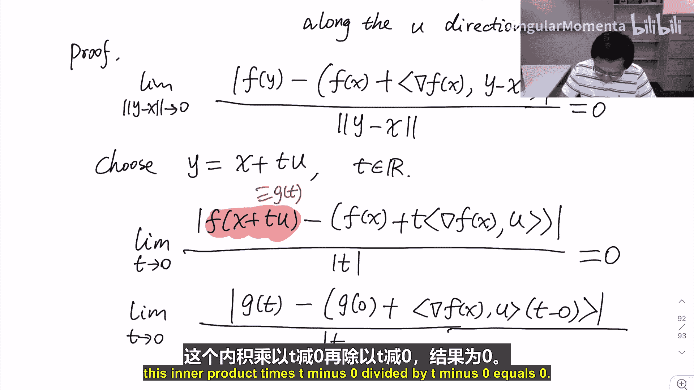

接下来，我们定义一个新函数 **g(t) = f(x + t u)**。

上述极限可以重写为：
\[
\lim_{t \to 0} \frac{g(t) - g(0) - t [\nabla f(x) \cdot u]}{|t|} = 0
\]
根据单变量函数导数的定义，这个极限为0意味着 **g(t)** 在 **t=0** 处的导数恰好等于 **∇f(x) · u**。即：
\[
g'(0) = \nabla f(x) \cdot u
\]
而根据 **g(t)** 的定义，**g'(0)** 正是 **f(x + t u)** 在 **t=0** 处的导数：
\[
g'(0) = \frac{d}{dt} f(x + t u) \bigg|_{t=0}
\]
由此，我们证明了：
\[
\nabla f(x) \cdot u = \frac{d}{dt} f(x + t u) \bigg|_{t=0}
\]
这正是函数 **f** 在点 **x** 处沿方向 **u** 的方向导数。证明完成。

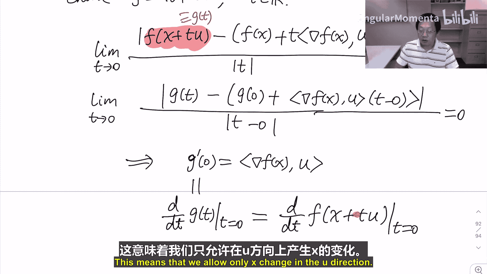

### 总结

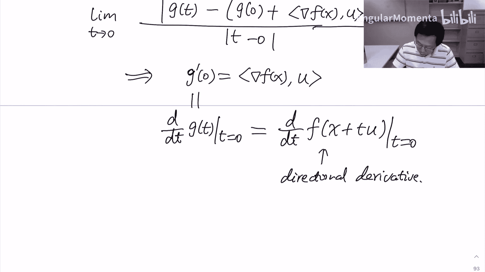

本节课中我们一起学习了方向导数的概念及其与梯度的关系。我们证明了：对于一个在点 **x** 处可微的函数，其梯度 **∇f(x)** 与任意单位方向向量 **u** 的点积，就等于函数沿该方向的方向导数。这个性质将梯度（一个向量）与函数沿任意方向的变化率（一个标量）紧密联系了起来，是理解梯度几何意义和应用（如最速下降法）的基础。