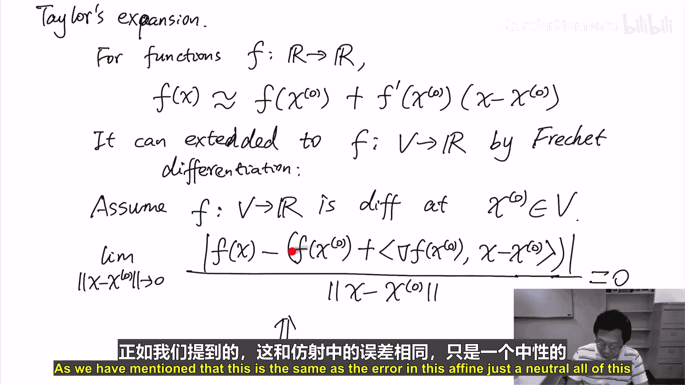
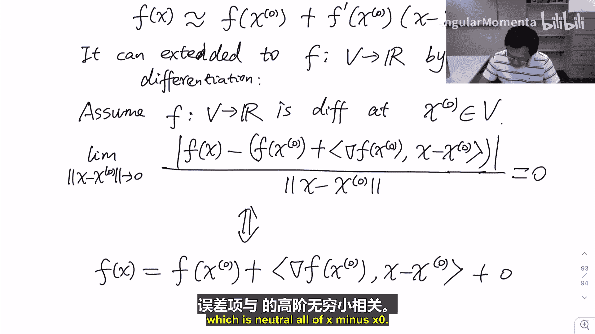
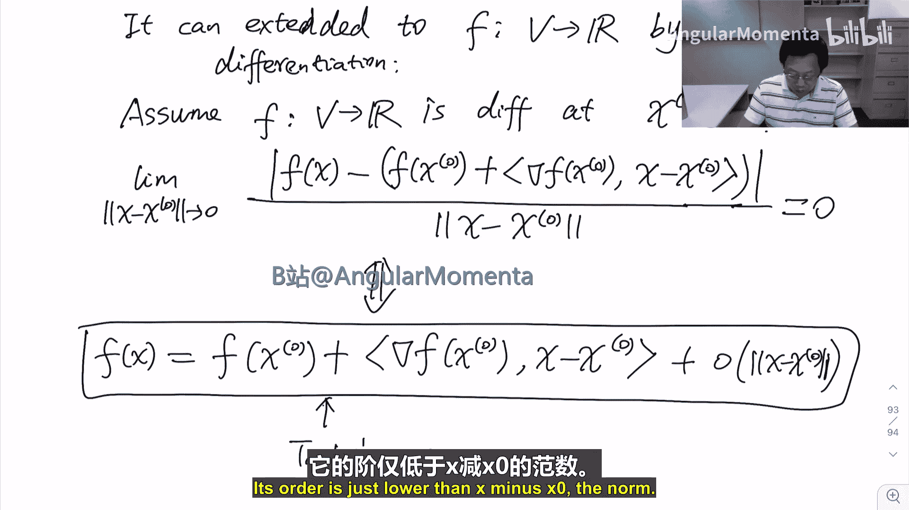
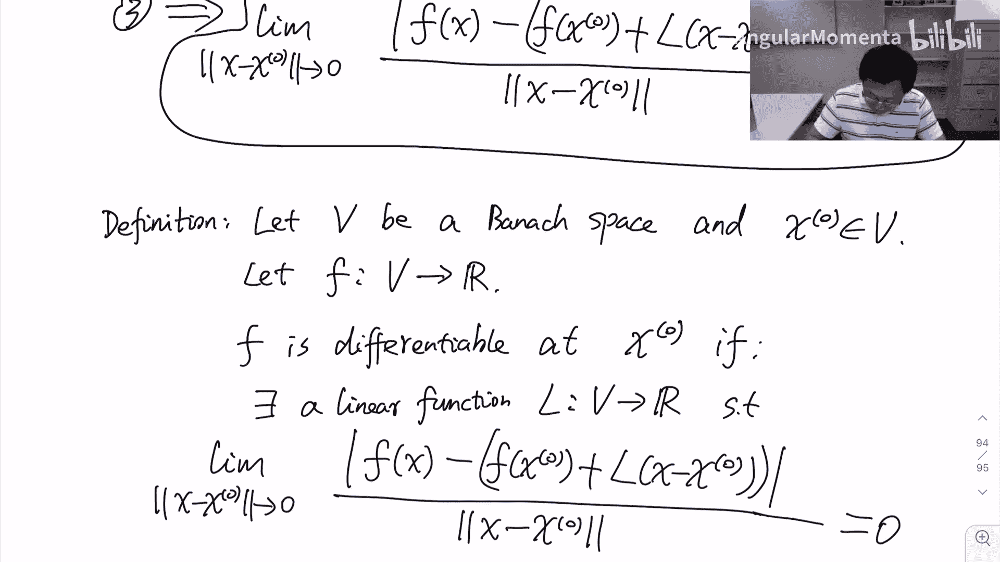
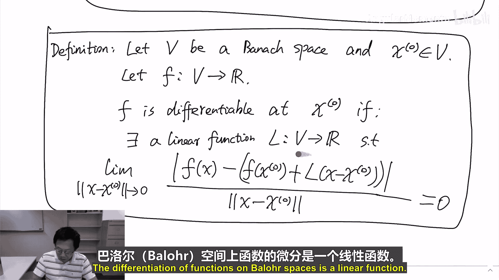
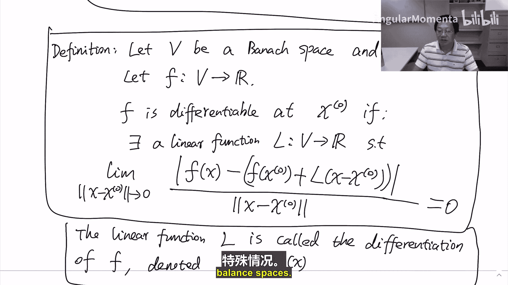

# 072：从希尔伯特空间到巴拿赫空间的微分

在本节课中，我们将要学习如何将弗雷歇微分的概念从希尔伯特空间推广到更一般的巴拿赫空间。我们将看到，泰勒展开的思想和仿射近似的定义如何被自然地扩展，并理解在缺乏内积结构时，微分如何被定义为一个线性泛函。

## 希尔伯特空间中的一阶泰勒展开

上一节我们介绍了希尔伯特空间中的弗雷歇微分。本节中我们来看看它如何推广单变量微积分中的泰勒展开。

对于从实数域到实数域的函数 \( f: \mathbb{R} \to \mathbb{R} \)，我们熟知其一阶泰勒展开为：
\[
f(x) \approx f(x_0) + f'(x_0)(x - x_0)
\]
我们可以利用弗雷歇微分，将这种一阶泰勒展开的思想推广到希尔伯特空间中的函数。

设 \( f: V \to \mathbb{R} \) 在点 \( x_0 \in V \) 处弗雷歇可微，其中 \( V \) 是一个希尔伯特空间。根据弗雷歇微分的定义，我们有：
\[
\lim_{\|x - x_0\| \to 0} \frac{|f(x) - [f(x_0) + \langle \nabla f(x_0), x - x_0 \rangle]|}{\|x - x_0\|} = 0
\]
换句话说，函数 \( f \) 在 \( x_0 \) 附近可以近似为：
\[
f(x) = f(x_0) + \langle \nabla f(x_0), x - x_0 \rangle + o(\|x - x_0\|)
\]
这个展开式就是希尔伯特空间上函数的一阶泰勒展开。误差项 \( o(\|x - x_0\|) \) 表示其增长阶数低于 \( \|x - x_0\| \)。

## 推广到巴拿赫空间

以上讨论都基于希尔伯特空间的内积结构。我们也可以将弗雷歇微分的概念推广到巴拿赫空间（即完备的赋范向量空间）上的函数。

设 \( V \) 是一个巴拿赫空间，\( f: V \to \mathbb{R} \) 是一个函数。对于微分，我们采用与希尔伯特空间相同的核心思想：使用仿射近似。

我们希望在点 \( x_0 \in V \) 处找到函数 \( f \) 的微分。这意味着我们要寻找一个仿射函数 \( G: V \to \mathbb{R} \)，它满足以下条件：
1.  \(G\) 是仿射的。
2.  \(G\) 在 \( x_0 \) 处与 \( f \) 的值一致，即 \( G(x_0) = f(x_0) \)。
3.  近似误差是 \( o(\|x - x_0\|) \)。

以下是寻找 \( G \) 的过程：
由于 \( G \) 是仿射函数，它可以写成 \( G(x) = L(x) + a \) 的形式，其中 \( L: V \to \mathbb{R} \) 是一个线性泛函，\( a \) 是一个常数。
由条件2，\( G(x_0) = L(x_0) + a = f(x_0) \)。
因此，我们可以将 \( G \) 重写为：
\[
G(x) = L(x) + a = L(x - x_0) + L(x_0) + a = L(x - x_0) + f(x_0)
\]
这里用到了线性泛函 \( L \) 的性质：\( L(x) - L(x_0) = L(x - x_0) \)。

现在，由条件3，我们希望以下极限成立：
\[
\lim_{\|x - x_0\| \to 0} \frac{|f(x) - [f(x_0) + L(x - x_0)]|}{\|x - x_0\|} = 0
\]
这个极限表达式定义了近似误差趋于零的速度。

## 巴拿赫空间上的可微性定义

基于上述推导，我们可以给出巴拿赫空间上函数可微性的正式定义。

**定义**：设 \( V \) 是一个巴拿赫空间，\( x_0 \in V \)，\( f: V \to \mathbb{R} \) 是一个函数。称 \( f \) 在点 \( x_0 \) 处**可微**，如果存在一个线性泛函 \( L: V \to \mathbb{R} \)，使得下式成立：
\[
\lim_{\|x - x_0\| \to 0} \frac{|f(x) - f(x_0) - L(x - x_0)|}{\|x - x_0\|} = 0
\]
此时，这个线性泛函 \( L \) 被称为 \( f \) 在点 \( x_0 \) 处的**微分**（或**导数**），记作 \( Df(x_0) \)。

与希尔伯特空间的关键区别在于，在一般的巴拿赫空间中，我们没有一个内积结构。因此，微分 \( Df(x_0) \) 不再能表示为一个梯度向量与自变量的内积形式（即 \( \langle \nabla f(x_0), \cdot \rangle \)），而必须保持为一个抽象的线性泛函 \( L \)。

特别地，当 \( V \) 是希尔伯特空间时，根据里斯表示定理，每个连续线性泛函 \( L \) 都可以唯一地表示为一个内积形式 \( L(\cdot) = \langle \mathbf{v}, \cdot \rangle \)。这个向量 \( \mathbf{v} \) 就是我们熟悉的梯度 \( \nabla f(x_0) \)。因此，希尔伯特空间上的弗雷歇微分可以看作是巴拿赫空间上微分定义的一个特例。

## 总结

本节课中我们一起学习了：
1.  如何将单变量泰勒展开的思想，通过弗雷歇微分推广到希尔伯特空间，得到形式为 \( f(x) = f(x_0) + \langle \nabla f(x_0), x - x_0 \rangle + o(\|x - x_0\|) \) 的一阶近似。
2.  如何进一步将微分的概念扩展到更一般的巴拿赫空间。其核心仍是寻找一个仿射函数作为最佳近似，但微分被定义为一个满足特定极限条件的线性泛函 \( Df(x_0) \)。
3.  希尔伯特空间中的梯度是巴拿赫空间中微分在线性泛函具有内积表示时的特殊形式。当空间没有内积时，微分就表现为抽象的线性算子。

理解从具体（内积空间）到抽象（赋范空间）的推广过程，有助于我们掌握现代分析学中微分概念的统一框架。