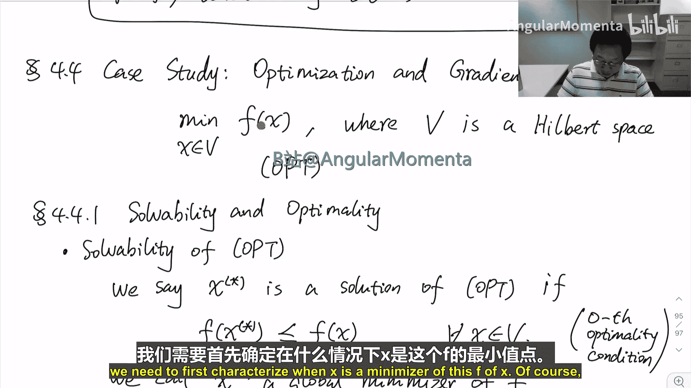
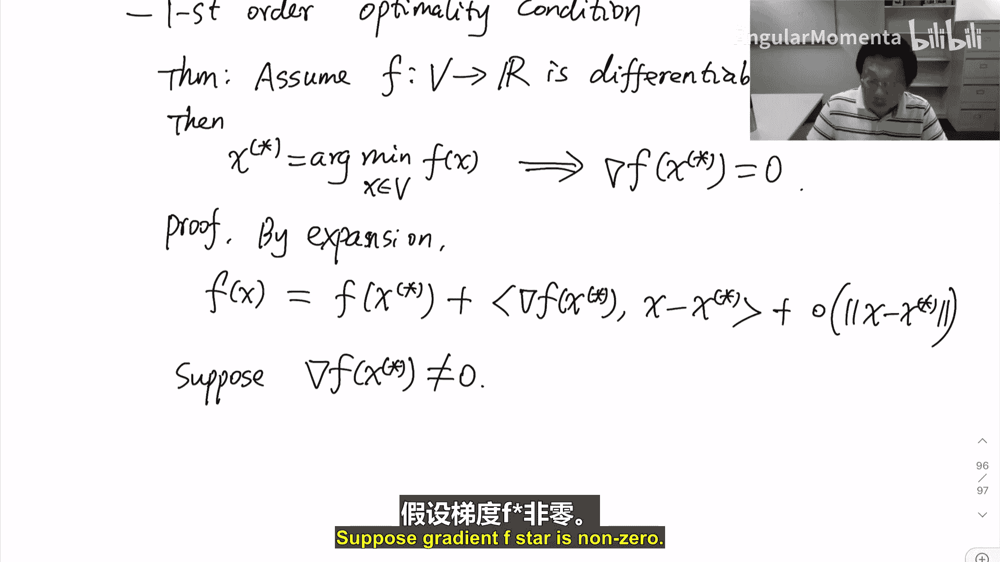
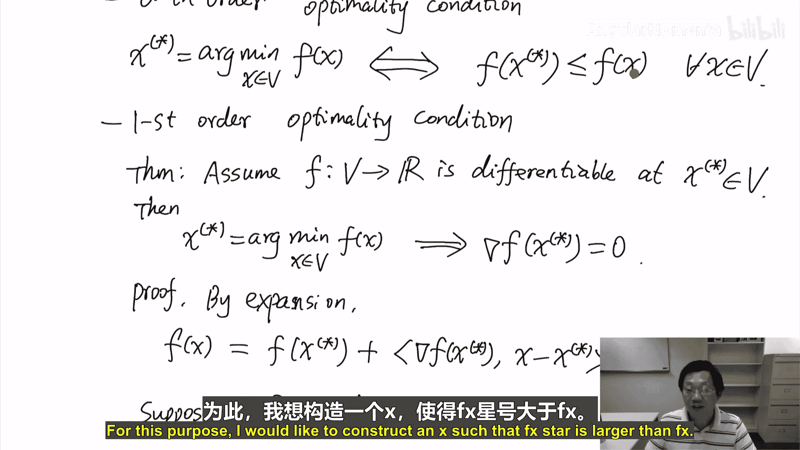
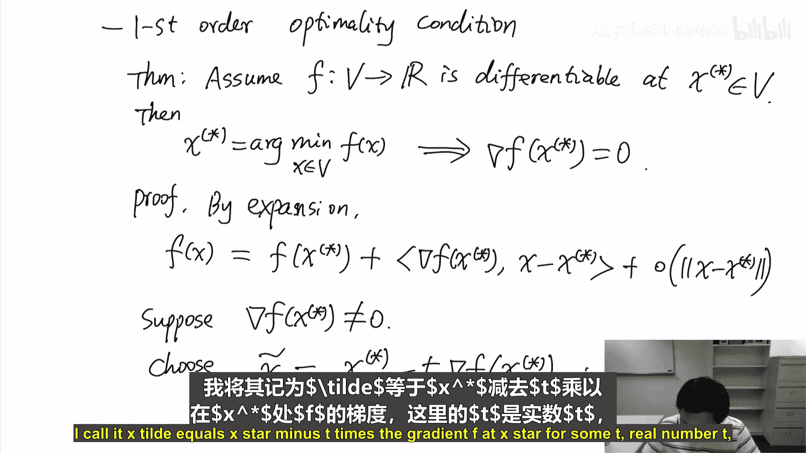
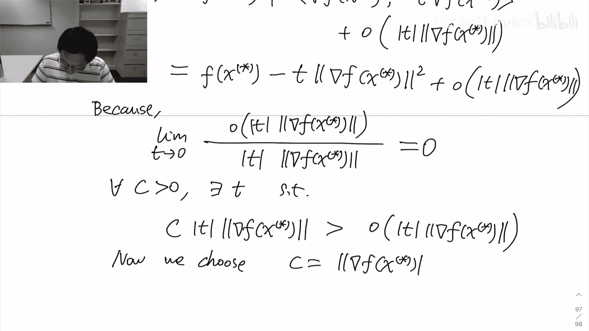
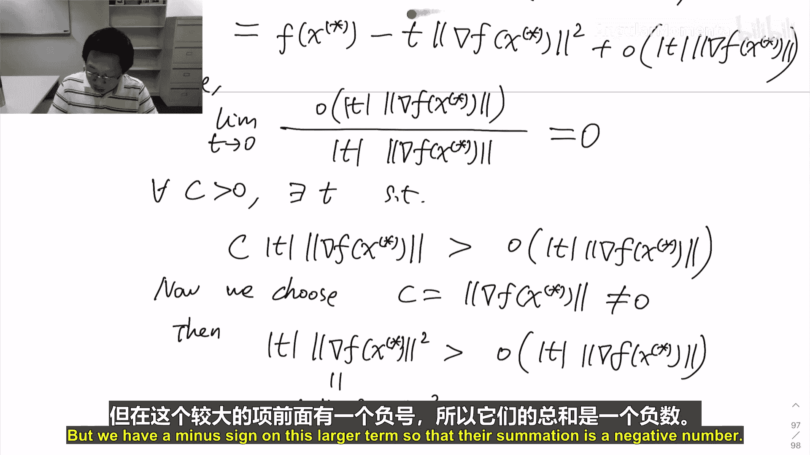
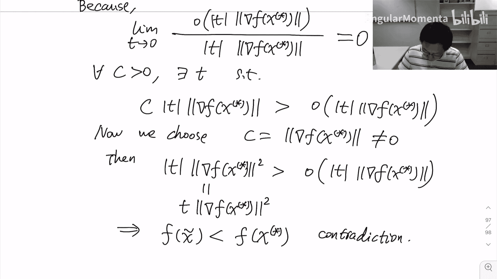

# 074：一阶最优性条件 🎯

在本节课中，我们将学习如何判断一个点是否为优化问题的最优解。我们将重点介绍一种比零阶条件更容易验证的方法——一阶最优性条件，它利用函数的梯度来刻画最优解。

上一节我们介绍了零阶最优性条件，它要求最优解处的函数值不大于定义域内任何其他点处的函数值。然而，这个条件在实际中很难验证，因为它需要比较所有可能的点。本节中我们来看看一个更实用的条件。

## 零阶最优性条件的局限性

假设我们求解一个存在解的优化问题。为了求解这个最小化问题，我们需要首先找到最优解。

当 **X*** 是函数 **F(X)** 的一个极小化点时，根据定义，它满足零阶最优性条件：

**F(X*) ≤ F(X)**， 对于所有 **X ∈ V**

但这个条件非常难以检验，因为它是全局性的，你必须尝试定义域 **V** 中的所有 **X**，并测试 **F(X*)** 是否小于等于所有 **F(X)**。这通常非常困难。因此，我们需要一些更容易的条件来刻画解的特征。

## 一阶最优性条件

一个相对更容易检验的条件是一阶最优性条件。它利用了微分和梯度的概念。

**定理**：假设函数 **F** 在点 **X*** 处可微。那么，如果 **X*** 是 **F** 的一个全局极小化点，则必有：

**∇F(X*) = 0** （梯度向量为零向量）

在这个刻画中，我们使用了一阶导数，因此它被称为一阶最优性条件。这个条件比零阶条件更容易检验，因为我们只需要检验函数在 **X*** 这一个点处的梯度，而零阶条件需要将 **F(X*)** 与定义域内任何其他 **X** 的 **F(X)** 进行比较。

## 定理证明

这个定理的证明将利用可微性的定义，特别是泰勒展开式。

根据 **F** 在 **X*** 处可微的定义，我们有泰勒展开：

**F(X) = F(X*) + ∇F(X*)ᵀ (X - X*) + o(||X - X*||)**

其中 **o(||X - X*||)** 是比 **||X - X*||** 更高阶的无穷小量。

我们使用反证法来证明定理。**假设梯度 ∇F(X*) 不为零**，我们想推导出矛盾。我们将证明，如果梯度非零，那么零阶最优性条件将被违反。

为此，我们构造一个点 **X**，使得 **F(X*) > F(X)**。我们选择：

**Xₜ = X* - t · ∇F(X*)**

其中 **t** 是一个正实数。

将 **Xₜ** 代入泰勒展开式：

**F(Xₜ) = F(X*) + ∇F(X*)ᵀ (Xₜ - X*) + o(||Xₜ - X*||)**

由于 **Xₜ - X* = -t ∇F(X*)**，且 **||Xₜ - X*|| = |t| · ||∇F(X*)||**，代入得：

**F(Xₜ) = F(X*) - t ||∇F(X*)||² + o(|t| · ||∇F(X*)||)**

为了证明 **F(Xₜ) < F(X*)**，我们需要比较 **-t ||∇F(X*)||²** 项和无穷小项 **o(|t| · ||∇F(X*)||)**。

根据“小o”符号的定义，当 **t → 0** 时，有：

**lim_{t→0} [ o(|t| · ||∇F(X*)||) / (|t| · ||∇F(X*)||) ] = 0**

这意味着，对于任意正常数 **c**，我们总能找到一个足够小的 **t**，使得无穷小项显著小于 **c · t · ||∇F(X*)||**。特别地，我们可以选择 **c = ||∇F(X*)||**（这是一个非零数，因为我们已经假设梯度非零）。

于是，对于足够小的正数 **t**，我们有：

**|o(|t| · ||∇F(X*)||)| < t · ||∇F(X*)||²**

因此，**-t ||∇F(X*)||² + o(|t| · ||∇F(X*)||) < 0**。

所以，**F(Xₜ) = F(X*) + (一个负数) < F(X*)**。

但这与 **X*** 是极小化点的假设（即 **F(X*)** 应为最小值）相矛盾。因此，最初的假设“梯度 ∇F(X*) 不为零”是错误的。

**故必有 ∇F(X*) = 0**。证明完毕。

---

本节课中我们一起学习了判断优化问题最优解的一阶必要条件。我们了解到，对于一个可微函数，其任何局部或全局极小点处的梯度必须为零向量（**∇F(X*) = 0**）。这个条件比直接比较所有函数值的零阶条件更易于操作和验证，为我们寻找最优解提供了一个关键的工具。在后续课程中，我们将看到如何利用这个条件来实际求解优化问题。