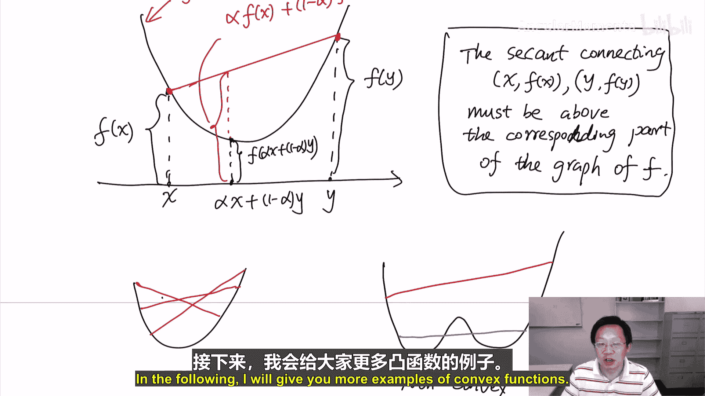
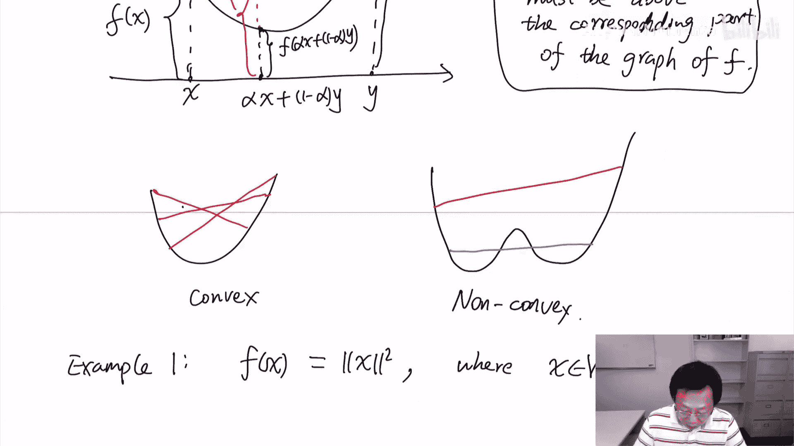
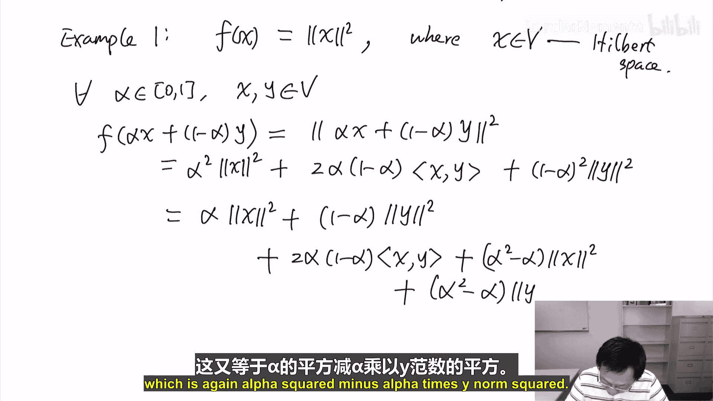
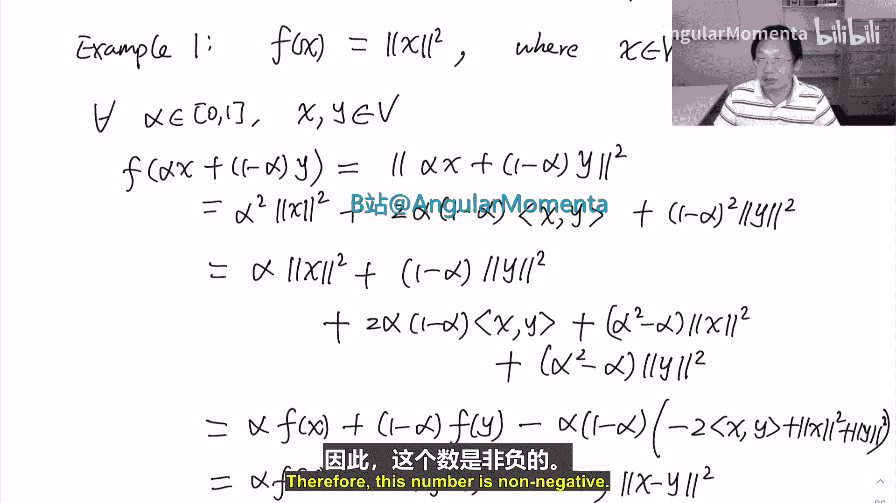
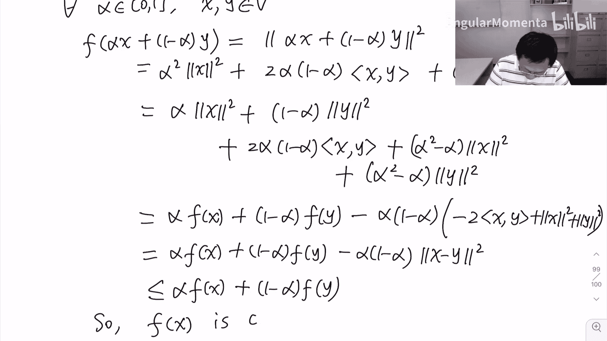
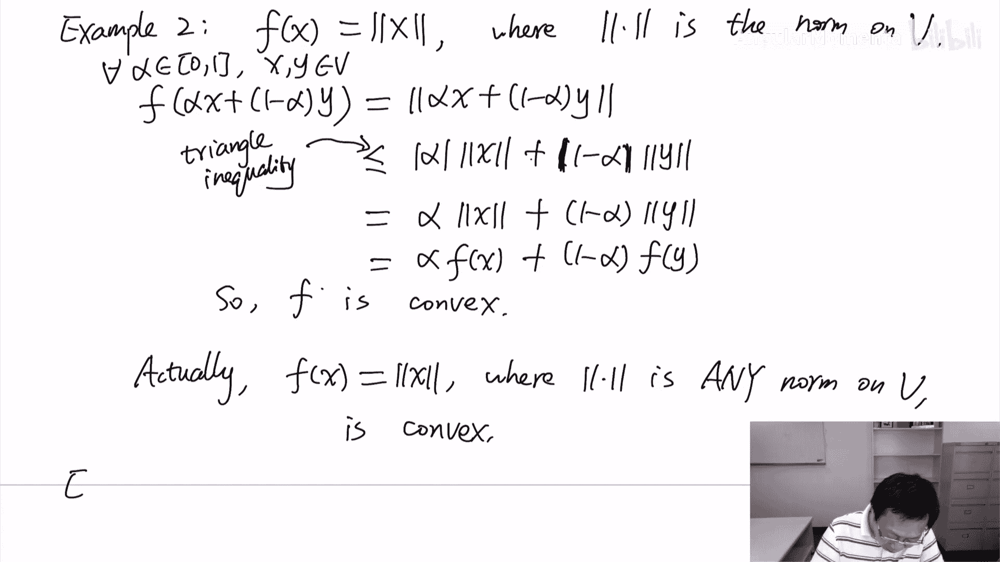
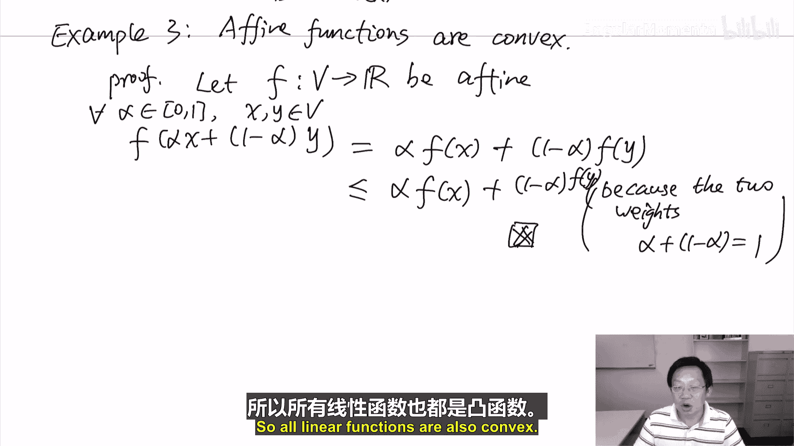

# 077：凸函数示例详解 📚

在本节课中，我们将通过几个具体的例子，深入学习如何判断一个函数是否为凸函数。我们将分析三种不同类型的函数：范数的平方、范数本身以及仿射函数，并利用凸函数的定义来证明它们的凸性。

---

## 示例1：范数平方函数

上一节我们介绍了凸函数的定义，本节中我们来看看第一个例子：**范数平方函数**。

设函数 **F(x) = ||x||²**，其中 **x** 属于希尔伯特空间 **V**，这里的范数是由该空间上的内积诱导的标准范数。为了检验其凸性，我们直接使用凸性的解析定义。

对于任意 **α ∈ [0, 1]** 和任意 **x, y ∈ V**，我们考察：
**F(αx + (1-α)y) = ||αx + (1-α)y||²**

以下是证明步骤：
1.  首先展开范数的平方：
    **||αx + (1-α)y||² = α²||x||² + (1-α)²||y||² + 2α(1-α)⟨x, y⟩**
2.  我们希望证明该式小于等于 **αF(x) + (1-α)F(y) = α||x||² + (1-α)||y||²**。
3.  计算两者的差值：
    **差值 = [α²||x||² + (1-α)²||y||² + 2α(1-α)⟨x, y⟩] - [α||x||² + (1-α)||y||²]**
4.  整理后得到：
    **差值 = α(1-α)[ -2⟨x, y⟩ + ||x||² + ||y||² ]**
5.  注意到括号内的项是一个完全平方：
    **-2⟨x, y⟩ + ||x||² + ||y||² = ||x - y||²**
6.  因此，**差值 = α(1-α)||x - y||²**。
7.  由于 **α ∈ [0, 1]**，**α(1-α) ≥ 0**，且 **||x - y||² ≥ 0**，所以差值非负。

由此我们得出结论：
**F(αx + (1-α)y) ≤ αF(x) + (1-α)F(y)**
所以，由内积诱导的范数的平方函数 **F(x) = ||x||²** 是凸函数。

这个例子告诉我们，**任何由内积诱导的范数的平方函数都是凸函数**。

---

## 示例2：范数函数

在了解了范数平方的凸性后，本节我们来看一个更一般的情况：**范数函数本身**。

设函数 **F(x) = ||x||**，其中 **||·||** 是向量空间 **V** 上的任意范数。我们证明它也是凸函数。

对于任意 **α ∈ [0, 1]** 和任意 **x, y ∈ V**，我们考察：
**F(αx + (1-α)y) = ||αx + (1-α)y||**

以下是证明思路：
1.  根据范数的三角不等式，有：
    **||αx + (1-α)y|| ≤ ||αx|| + ||(1-α)y||**
2.  根据范数的齐次性，**||αx|| = |α|·||x||**，**||(1-α)y|| = |1-α|·||y||**。
3.  由于 **α ∈ [0, 1]**，所以 **|α| = α**，**|1-α| = 1-α**。
4.  因此，上式可化为：
    **||αx + (1-α)y|| ≤ α||x|| + (1-α)||y||**
5.  这正好等于 **αF(x) + (1-α)F(y)**。

由此我们得出结论：
**F(αx + (1-α)y) ≤ αF(x) + (1-α)F(y)**
所以，**任何范数函数 F(x) = ||x|| 都是凸函数**。

证明中唯一用到的性质是范数的三角不等式，它对所有范数都成立。因此，这个结论具有普适性。一些具体的例子包括：
*   欧几里得空间上的 **L1 范数**、**Lp 范数**。
*   矩阵的 **Frobenius 范数**、**无穷范数**。

---

## 示例3：仿射函数与线性函数

最后，我们探讨凸性与线性之间的关系。本节我们证明：**所有仿射函数（包括线性函数）都是凸函数**。

设 **F** 是一个仿射函数。根据定义，对于任意 **α ∈ [0, 1]** 和任意 **x, y ∈ V**，有：
**F(αx + (1-α)y) = αF(x) + (1-α)F(y)**

以下是分析：
1.  上述等式直接由仿射函数的定义得出（因为系数 **α** 和 **(1-α)** 之和为1）。
2.  等式 **“F(αx + (1-α)y) = αF(x) + (1-α)F(y)”** 显然满足不等式 **“F(αx + (1-α)y) ≤ αF(x) + (1-α)F(y)”**。
3.  因此，仿射函数满足凸函数的定义。

由于线性函数是仿射函数的特例，所以**所有线性函数也都是凸函数**。这是一个非常直观的结果，因为连接函数图像上两点的线段就落在函数图像本身上。

---

## 总结 🎯

本节课中我们一起学习了三个重要的凸函数示例：
1.  **范数平方函数**：由内积诱导的范数的平方 **||x||²** 是凸函数。
2.  **范数函数**：任意范数 **||x||** 本身都是凸函数，证明依赖于范数的三角不等式。
3.  **仿射/线性函数**：所有仿射函数（包括线性函数）都是凸函数，这是由它们的定义直接保证的。

这些例子为我们识别和构建凸函数提供了坚实的基础，在优化理论和数据分析中有着广泛的应用。