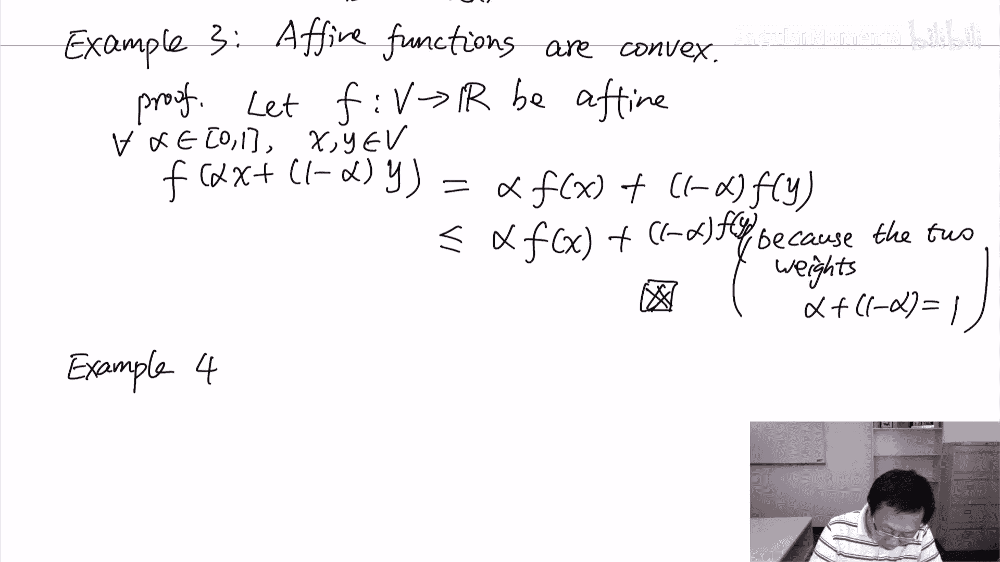
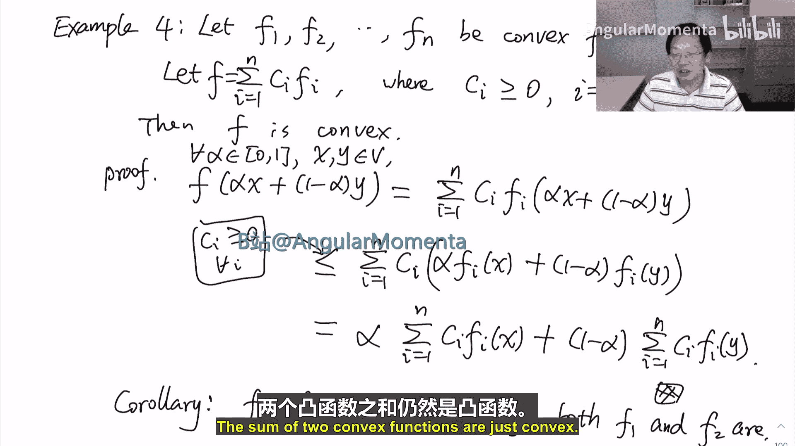
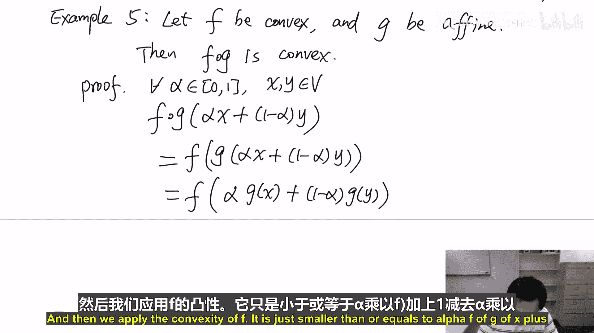
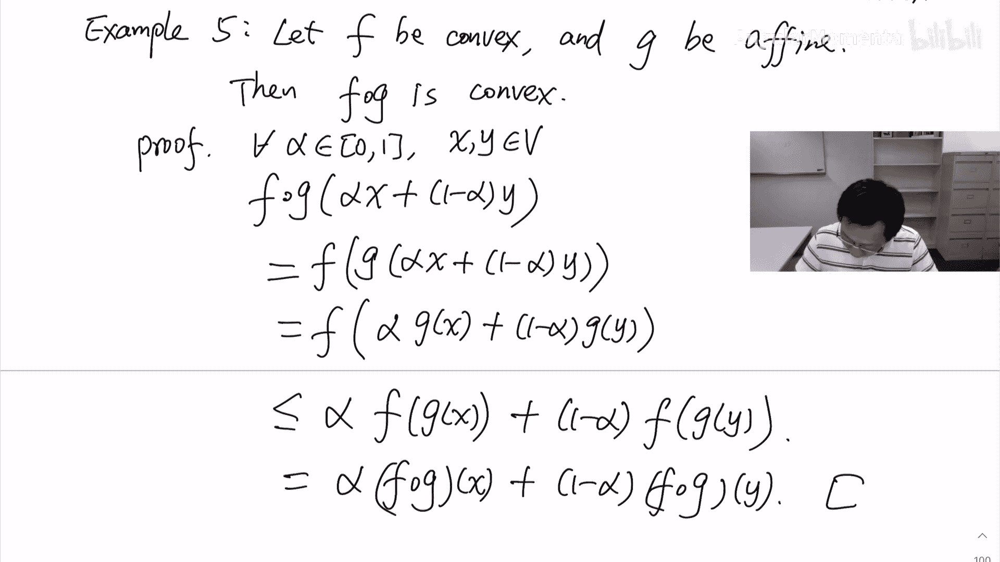
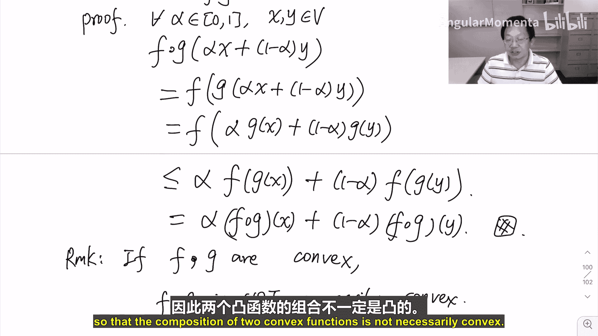

# 078：凸函数的运算性质

在本节课中，我们将要学习凸函数的两个重要运算性质：非负加权和与仿射复合。这些性质帮助我们理解如何通过组合简单的凸函数来构造新的凸函数，这在优化和数据分析中非常有用。

## 非负加权和

上一节我们介绍了凸函数的定义，本节中我们来看看如何通过加权求和来构造新的凸函数。

我们考虑 N 个凸函数。现在考虑它们的线性组合，即 **Σᵢ₌₁ᴺ Cᵢ fᵢ**。但这里对系数有一个约束：系数 Cᵢ 对所有 i 都是非负的。我们考虑 fᵢ 的一个非负加权和，那么得到的函数 f 是凸的。

**证明**：我们考虑 f(αx + (1-α)y)，其中 α ∈ (0, 1)，x 和 y 在向量空间 V 中。根据 f 的定义，这是 **Σᵢ₌₁ᴺ Cᵢ fᵢ(αx + (1-α)y)**。由于每个 fᵢ 是凸的，对于每个 i，有：
**fᵢ(αx + (1-α)y) ≤ α fᵢ(x) + (1-α) fᵢ(y)**。
并且我们知道 Cᵢ 是非负的。因此，将不等式两边乘以 Cᵢ，不等号方向不变。然后将所有 i 的不等式相加。因此，在这个推导中，我们使用了所有 Cᵢ 非负这一事实。如果某个 Cᵢ 为负，当我们对不等式两边乘以 Cᵢ 时，不等号方向会改变，因此结论可能不成立。所以，让这个不等式成立的关键是 Cᵢ 全部非负。合并项后，它可以重写为：
**α Σᵢ₌₁ᴺ Cᵢ fᵢ(x) + (1-α) Σᵢ₌₁ᴺ Cᵢ fᵢ(y)**。
证明完成。

以下是此性质的一个有趣特例：
*   **例1**：设 n=2，且 C₁ = C₂ = 1。那么我们得到 **f₁ + f₂** 是凸的。如果 f₁ 和 f₂ 都是凸函数，那么两个凸函数的和仍然是凸函数。
*   **例2**：考虑 **f₁ - f₂**。即使 f₁ 和 f₂ 都是凸的，由于系数 C₂ = -1 是负数，上述推导中的不等式可能不成立，因此 f₁ - f₂ 不一定是凸的。当然，你可以构造一些例子使得 f₁ - f₂ 是凸的，但一般而言，它不一定凸。相反，f₁ + f₂ 必定是凸的。

## 与仿射函数的复合

接下来，我们探讨凸函数与另一种特殊函数——仿射函数——复合后的性质。

我们考虑两个函数的复合。令 f 是凸函数，g 不仅是凸函数，而且是仿射函数。那么，复合函数 **f ∘ g** 是凸的。

**证明**：使用定义，对于任意 α ∈ (0, 1) 和 x, y ∈ V，有：
**(f ∘ g)(αx + (1-α)y) = f( g(αx + (1-α)y) )**。
因为 g 是仿射函数，我们有：
**g(αx + (1-α)y) = α g(x) + (1-α) g(y)**。
对于仿射函数，如果两个权重之和为1，它严格等于 α g(x) + (1-α) g(y)。所以这里是一个等式。然后我们应用 f 的凸性，得到：
**f(α g(x) + (1-α) g(y)) ≤ α f(g(x)) + (1-α) f(g(y))**。
这正好等于 **α (f ∘ g)(x) + (1-α) (f ∘ g)(y)**。证明完成。

**注意**：如果 f 和 g 都是凸函数，那么复合函数 **f ∘ g** 不一定是凸的。原因在于证明中，从 g(αx + (1-α)y) 到 α g(x) + (1-α) g(y) 这一步，我们使用了 g 的仿射性质。现在，如果 g 仅仅是凸的，那么 g(αx + (1-α)y) ≤ α g(x) + (1-α) g(y)。这个项可能小于等于右边，也可能大于右边（实际上凸性保证了它是小于等于）。关键在于 f 的单调性。如果 f 是单调递增的，那么 f(g(αx + (1-α)y)) ≤ f(α g(x) + (1-α) g(y))，然后可以继续推导。否则，一般而言，两个凸函数的复合不一定是凸函数。

## 总结

本节课中我们一起学习了凸函数的两个构造性质：
1.  **非负加权和**：多个凸函数的非负系数线性组合仍然是凸函数。特别地，两个凸函数的和必定是凸函数，但差不一定。
2.  **与仿射函数复合**：凸函数与仿射函数复合后仍然是凸函数。但两个凸函数复合则不一定保持凸性，除非外层函数具有特定的单调性。

理解这些性质有助于我们在构建模型或设计算法时，判断目标函数的凸性，从而选择合适的优化方法。