# 079：凸函数全局最优解的充要条件 🎯

在本节课中，我们将学习凸函数全局最优解的一个充要条件。这个条件将梯度为零与全局最小化联系起来，为判断凸函数的最优解提供了简洁有力的工具。

上一节我们介绍了凸函数的基本概念，本节中我们来看看如何判断一个凸函数的全局最优解。

## 定理：凸函数全局最优解的充要条件

**定理**：设函数 **F: V → R** 是凸函数且可微。那么，点 **x*** 是函数 **F(x)** 的全局最小化点，当且仅当其梯度在 **x*** 处为零。

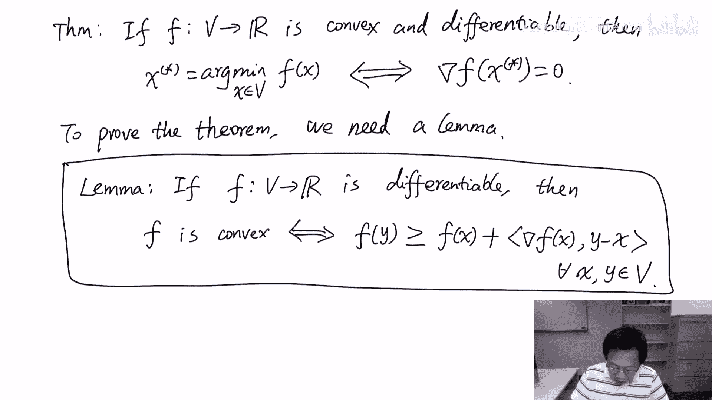

用公式表示为：
**x* 是全局最小化点 ⇔ ∇F(x*) = 0**

这个定理告诉我们，要检查一个点是否是凸函数的全局最优解，只需检查该点的梯度是否为零。如果梯度为零，则该点必定是全局最小化点。

为了证明这个定理，我们需要一个引理，这个引理本身也很有趣。

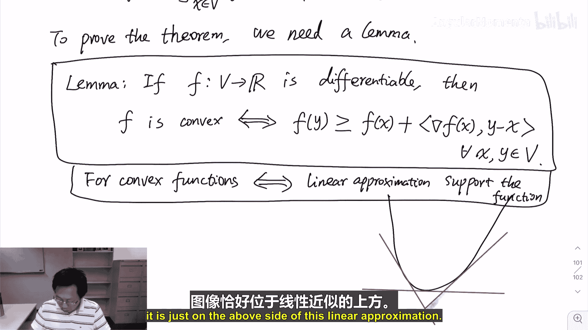

## 引理：凸性的等价刻画

**引理**：如果函数 **F** 是可微的，那么 **F** 是凸函数，当且仅当对于任意 **x** 和 **y** 属于 **V**，都有：
**F(y) ≥ F(x) + ∇F(x)ᵀ (y - x)**

这个引理通过上述不等式给出了凸性的一个等价刻画。不等式右边是函数在点 **y** 处的线性近似。该不等式表明，函数值在任何点 **y** 处都应大于或等于其线性近似值。

从几何上看，这意味着对于凸函数，其函数图像必须位于其任意点处切线（或超平面）的上方。换句话说，线性近似支撑着函数图像。

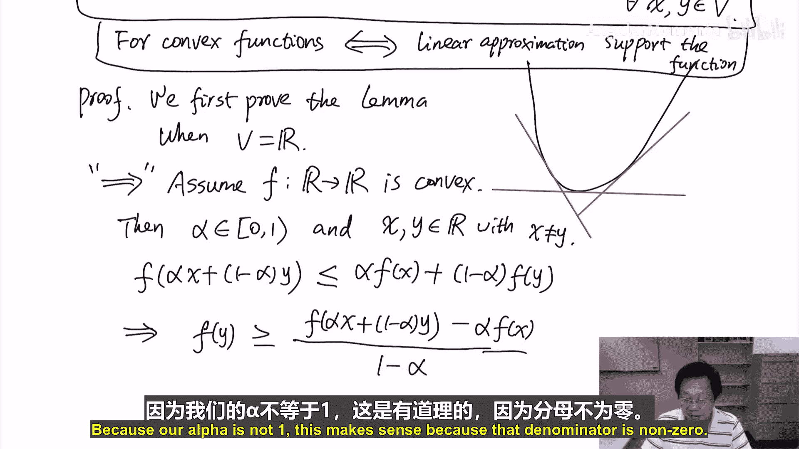

让我们来证明这个引理。

### 引理的证明（V = R 的情况）

我们首先证明一维（V = R）的特殊情况。在这种情况下，内积就是乘法，梯度就是导数 **F'(x)**。

**证明方向一：从凸性推导不等式**

假设 **F** 是凸函数。根据凸性定义，对于任意 **α ∈ [0, 1]** 和 **x, y ∈ R**（且 **x ≠ y**），有：
**F(αx + (1-α)y) ≤ αF(x) + (1-α)F(y)**

由此可以推导出：
**F(y) ≥ [F(αx + (1-α)y) - αF(x)] / (1-α)**

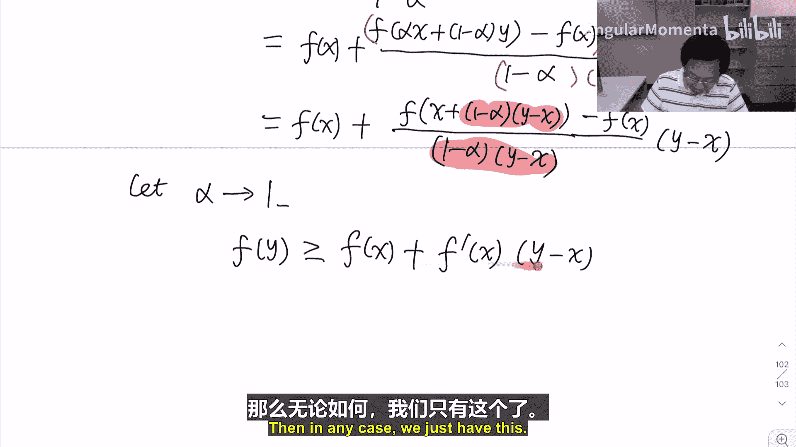

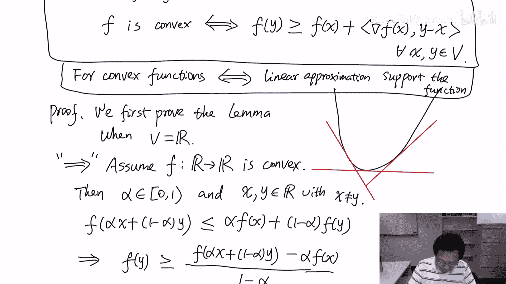

对上述表达式进行代数变换，并乘以和除以 **(y - x)**，可以得到一个差商形式。然后令 **α → 1⁻**（从左侧趋近于1），该差商的极限就是导数 **F'(x)**。最终我们得到：
**F(y) ≥ F(x) + F'(x)(y - x)**

当 **x = y** 时，不等式显然成立。因此，对于所有 **x, y ∈ R**，不等式都成立。

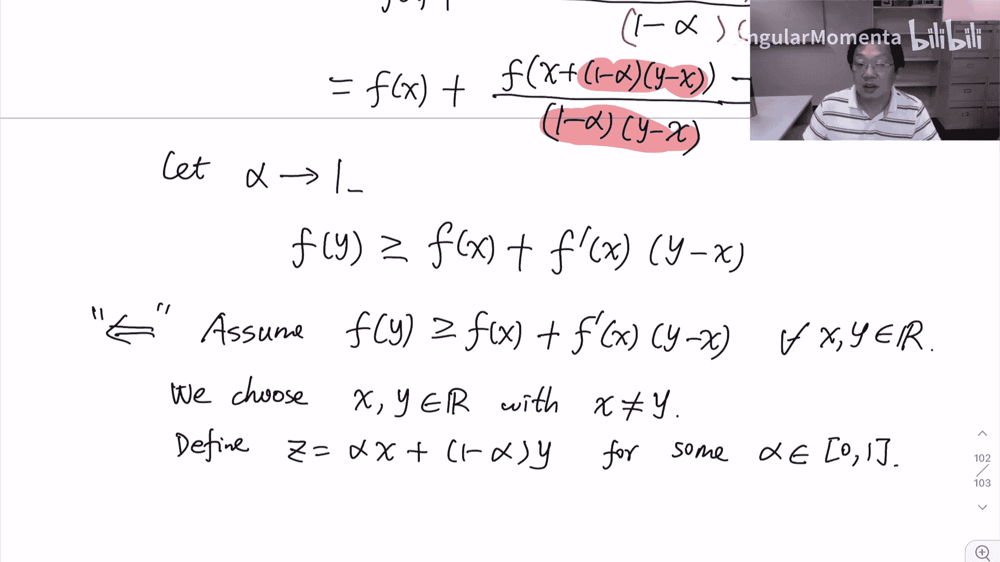

**证明方向二：从不等式推导凸性**

现在假设对于任意 **x, y ∈ R**，都有 **F(y) ≥ F(x) + F'(x)(y - x)**。我们想证明 **F** 是凸的。

选取任意 **x, y ∈ R**（**x ≠ y**），并定义 **z = αx + (1-α)y**，其中 **α ∈ (0, 1)**。

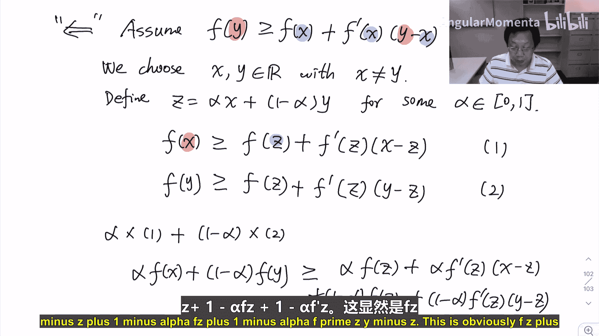

以下是推导的关键步骤：

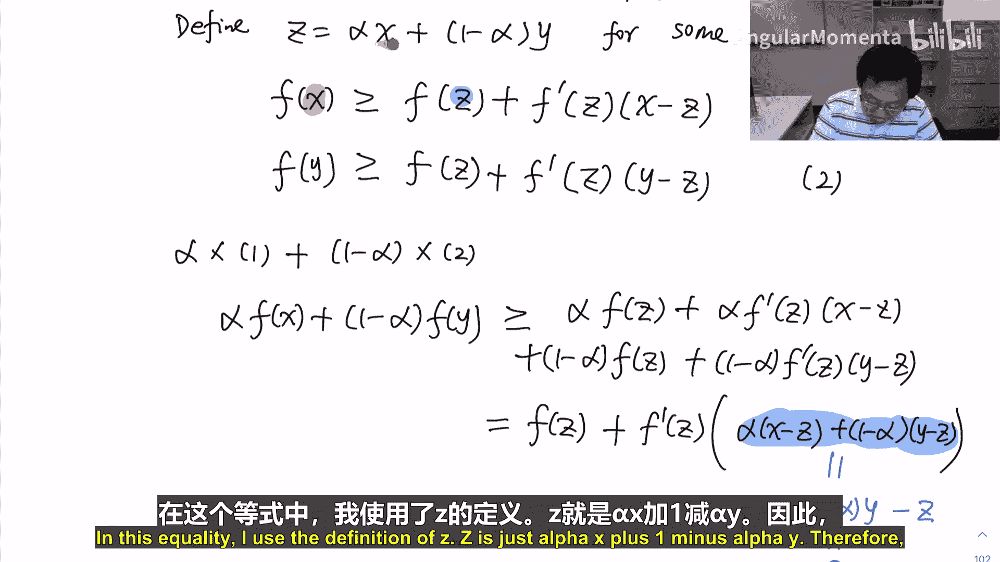

1.  在原不等式中，令 **y = x**， **x = z**，得到不等式(1)。
2.  在原不等式中，令 **y = y**， **x = z**，得到不等式(2)。
3.  将不等式(1)乘以 **α**，不等式(2)乘以 **(1-α)**，然后将两个不等式相加。
4.  利用 **z** 的定义，化简后会发现包含 **F'(z)** 的项相互抵消。
5.  最终得到：**αF(x) + (1-α)F(y) ≥ F(z) = F(αx + (1-α)y)**。

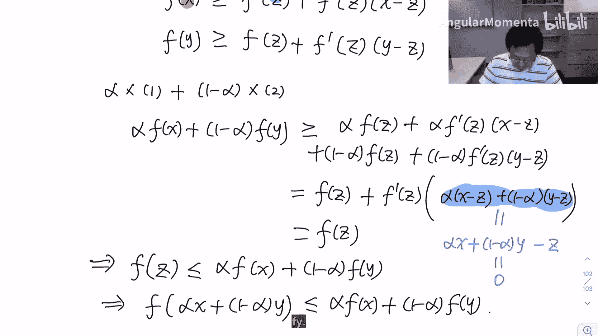

这正是凸函数的定义。当 **x = y** 时，不等式显然成立。因此，**F** 是凸函数。

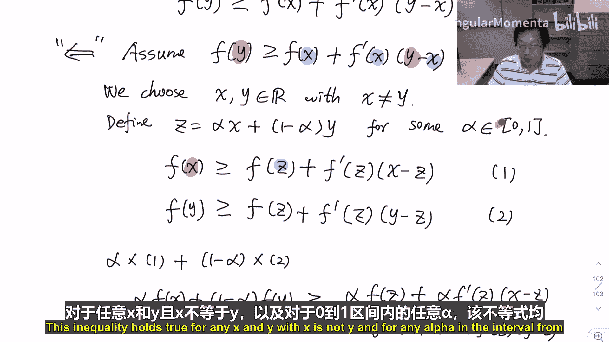

至此，我们在一维情况下证明了引理：**F** 是凸函数当且仅当 **F(y) ≥ F(x) + F'(x)(y - x)** 对所有 **x, y** 成立。

---

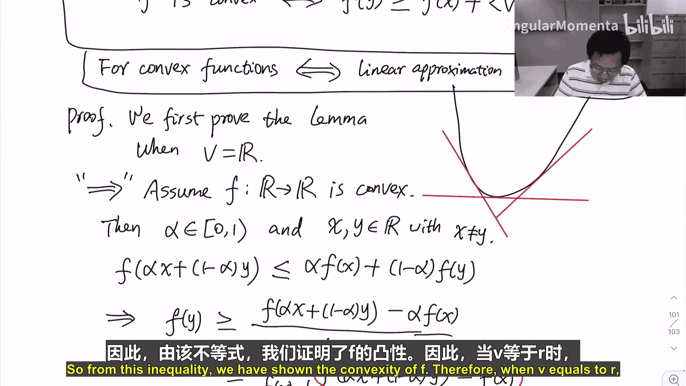

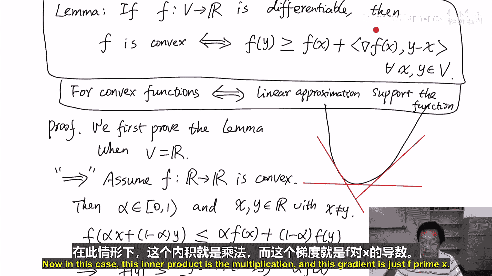

本节课中我们一起学习了凸函数全局最优解的充要条件：对于可微凸函数，梯度为零的点就是全局最小化点。我们还学习并证明了一个关键的引理，该引理用函数值与其线性近似的关系来等价刻画凸性，这是一维情况的证明，其思想可以推广到高维空间。这个定理极大地简化了寻找凸函数最优解的过程。