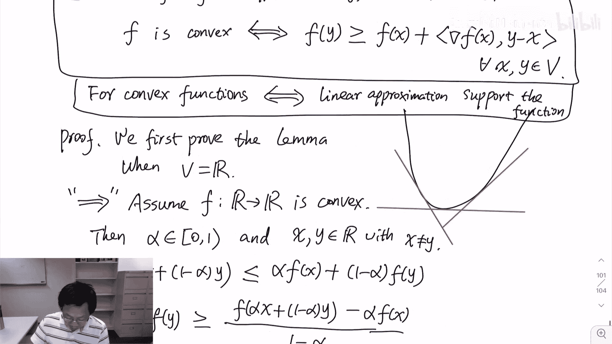

# 080：凸函数的一阶条件证明 🧮

在本节课中，我们将学习如何证明凸函数的一个重要性质：一阶条件。这个条件将函数的凸性与其一阶导数（梯度）联系起来，是优化理论中的核心工具。

上一节我们介绍了在一维实数空间 `R` 中凸函数的一阶条件。本节中，我们将把这个结论推广到一般的向量空间 `V` 中。

## 从凸性推导一阶条件

给定函数 `F` 是凸的，我们希望证明对于任意 `x` 和 `y` 属于 `V`，下式成立：

**F(y) ≥ F(x) + ∇F(x)ᵀ (y - x)**

证明的思路是利用我们已经证明的一维情况。我们将在向量空间 `V` 中构造一条直线，将问题转化为一维问题。

以下是具体的证明步骤：

1.  **构造辅助函数**：对于任意 `x, y ∈ V`，我们考虑连接 `y` 和 `x` 的直线上的点。这些点可以参数化为 `z(t) = t x + (1 - t) y`，其中 `t ∈ R`。当 `t=0` 时，得到 `y`；当 `t=1` 时，得到 `x`。
2.  **定义一维函数**：我们定义一个新函数 `g(t) = F(z(t)) = F(t x + (1 - t) y)`。这是一个从 `R` 到 `R` 的函数。
3.  **分析函数 `g`**：
    *   **凸性**：由于 `F` 是凸函数，将其限制在这条直线上得到的 `g(t)` 也是一个凸函数。
    *   **导数**：函数 `g` 在 `t` 处的导数 `g'(t)`，实际上是 `F` 在点 `z(t)` 处沿方向 `(x - y)` 的方向导数。根据可微性的定义，可以严格证明：
        **g'(t) = ∇F(z(t))ᵀ (x - y)**
4.  **应用一维结论**：对于一维凸函数 `g`，我们已有结论：对于任意 `s, t ∈ R`，有 `g(s) ≥ g(t) + g'(t)(s - t)`。
5.  **代入特殊值**：我们选择 `s = 0` 和 `t = 1` 代入上述不等式：
    `g(0) ≥ g(1) + g'(1)(0 - 1)`
    将 `g` 的定义和导数公式代回：
    `F(y) ≥ F(x) + [∇F(x)ᵀ (x - y)] * (-1)`
    化简后即得到我们想要证明的公式：
    **F(y) ≥ F(x) + ∇F(x)ᵀ (y - x)**

至此，我们完成了从凸性推导一阶条件的过程。

## 从一阶条件推导凸性

上一部分我们证明了凸函数必然满足一阶条件。现在，我们证明其逆命题也成立：如果一个可微函数 `F` 满足对于所有 `x, y ∈ V` 都有 `F(y) ≥ F(x) + ∇F(x)ᵀ (y - x)`，那么 `F` 是凸函数。

以下是证明步骤：

1.  **设定与构造**：任取 `x, y ∈ V` 和 `α ∈ [0, 1]`。定义点 `z = α x + (1 - α) y`。
2.  **应用一阶条件**：将一阶条件分别应用于点对 `(z, x)` 和 `(z, y)`，我们得到两个不等式：
    *   **不等式 1**：`F(x) ≥ F(z) + ∇F(z)ᵀ (x - z)`
    *   **不等式 2**：`F(y) ≥ F(z) + ∇F(z)ᵀ (y - z)`
3.  **进行线性组合**：将第一个不等式乘以 `α`，第二个不等式乘以 `(1 - α)`，然后相加。因为 `α` 和 `(1 - α)` 都是非负的，不等号方向不变：
    `α F(x) + (1 - α) F(y) ≥ [α F(z) + (1 - α) F(z)] + ∇F(z)ᵀ [α (x - z) + (1 - α) (y - z)]`
4.  **化简**：
    *   右边第一部分：`α F(z) + (1 - α) F(z) = F(z)`
    *   右边第二部分：`α (x - z) + (1 - α) (y - z) = α x + (1 - α) y - z`
        根据 `z` 的定义，`α x + (1 - α) y` 就是 `z`，因此这个表达式等于 `0`。
    *   梯度与零向量的内积为 `0`。
5.  **得到结论**：于是，不等式简化为：
    `α F(x) + (1 - α) F(y) ≥ F(z) = F(α x + (1 - α) y)`
    这正是凸函数的定义。因此，`F` 是凸函数。

## 总结

本节课中我们一起学习了凸函数一阶条件的完整证明。我们证明了在一般向量空间中，函数 `F` 是凸的 **当且仅当** 对于其定义域内任意两点 `x` 和 `y`，都满足：
**F(y) ≥ F(x) + ∇F(x)ᵀ (y - x)**
这个结论将函数的几何性质（凸性）与其分析性质（梯度）紧密联系起来，是判断函数凸性和设计优化算法的重要理论基础。