# 081：凸函数最优性条件 🔍

在本节课中，我们将学习凸函数的一个核心性质：如何判断一个点是否为全局最小值点。我们将通过一个重要的定理及其证明来理解这一点。

---

上一节我们介绍了凸函数的一阶特性，本节中我们来看看如何利用这个特性来刻画最优解。

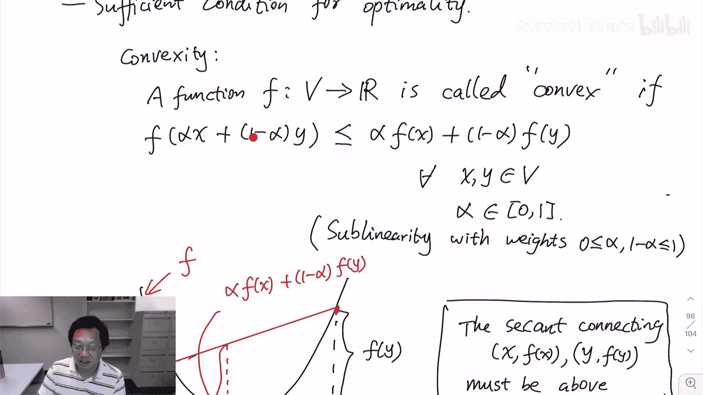

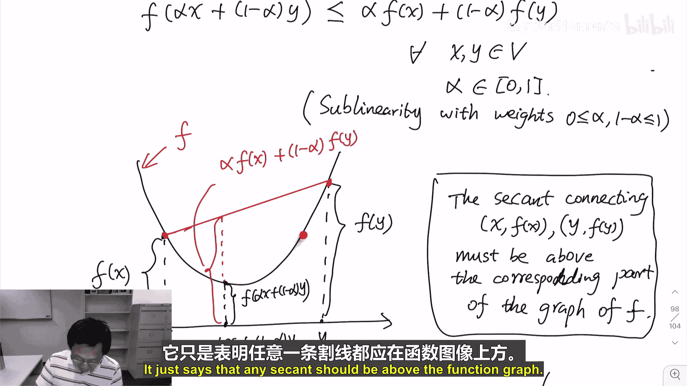

这个网络为我们提供了凸函数的一个等价定义。函数 **F** 是凸的，当且仅当满足以下条件：

$$
F(y) \ge F(x) + \nabla F(x)^T (y - x)
$$

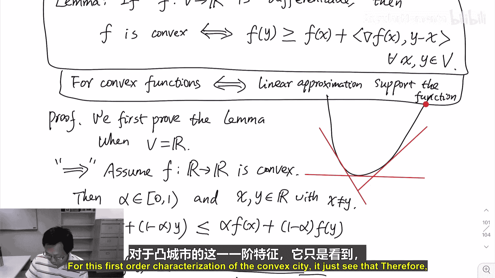

在这个不等式中，我们使用了函数 **F** 在点 **x** 处的梯度。因此，这是凸函数的一阶特性。在凸函数的原始定义中，我们只使用了函数值，不涉及任何梯度或导数，所以那是一个零阶特性。

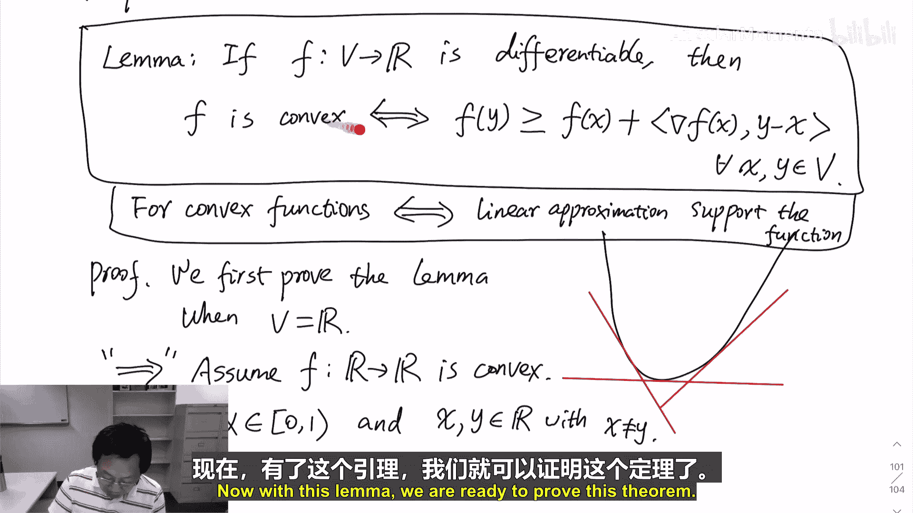

一阶特性可以直观地理解为：对于凸函数，其图像上任意一点的切线（线性近似）都位于函数图像的下方。这个引理本身非常有趣，也是凸分析的基础。

现在，利用这个引理，我们准备证明以下定理。

---

### 定理：凸函数的最优性条件

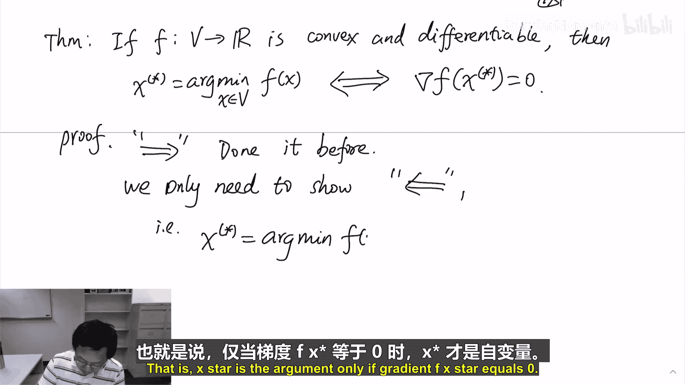

定理表述如下：如果 **F** 是从空间 **V** 到实数 **R** 的凸函数且可微，那么点 **x*** 是 **F** 的全局最小点的**充要条件**是 **F** 在 **x*** 处的梯度为零，即：

$$
\nabla F(x^*) = 0
$$

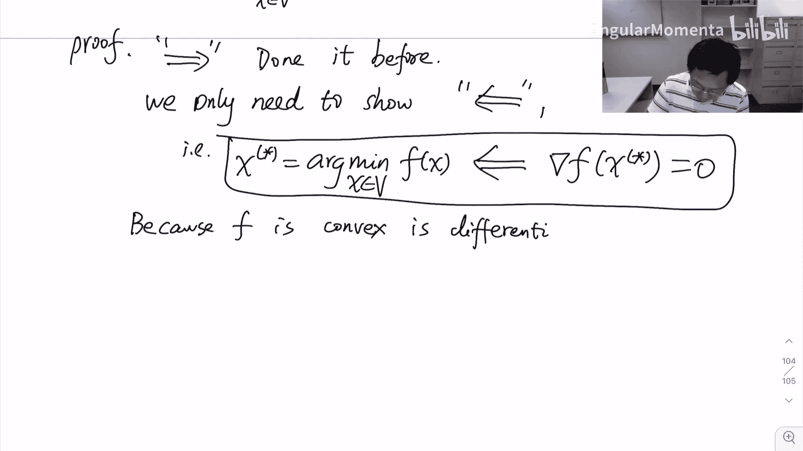

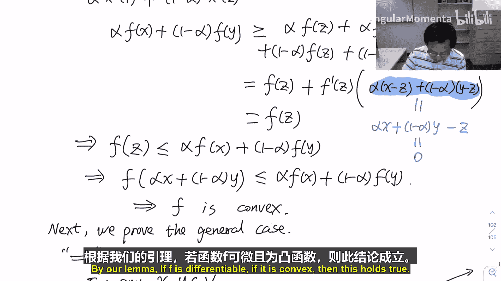

**证明：**

从必要性（左推右）来看，梯度为零是全局最小点的必要条件，这一点是显然的。我们主要需要证明充分性（右推左），即：如果梯度 **∇F(x*)** 等于 **0**，那么 **x*** 就是全局最小点。

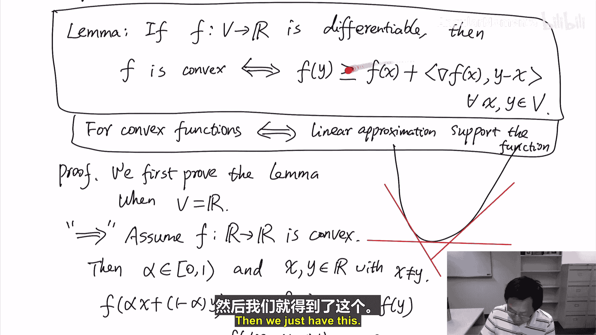

以下是证明过程：

因为 **F** 是凸且可微的，根据我们之前提到的引理，对于任意 **x** 和 **y**，下式成立：

$$
F(y) \ge F(x) + \nabla F(x)^T (y - x)
$$

现在，我们令上述不等式中的 **x** 为 **x***，令 **y** 为任意点 **x**。由于已知 **∇F(x*) = 0**，将其代入不等式，我们得到：

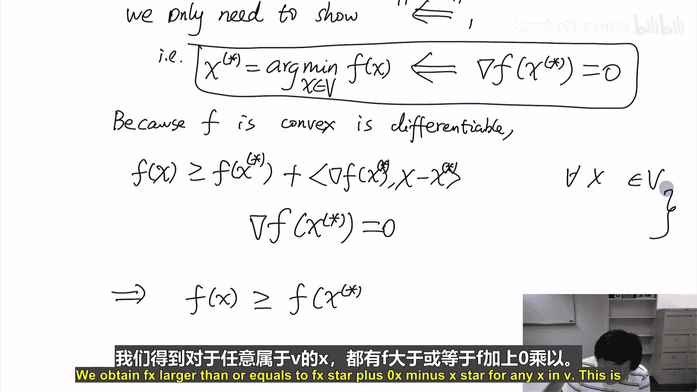

$$
F(x) \ge F(x^*) + 0^T (x - x^*)
$$

这显然简化为：

$$
F(x) \ge F(x^*)
$$

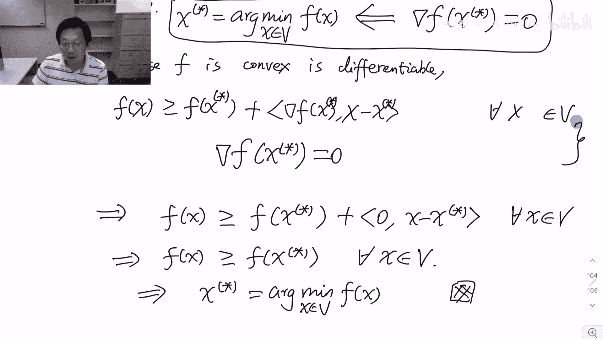

这个不等式对定义域 **V** 内的任意 **x** 都成立。这正是 **x*** 为全局最小点的定义。因此，我们证明了从 **∇F(x*) = 0** 可以推导出 **x*** 是 **F** 的全局最小点。证明完毕。

---

### 总结与意义

本节课中我们一起学习了凸函数最优性的核心定理。

**总结如下：**
对于定义在空间 **V** 上的函数 **F**，如果它是凸的且可微，那么一个点 **x*** 是 **F** 的全局最小点的**充要条件**是梯度在该点为零，即 **∇F(x*) = 0**。

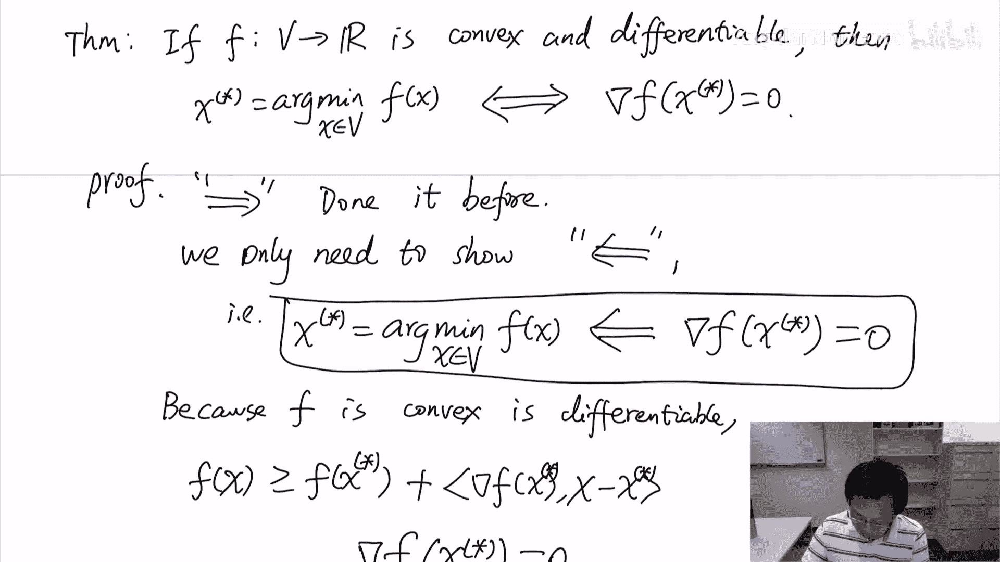

这个等价刻画具有重要的实践意义。在许多数值优化算法中，我们的目标正是寻找一个满足梯度为零条件的解 **x***。这为求解凸优化问题提供了一个清晰而强大的工具。