# 082：梯度下降法

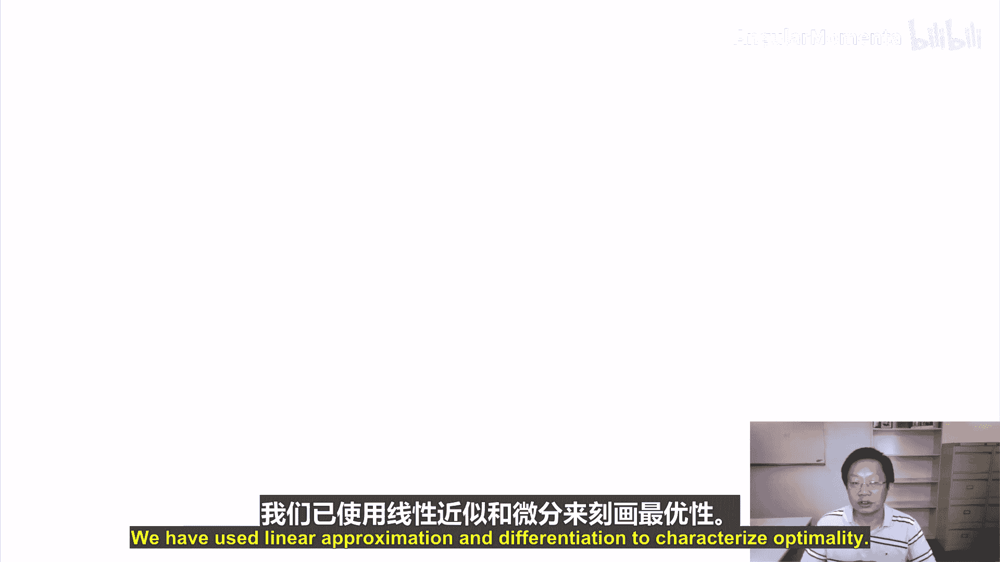

在本节课中，我们将学习如何利用线性近似和微分的概念，来构建一个用于函数最小化的实用算法——梯度下降法。我们将从最优性条件出发，逐步推导出算法的核心思想。

## 概述

我们之前已经使用线性近似和微分来刻画最优性。具体来说，我们证明了以下结论：

*   如果函数 **F** 是凸函数且可微，那么 **x*** 是 **F** 的全局最小值的充要条件是梯度为零：**∇F(x*) = 0**。
*   如果 **F** 仅仅是可微（不一定是凸函数），那么 **x*** 是 **F** 的全局最小值的**必要**条件是 **∇F(x*) = 0**。但反过来不成立，即梯度为零的点不一定是全局最小值点。

接下来，我们希望利用线性近似和微分的思想，来开发用于最小化 **F** 的算法。我们将重点介绍**梯度下降法**。

## 问题设定与算法思路

我们希望最小化函数 **F(x)**，其中 **x** 属于向量空间 **V**，且 **F** 是从 **V** 到实数 **R** 的可微函数。这是一个**无约束优化**问题，因为 **x** 可以是 **V** 中的任意向量。

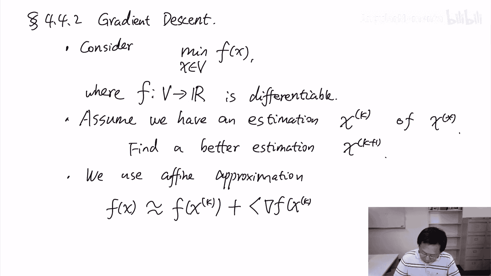

我们将采用一种**迭代算法**。这意味着我们从一个初始估计值开始，然后逐步改进这个估计值，最终逼近全局最小值点。

*   在第 **k** 步，我们有一个估计值 **x_k**。
*   我们的目标是，基于 **x_k**，找到一个更好的估计值 **x_{k+1}**。

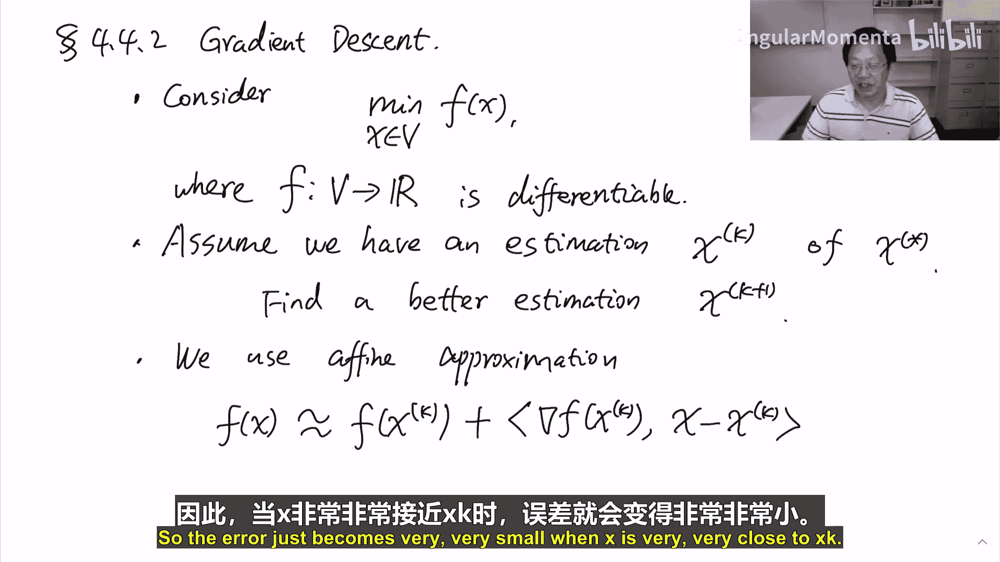

核心思路是使用**线性近似**。由于直接最小化复杂的 **F** 很困难，我们可以在 **x_k** 附近用一个简单的函数（线性函数）来近似 **F**，然后最小化这个近似函数。

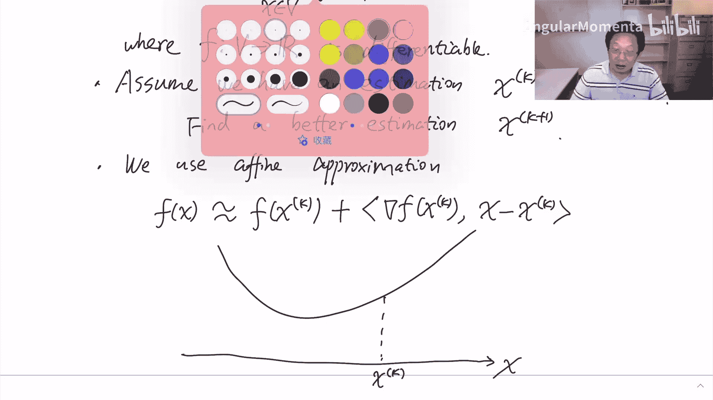

函数 **F** 在 **x_k** 处的线性近似为：
**F(x) ≈ F(x_k) + ⟨∇F(x_k), x - x_k⟩**

这个近似只在 **x** 非常接近 **x_k** 时才足够精确。因此，我们不能直接用这个近似来全局地最小化 **F**，而必须采取**局部最小化**的策略。

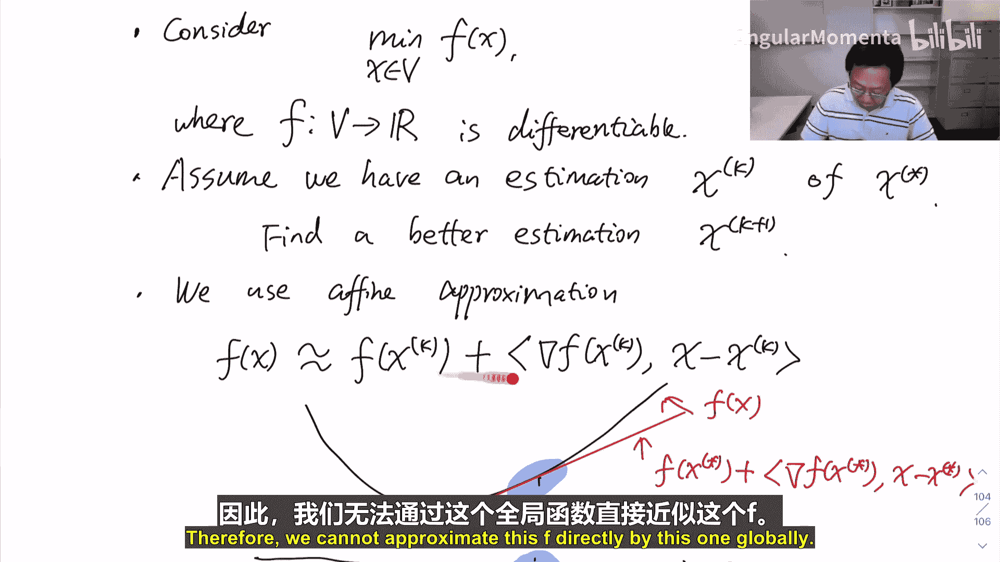

## 从邻近算法到梯度下降

上一节我们提到了局部最小化的思路。一个自然的想法是，在 **x_k** 的一个小邻域内寻找使 **F** 最小的点作为 **x_{k+1}**。这引出了**邻近算法**：

**x_{k+1} = argmin_{x ∈ V} F(x)**
**约束条件：||x - x_k|| ≤ α_k ||∇F(x_k)||**

这个算法在几何上很直观：从 **x_k** 出发，在其邻域内找到最优点 **x_{k+1}**；然后以 **x_{k+1}** 为中心，重复此过程，最终收敛到 **x***。

然而，邻近算法通常**难以实现**，因为在每一步都需要解决一个带约束的优化问题，这可能比原问题更复杂。

为了得到一个可计算的实用算法，我们进行关键改进：既然我们在 **x_k** 的小邻域内操作，而线性近似在该邻域内非常精确，那么我们可以**最小化线性近似函数本身**，而不是原函数 **F**。

于是，优化问题变为：
**x_{k+1} = argmin_{x ∈ V} [ F(x_k) + ⟨∇F(x_k), x - x_k⟩ ]**
**约束条件：||x - x_k|| ≤ α_k ||∇F(x_k)||**

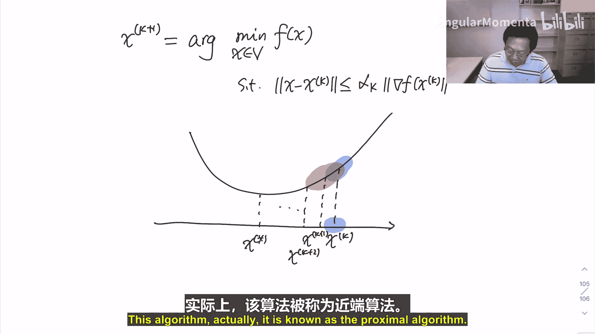

在这个问题中，**F(x_k)** 是常数，不影响最小值点的位置。因此，我们实际上是在最小化 **⟨∇F(x_k), x - x_k⟩**。

## 梯度下降法的推导

现在，我们来求解这个简化后的问题。目标是在以 **x_k** 为中心、半径为 **α_k ||∇F(x_k)||** 的球内，最小化线性项 **⟨∇F(x_k), x - x_k⟩**。

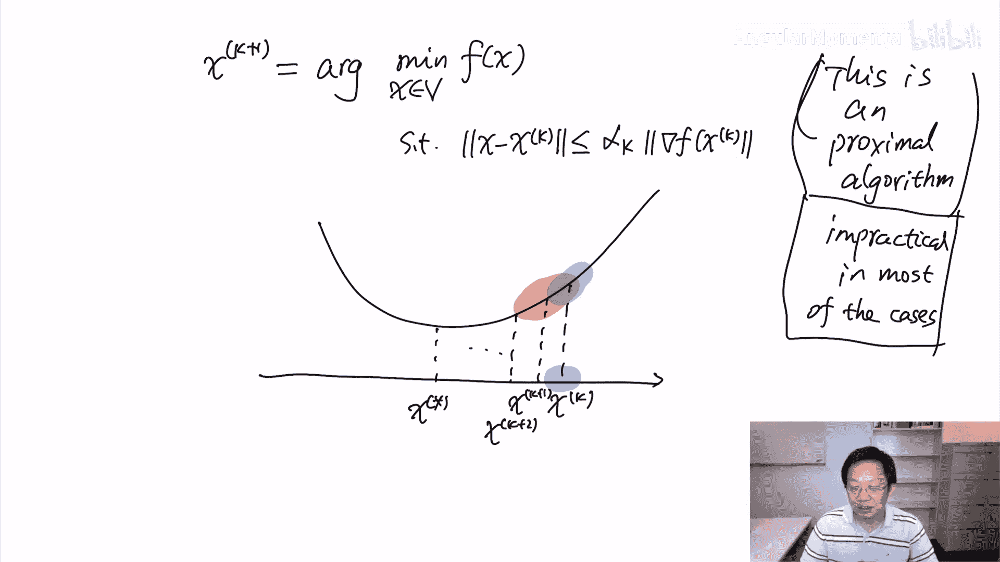

这是一个线性函数在球面上的最小化问题。根据柯西-施瓦茨不等式，当 **x - x_k** 的方向与梯度 **-∇F(x_k)** 的方向完全一致，且取到最大允许长度（即球的半径）时，该内积取得最小值。

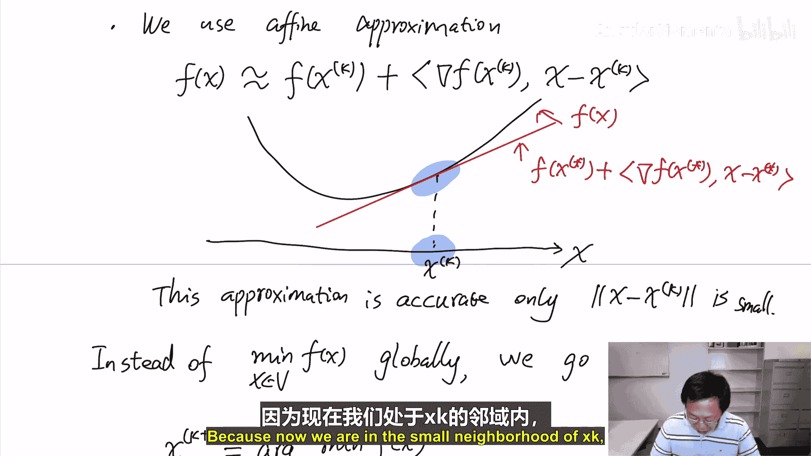

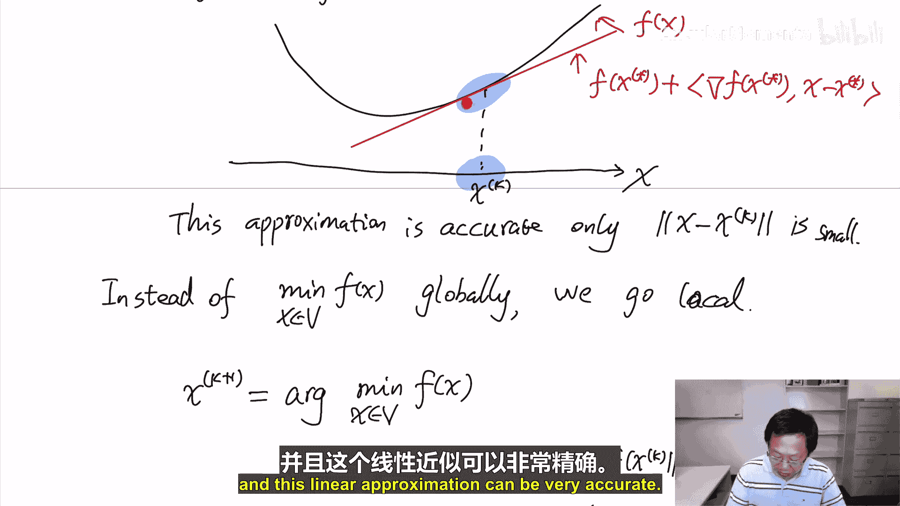

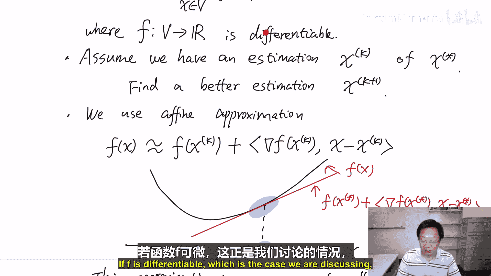

因此，最优解 **x_{k+1}** 为：
**x_{k+1} = x_k - α_k ∇F(x_k)**

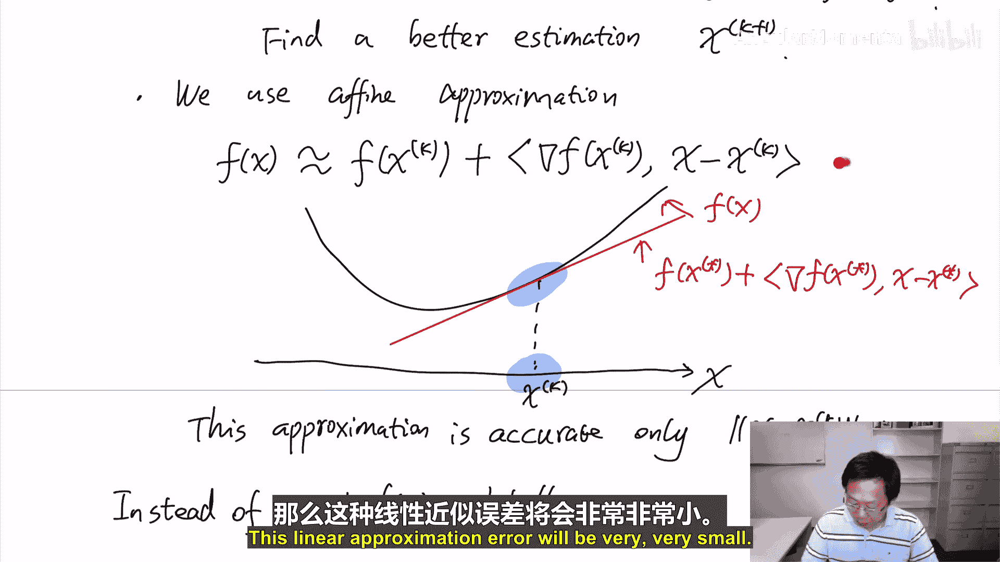

这个简洁的迭代公式就是**梯度下降法**的核心。其中，**α_k** 是一个正数，称为**步长**或**学习率**。

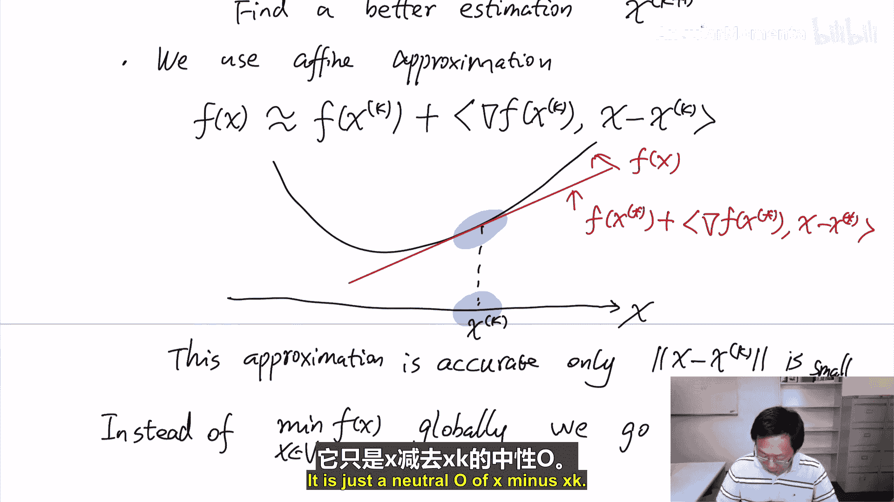

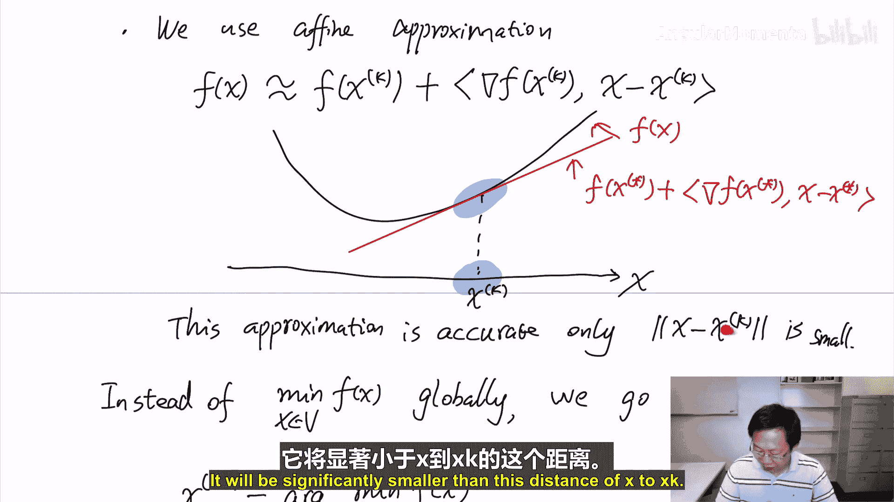

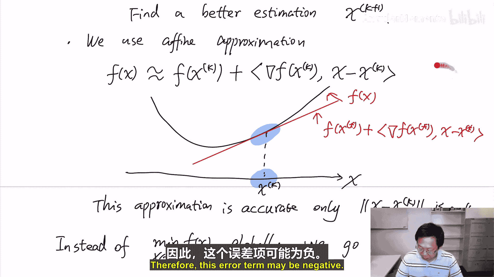

## 算法总结

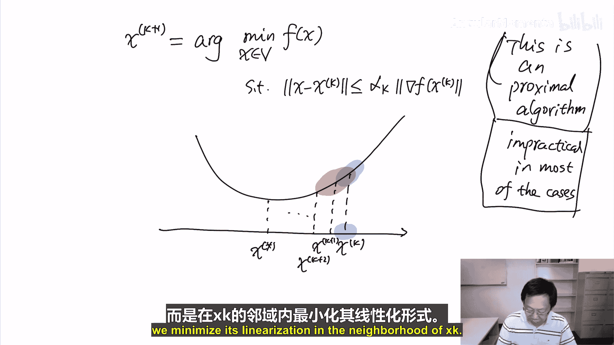

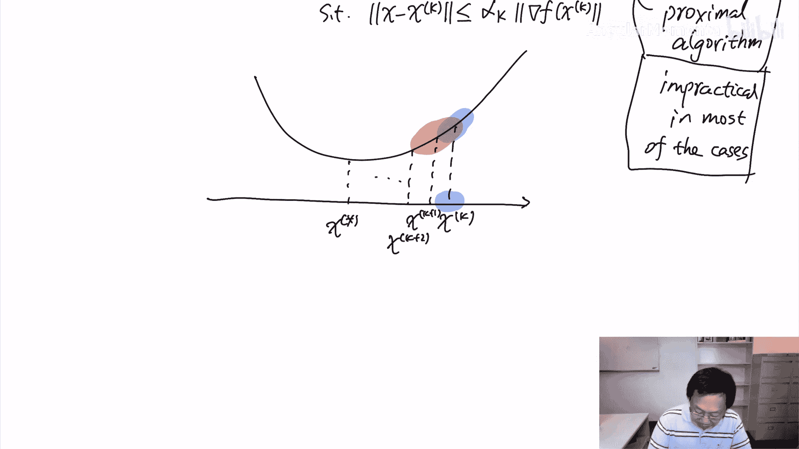

本节课我们一起学习了梯度下降法的推导过程。我们从函数最优性的必要条件出发，通过引入局部搜索和线性近似的思想，先得到了理论上可行但计算困难的邻近算法。然后，通过用线性近似替代原目标函数，我们最终推导出了实用且高效的梯度下降迭代公式：

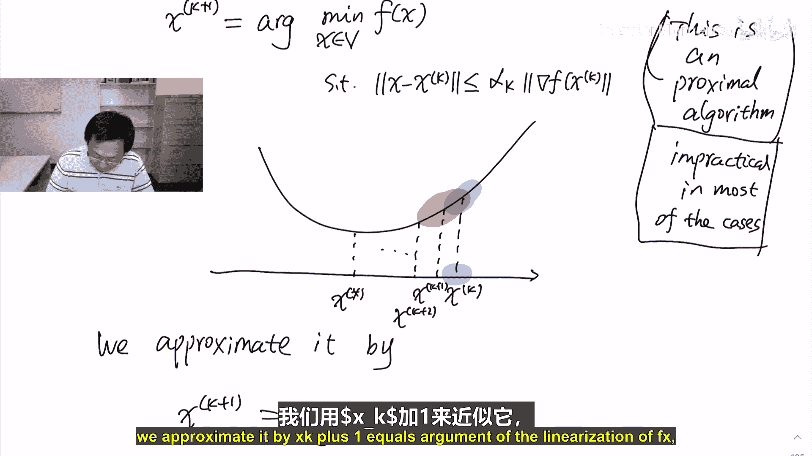

**x_{k+1} = x_k - α_k ∇F(x_k)**

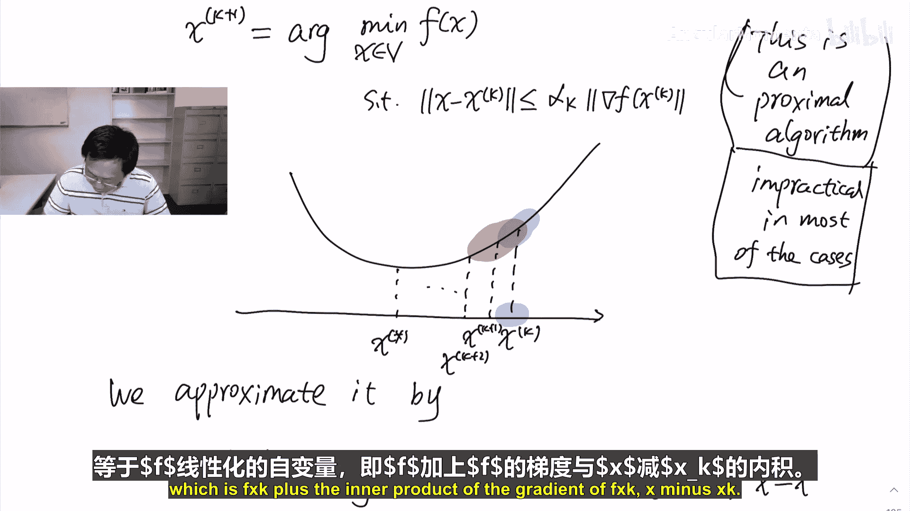

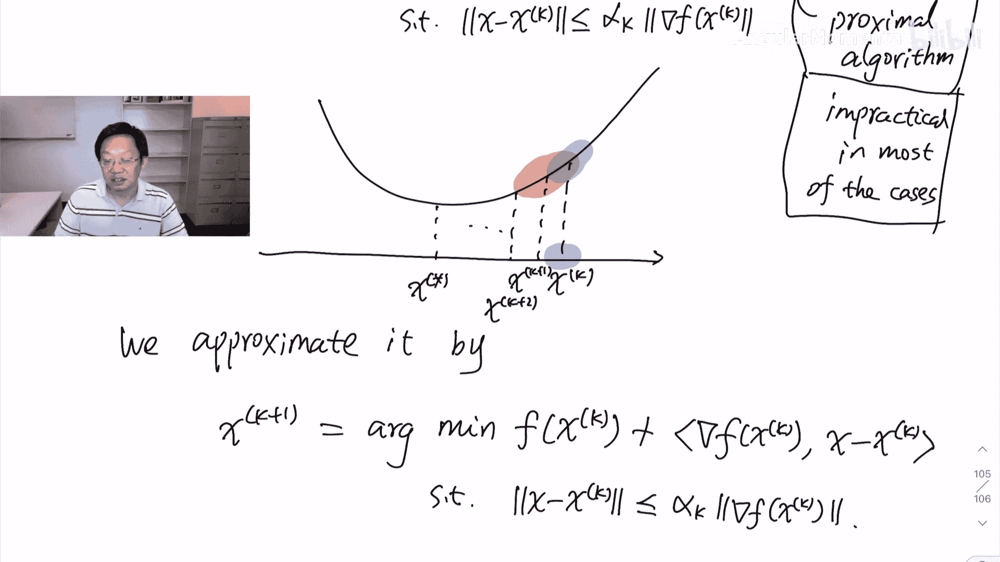

该公式的含义非常直观：为了最小化函数，我们沿着当前点梯度（指向函数增长最快方向）的**反方向**，移动一小步（由步长 **α_k** 控制）。通过不断重复这个过程，我们期望能够逐步逼近函数的最小值点。在后续课程中，我们将讨论如何选择步长 **α_k** 以及该算法的收敛性质。