# 083：梯度下降法推导 🧮

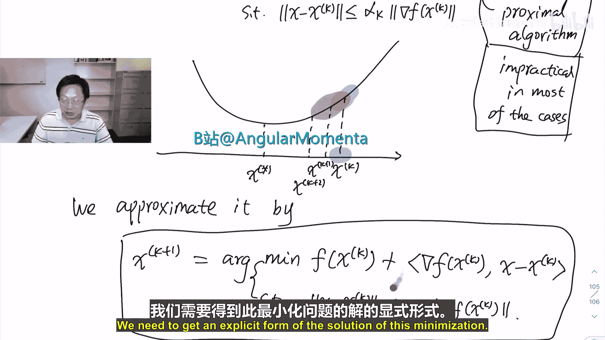

在本节课中，我们将学习如何推导梯度下降算法。我们将从一个最小化问题出发，通过数学分析，最终得到梯度下降的显式迭代公式。

上一节我们介绍了通过局部线性近似来逼近函数最小值的思想。本节中我们来看看如何具体求解这个近似问题，并得到梯度下降法的核心公式。

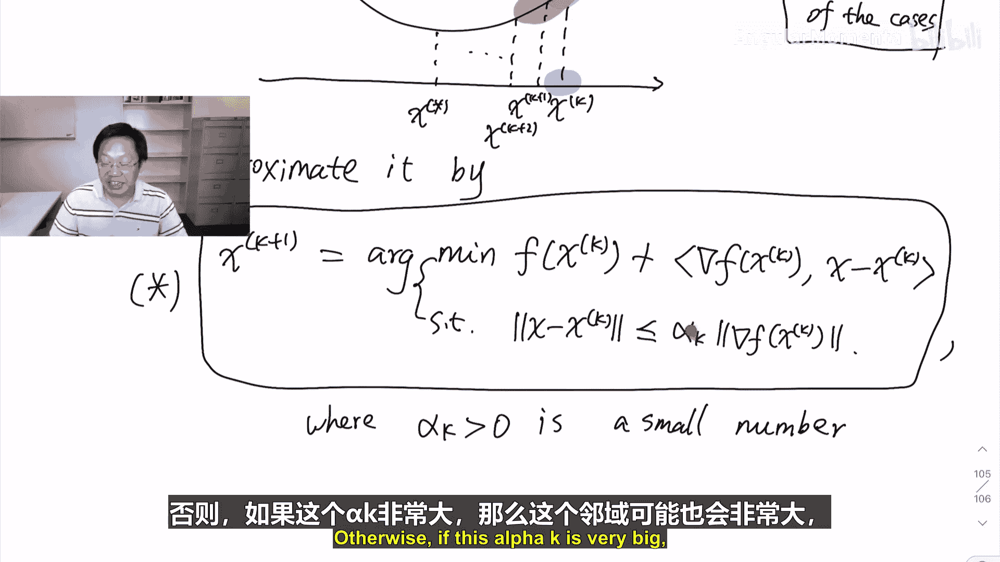

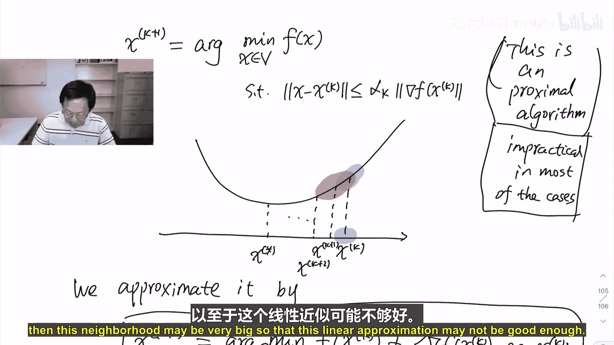

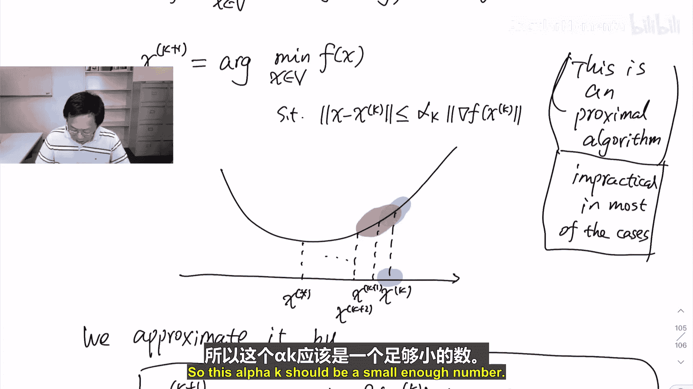

## 问题定义与近似

我们需要解决以下最小化问题，以得到迭代解 \( X_{k+1} \)：

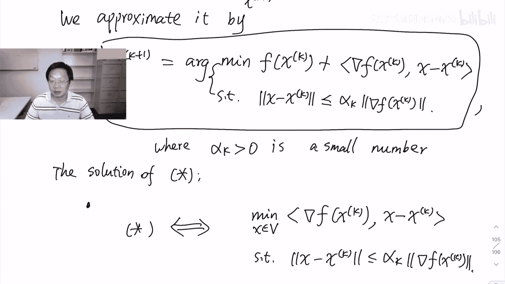

\[
X_{k+1} = \arg\min_{x} \left[ f(X_k) + \langle \nabla f(X_k), x - X_k \rangle \right]
\]
\[
\text{subject to } \| x - X_k \| \leq \alpha_k
\]

我们称此问题为**星号问题**。这里，\( \alpha_k \) 是一个较小的正数，以确保 \( x \) 位于 \( X_k \) 的一个小邻域内，从而使线性近似足够精确。

## 求解星号问题

为了求解星号问题，我们回到其定义。由于 \( f(X_k) \) 是一个常数，最小化原目标函数等价于最小化内积项，约束条件不变：

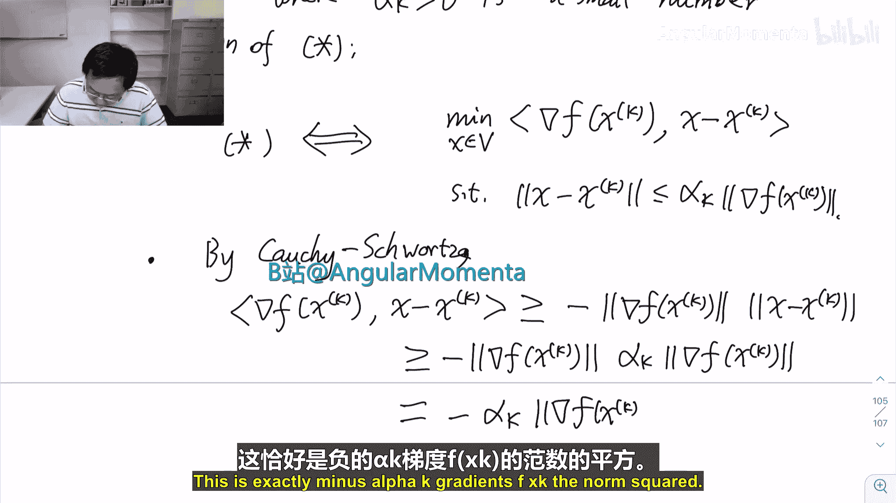

\[
\min_{x} \langle \nabla f(X_k), x - X_k \rangle
\]
\[
\text{s.t. } \| x - X_k \| \leq \alpha_k
\]

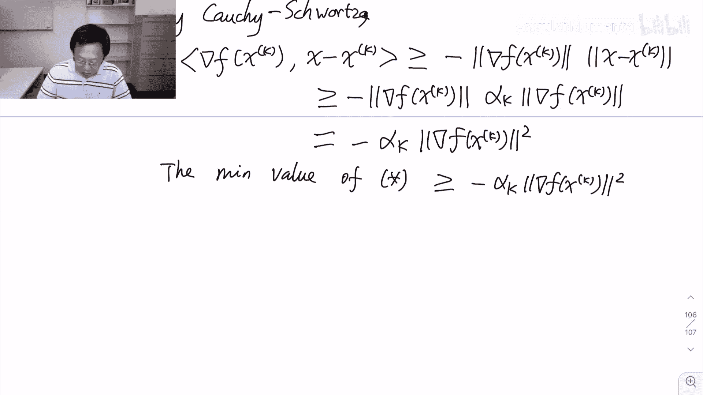

对于这个最小化问题，我们可以通过柯西-施瓦茨不等式来分析其下界。

目标函数是一个内积。根据柯西-施瓦茨不等式，该内积满足：
\[
\langle \nabla f(X_k), x - X_k \rangle \geq - \| \nabla f(X_k) \| \cdot \| x - X_k \|
\]
由于我们在最小化这个内积，其最小值不会低于右边的值。结合约束条件 \( \| x - X_k \| \leq \alpha_k \)，我们得到：
\[
\langle \nabla f(X_k), x - X_k \rangle \geq - \alpha_k \| \nabla f(X_k) \|
\]
进一步，我们可以得到目标函数最小值的一个下界：
\[
\min \langle \nabla f(X_k), x - X_k \rangle \geq - \alpha_k \| \nabla f(X_k) \|^2
\]

## 达到下界的条件

这个下界是可以达到的。如果我们希望星号问题的目标函数达到这个下界，那么推导过程中的两个不等式必须同时取等号。

以下是两个不等式取等号的条件：

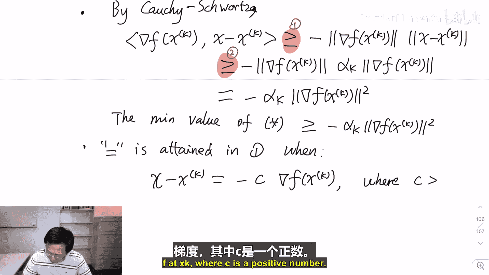

*   **第一个不等式（柯西-施瓦茨不等式）取等号**：当向量 \( x - X_k \) 与梯度 \( \nabla f(X_k) \) 方向相反时成立。即存在一个正数 \( c \)，使得：
    \[
    x - X_k = -c \nabla f(X_k)
    \]

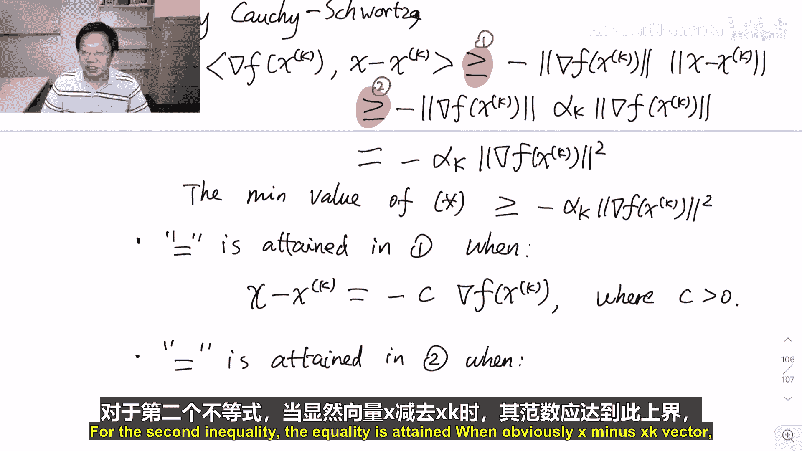

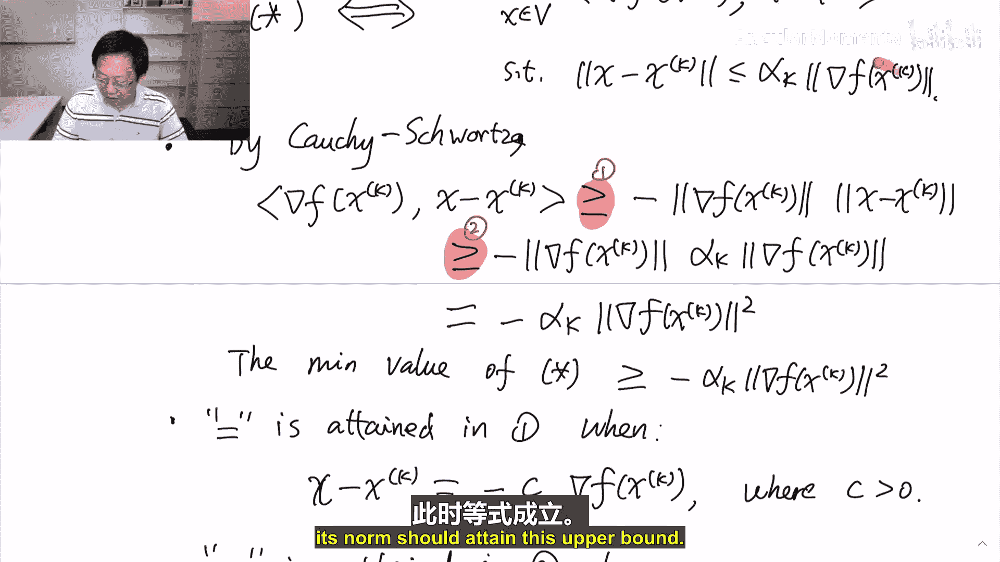

*   **第二个不等式（范数约束）取等号**：当 \( x - X_k \) 的范数达到其上界时成立。即：
    \[
    \| x - X_k \| = \alpha_k
    \]

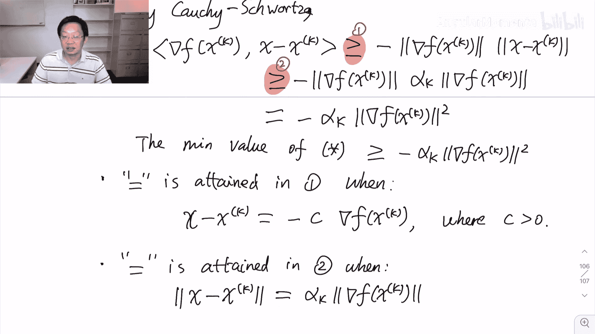

结合这两个条件，我们对第一个等式两边取范数，得到 \( c \| \nabla f(X_k) \| = \alpha_k \)，因此 \( c = \alpha_k \)。

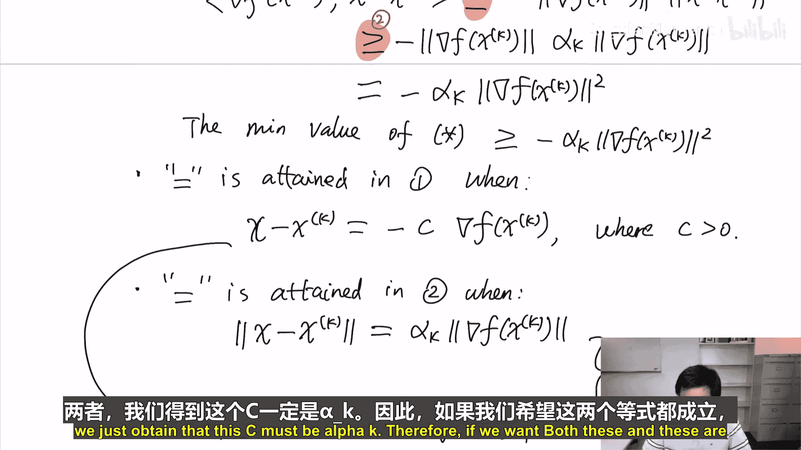

所以，同时满足两个等号条件的解为：
\[
x - X_k = -\alpha_k \nabla f(X_k)
\]
即：
\[
x = X_k - \alpha_k \nabla f(X_k)
\]

选择这个 \( x \)，内积项就能达到其下界，从而得到星号问题的最优解。

## 梯度下降算法

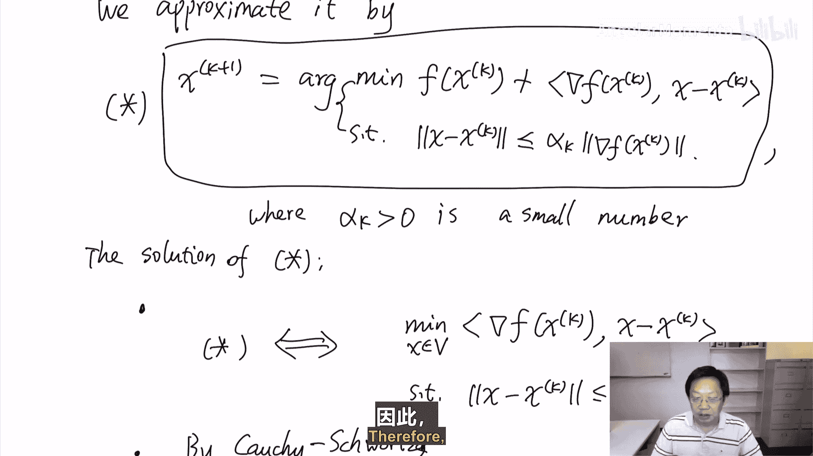

因此，我们得到了迭代算法中最小化问题的闭式解，从而推导出梯度下降算法的迭代公式：

\[
X_{k+1} = X_k - \alpha_k \nabla f(X_k)
\]

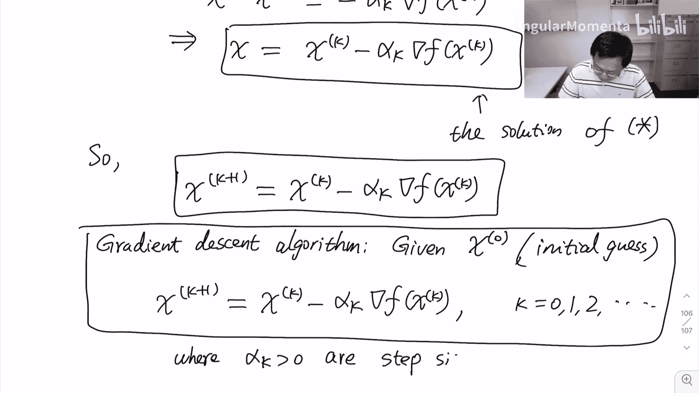

这个算法被称为**梯度下降算法**。

启动该算法需要首先指定一个初始猜测 \( X_0 \)。然后按以下公式迭代，\( k = 0, 1, 2, \dots \)，直到获得满意结果：
\[
X_{k+1} = X_k - \alpha_k \nabla f(X_k)
\]
其中，参数 \( \alpha_k \) 被称为**步长**。

这个简单的梯度下降算法非常强大，是许多高级优化算法的基础。例如，神经网络训练中使用的随机梯度下降法就是其随机版本。

## 算法讨论

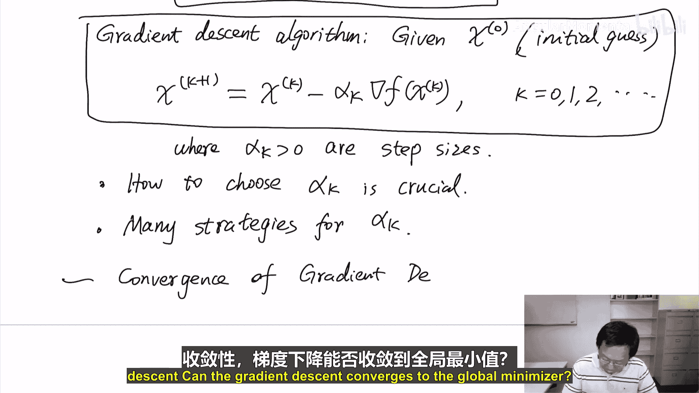

在这个算法中，步长 \( \alpha_k \) 的选择是一个关键问题，对于算法的效率至关重要。有许多选择步长的技巧和策略，这通常在优化领域的高级课程中讨论。

关于梯度下降的收敛性，我们关心它能否收敛到全局最小值。

*   **收敛性**：在步长 \( \alpha_k \) 足够小的情况下，梯度下降算法总是收敛的。
*   **收敛点性质**：如果算法收敛到极限点 \( X_{\infty} \)，则该点满足梯度为零的条件：\( \nabla f(X_{\infty}) = 0 \)。
    *   如果函数 \( f \) 是凸函数，那么零梯度点就是全局最小点。
    *   然而，如果函数 \( f \) 是非凸的，一般情况下无法保证 \( X_{\infty} \) 是全局最小点。因为梯度为零的点可能是局部极小点、局部极大点、鞍点，或者什么都不是。

---

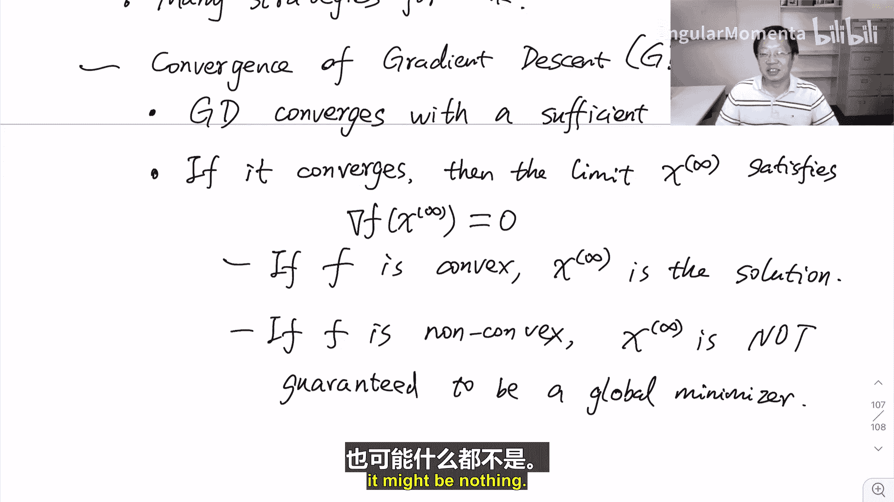

本节课中我们一起学习了梯度下降法的完整推导过程。我们从局部线性近似构建的最小化问题出发，利用柯西-施瓦茨不等式分析了其下界，并找到了达到该下界的条件，从而得到了梯度下降的迭代公式 \( X_{k+1} = X_k - \alpha_k \nabla f(X_k) \)。我们还简要讨论了算法的初始化、步长选择的重要性以及收敛性。梯度下降法虽然形式简单，但它是连接理论优化与大规模机器学习应用的核心桥梁。