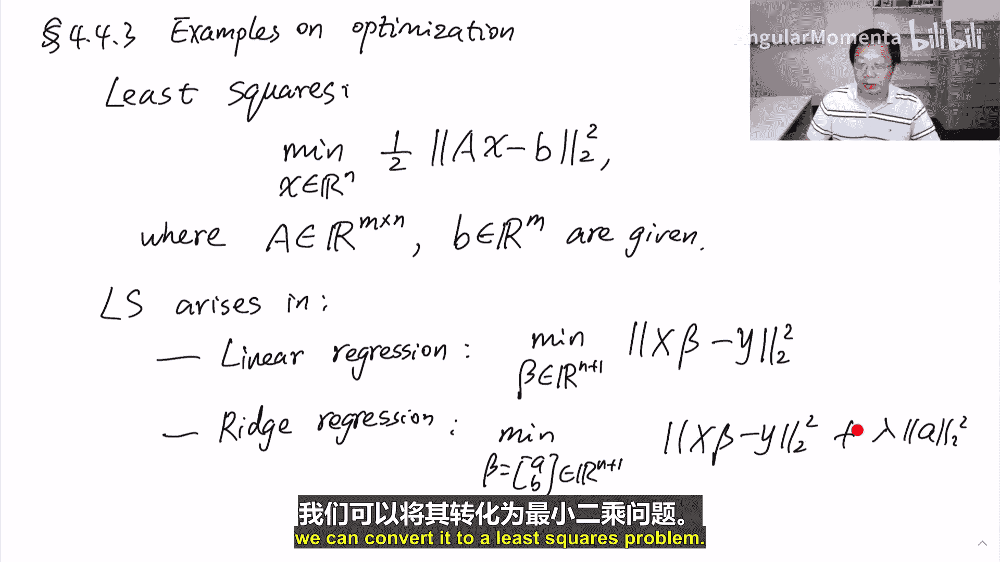
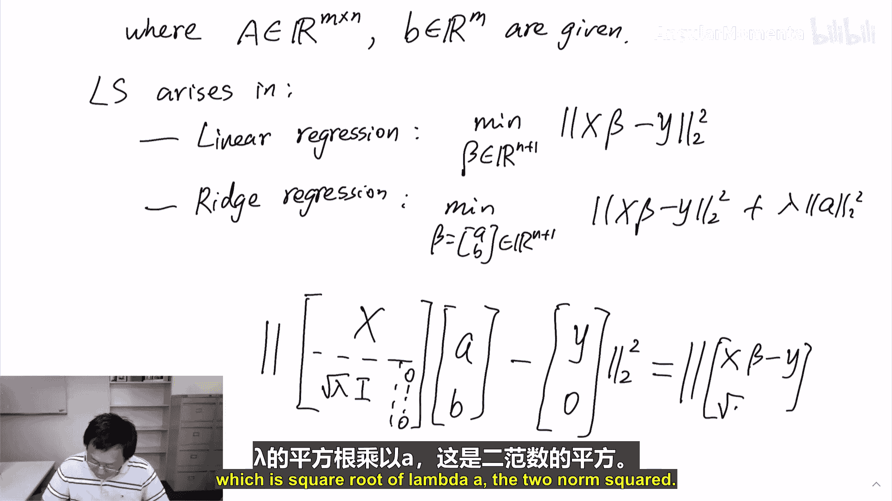
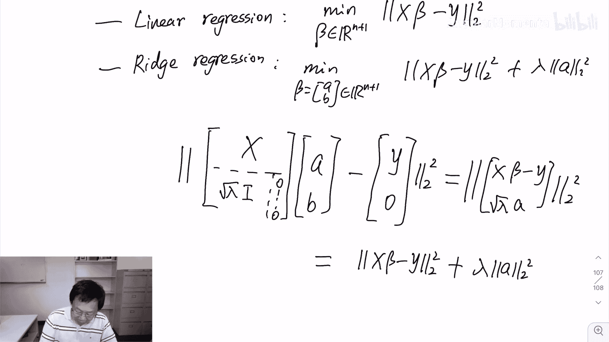
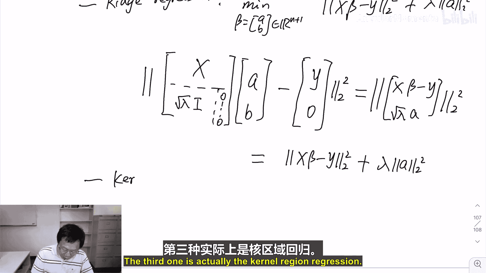
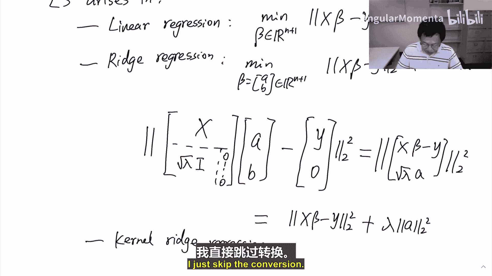
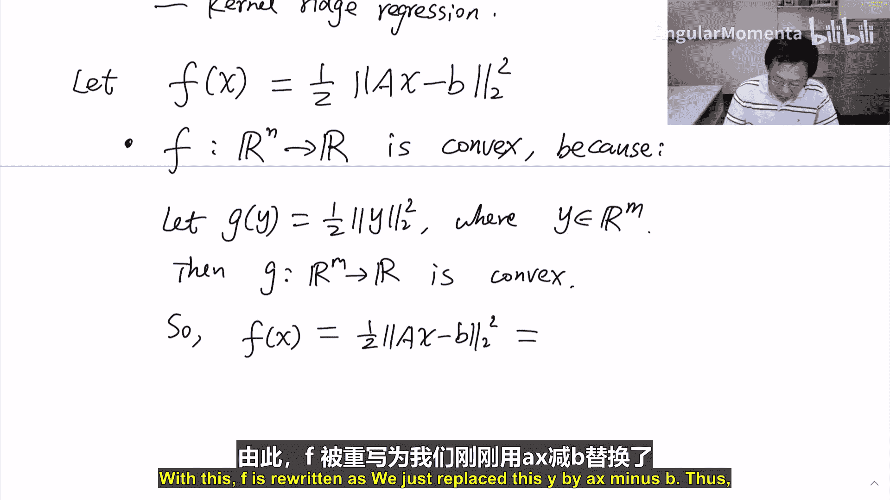
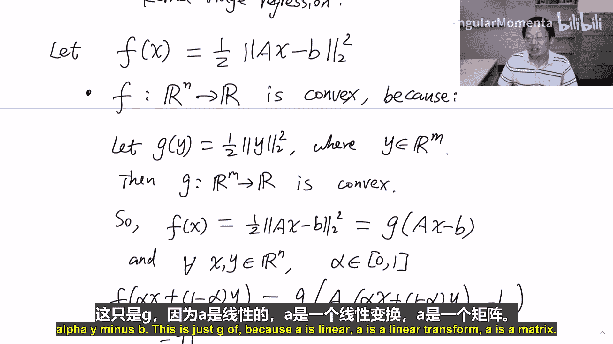
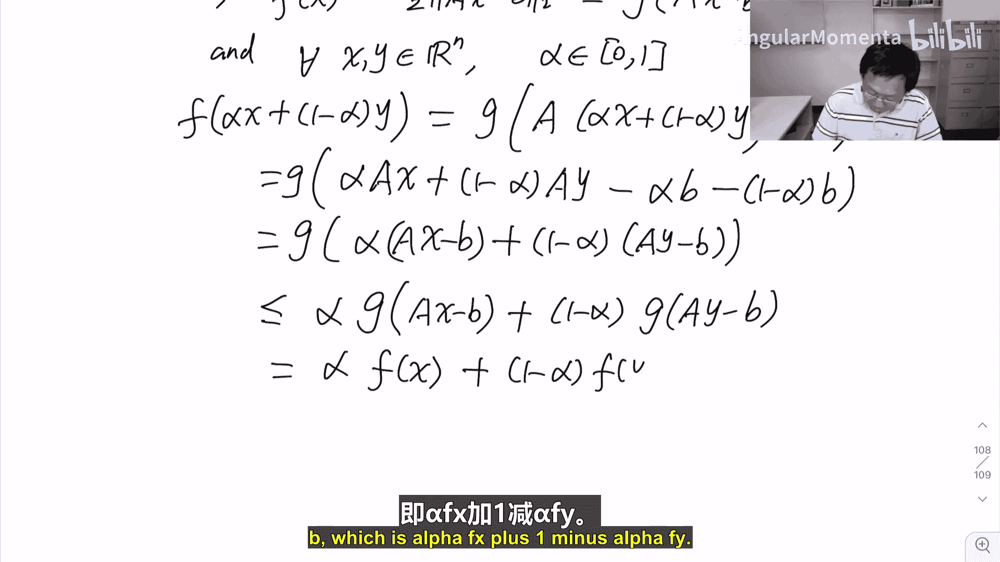
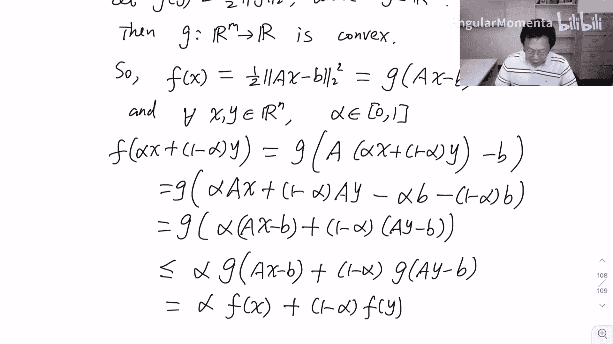
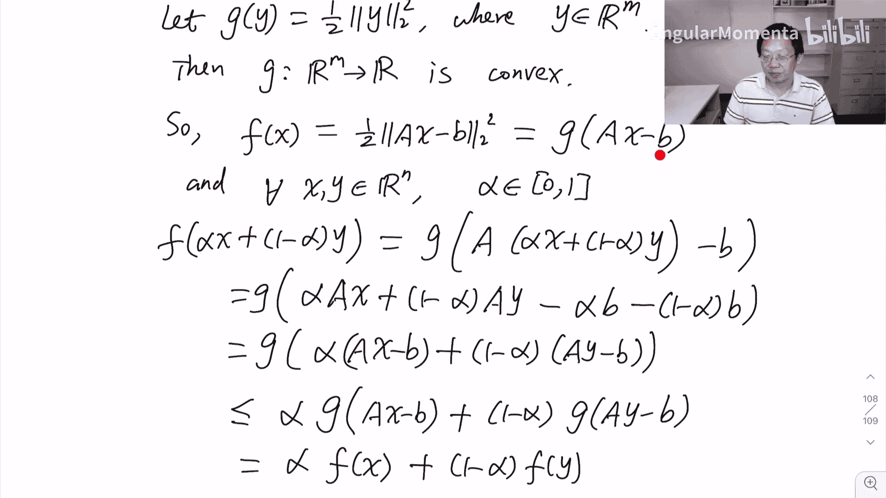

# 084：优化问题与最小二乘法 🧮

在本节课中，我们将学习如何运用梯度、微分和线性逼近等数学工具，解决机器学习中常见的优化问题。我们将重点探讨一个核心问题——**最小二乘法**，并展示其在机器学习模型（如线性回归和岭回归）中的应用。

---

## 最小二乘问题概述

最小二乘问题通常可以表述为以下标准形式：

**最小化**：  
\[
\min_{x \in \mathbb{R}^n} \frac{1}{2} \|Ax - b\|_2^2
\]

其中：
*   \( A \) 是一个给定的 \( m \times n \) 矩阵（通常 \( m > n \)，即数据点数量多于未知参数）。
*   \( b \) 是一个给定的 \( m \) 维向量。
*   \( x \) 是待求解的 \( n \) 维未知向量。

这个形式在机器学习中非常普遍。例如，在线性回归中，我们的目标是最小化残差的平方和，其形式与上述问题本质相同。

---

## 机器学习中的最小二乘问题

以下是几个将机器学习问题转化为最小二乘问题的例子。

### 线性回归

在线性回归中，我们求解参数 \( \beta \) 以最小化目标函数：
\[
\min_{\beta \in \mathbb{R}^{m+1}} \|X\beta - y\|_2^2
\]
这与标准最小二乘形式完全一致，其中 \( X \) 是设计矩阵，\( y \) 是观测值向量。目标函数前的常数因子 \( \frac{1}{2} \) 不影响最优解的位置。

### 岭回归

岭回归在目标函数中加入了正则化项：
\[
\min_{\beta = (a, b) \in \mathbb{R}^{m+1}} \|X\beta - y\|_2^2 + \lambda \|a\|_2^2
\]
我们可以通过构造增广矩阵将其转化为标准最小二乘问题。

定义增广矩阵 \( \tilde{A} \) 和增广向量 \( \tilde{b} \)：
\[
\tilde{A} = \begin{bmatrix} X \\ \sqrt{\lambda} I & 0 \end{bmatrix}, \quad \tilde{b} = \begin{bmatrix} y \\ 0 \end{bmatrix}
\]
其中 \( I \) 是单位矩阵，\( 0 \) 是零向量。

那么，新的目标函数变为：
\[
\|\tilde{A}\beta - \tilde{b}\|_2^2 = \|X\beta - y\|_2^2 + \|\sqrt{\lambda} a\|_2^2 = \|X\beta - y\|_2^2 + \lambda \|a\|_2^2
\]
这恰好是岭回归的目标函数。因此，通过求解 \( \min_{\beta} \frac{1}{2} \|\tilde{A}\beta - \tilde{b}\|_2^2 \) 即可得到岭回归的解。

### 套索回归

类似地，套索回归问题也可以通过一定技巧（例如引入辅助变量）转化为最小二乘问题，此处我们暂不展开。

---

## 最小二乘目标函数的凸性分析

现在，我们聚焦于分析标准最小二乘问题目标函数的性质。

定义目标函数 \( f: \mathbb{R}^n \to \mathbb{R} \)：
\[
f(x) = \frac{1}{2} \|Ax - b\|_2^2
\]

**我们断言：函数 \( f(x) \) 是凸函数。**

以下是证明步骤：

1.  **定义辅助函数**：令 \( g: \mathbb{R}^m \to \mathbb{R} \) 为 \( g(y) = \frac{1}{2} \|y\|_2^2 \)。我们知道，由内积诱导的范数的平方函数是凸函数，因此 \( g \) 是凸函数。

2.  **建立关系**：观察可知，\( f(x) = g(Ax - b) \)。即，\( f \) 是凸函数 \( g \) 与一个仿射变换 \( x \mapsto Ax - b \) 的复合。

3.  **证明凸性**：对于任意 \( x, y \in \mathbb{R}^n \) 和任意 \( \alpha \in [0, 1] \)，我们有：
    \[
    \begin{aligned}
    f(\alpha x + (1-\alpha)y) &= g(A(\alpha x + (1-\alpha)y) - b) \\
    &= g(\alpha (Ax - b) + (1-\alpha)(Ay - b)) \quad \text{(利用 } A \text{ 的线性性质)} \\
    &\leq \alpha g(Ax - b) + (1-\alpha) g(Ay - b) \quad \text{(利用 } g \text{ 的凸性)} \\
    &= \alpha f(x) + (1-\alpha) f(y)
    \end{aligned}
    \]
    这恰好满足了凸函数的定义。因此，\( f(x) \) 是凸函数。

**结论**：最小二乘问题的目标函数是一个凸函数。这一性质非常重要，因为它保证了该优化问题的任何局部最优解同时也是全局最优解，这大大简化了求解过程。

---

## 总结

本节课我们一起学习了：
1.  **最小二乘问题**的标准数学形式及其在机器学习（线性回归、岭回归）中的广泛应用。
2.  如何通过构造**增广矩阵**，将带有正则化项的岭回归问题转化为标准的最小二乘问题。
3.  对最小二乘目标函数进行了**凸性分析**，并证明了它是一个凸函数，这为寻找全局最优解奠定了理论基础。

理解最小二乘问题的这些基本性质，是掌握更复杂机器学习模型优化方法的关键第一步。