# 086：最小二乘问题的几何解释与梯度下降法

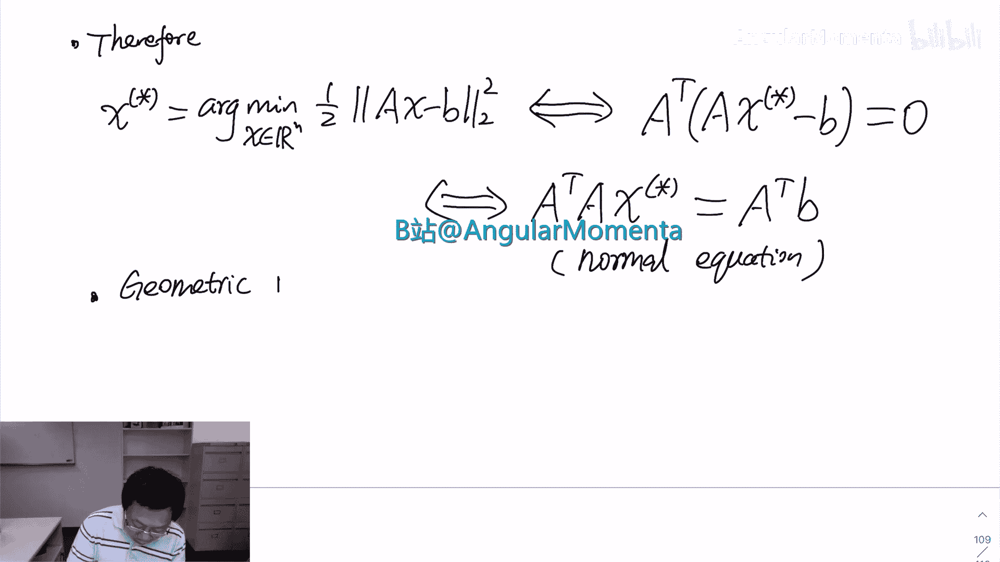

在本节课中，我们将学习最小二乘问题的几何解释，并推导出求解该问题的梯度下降算法。我们将看到，最小二乘问题等价于一个投影问题，并可以通过求解法方程或使用迭代优化算法来解决。

## 几何解释

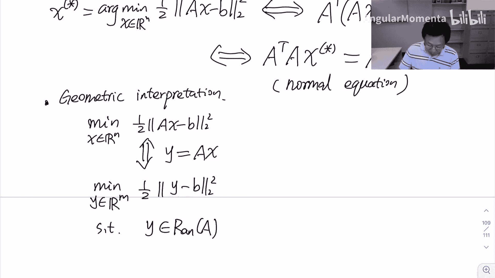

上一节我们介绍了最小二乘问题的数学形式。本节中我们来看看它的几何意义。

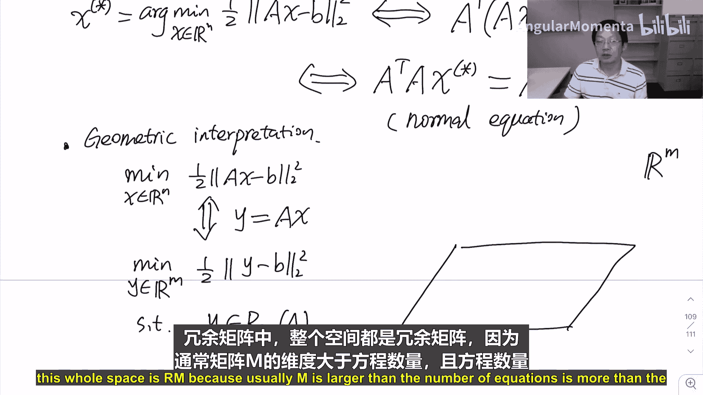

求解最小二乘问题等价于求解法方程。这背后有一个几何解释。

我们希望求解最小二乘问题。我们想做一些转换。我们引入一个新变量，称为 **Y**。**Y** 等于 **A** 乘以 **X**。

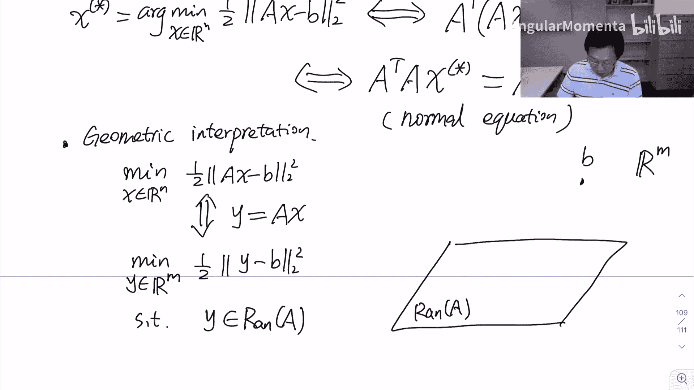

于是，最小二乘问题变为：在 **R^M** 中最小化 `(1/2) * ||y - b||^2`，但有一个约束条件：`y = A * x`。我们消去 **X**。**Y** 应该是 **A** 乘以某个 **X**。换句话说，**Y** 应该在矩阵 **A** 的值域内。

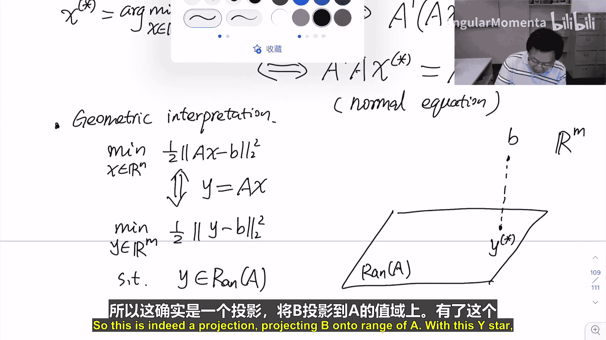

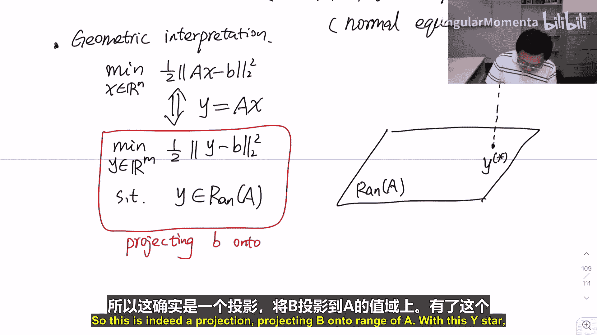

因此，这个最小二乘问题被转换为一个带约束的优化问题。

现在，在这个 **R^M** 空间中，整个空间是 **R^M**，因为通常方程数 **M** 大于未知数的数量。所以 **M** 更大。而矩阵 **A** 的值域，因为 **A** 是 **M x N** 的，其值域通常是一个子空间。它是 **R^M** 中的一个低维空间。

回到这个问题。**b** 是 **R^M** 中的一个给定向量。所以 **b** 可能在这里。从这里可以看到，我们想找到一个在 **A** 的值域上的 **Y**，使得它最接近 **b**。

这正是一个投影问题。我们想要将 **b** 投影到 **A** 的值域上。这个投影点就是 **y***。所以这确实是一个投影：将 **b** 投影到 **A** 的值域上。

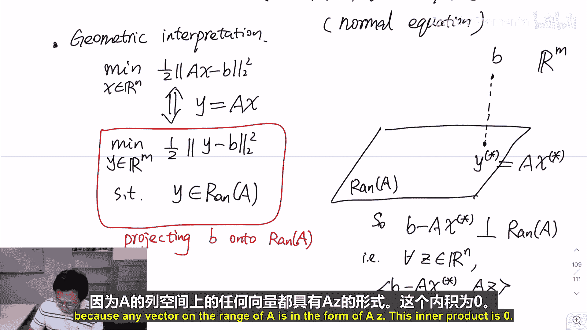

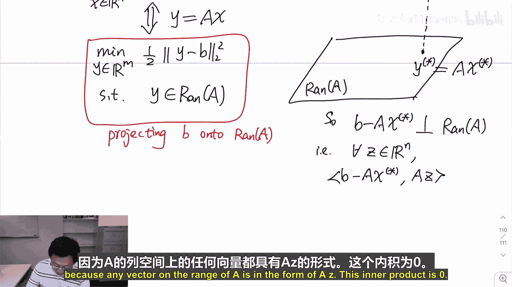

其中，这个 **y***，我们使用关系式 `y = A * x`。这个 **x** 就是原始最小二乘问题的解。所以这个 **y*** 应该是 `A * x*`，那么 **x*** 就是最小二乘问题的解。

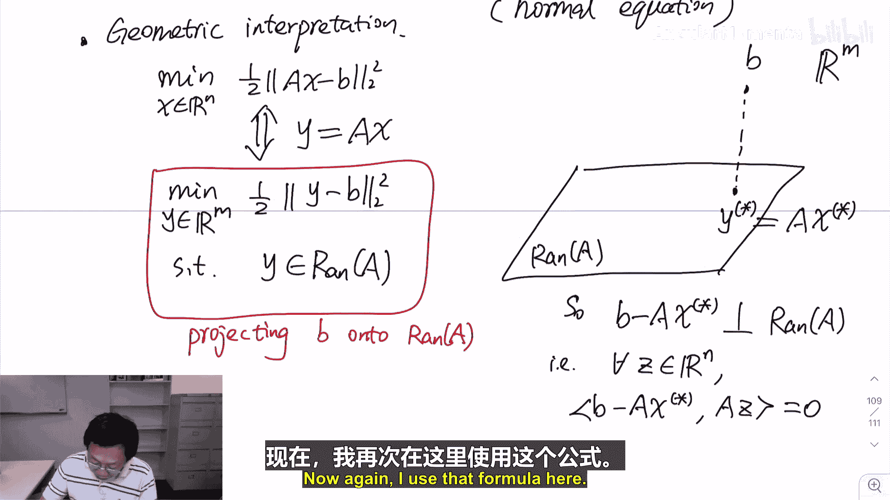

## 推导法方程

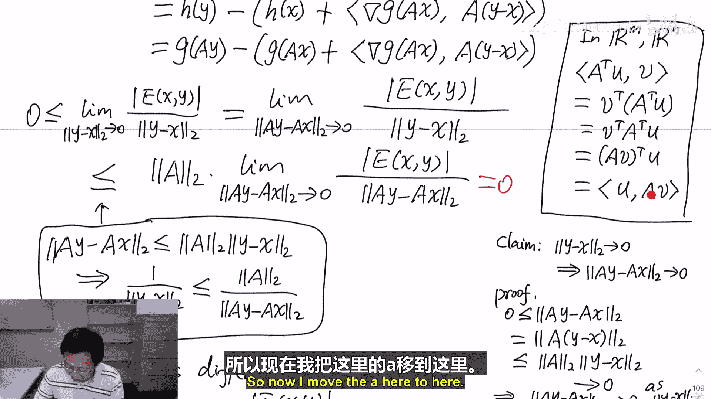

为了找出这个 **x*** 或 **y***，我们需要使用投影定理。回想一下，投影到超平面上，我们证明过残差必须正交于该超平面。在这里，残差应该正交于 **A** 的值域。

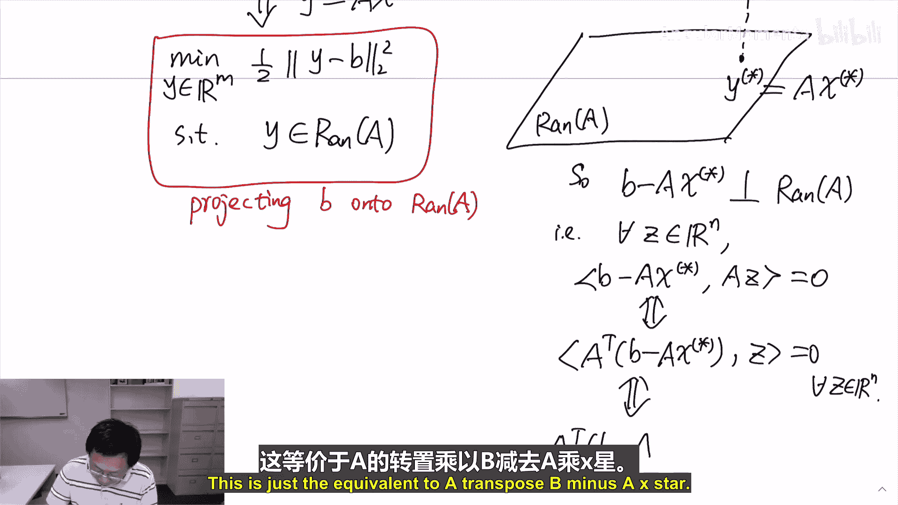

换句话说，对于 **R^N** 中的任意向量 **z**，`b - A * x*` 应该正交于 `A * z`，因为值域 **A** 上的任何向量都具有 `A * z` 的形式。

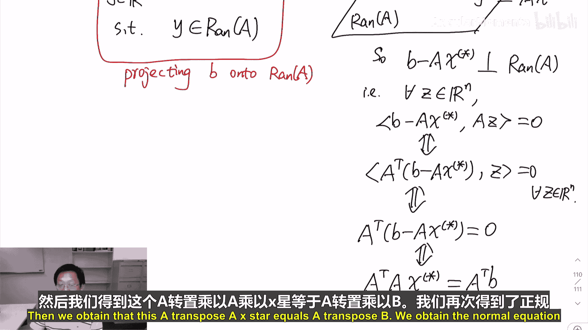

这个内积为 0。现在，再次使用公式 `A^T * u * v = u * A * v`。我把这里的 **A** 移过去，那么这里就应该有 **A^T**。

这等价于：`A^T * (b - A * x*)` 与 **z** 的内积等于 0，对于 **R^N** 中的任意 **z** 成立。

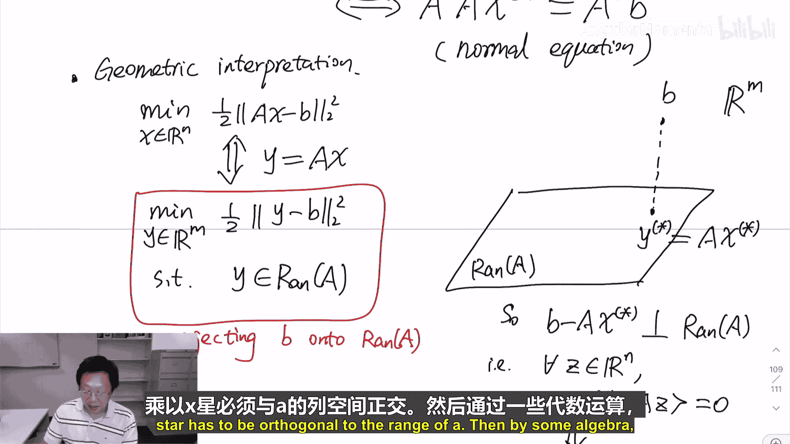

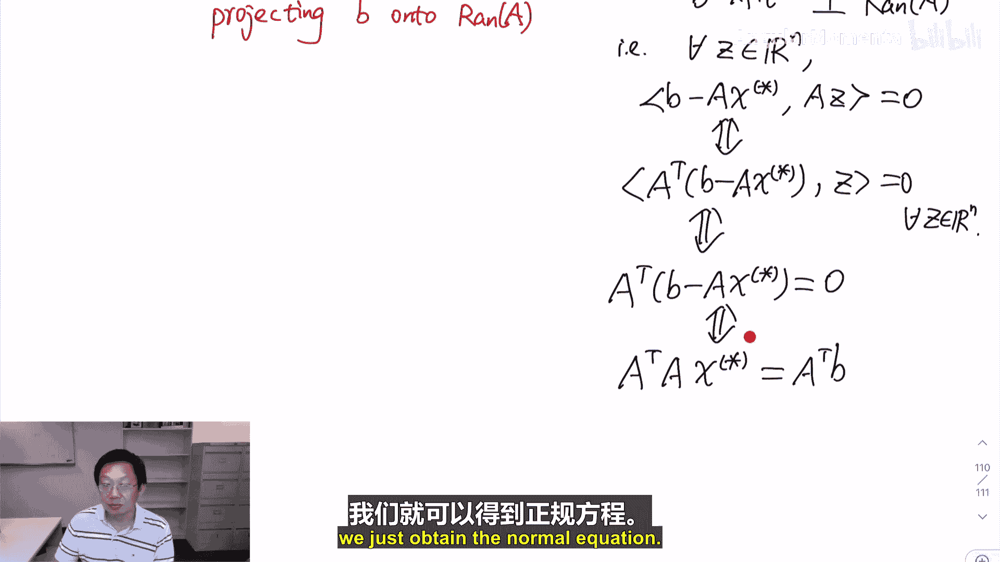

由于它对 **R^N** 中的任何向量都成立，我可以选择 **z** 为 **e_i**（标准基向量），那么我将得到这个向量的每个分量都应为零，因此它应该是一个零向量。

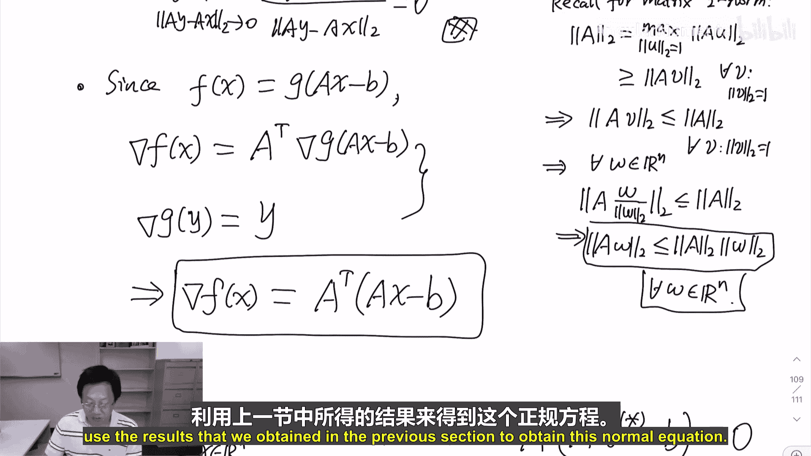

这等价于 `A^T * (b - A * x*) = 0`。然后我们得到 `A^T * A * x* = A^T * b`。我们再次得到了法方程。

因此，这个法方程也可以通过这种几何方式推导出来。我们将最小二乘问题视为一个投影问题。它等价于将 **b** 投影到 **A** 的值域上，然后 `b - y*` 或 `b - A * x*` 必须正交于 **A** 的值域。通过一些代数运算，我们就得到了法方程。

或者，我们也可以直接使用梯度。利用上一节得到的结果来得到这个法方程。法方程的解 **x*** 必须满足法方程。法方程的解也必定是最小二乘问题的解。因此，我们刻画了最小二乘问题的解，它由法方程给出。

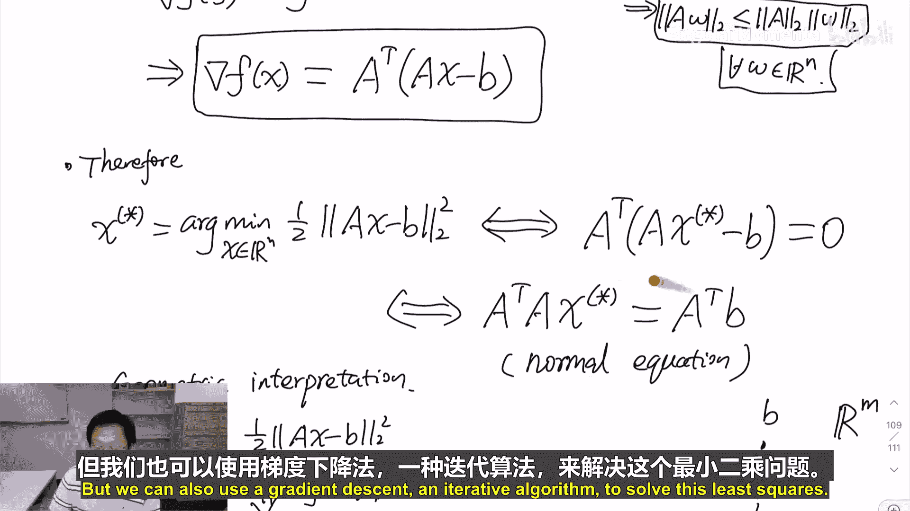

所以，要解决一个最小二乘问题，你可以直接求解这个法方程。实际上许多数值软件包正是这样做的。但我们也可以使用梯度下降等迭代算法来解决这些最小二乘问题。

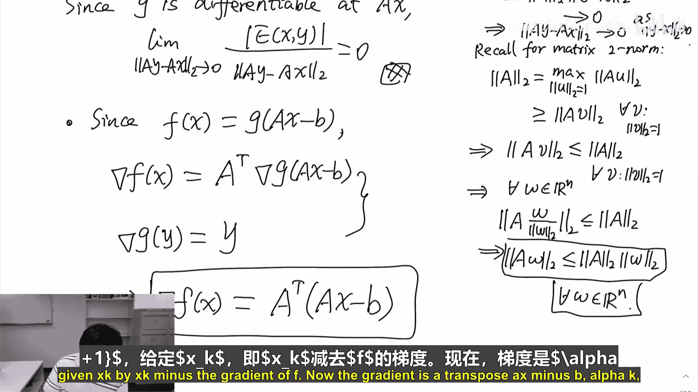

## 梯度下降法

我们可以使用梯度下降法。对于最小二乘问题，我们按以下方式产生迭代序列 **x_{k+1}**：给定 **x_k**，计算 `x_{k+1} = x_k - α_k * gradient(f)`。

现在梯度是 `A^T * (A * x - b)`。

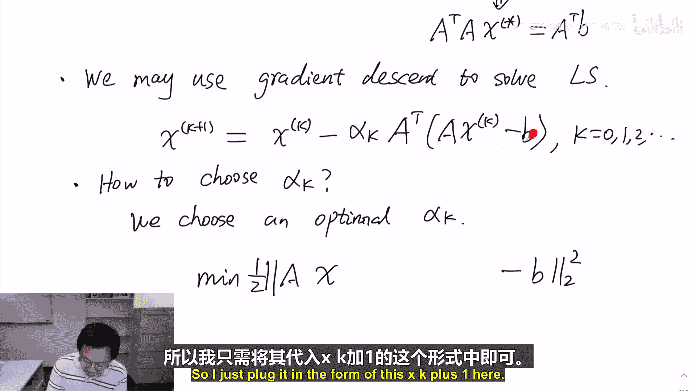

所以迭代公式为：
`x_{k+1} = x_k - α_k * A^T * (A * x_k - b)`，其中 `k = 0, 1, 2, ...`

正如我多次提到的，如何选择步长 **α_k** 在梯度下降算法中至关重要。但在这里这不是一个大问题，因为我们可以有一个最优的 **α_k** 选择。

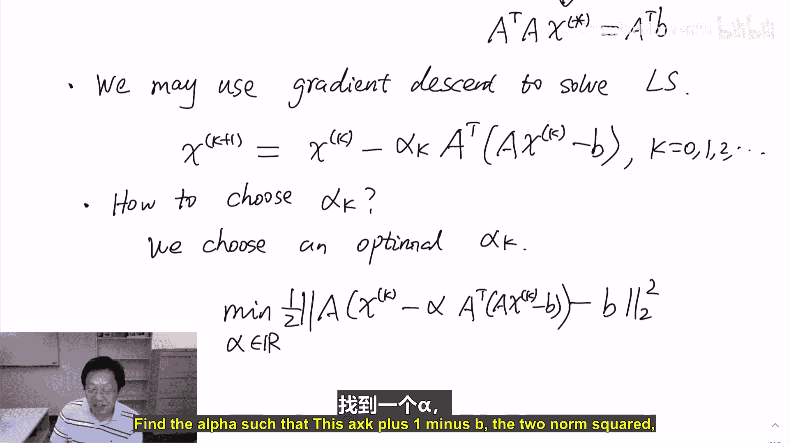

我们这样选择 **α_k**：因为我们的 `x_{k+1}` 是这种形式，并且假设这个 **α_k** 是未知的。所以我们把 **α_k** 看作一个变量。我们选择最好的 **α**。因为我们的目标是最小化 `(1/2) * ||A * x - b||^2`。现在，下一次迭代中的 **x** 是按这种形式选择的。所以我只需将 `x_{k+1}` 的形式代入这个最小二乘的目标函数中。

具体来说，我们移除下标。找到 **α**，使得 `||A * x_{k+1} - b||^2` 在所有 **α** 中被最小化。这个 **α** 就是 **α_k**。所以这个 **α_k** 将是最优的。一旦梯度方向被选定，我们能选择的唯一自由度就是 **α**。选择最优的 **α** 使得最小二乘中的目标函数最小化。

同样，我们需要解决这个最小化问题。为了解决这个最小化问题，我将称这个函数为 `g(α)`。

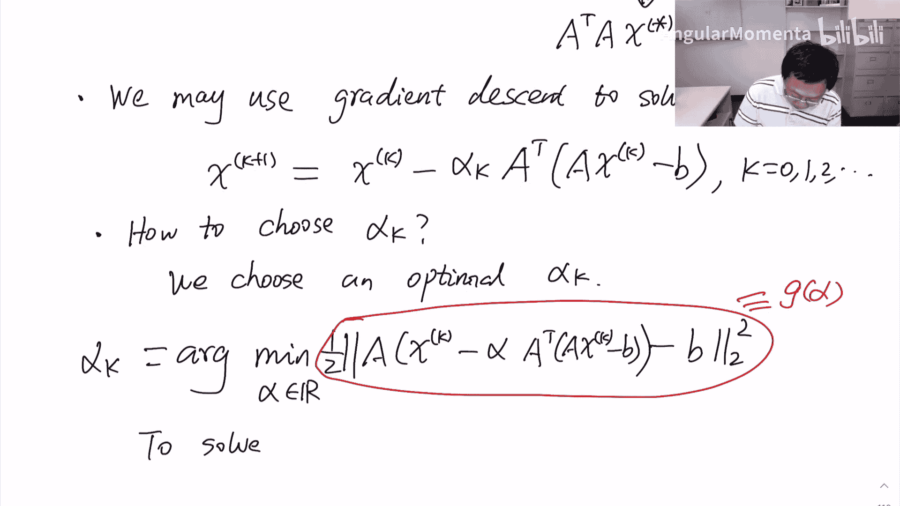

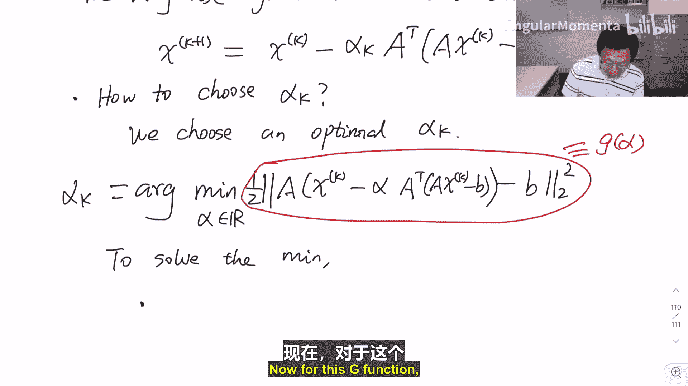

现在，对于这个函数 `g(α)`，它是一个关于 **α** 的二次函数。因为 **α^2** 项前的系数是正的，所以这个函数是凸的。因此，**α_k** 是这个最小化问题的解，等价于 `g'(α_k) = 0`。

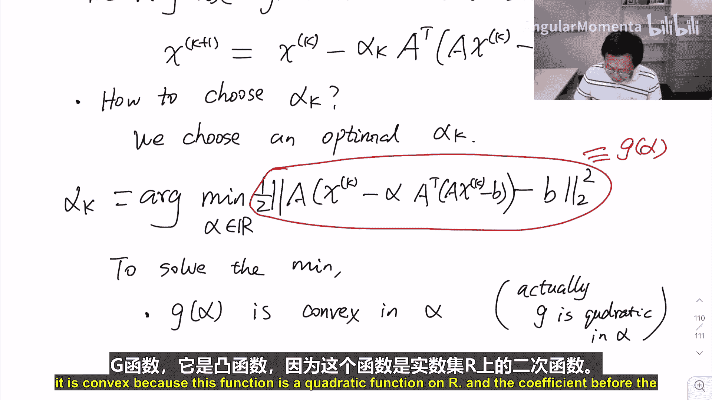

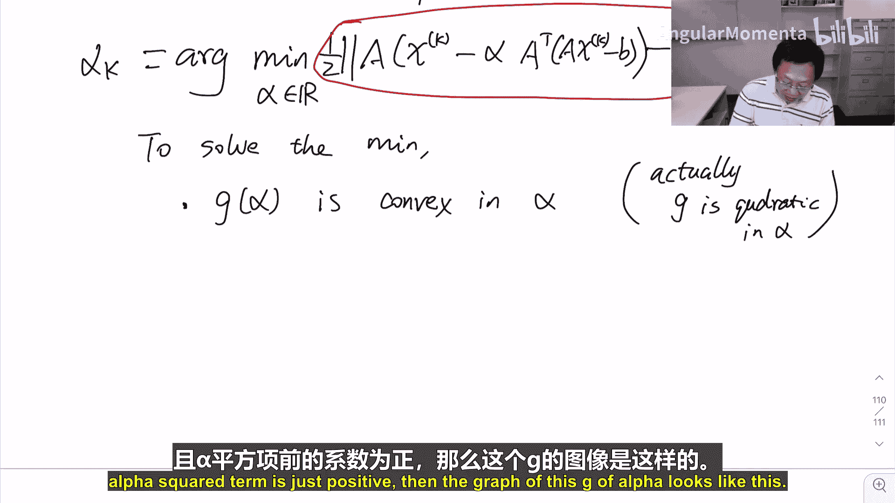

通过一些计算，你会发现 **α_k** 的形式。**α_k** 由下式给出：
`α_k = ||A^T * (A * x_k - b)||^2 / ||A * A^T * (A * x_k - b)||^2`

这个 **α_k** 的计算是繁琐的，在此略过。如果你感兴趣，可以自行验证。因此，这个 **α_k** 的选择是最优步长。

## 最终算法

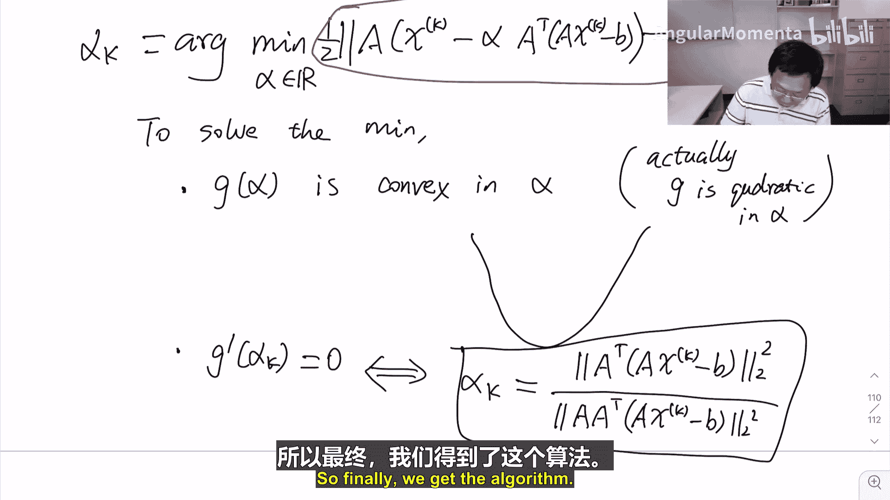

最终我们得到算法。我们首先通过这个公式选择我们的 **α_k**。一旦 **α_k** 选定，我们就通过这个公式得到 `x_{k+1}`。

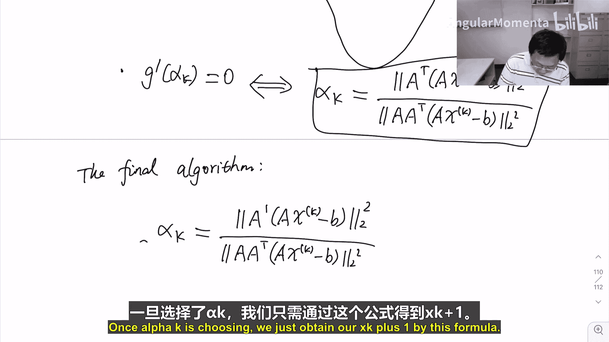

这是求解最小二乘问题的最终算法。这是最速下降法，因为我们使用了最优步长，所以下降是最速的。

另外，这个实现方式不是最优的，因为我们需要多次计算 `A * x_k` 和 `A^T * x_k`。在这里至少需要计算三次。我们有更高效的实现方式。

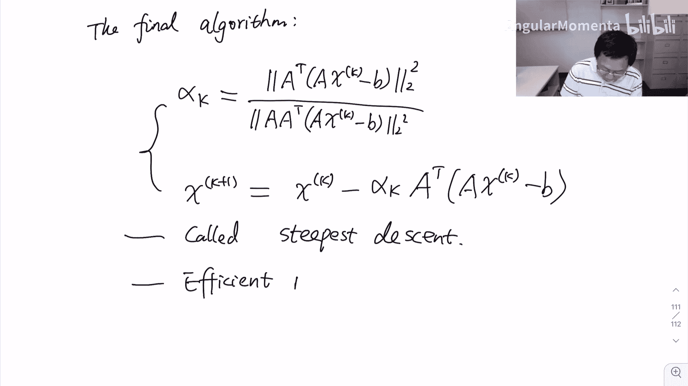

我们只需用一个变量来表示 `A^T * (A * x_k - b)`。然后我们用 **g_k** 来替换 `A^T * (A * x_k - b)`。有了 **g_k**，我们的 **α_k** 将变得非常简单。它就是 `||g_k||^2 / ||A * g_k||^2`。而 `x_{k+1}` 就是 `x_k - α_k * g_k`。

然后我们需要做的就是将其放入一个循环中。当然，我们需要初始化 `x_0`。

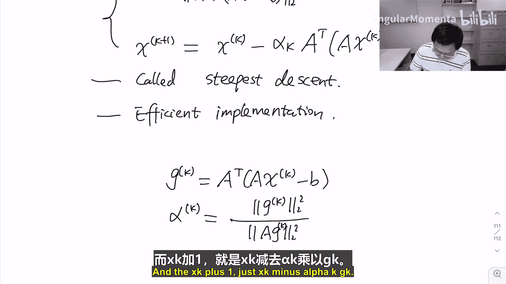

这是最速下降法的一个实现。它效果很好。但当然，对于最小二乘问题，我们有更先进、更高效的算法，即共轭梯度法。共轭梯度法实际上只是最速下降法的一个变体，是带有动量的最速下降法。如果你想了解这个，你需要学习更高级的优化课程。

## 总结

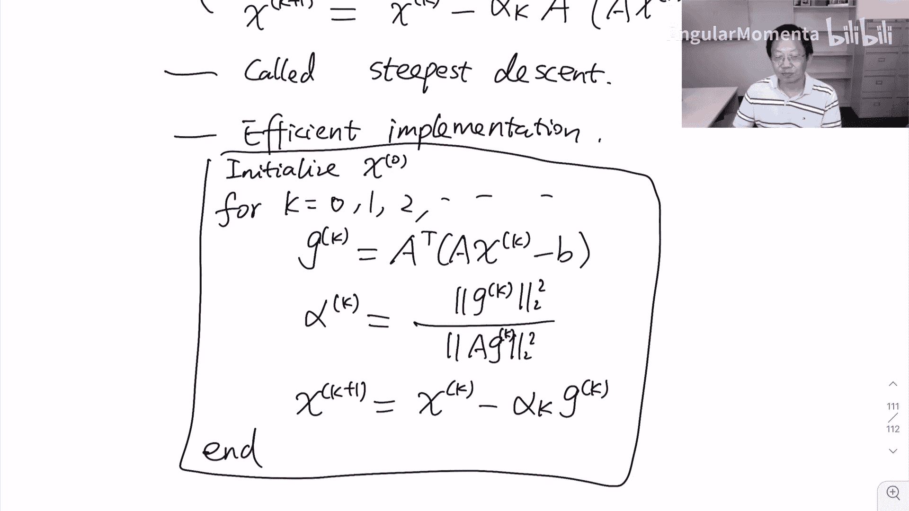

本节课中我们一起学习了最小二乘问题的几何视角。我们了解到，求解最小二乘问题等价于将向量 **b** 投影到矩阵 **A** 的列空间上，并由此推导出了熟悉的法方程。接着，我们探讨了使用梯度下降法求解该问题的迭代过程，并介绍了通过优化步长选择来得到最速下降法的具体算法步骤。这为我们理解最小二乘问题的本质和求解方法提供了更直观的几何基础和实用的计算工具。