# 087：线性变换与高阶微分

在本章中，我们将学习线性变换的概念，并以此为基础，为后续研究高阶微分做准备。上一章我们学习了线性函数和微分，微分本质上是线性近似，更精确地说是精细近似。我们看到微分是刻画优化问题和发展优化数值算法的有力工具。然而，我们目前的微分工具仍然非常有限。

## 线性变换的定义

上一节我们介绍了微分作为工具的重要性，本节中我们来看看线性变换。线性变换，也称为线性算子，是两个向量空间之间的映射。

设 **V₁** 和 **V₂** 是两个向量空间。我们有一个从 **V₁** 到 **V₂** 的映射 **L**，即 **L(x)** 是 **V₂** 中的一个向量。我们称 **L** 为线性变换或线性算子，如果 **L** 是线性的。这意味着 **L** 与线性组合是可交换的。更精确地说，对于任意实数 **α**、**β** 和向量 **x**、**y ∈ V₁**，下式成立：

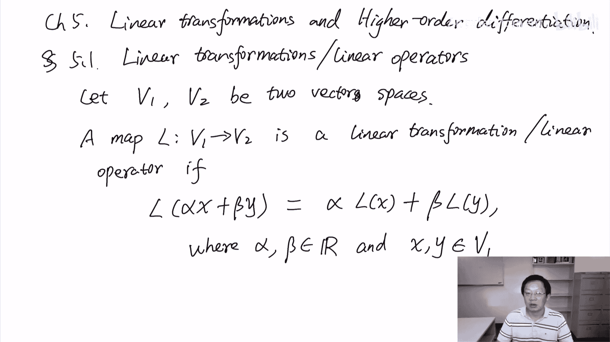

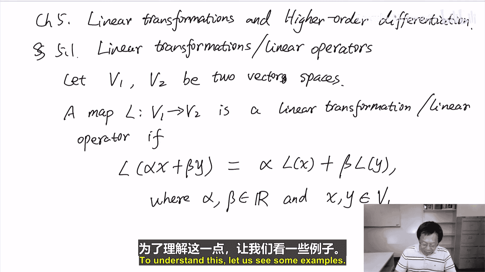

**L(αx + βy) = αL(x) + βL(y)**

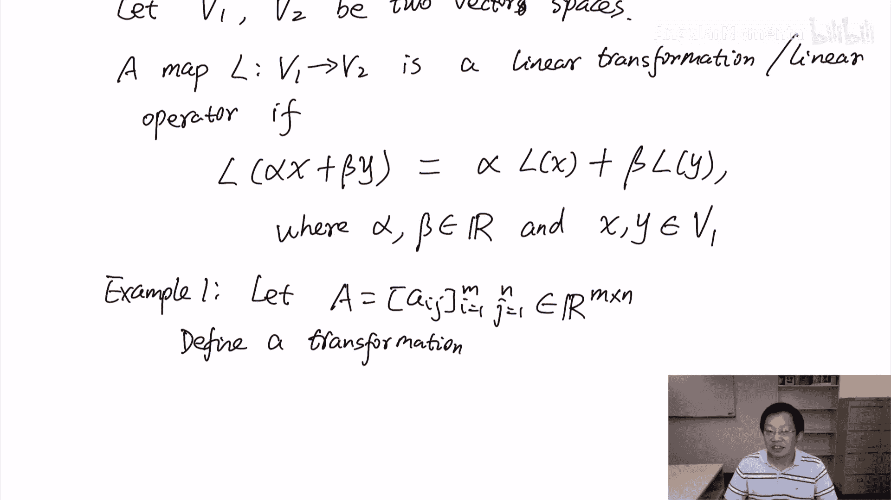

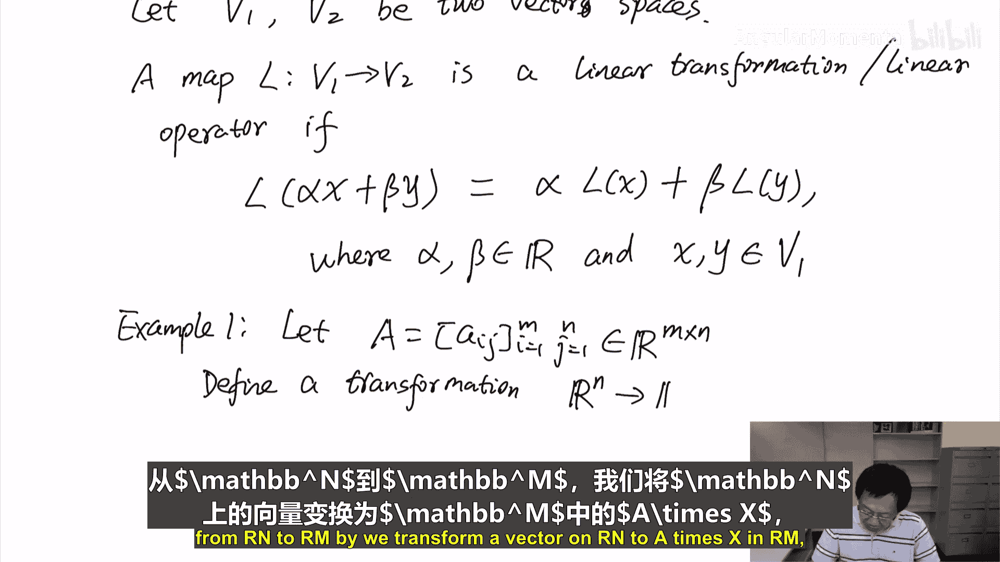

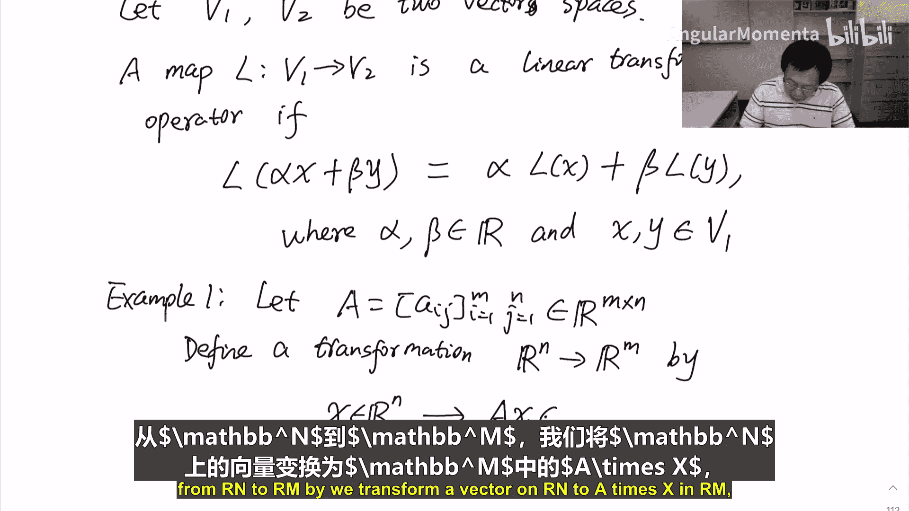

如果满足此条件，则 **L** 被称为线性变换或线性算子。

## 线性变换的示例

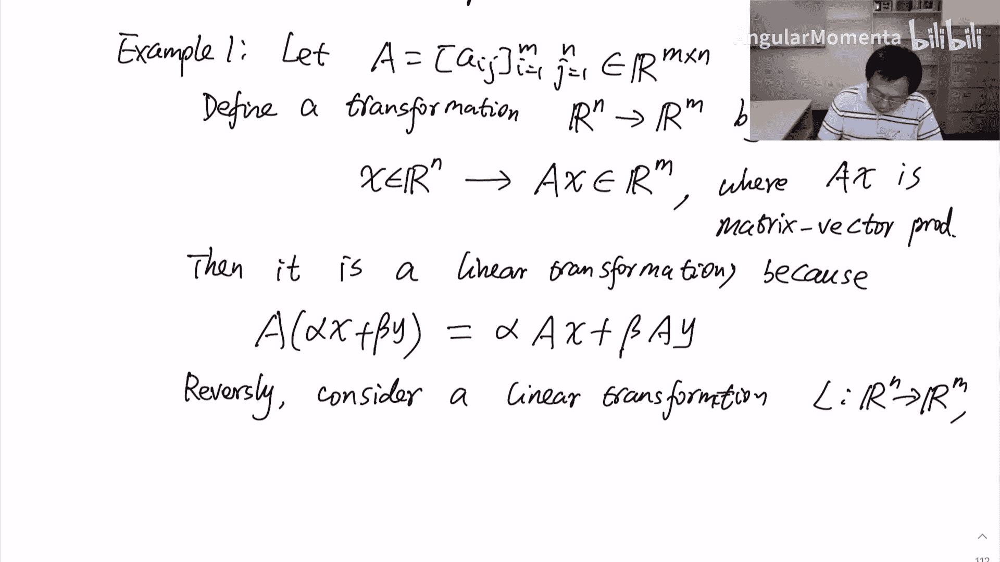

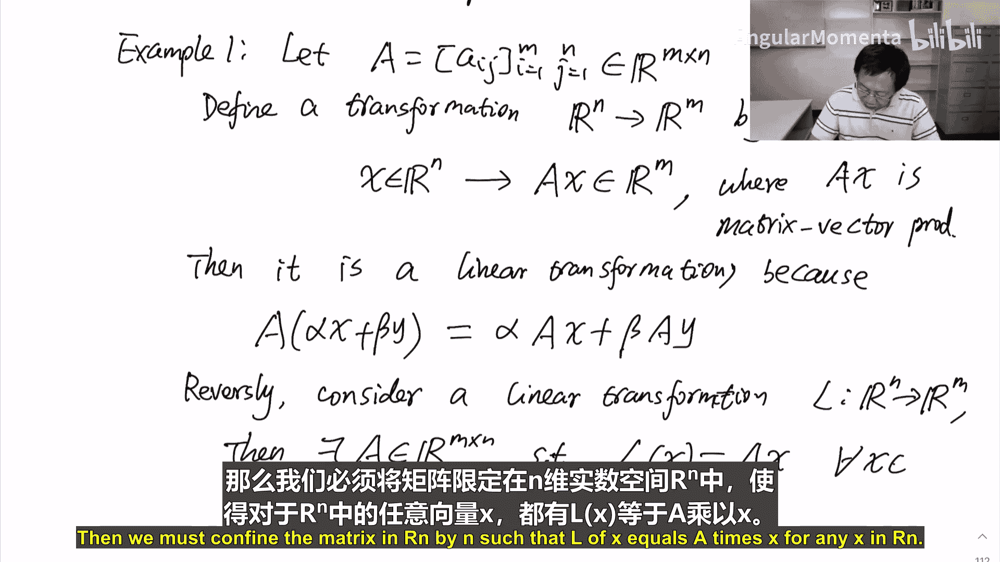

为了理解这个概念，让我们看一些例子。以下是几个线性变换的典型场景：

**示例 1：矩阵变换**
设 **A = [aᵢⱼ] ∈ ℝ^(m×n)** 为一个矩阵。我们可以定义一个从 **ℝⁿ** 到 **ℝᵐ** 的变换：**L(x) = A x**。这是一个线性变换，因为矩阵向量乘法是线性的。反之，任何从 **ℝⁿ** 到 **ℝᵐ** 的线性变换 **L**，都可以用一个矩阵 **A** 来表示，使得 **L(x) = A x**。因此，矩阵与这类线性变换之间存在一一对应关系。

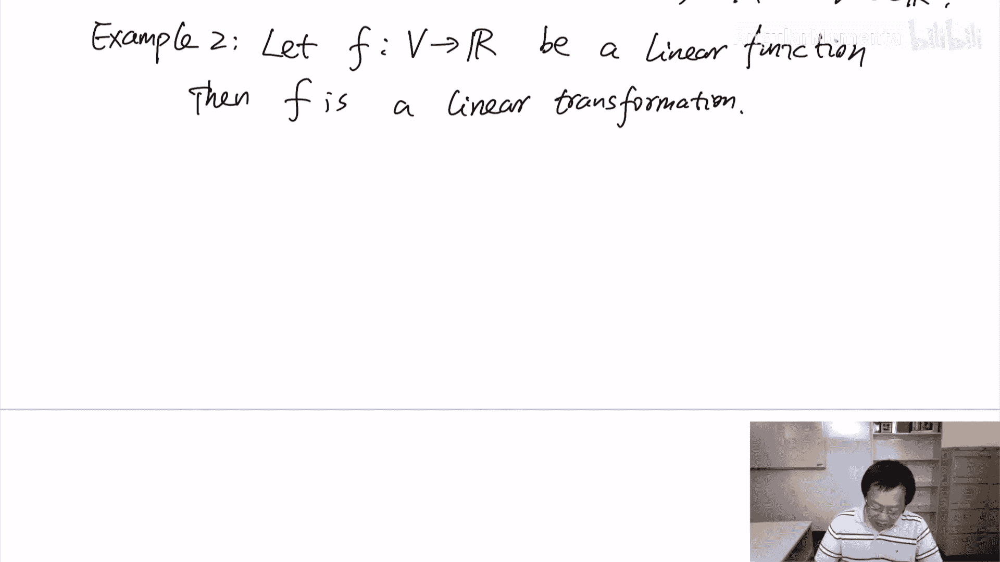

**示例 2：线性函数**
设 **f: V → ℝ** 是一个线性函数，其中 **V** 是向量空间。那么 **f** 可以看作是从 **V** 到 **ℝ** 的线性变换。因此，线性变换是线性函数的推广。

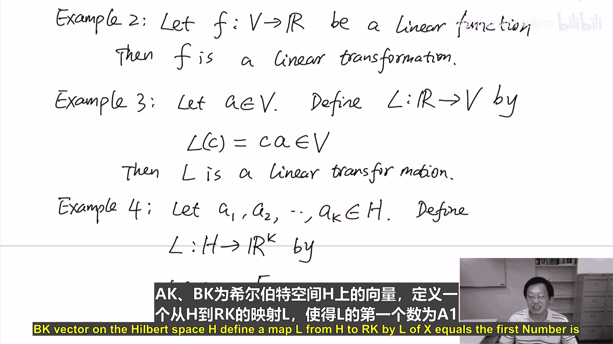

**示例 3：标量乘法**
设 **a** 是向量空间 **V** 中的一个固定向量。定义映射 **L: ℝ → V** 为 **L(c) = c · a**。这个映射是一个线性变换。

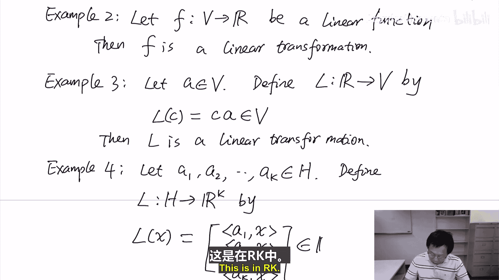

**示例 4：内积映射**
设 **a₁, a₂, ..., aₖ** 是希尔伯特空间 **H** 中的 **k** 个向量。定义映射 **L: H → ℝᵏ** 为：
**L(x) = (⟨a₁, x⟩, ⟨a₂, x⟩, ..., ⟨aₖ, x⟩)**
由于每个分量都是线性的，所以 **L** 是一个线性变换。

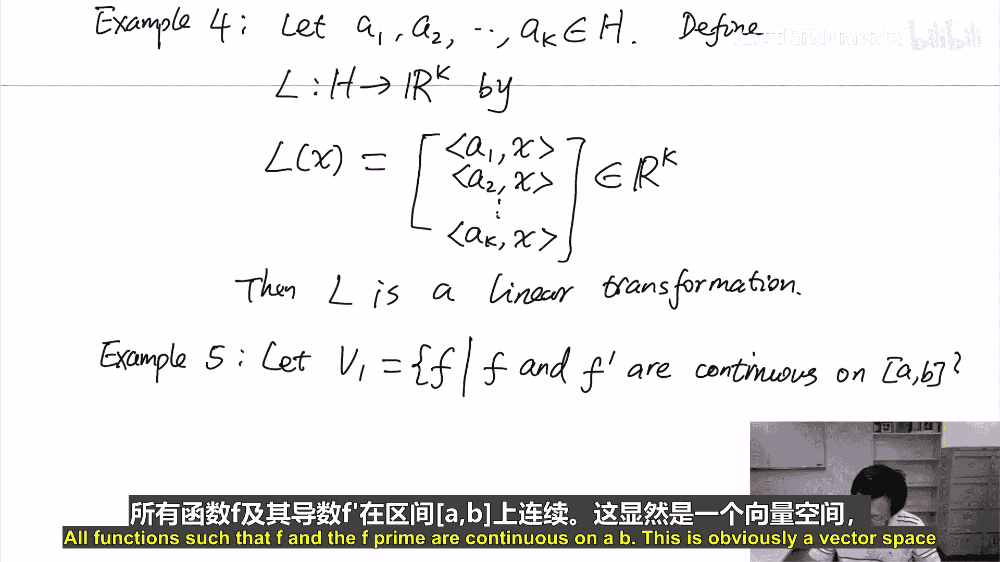

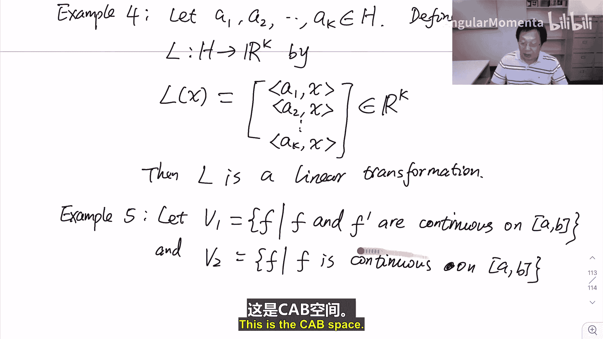

**示例 5：微分算子**
设 **V₁** 是所有函数 **f** 构成的空间，其中 **f** 和 **f'** 在 **[a, b]** 上连续。设 **V₂** 是所有在 **[a, b]** 上连续的函数构成的空间。定义映射 **D: V₁ → V₂** 为 **D(f) = f'**。由于求导运算是线性的，所以 **D** 是一个线性变换。

**示例 6：平移算子**
设 **C[-1,1]** 和 **C[0,2]** 分别是定义在区间 **[-1,1]** 和 **[0,2]** 上的连续函数空间。定义平移算子 **T: C[-1,1] → C[0,2]** 为：对于任意 **f ∈ C[-1,1]**，定义 **(Tf)(t) = f(t-1)**，其中 **t ∈ [0,2]**。这个算子也是线性的，在图像数据处理等建模中非常有用，因为图像常包含平移不变的特征。

## 本章总结

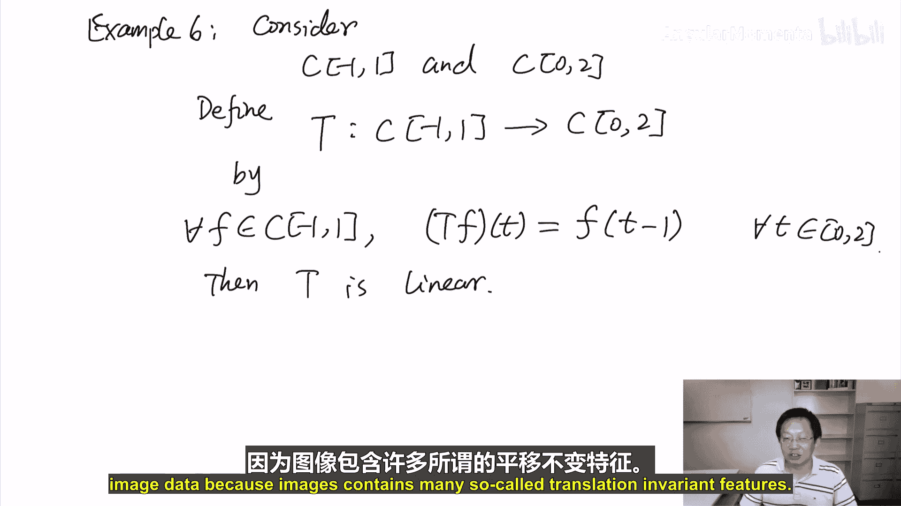

本节课中我们一起学习了线性变换的基本概念。我们首先给出了线性变换的严格定义，即保持向量加法和标量乘法的映射。然后，我们通过从矩阵变换到微分算子等一系列具体示例，展示了线性变换的多样性和广泛适用性。理解线性变换是深入研究高阶微分和更复杂数值优化算法的重要基础。在接下来的章节中，我们将基于线性变换来构建高阶微分的理论框架。