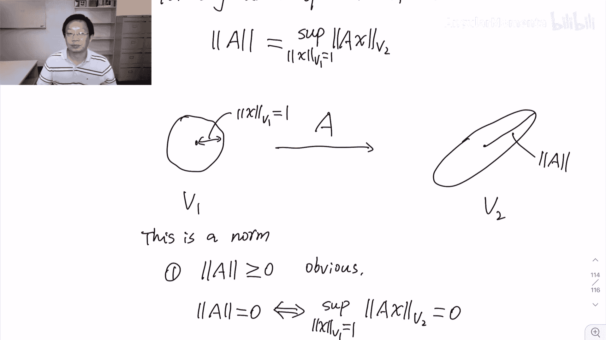

# 088：有界线性算子 🧮

在本节课中，我们将学习线性算子理论中的一个核心概念：有界线性算子。我们将从线性算子的集合结构出发，定义其上的范数，并验证该定义确实满足范数的所有性质。

上一节我们讨论了线性函数与有界线性函数的区别。本节中，我们将把这一概念推广到更一般的线性算子（即线性变换）上。

## 线性算子集合的向量空间结构

我们考虑从向量空间 **V₁** 到 **V₂** 的所有线性变换（或称线性算子）的集合。假设 **V₁** 和 **V₂** 上分别定义了范数，我们称之为 **V₁ 范数** 和 **V₂ 范数**。

为了定义有界性，我们首先需要为线性算子的集合定义一个范数。为此，我们必须先为该集合赋予向量空间的结构，即定义线性算子的加法和标量乘法。

以下是具体的定义方式：

*   **加法**：设 **A** 和 **B** 是两个从 **V₁** 到 **V₂** 的线性算子。我们定义它们的和 **(A + B)** 为：对于任意 **x ∈ V₁**，有 **(A + B)(x) = A(x) + B(x)**。由于 **A(x)** 和 **B(x)** 都在 **V₂** 中，它们的加法是 **V₂** 中的运算。可以验证，**A + B** 仍然是一个从 **V₁** 到 **V₂** 的线性算子。
*   **标量乘法**：设 **α ∈ ℝ**，**A** 是一个从 **V₁** 到 **V₂** 的线性算子。我们定义标量乘法 **(αA)** 为：对于任意 **x ∈ V₁**，有 **(αA)(x) = α · A(x)**。同样可以验证，**αA** 也是一个从 **V₁** 到 **V₂** 的线性算子。

## 线性算子范数的定义

在定义了向量空间结构后，我们可以为线性算子定义范数。这个定义的思路与矩阵范数（如矩阵的 p-范数）类似。

对于一个从 **V₁** 到 **V₂** 的线性算子 **A**，我们定义其**算子范数**为：

**‖A‖ = sup { ‖A(x)‖₂ : x ∈ V₁, ‖x‖₁ = 1 }**

其中，**‖·‖₁** 和 **‖·‖₂** 分别表示 **V₁** 和 **V₂** 上的范数。

这个定义的含义是：考虑 **V₁** 中所有范数为 1 的向量（即单位球面），计算它们经过算子 **A** 映射后在 **V₂** 中的范数，这些范数的**上确界（supremum）** 就定义为算子 **A** 的范数。在有限维空间（如矩阵从 ℝⁿ 映射到 ℝᵐ）中，上确界就是最大值（max）。但在一般的（可能是无限维的）向量空间中，最大值不一定能达到，因此我们使用更一般的“上确界”概念。

## 算子范数性质的验证

现在，我们来验证上面定义的算子范数确实满足范数的所有公理。

以下是需要验证的三个性质：

1.  **正定性**：显然 **‖A‖ ≥ 0**。如果 **‖A‖ = 0**，则意味着对所有满足 **‖x‖₁ = 1** 的 **x**，都有 **‖A(x)‖₂ = 0**，这等价于对所有 **y ∈ V₁**（包括 **y=0**），都有 **A(y) = 0**。因此，**A** 是零算子。
2.  **齐次性**：对于任意标量 **α**，有 **‖αA‖ = |α| · ‖A‖**。证明如下：
    **‖αA‖ = sup_{‖x‖₁=1} ‖αA(x)‖₂ = sup_{‖x‖₁=1} |α| · ‖A(x)‖₂ = |α| · sup_{‖x‖₁=1} ‖A(x)‖₂ = |α| · ‖A‖**
    这里用到了 **V₂** 范数的齐次性。
3.  **三角不等式**：对于任意两个算子 **A** 和 **B**，有 **‖A + B‖ ≤ ‖A‖ + ‖B‖**。证明如下：
    **‖A + B‖ = sup_{‖x‖₁=1} ‖A(x) + B(x)‖₂**
    根据 **V₂** 范数的三角不等式，有 **‖A(x) + B(x)‖₂ ≤ ‖A(x)‖₂ + ‖B(x)‖₂**。
    因此，**‖A + B‖ ≤ sup_{‖x‖₁=1} (‖A(x)‖₂ + ‖B(x)‖₂)**。
    由上确界的性质可知，**sup (f+g) ≤ sup f + sup g**，所以：
    **‖A + B‖ ≤ sup_{‖x‖₁=1} ‖A(x)‖₂ + sup_{‖x‖₁=1} ‖B(x)‖₂ = ‖A‖ + ‖B‖**

至此，我们验证了算子范数满足范数的所有公理。因此，在由所有从 **V₁** 到 **V₂** 的线性算子构成的向量空间上，我们确实定义了一个有效的范数。

## 有界线性算子的定义

有了算子范数的概念，我们就可以正式定义**有界线性算子**：

> 一个从 **V₁** 到 **V₂** 的线性算子 **A** 被称为**有界的**，如果其算子范数 **‖A‖** 是有限的（即 **‖A‖ < ∞**）。

这个定义直观上意味着，算子 **A** 不会将 **V₁** 中的单位球“过度拉伸”到无穷大。在后续学习中，我们会看到有界性（在赋范空间中）与连续性等价，这是一个非常重要的结论。

本节课中我们一起学习了如何在线性算子的集合上构建向量空间结构，并定义了关键的算子范数。我们详细验证了该范数满足正定性、齐次性和三角不等式。最后，我们基于算子范数定义了有界线性算子的概念，这是泛函分析中研究算子性质的基础。